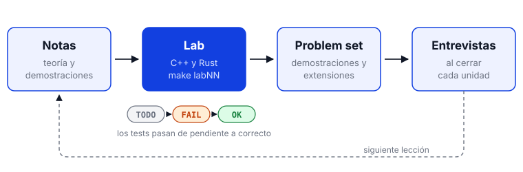
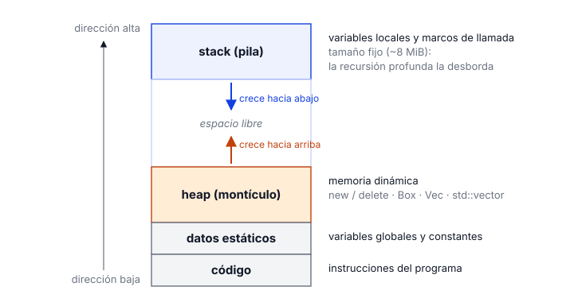

# Lección 0 — Prerrequisitos: las herramientas que usaremos todo el curso

> **Qué es esta lección.** Antes de estudiar algoritmos necesitamos tres cosas: un **idioma** para escribir afirmaciones precisas (lógica), unas **herramientas** para demostrarlas (inducción, invariantes) y para contar (logaritmos, sumas, recurrencias, probabilidad), y un **modelo mental** de cómo la computadora guarda los datos (memoria, C, C++ y Rust).
>
> **Cómo leerla.** Cada tema sigue el mismo orden: *para qué sirve en el curso* → *la idea con un ejemplo cotidiano* → *la definición precisa* → *un ejemplo resuelto paso a paso* → *un programa que puedes compilar y correr* → *errores típicos* → *ejercicios con solución*.
>
> **Los programas** vienen en tres pestañas: **C**, **C++** y **Rust**. Los tres hacen exactamente lo mismo e imprimen exactamente la misma salida; elige el lenguaje que conozcas mejor y compara con los otros dos. Todos los programas de esta lección se compilan y ejecutan automáticamente (`make ejemplos`), así que puedes copiarlos con confianza.

---

## 0. Cómo funciona el curso



Cada lección tiene cuatro partes:

1. **Notas** (como esta): teoría con demostraciones completas.
2. **Lab**: implementas la estructura de datos de la lección en **C, C++ y Rust** dentro de nuestra librería `algolib`. Los tests ya están escritos; al principio salen `[TODO]` y tu trabajo es dejarlos en `[ OK ]`.
3. **Problem set**: ejercicios de demostración y de extensión del lab.
4. **Preguntas de entrevista**, al cerrar cada unidad.

### 0.1 Preparar tu computadora

| Sistema | Compiladores de C y C++, CMake | Rust |
|---|---|---|
| Ubuntu / Debian / WSL | `sudo apt install build-essential cmake` | `curl https://sh.rustup.rs -sSf \| sh` |
| macOS | `xcode-select --install` y `brew install cmake` | igual que arriba |
| Windows | usa WSL (Ubuntu) y sigue la primera fila | igual que arriba |

### 0.2 Tu primer programa en los tres lenguajes

Guarda cada versión en un archivo, compílala y ejecútala. Fíjate en cómo cambia la forma de compilar:

::: {.tabs}
```c
// hola.c        compilar:  gcc -std=c17 hola.c -o hola     ejecutar:  ./hola
#include <stdio.h>

int main(void) {
    printf("Hola, algolib\n");
    return 0;
}
```

```cpp
// hola.cpp      compilar:  g++ -std=c++20 hola.cpp -o hola  ejecutar:  ./hola
#include <iostream>

int main() {
    std::cout << "Hola, algolib\n";
}
```

```rust
// hola.rs       compilar:  rustc hola.rs                   ejecutar:  ./hola
fn main() {
    println!("Hola, algolib");
}
```
:::

```{.text .salida}
Hola, algolib
```

Con la librería del curso todo se hace con `make`:

```bash
make lab01        # compila y corre los tests del lab 1 en C, C++ y Rust
```

---

## 1. Lógica: el idioma de las definiciones

**¿Para qué la necesitamos?** La definición central del curso, la de $O(\cdot)$, es una frase con tres cuantificadores seguidos:
$$f\in O(g)\iff \exists c>0\ \ \exists n_0\ \ \forall n\ge n_0:\ f(n)\le c\,g(n).$$
Si no sabes leer, usar y **negar** frases así, no podrás demostrar ni refutar una cota. Esta sección te deja listo para eso.

### 1.1 Proposiciones y conectivos

Una **proposición** es una afirmación que es verdadera o falsa: "$7$ es primo" (verdadera), "$2+2=5$" (falsa). Se combinan con **conectivos**:

| Símbolo | Se lee | Es verdadera cuando… | En C, C++ y Rust |
|---|---|---|---|
| $\neg P$ | "no $P$" | $P$ es falsa | `!p` |
| $P\land Q$ | "$P$ y $Q$" | las dos son verdaderas | `p && q` |
| $P\lor Q$ | "$P$ o $Q$" | al menos una es verdadera | `p \|\| q` |
| $P\Rightarrow Q$ | "si $P$, entonces $Q$" | **todos los casos excepto** $P$ verdadera y $Q$ falsa | `!p \|\| q` |
| $P\iff Q$ | "$P$ si y solo si $Q$" | las dos tienen el mismo valor | `p == q` |

**La implicación es la que confunde.** Piensa en una promesa: *"si llueve, llevo paraguas"*. ¿Cuándo **rompí** la promesa? Solo si llovió **y** no llevé paraguas. Si no llovió, no rompí nada, lleve o no paraguas. Por eso $P\Rightarrow Q$ es falsa **solo** cuando $P$ es verdadera y $Q$ es falsa:

| $P$ | $Q$ | $P\Rightarrow Q$ | ¿Rompí la promesa? |
|---|---|---|---|
| V | V | V | no: llovió y llevé paraguas |
| V | F | **F** | **sí**: llovió y no llevé |
| F | V | V | no: no llovió (llevar paraguas no rompe nada) |
| F | F | V | no: no llovió |

### 1.2 Cuantificadores: "para todo" y "existe"

- $\forall x\in A:\ P(x)$ — "**para todo** $x$ de $A$ se cumple $P(x)$".
- $\exists x\in A:\ P(x)$ — "**existe** (al menos un) $x$ de $A$ con $P(x)$".

La mejor forma de entenderlos es como **ciclos**:

- Para comprobar un $\forall$, recorres **todos** los elementos y te detienes en cuanto uno **falla** (un contraejemplo basta para que sea falso).
- Para comprobar un $\exists$, recorres hasta encontrar **uno que cumpla** (un testigo basta para que sea verdadero).

::: {.tabs}
```c
#include <stdbool.h>
#include <stdio.h>

// ∀ i: a[i] > 0      → busca un contraejemplo
bool todos_positivos(const int *a, int n) {
    for (int i = 0; i < n; i++)
        if (!(a[i] > 0)) return false;   // encontré uno que falla
    return true;                          // ninguno falló
}

// ∃ i: a[i] < 0      → busca un testigo
bool existe_negativo(const int *a, int n) {
    for (int i = 0; i < n; i++)
        if (a[i] < 0) return true;        // encontré uno que cumple
    return false;                         // ninguno cumplió
}

int main(void) {
    int a[] = {3, 1, -4, 1, 5};
    int n = 5;
    printf("todos positivos: %s\n", todos_positivos(a, n) ? "sí" : "no");
    printf("existe negativo: %s\n", existe_negativo(a, n) ? "sí" : "no");
    return 0;
}
```

```cpp
#include <algorithm>
#include <iostream>
#include <vector>

// ∀ i: a[i] > 0      → busca un contraejemplo
bool todos_positivos(const std::vector<int>& a) {
    for (int x : a)
        if (!(x > 0)) return false;   // encontré uno que falla
    return true;                       // ninguno falló
}

// ∃ i: a[i] < 0      → busca un testigo
bool existe_negativo(const std::vector<int>& a) {
    for (int x : a)
        if (x < 0) return true;        // encontré uno que cumple
    return false;                      // ninguno cumplió
}

int main() {
    std::vector<int> a{3, 1, -4, 1, 5};
    std::cout << "todos positivos: " << (todos_positivos(a) ? "sí" : "no") << "\n";
    std::cout << "existe negativo: " << (existe_negativo(a) ? "sí" : "no") << "\n";
    // La biblioteca estándar ya trae ambos cuantificadores:
    //   std::all_of(a.begin(), a.end(), pred)   es ∀
    //   std::any_of(a.begin(), a.end(), pred)   es ∃
    bool t = std::all_of(a.begin(), a.end(), [](int x) { return x > 0; });
    (void)t;
}
```

```rust
// ∀ i: a[i] > 0      → busca un contraejemplo
fn todos_positivos(a: &[i32]) -> bool {
    for &x in a {
        if !(x > 0) {
            return false; // encontré uno que falla
        }
    }
    true // ninguno falló
}

// ∃ i: a[i] < 0      → busca un testigo
fn existe_negativo(a: &[i32]) -> bool {
    for &x in a {
        if x < 0 {
            return true; // encontré uno que cumple
        }
    }
    false // ninguno cumplió
}

fn main() {
    let a = [3, 1, -4, 1, 5];
    println!("todos positivos: {}", if todos_positivos(&a) { "sí" } else { "no" });
    println!("existe negativo: {}", if existe_negativo(&a) { "sí" } else { "no" });
    // Los iteradores ya traen ambos cuantificadores:
    //   a.iter().all(|&x| x > 0)   es ∀
    //   a.iter().any(|&x| x < 0)   es ∃
    assert_eq!(a.iter().all(|&x| x > 0), todos_positivos(&a));
}
```
:::

```{.text .salida}
todos positivos: no
existe negativo: sí
```

### 1.3 Negar una frase con cuantificadores

Observa el código de arriba: "**no** todos son positivos" es lo mismo que "**existe** uno que **no** es positivo". En general:

$$\neg\big(\forall x:\ P(x)\big)\iff\exists x:\ \neg P(x)\qquad\qquad\neg\big(\exists x:\ P(x)\big)\iff\forall x:\ \neg P(x)$$

**Regla mecánica:** para negar, recorre la frase de izquierda a derecha, **cambia cada $\forall$ por $\exists$ y cada $\exists$ por $\forall$**, y al final **niega la condición**.

**Ejemplo resuelto: negar la definición de $O$.** Queremos escribir qué significa $f\notin O(g)$.

| Paso | Frase | Qué hicimos |
|---|---|---|
| 0 | $\neg\big(\exists c>0\ \exists n_0\ \forall n\ge n_0:\ f(n)\le c\,g(n)\big)$ | la negación de la definición |
| 1 | $\forall c>0\ \neg\big(\exists n_0\ \forall n\ge n_0:\ f(n)\le c\,g(n)\big)$ | primer $\exists$ → $\forall$, la negación avanza |
| 2 | $\forall c>0\ \forall n_0\ \neg\big(\forall n\ge n_0:\ f(n)\le c\,g(n)\big)$ | segundo $\exists$ → $\forall$ |
| 3 | $\forall c>0\ \forall n_0\ \exists n\ge n_0:\ \neg\big(f(n)\le c\,g(n)\big)$ | $\forall$ → $\exists$ |
| 4 | $\forall c>0\ \forall n_0\ \exists n\ge n_0:\ f(n)> c\,g(n)$ | negar "$\le$" da "$>$" |

En palabras: *"para cualquier constante $c$ y cualquier umbral $n_0$ que me den, puedo encontrar una $n$ más allá del umbral donde la cota falla"*. Lo usaremos en la L01 §3.3.8.

> ⚠️ Observa que $c>0$ **no** se niega: es la descripción de *qué valores recorre* $c$, no parte de la condición. La negación de "$\exists c>0$" es "$\forall c>0$", no "$\forall c\le 0$".

### 1.4 El orden de los cuantificadores importa

Compara estas dos frases sobre los alumnos y los asientos de un salón:

- $\forall$ alumno $\exists$ asiento: el alumno se sienta en el asiento. — *"Cada alumno tiene **algún** asiento"* (pueden ser asientos distintos).
- $\exists$ asiento $\forall$ alumno: el alumno se sienta en el asiento. — *"Hay **un** asiento donde se sientan **todos**"* (absurdo).

Con números: $\forall x\ \exists y:\ y>x$ es verdadera (dado $x$, toma $y=x+1$). Pero $\exists y\ \forall x:\ y>x$ es falsa (no hay un número mayor que todos). **Cambiar el orden cambia el significado.** En la definición de $O$, $c$ y $n_0$ van **antes** del $\forall n$: deben funcionar **para todas** las $n$ a la vez, no una $c$ distinta para cada $n$.

✏️ **Ejercicio 0.1.** Niega formalmente: $\forall\varepsilon>0\ \exists\delta>0\ \forall x:\ |x|<\delta\Rightarrow|f(x)|<\varepsilon$.
<details><summary>Solución</summary>

Paso a paso: $\exists\varepsilon>0\ \forall\delta>0\ \exists x:\ \neg\big(|x|<\delta\Rightarrow|f(x)|<\varepsilon\big)$. Y la negación de una implicación $P\Rightarrow Q$ es $P\land\neg Q$ (la promesa se rompe cuando $P$ ocurre y $Q$ no). Resultado:
$$\exists\varepsilon>0\ \forall\delta>0\ \exists x:\ |x|<\delta\ \land\ |f(x)|\ge\varepsilon.$$
</details>

---

## 2. Cómo se escribe una demostración

**¿Para qué?** En este curso no basta con que un algoritmo "funcione en los ejemplos": hay que **demostrar** que es correcto y cuánto cuesta. Hay cuatro técnicas básicas; aquí va cada una con un ejemplo corto.

### 2.1 Demostración directa

Partes de la hipótesis y avanzas con pasos válidos hasta la conclusión.

**Afirmación:** si $n$ es par, entonces $n^2$ es par.
1. "$n$ es par" significa que existe un entero $k$ con $n=2k$.
2. Entonces $n^2=(2k)^2=4k^2=2\cdot(2k^2)$.
3. Como $2k^2$ es entero, $n^2$ es el doble de un entero, es decir, es par. $\square$

### 2.2 Contrapositiva

$P\Rightarrow Q$ es **equivalente** a $\neg Q\Rightarrow\neg P$ (si la promesa "si llueve, llevo paraguas" se cumple, entonces "si no llevo paraguas, es que no llovió"). A veces la segunda es más fácil de probar.

**Afirmación:** si $n^2$ es par, entonces $n$ es par.
Directamente es incómodo. Probamos la contrapositiva: **si $n$ es impar, entonces $n^2$ es impar.**
1. $n$ impar: $n=2k+1$.
2. $n^2=4k^2+4k+1=2(2k^2+2k)+1$, que es impar. $\square$

### 2.3 Por contradicción

Supones que la conclusión es **falsa** y llegas a algo imposible. Entonces la conclusión tenía que ser verdadera.

**Afirmación (Euclides):** hay infinitos números primos.
1. Supongamos lo contrario: hay una cantidad finita, $p_1,p_2,\dots,p_k$.
2. Consideremos $N=p_1\cdot p_2\cdots p_k+1$.
3. $N$ deja residuo 1 al dividirlo entre cualquier $p_i$, así que ningún $p_i$ lo divide.
4. Pero todo entero $\ge2$ tiene algún divisor primo (lo demostramos en §3.5), y ese primo no está en la lista. Contradicción con el paso 1. $\square$

### 2.4 Contraejemplo: para refutar un "para todo"

Para demostrar que una afirmación "**para todo** $n$…" es **falsa**, basta **un** caso donde falle (§1.3).

**Afirmación (falsa):** "$n^2+n+41$ es primo para todo $n\ge0$". Para $n=0,1,2,\dots,39$ da primos ($41, 43, 47, 53,\dots$). Parece cierta… hasta que una computadora busca el contraejemplo:

::: {.tabs}
```c
#include <stdbool.h>
#include <stdio.h>

// Devuelve el divisor más pequeño de x (>= 2); si x es primo, devuelve x.
long menor_divisor(long x) {
    for (long d = 2; d * d <= x; d++)
        if (x % d == 0) return d;
    return x;
}

int main(void) {
    for (long n = 0;; n++) {
        long v = n * n + n + 41;
        long d = menor_divisor(v);
        if (d != v) {   // no es primo: ¡contraejemplo!
            printf("primer contraejemplo: n = %ld, valor = %ld = %ld x %ld\n", n, v, d, v / d);
            return 0;
        }
    }
}
```

```cpp
#include <iostream>

// Devuelve el divisor más pequeño de x (>= 2); si x es primo, devuelve x.
long menor_divisor(long x) {
    for (long d = 2; d * d <= x; ++d)
        if (x % d == 0) return d;
    return x;
}

int main() {
    for (long n = 0;; ++n) {
        long v = n * n + n + 41;
        long d = menor_divisor(v);
        if (d != v) {   // no es primo: ¡contraejemplo!
            std::cout << "primer contraejemplo: n = " << n << ", valor = " << v
                      << " = " << d << " x " << v / d << "\n";
            return 0;
        }
    }
}
```

```rust
/// Devuelve el divisor más pequeño de x (>= 2); si x es primo, devuelve x.
fn menor_divisor(x: i64) -> i64 {
    let mut d = 2;
    while d * d <= x {
        if x % d == 0 {
            return d;
        }
        d += 1;
    }
    x
}

fn main() {
    for n in 0i64.. {
        let v = n * n + n + 41;
        let d = menor_divisor(v);
        if d != v {
            // no es primo: ¡contraejemplo!
            println!("primer contraejemplo: n = {n}, valor = {v} = {d} x {}", v / d);
            return;
        }
    }
}
```
:::

```{.text .salida}
primer contraejemplo: n = 40, valor = 1681 = 41 x 41
```

> **Moraleja (muy importante para los labs):** 40 casos que funcionan **no demuestran** nada; un solo caso que falla **refuta**. Los tests pueden encontrar errores, pero nunca demuestran que no los hay. Por eso en este curso los tests y las demostraciones van juntos.

---

## 3. Inducción matemática

**¿Para qué?** Casi todas las demostraciones del curso son inducciones disfrazadas: la correctitud de un algoritmo recursivo, el costo de una secuencia de operaciones, la altura de un árbol balanceado.

### 3.1 La idea: una fila de dominós

Imagina una fila infinita de dominós numerados $0,1,2,\dots$ Para estar seguro de que **todos** caen, basta saber dos cosas:

1. **Base:** el primer dominó cae.
2. **Paso:** si cualquier dominó cae, tumba al siguiente.

Con eso, cae el 0; como cae el 0, cae el 1; como cae el 1, cae el 2; y así **para siempre**. No hace falta revisar los dominós uno por uno: el paso es una sola demostración que vale para **todos** a la vez.

**Plantilla de una demostración por inducción** (cópiala tal cual en tus tareas):

> **Afirmación $P(n)$:** … (escríbela explícitamente, con $n$)
> **Base:** demuestro $P(n_0)$ (normalmente $n_0=0$ o $1$) sustituyendo y calculando.
> **Hipótesis de inducción (HI):** supongo que $P(k)$ es verdadera para un $k\ge n_0$ **cualquiera**.
> **Paso:** usando la HI, demuestro $P(k+1)$. *(Señala en qué renglón usas la HI.)*
> **Conclusión:** por inducción, $P(n)$ vale para todo $n\ge n_0$. $\square$

### 3.2 Ejemplo resuelto: la suma $1+2+\dots+n$

**Afirmación $P(n)$:** $\displaystyle 1+2+\dots+n=\frac{n(n+1)}{2}$, para todo $n\ge1$.

**Base ($n=1$):** el lado izquierdo es $1$. El derecho es $\frac{1\cdot2}{2}=1$. Son iguales ✓.

**HI:** para un $k\ge1$ cualquiera, $1+2+\dots+k=\frac{k(k+1)}2$.

**Paso:** quiero probar $1+2+\dots+k+(k+1)=\frac{(k+1)(k+2)}2$.

| Renglón | Expresión | Justificación |
|---|---|---|
| 1 | $1+2+\dots+k+(k+1)$ | lado izquierdo de $P(k+1)$ |
| 2 | $=\dfrac{k(k+1)}{2}+(k+1)$ | **aquí uso la HI** para los primeros $k$ términos |
| 3 | $=\dfrac{k(k+1)}{2}+\dfrac{2(k+1)}{2}$ | escribo $(k+1)$ con denominador 2 |
| 4 | $=\dfrac{k(k+1)+2(k+1)}{2}$ | sumo fracciones |
| 5 | $=\dfrac{(k+1)(k+2)}{2}$ | factorizo $(k+1)$ |

El renglón 5 es el lado derecho de $P(k+1)$ ✓. Por inducción, la fórmula vale para todo $n\ge1$. $\square$

Un programa puede **comprobar** la fórmula para muchos valores (y es buena práctica hacerlo antes de intentar demostrarla), pero recuerda §2.4: comprobar no es demostrar.

::: {.tabs}
```c
#include <stdio.h>

int main(void) {
    printf(" n  suma  n(n+1)/2\n");
    for (int n = 1; n <= 6; n++) {
        int suma = 0;
        for (int i = 1; i <= n; i++) suma += i;
        printf("%2d  %4d  %8d\n", n, suma, n * (n + 1) / 2);
    }
    return 0;
}
```

```cpp
#include <cstdio>

int main() {
    std::printf(" n  suma  n(n+1)/2\n");
    for (int n = 1; n <= 6; ++n) {
        int suma = 0;
        for (int i = 1; i <= n; ++i) suma += i;
        std::printf("%2d  %4d  %8d\n", n, suma, n * (n + 1) / 2);
    }
}
```

```rust
fn main() {
    println!(" n  suma  n(n+1)/2");
    for n in 1..=6 {
        let suma: i32 = (1..=n).sum();
        println!("{:2}  {:4}  {:8}", n, suma, n * (n + 1) / 2);
    }
}
```
:::

```{.text .salida}
 n  suma  n(n+1)/2
 1     1         1
 2     3         3
 3     6         6
 4    10        10
 5    15        15
 6    21        21
```

### 3.3 Segundo ejemplo: una desigualdad

**Afirmación $P(n)$:** $2^n\ge n+1$ para todo $n\ge0$.

**Base ($n=0$):** $2^0=1\ge0+1=1$ ✓.
**HI:** $2^k\ge k+1$ para un $k\ge0$.
**Paso:** quiero $2^{k+1}\ge k+2$.
$$2^{k+1}=2\cdot2^k\ \overset{\text{HI}}{\ge}\ 2(k+1)=2k+2\ \ge\ k+2.$$
El último $\ge$ vale porque $2k+2-(k+2)=k\ge0$. ✓ $\square$

> **Truco para desigualdades:** escribe el lado izquierdo de $P(k+1)$ de forma que **aparezca** el lado izquierdo de $P(k)$ (aquí $2^{k+1}=2\cdot 2^k$), aplica la HI y luego cierra la distancia que falta con álgebra.

### 3.4 Inducción y recursión son lo mismo

Una función recursiva es una inducción escrita en código: el **caso base** de la función es la **base** de la inducción, y la **llamada recursiva** confía en que la función ya es correcta para un valor más chico, igual que la **HI**.

::: {.tabs}
```c
#include <stdio.h>

// Afirmación: suma(n) devuelve 1 + 2 + ... + n.
long suma(long n) {
    if (n == 0) return 0;      // base: la suma vacía es 0
    return n + suma(n - 1);    // HI: suma(n-1) ya es correcta
}

int main(void) {
    printf("suma(100) = %ld\n", suma(100));
    return 0;
}
```

```cpp
#include <iostream>

// Afirmación: suma(n) devuelve 1 + 2 + ... + n.
long suma(long n) {
    if (n == 0) return 0;      // base: la suma vacía es 0
    return n + suma(n - 1);    // HI: suma(n-1) ya es correcta
}

int main() {
    std::cout << "suma(100) = " << suma(100) << "\n";
}
```

```rust
/// Afirmación: suma(n) devuelve 1 + 2 + ... + n.
fn suma(n: u64) -> u64 {
    if n == 0 {
        return 0; // base: la suma vacía es 0
    }
    n + suma(n - 1) // HI: suma(n-1) ya es correcta
}

fn main() {
    println!("suma(100) = {}", suma(100));
}
```
:::

```{.text .salida}
suma(100) = 5050
```

**Demostración de que `suma` es correcta**, por inducción sobre $n$:
- *Base:* `suma(0)` devuelve 0, que es la suma de cero términos ✓.
- *HI:* `suma(k)` devuelve $1+\dots+k$.
- *Paso:* `suma(k+1)` devuelve `(k+1) + suma(k)`, que por la HI es $(k+1)+(1+\dots+k)=1+\dots+(k+1)$ ✓. $\square$

> Esta forma de razonar ("supongo que la llamada recursiva funciona") es exactamente cómo se diseñan los algoritmos recursivos del curso: merge sort, quicksort, los recorridos de árboles.

### 3.5 Inducción fuerte

A veces, para probar $P(k+1)$, no basta con $P(k)$: necesitas $P$ de un valor **cualquiera** más chico. La **inducción fuerte** te deja suponer **todos** los anteriores:

> **HI fuerte:** supongo $P(j)$ para **todo** $j$ con $n_0\le j\le k$. **Paso:** demuestro $P(k+1)$.

**Afirmación:** todo entero $n\ge2$ es producto de primos.
- *Base:* $n=2$ es primo; es un producto de un solo primo ✓.
- *HI fuerte:* todo $j$ con $2\le j\le k$ es producto de primos.
- *Paso:* considero $k+1$. Si es primo, listo. Si no, $k+1=a\cdot b$ con $2\le a,b\le k$. Por la HI fuerte, $a$ y $b$ son productos de primos, así que $a\cdot b$ también ✓. $\square$

Fíjate en que $a$ y $b$ **no** son $k$: pueden ser cualquier valor más chico. Por eso hace falta la versión fuerte. Es lo que pasa en divide y vencerás: los subproblemas son "más chicos", pero no "uno menos". El programa sigue exactamente la demostración:

::: {.tabs}
```c
#include <stdio.h>

// Imprime la factorización de n >= 2 en primos (en orden no decreciente).
void factorizar(long n) {
    for (long d = 2; d * d <= n; d++) {
        if (n % d == 0) {          // n = d * (n/d), ambos más chicos que n
            factorizar(d);         // HI fuerte sobre d
            printf(" x");
            factorizar(n / d);     // HI fuerte sobre n/d
            return;
        }
    }
    printf(" %ld", n);             // n es primo: caso base
}

int main(void) {
    printf("360 =");
    factorizar(360);
    printf("\n");
    return 0;
}
```

```cpp
#include <iostream>

// Imprime la factorización de n >= 2 en primos (en orden no decreciente).
void factorizar(long n) {
    for (long d = 2; d * d <= n; ++d) {
        if (n % d == 0) {          // n = d * (n/d), ambos más chicos que n
            factorizar(d);         // HI fuerte sobre d
            std::cout << " x";
            factorizar(n / d);     // HI fuerte sobre n/d
            return;
        }
    }
    std::cout << " " << n;         // n es primo: caso base
}

int main() {
    std::cout << "360 =";
    factorizar(360);
    std::cout << "\n";
}
```

```rust
/// Imprime la factorización de n >= 2 en primos (en orden no decreciente).
fn factorizar(n: u64) {
    let mut d = 2;
    while d * d <= n {
        if n % d == 0 {
            // n = d * (n/d), ambos más chicos que n
            factorizar(d); // HI fuerte sobre d
            print!(" x");
            factorizar(n / d); // HI fuerte sobre n/d
            return;
        }
        d += 1;
    }
    print!(" {n}"); // n es primo: caso base
}

fn main() {
    print!("360 =");
    factorizar(360);
    println!();
}
```
:::

```{.text .salida}
360 = 2 x 2 x 2 x 3 x 3 x 5
```

### 3.6 Errores típicos con la inducción

1. **Olvidar la base.** El paso solo no basta: "si $k$ dominós caen, el siguiente cae" no sirve si ningún dominó cae nunca. (Prueba a "demostrar" $n=n+1$: el paso funciona —si $k=k+1$, sumando 1 queda $k+1=k+2$— pero la base es falsa.)
2. **Suponer lo que se quiere probar.** La HI es para $k$, no para $k+1$.
3. **Un paso que no funciona para el primer $k$.** El ejemplo clásico de "todos los caballos son del mismo color" falla al pasar de $k=1$ a $k=2$. Verifica siempre que tu paso funciona para el $k$ más chico.

✏️ **Ejercicio 0.2.** Demuestra por inducción que $\sum_{i=0}^{k}2^i=2^{k+1}-1$. (Lo usaremos en la L01 para el arreglo dinámico.)
<details><summary>Solución</summary>

*Base* $k=0$: $2^0=1=2^1-1$ ✓. *HI:* $\sum_{i=0}^{k}2^i=2^{k+1}-1$. *Paso:* $\sum_{i=0}^{k+1}2^i=\Big(\sum_{i=0}^{k}2^i\Big)+2^{k+1}\overset{\text{HI}}{=}(2^{k+1}-1)+2^{k+1}=2\cdot2^{k+1}-1=2^{k+2}-1$ ✓. $\square$
</details>

---

## 4. Invariantes de ciclo: inducción para ciclos `for` y `while`

**¿Para qué?** Para demostrar que un ciclo calcula lo que dice. Es la herramienta con la que justificaremos cada algoritmo iterativo del curso: búsqueda binaria, particionado de quicksort, Dijkstra.

### 4.1 La idea

Un **invariante** es una afirmación sobre las variables que es verdadera **al inicio de cada vuelta** del ciclo. Se demuestra igual que una inducción, sobre el número de vueltas:

| Parte | Qué se demuestra | Analogía con la inducción |
|---|---|---|
| **Inicialización** | el invariante vale antes de la primera vuelta | base |
| **Mantenimiento** | si vale al inicio de una vuelta, vale al inicio de la siguiente | paso |
| **Terminación** | el ciclo termina, y al terminar, *invariante + condición de salida* dan el resultado | conclusión |

### 4.2 Primer ejemplo: sumar un arreglo

El ciclo empieza con `s = 0` y, para cada `i` de `0` a `n-1`, hace `s += a[i]` (el programa completo está más abajo).

**Invariante:** al inicio de la vuelta con índice $i$, se cumple $s=a[0]+a[1]+\dots+a[i-1]$ (la suma de los primeros $i$ elementos).

Seguimos el ciclo a mano con `a = [4, 2, 7, 1]`:

| Inicio de la vuelta | $i$ | $s$ | ¿$s$ = suma de los primeros $i$? |
|---|---|---|---|
| 1ª | 0 | 0 | suma vacía = 0 ✓ |
| 2ª | 1 | 4 | $4$ ✓ |
| 3ª | 2 | 6 | $4+2$ ✓ |
| 4ª | 3 | 13 | $4+2+7$ ✓ |
| salida | 4 | 14 | $4+2+7+1$ ✓ |

- **Inicialización:** antes de la primera vuelta $i=0$ y $s=0$, la suma de cero elementos ✓.
- **Mantenimiento:** si $s=a[0]+\dots+a[i-1]$ y la vuelta hace $s\gets s+a[i]$, queda $s=a[0]+\dots+a[i]$, que es el invariante para $i+1$ ✓.
- **Terminación:** $i$ sube de 1 en 1 y el ciclo para en $i=n$. El invariante con $i=n$ dice $s=a[0]+\dots+a[n-1]$, que es lo que queríamos ✓.

Un invariante también se puede **comprobar en el código** con `assert`. Es una gran herramienta de depuración: si el invariante se rompe, el programa se detiene justo ahí.

::: {.tabs}
```c
#include <assert.h>
#include <stdio.h>

// suma de a[0..i)  (solo para verificar el invariante)
static int suma_prefijo(const int *a, int i) {
    int s = 0;
    for (int j = 0; j < i; j++) s += a[j];
    return s;
}

int main(void) {
    int a[] = {4, 2, 7, 1};
    int n = 4, s = 0;
    for (int i = 0; i < n; i++) {
        assert(s == suma_prefijo(a, i));   // INVARIANTE al inicio de la vuelta
        s += a[i];
    }
    assert(s == suma_prefijo(a, n));       // terminación: i == n
    printf("suma = %d\n", s);
    return 0;
}
```

```cpp
#include <cassert>
#include <iostream>
#include <numeric>
#include <vector>

int main() {
    std::vector<int> a{4, 2, 7, 1};
    int s = 0;
    for (std::size_t i = 0; i < a.size(); ++i) {
        // INVARIANTE al inicio de la vuelta: s == a[0] + ... + a[i-1]
        assert(s == std::accumulate(a.begin(), a.begin() + i, 0));
        s += a[i];
    }
    assert(s == std::accumulate(a.begin(), a.end(), 0));  // terminación
    std::cout << "suma = " << s << "\n";
}
```

```rust
fn main() {
    let a = [4, 2, 7, 1];
    let mut s = 0;
    for i in 0..a.len() {
        // INVARIANTE al inicio de la vuelta: s == a[0] + ... + a[i-1]
        assert_eq!(s, a[..i].iter().sum::<i32>());
        s += a[i];
    }
    assert_eq!(s, a.iter().sum::<i32>()); // terminación
    println!("suma = {s}");
}
```
:::

```{.text .salida}
suma = 14
```

### 4.3 Ejemplo importante: búsqueda binaria

**Problema:** dado un arreglo **ordenado** `a[0..n)` y un valor `x`, encontrar el **primer índice** `i` con `a[i] >= x` (o `n` si no hay ninguno). Es el `std::lower_bound` de C++ y el `partition_point` de Rust.

**Idea:** mantener un rango `[lo, hi)` donde está la respuesta, y partirlo a la mitad en cada vuelta.

**Invariante:** todo lo que está a la izquierda de `lo` es $<x$, y todo lo que está desde `hi` en adelante es $\ge x$:

```
 índice:   0 ... lo-1 | lo ... hi-1 | hi ... n-1
 valor:    todos < x  | sin decidir | todos >= x
```

::: {.tabs}
```c
#include <stddef.h>
#include <stdio.h>

// Primer índice i con a[i] >= x, o n si no existe. Requiere a ordenado.
size_t lower_bound(const int *a, size_t n, int x) {
    size_t lo = 0, hi = n;
    // INVARIANTE: a[0..lo) < x  y  a[hi..n) >= x
    while (lo < hi) {
        size_t mid = lo + (hi - lo) / 2;   // lo <= mid < hi
        if (a[mid] < x) lo = mid + 1;      // a[0..mid] < x
        else            hi = mid;          // a[mid..n) >= x
    }
    return lo;                             // lo == hi: la frontera
}

int main(void) {
    int a[] = {1, 3, 3, 5, 8, 13};
    int xs[] = {0, 3, 5, 6, 13, 20};
    for (int k = 0; k < 6; k++)
        printf("lower_bound(%d) = %zu\n", xs[k], lower_bound(a, 6, xs[k]));
    return 0;
}
```

```cpp
#include <cstddef>
#include <iostream>
#include <vector>

// Primer índice i con a[i] >= x, o a.size() si no existe. Requiere a ordenado.
std::size_t lower_bound(const std::vector<int>& a, int x) {
    std::size_t lo = 0, hi = a.size();
    // INVARIANTE: a[0..lo) < x  y  a[hi..n) >= x
    while (lo < hi) {
        std::size_t mid = lo + (hi - lo) / 2;   // lo <= mid < hi
        if (a[mid] < x) lo = mid + 1;           // a[0..mid] < x
        else            hi = mid;               // a[mid..n) >= x
    }
    return lo;                                  // lo == hi: la frontera
}

int main() {
    std::vector<int> a{1, 3, 3, 5, 8, 13};
    for (int x : {0, 3, 5, 6, 13, 20})
        std::cout << "lower_bound(" << x << ") = " << lower_bound(a, x) << "\n";
    // Equivale a: std::lower_bound(a.begin(), a.end(), x) - a.begin()
}
```

```rust
/// Primer índice i con a[i] >= x, o a.len() si no existe. Requiere a ordenado.
fn lower_bound(a: &[i32], x: i32) -> usize {
    let (mut lo, mut hi) = (0, a.len());
    // INVARIANTE: a[0..lo) < x  y  a[hi..n) >= x
    while lo < hi {
        let mid = lo + (hi - lo) / 2; // lo <= mid < hi
        if a[mid] < x {
            lo = mid + 1; // a[0..=mid] < x
        } else {
            hi = mid; // a[mid..n) >= x
        }
    }
    lo // lo == hi: la frontera
}

fn main() {
    let a = [1, 3, 3, 5, 8, 13];
    for x in [0, 3, 5, 6, 13, 20] {
        println!("lower_bound({x}) = {}", lower_bound(&a, x));
        assert_eq!(lower_bound(&a, x), a.partition_point(|&v| v < x));
    }
}
```
:::

```{.text .salida}
lower_bound(0) = 0
lower_bound(3) = 1
lower_bound(5) = 3
lower_bound(6) = 4
lower_bound(13) = 5
lower_bound(20) = 6
```

**Traza a mano** con `a = [1, 3, 3, 5, 8, 13]` y `x = 5`:

| Vuelta | `lo` | `hi` | `mid` | `a[mid]` | ¿`a[mid] < 5`? | Acción |
|---|---|---|---|---|---|---|
| 1 | 0 | 6 | 3 | 5 | no | `hi = 3` |
| 2 | 0 | 3 | 1 | 3 | sí | `lo = 2` |
| 3 | 2 | 3 | 2 | 3 | sí | `lo = 3` |
| fin | 3 | 3 | — | — | — | devuelve 3 |

**Demostración de correctitud:**
- **Inicialización:** `lo = 0` y `hi = n`, así que `a[0..0)` y `a[n..n)` están vacíos y el invariante se cumple sin nada que revisar ✓.
- **Mantenimiento:** sea `mid` con `lo <= mid < hi`.
  - Si `a[mid] < x`, como el arreglo está ordenado, `a[lo..mid]` también es $<x$ (son $\le$ `a[mid]`). Junto con `a[0..lo) < x`, queda `a[0..mid+1) < x`, y por eso podemos hacer `lo = mid + 1` ✓.
  - Si `a[mid] >= x`, por el orden, todo `a[mid..n)` es $\ge x$, y podemos hacer `hi = mid` ✓.
- **Terminación:** en cada vuelta `hi - lo` **decrece estrictamente** (porque `lo <= mid < hi`), y nunca es negativo, así que el ciclo termina. Al salir, `lo == hi`, y el invariante dice que todo lo anterior a `lo` es $<x$ y todo desde `lo` es $\ge x$: `lo` es la frontera que buscábamos ✓. $\square$
- **Costo:** el rango se reduce a la mitad (o menos) en cada vuelta, así que hay a lo más $\lfloor\lg n\rfloor+1$ vueltas, es decir $O(\lg n)$ (§5).

### 4.4 Un detalle que causa errores reales: el desbordamiento

¿Por qué `mid = lo + (hi - lo) / 2` y no `(lo + hi) / 2`, que es más corto? Porque `lo + hi` puede **pasarse del máximo** que cabe en el tipo entero. Este error estuvo escondido nueve años en la búsqueda binaria de la biblioteca estándar de Java (Bloch, 2006).

::: {.tabs}
```c
#include <inttypes.h>
#include <stdio.h>

int main(void) {
    uint32_t lo = 3000000000u, hi = 4000000000u;   // el máximo de uint32_t es 4294967295
    uint32_t malo  = (lo + hi) / 2;      // lo + hi se pasa de 2^32 y "da la vuelta"
    uint32_t bueno = lo + (hi - lo) / 2; // hi - lo nunca se pasa
    printf("(lo + hi) / 2      = %" PRIu32 "  <- incorrecto\n", malo);
    printf("lo + (hi - lo) / 2 = %" PRIu32 "\n", bueno);
    return 0;
}
```

```cpp
#include <cstdint>
#include <iostream>

int main() {
    std::uint32_t lo = 3000000000u, hi = 4000000000u;  // el máximo de uint32_t es 4294967295
    std::uint32_t malo  = (lo + hi) / 2;      // lo + hi se pasa de 2^32 y "da la vuelta"
    std::uint32_t bueno = lo + (hi - lo) / 2; // hi - lo nunca se pasa
    std::cout << "(lo + hi) / 2      = " << malo << "  <- incorrecto\n";
    std::cout << "lo + (hi - lo) / 2 = " << bueno << "\n";
}
```

```rust
fn main() {
    let (lo, hi): (u32, u32) = (3_000_000_000, 4_000_000_000); // u32::MAX = 4294967295
    // En Rust, `lo + hi` haría PANIC en modo debug ("attempt to add with overflow").
    // Para ver el mismo valor que en C/C++ hay que pedir la vuelta explícitamente:
    let malo = lo.wrapping_add(hi) / 2;
    let bueno = lo + (hi - lo) / 2;
    println!("(lo + hi) / 2      = {malo}  <- incorrecto");
    println!("lo + (hi - lo) / 2 = {bueno}");
}
```
:::

```{.text .salida}
(lo + hi) / 2      = 1352516352  <- incorrecto
lo + (hi - lo) / 2 = 3500000000
```

**Qué pasa en cada lenguaje:**
- **C y C++, enteros sin signo:** "dar la vuelta" está definido (se calcula módulo $2^{32}$), así que el programa **sigue** con un `mid` absurdo, menor que `lo`.
- **C y C++, enteros con signo (`int`):** el desbordamiento es **comportamiento indefinido**. El compilador puede asumir que nunca ocurre, y el resultado es impredecible.
- **Rust:** en modo debug el desbordamiento **detiene el programa** con un *panic*; en modo release da la vuelta, salvo que se use `checked_add` u `overflow-checks`.

✏️ **Ejercicio 0.3.** En la búsqueda binaria, ¿qué pasaría si escribieras `lo = mid` en lugar de `lo = mid + 1`? Busca un arreglo de 2 elementos donde el ciclo no termine.
<details><summary>Solución</summary>

Con `a = [1, 2]` y `x = 5`: `lo = 0`, `hi = 2`, `mid = 1`, `a[1] = 2 < 5`, así que `lo = 1`. Luego `mid = 1 + (2-1)/2 = 1`, `a[1] < 5`, `lo = 1`… **no avanza nunca**. La demostración de terminación usaba que `hi - lo` **decrece estrictamente**; con `lo = mid` eso falla cuando `mid == lo`.
</details>

---

## 5. Potencias y logaritmos

**¿Para qué?** El logaritmo aparece cada vez que un algoritmo **divide el problema a la mitad**: búsqueda binaria, altura de un árbol balanceado, profundidad de merge sort. Es la razón por la que esos algoritmos son tan rápidos.

### 5.1 Potencias de 2 que conviene saber de memoria

| $n$ | $2^n$ | Para ubicarte |
|---|---|---|
| 0 | 1 | |
| 1 | 2 | |
| 8 | 256 | valores de un byte |
| 10 | 1 024 | ≈ mil ($10^3$) |
| 16 | 65 536 | |
| 20 | 1 048 576 | ≈ un millón ($10^6$) |
| 30 | ≈ $1.07\times10^9$ | ≈ mil millones |
| 32 | 4 294 967 296 | valores de `uint32_t` |
| 64 | ≈ $1.8\times10^{19}$ | valores de `uint64_t` |

Regla práctica: **$2^{10}\approx10^3$**. Por eso $2^{20}\approx10^6$ y $2^{30}\approx10^9$.

### 5.2 Qué es un logaritmo

$\lg n$ (logaritmo **base 2**) es **el exponente al que hay que elevar 2 para obtener $n$**:
$$\lg n=x\iff 2^x=n.\qquad\text{Ejemplos: }\lg 8=3\ (\text{porque }2^3=8),\quad\lg 1024=10,\quad\lg 1=0.$$

**La interpretación que usaremos siempre:** $\lfloor\lg n\rfloor$ es **cuántas veces puedes dividir $n$ entre 2** (división entera) **antes de llegar a 1**.

::: {.tabs}
```c
#include <stdio.h>

// ¿Cuántas veces puedo dividir n entre 2 antes de llegar a 1?  Es ⌊lg n⌋.
int mitades(unsigned long n) {
    int veces = 0;
    while (n > 1) {
        n /= 2;
        veces++;
    }
    return veces;
}

int main(void) {
    unsigned long ns[] = {1, 2, 3, 8, 1000, 1000000};
    for (int i = 0; i < 6; i++)
        printf("n = %7lu  ->  %2d mitades\n", ns[i], mitades(ns[i]));
    return 0;
}
```

```cpp
#include <bit>
#include <cassert>
#include <cstdio>
#include <initializer_list>

// ¿Cuántas veces puedo dividir n entre 2 antes de llegar a 1?  Es ⌊lg n⌋.
int mitades(unsigned long n) {
    int veces = 0;
    while (n > 1) {
        n /= 2;
        ++veces;
    }
    return veces;
}

int main() {
    for (unsigned long n : {1ul, 2ul, 3ul, 8ul, 1000ul, 1000000ul}) {
        std::printf("n = %7lu  ->  %2d mitades\n", n, mitades(n));
        // C++20 lo trae hecho: bit_width(n) es el número de bits de n = ⌊lg n⌋ + 1
        assert(mitades(n) == static_cast<int>(std::bit_width(n)) - 1);
    }
}
```

```rust
/// ¿Cuántas veces puedo dividir n entre 2 antes de llegar a 1?  Es ⌊lg n⌋.
fn mitades(mut n: u64) -> u32 {
    let mut veces = 0;
    while n > 1 {
        n /= 2;
        veces += 1;
    }
    veces
}

fn main() {
    for n in [1u64, 2, 3, 8, 1000, 1_000_000] {
        println!("n = {:7}  ->  {:2} mitades", n, mitades(n));
        // Rust lo trae hecho: n.ilog2() es ⌊lg n⌋
        assert_eq!(mitades(n), n.ilog2());
    }
}
```
:::

```{.text .salida}
n =       1  ->   0 mitades
n =       2  ->   1 mitades
n =       3  ->   1 mitades
n =       8  ->   3 mitades
n =    1000  ->   9 mitades
n = 1000000  ->  19 mitades
```

**Lee la última línea con calma:** un millón de elementos se reducen a uno en solo **19** mitades. Por eso la búsqueda binaria encuentra cualquier dato entre un millón con unas 20 comparaciones, mientras que revisarlos uno por uno puede costar un millón.

### 5.3 Las reglas de los logaritmos, con números

| Regla | Ejemplo numérico | Por qué es cierta |
|---|---|---|
| $\lg(xy)=\lg x+\lg y$ | $\lg(8\cdot4)=\lg32=5=3+2$ | $2^a\cdot2^b=2^{a+b}$: multiplicar suma exponentes |
| $\lg(x/y)=\lg x-\lg y$ | $\lg(32/4)=\lg 8=3=5-2$ | $2^a/2^b=2^{a-b}$ |
| $\lg(x^k)=k\lg x$ | $\lg(8^2)=\lg64=6=2\cdot3$ | $x^k$ es multiplicar $x$ por sí mismo $k$ veces |
| $\log_b x=\dfrac{\lg x}{\lg b}$ (cambio de base) | $\log_4 64=\dfrac{\lg64}{\lg4}=\dfrac62=3$ ✓ ($4^3=64$) | si $b^y=x$, aplicar $\lg$: $y\lg b=\lg x$ |
| $a^{\lg n}=n^{\lg a}$ | $4^{\lg n}=n^{\lg4}=n^2$ | aplicar $\lg$ a ambos lados: $\lg n\cdot\lg a$ en los dos |

**Consecuencia importante del cambio de base:** $\log_{10}n$, $\ln n$ y $\lg n$ difieren solo en una **constante multiplicativa** ($\log_b n=\lg n/\lg b$). Como $O(\cdot)$ ignora constantes, se escribe $O(\log n)$ **sin base**.

**Notación:** $\ln n=\log_e n$ (logaritmo natural). $\lg^2 n$ significa $(\lg n)^2$, que **no** es lo mismo que $\lg\lg n=\lg(\lg n)$.

### 5.4 Qué tan rápido crece cada función

Esta tabla es la razón de existir del curso. Supón una computadora que hace $10^9$ operaciones por segundo:

| $n$ | $\lg n$ | $\sqrt n$ | $n\lg n$ | $n^2$ | $2^n$ |
|---|---|---|---|---|---|
| 10 | 3.3 | 3.2 | 33 | 100 | 1 024 |
| 1 000 | 10 | 32 | ≈ $10^4$ | $10^6$ | ≈ $10^{301}$ |
| $10^6$ | 20 | 1 000 | ≈ $2\times10^7$ | $10^{12}$ | — |
| **Tiempo con $n=10^6$** | 20 ns | 1 µs | **0.02 s** | **17 minutos** | más que la edad del universo |

Pasar de un algoritmo $O(n^2)$ a uno $O(n\lg n)$ convierte 17 minutos en 0.02 segundos. Ninguna computadora más rápida compensa eso.

### 5.5 Un resultado que usaremos: $\lg(n!)=\Theta(n\lg n)$

($n!=1\cdot2\cdots n$. Este resultado da la cota inferior de ordenamiento en la L05.)

**Cota superior.** Cada uno de los $n$ factores de $n!$ es $\le n$:
$$n!=1\cdot2\cdots n\ \le\ \underbrace{n\cdot n\cdots n}_{n\text{ veces}}=n^n\quad\Longrightarrow\quad\lg(n!)\le\lg(n^n)=n\lg n.$$

**Cota inferior.** Nos quedamos solo con la **mitad superior** de los factores (los que van de $n/2$ a $n$). Hay al menos $n/2$ de ellos y cada uno es $\ge n/2$; los factores que tiramos son $\ge1$, así que tirarlos no aumenta el producto:
$$n!\ \ge\ \underbrace{\tfrac n2\cdot\tfrac n2\cdots\tfrac n2}_{n/2\text{ veces}}=\Big(\frac n2\Big)^{n/2}\quad\Longrightarrow\quad\lg(n!)\ge\frac n2\lg\frac n2=\frac n2(\lg n-1).$$
Para $n\ge4$, $\lg n-1\ge\frac12\lg n$, así que $\lg(n!)\ge\frac n4\lg n$. Con las dos cotas, $\lg(n!)=\Theta(n\lg n)$. $\square$

✏️ **Ejercicio 0.4.** Ordena de menor a mayor crecimiento: $n^{1/2}$, $\lg^3 n$, $2^{\lg n}$, $n\lg n$, $1.01^n$, $\lg\lg n$, $n!$, $4^{\lg n}$.
<details><summary>Solución</summary>

Primero simplifica con las reglas de §5.3: $2^{\lg n}=n$ y $4^{\lg n}=n^2$. Orden:
$\lg\lg n\ \prec\ \lg^3 n\ \prec\ n^{1/2}\ \prec\ 2^{\lg n}=n\ \prec\ n\lg n\ \prec\ 4^{\lg n}=n^2\ \prec\ 1.01^n\ \prec\ n!$.
</details>

---

## 6. Pisos, techos y la división entera de los lenguajes

**¿Para qué?** Cuando un algoritmo parte un arreglo de $n$ elementos "a la mitad", las mitades miden $\lfloor n/2\rfloor$ y $\lceil n/2\rceil$. Y la división entera de C, C++ y Rust **no** siempre es el piso: es una fuente clásica de errores.

### 6.1 Definiciones

- **Piso** $\lfloor x\rfloor$: el mayor entero $\le x$. $\ \lfloor3.7\rfloor=3$, $\lfloor5\rfloor=5$, $\lfloor-3.7\rfloor=-4$.
- **Techo** $\lceil x\rceil$: el menor entero $\ge x$. $\ \lceil3.2\rceil=4$, $\lceil5\rceil=5$, $\lceil-3.2\rceil=-3$.

Propiedades útiles: $x-1<\lfloor x\rfloor\le x\le\lceil x\rceil<x+1$; para enteros $n$, $\lfloor n/2\rfloor+\lceil n/2\rceil=n$; un entero $n\ge1$ se escribe con $\lfloor\lg n\rfloor+1$ bits.

### 6.2 Cuidado: `/` en C, C++ y Rust trunca hacia cero

Para números **positivos**, `a / b` es $\lfloor a/b\rfloor$. Para **negativos**, no: los tres lenguajes **truncan hacia cero**, y por eso `-7 / 2` da `-3`, no $\lfloor-3.5\rfloor=-4$. Y el residuo `%` toma el signo del dividendo.

::: {.tabs}
```c
#include <stdio.h>

// ⌊a / b⌋ para b > 0, también con a negativo
long piso_div(long a, long b) {
    long q = a / b;
    if ((a % b != 0) && (a < 0)) q--;   // si truncó hacia arriba, corrige
    return q;
}

// ⌈a / b⌉ para a >= 0, b > 0: el truco clásico
long techo_div(long a, long b) { return (a + b - 1) / b; }

int main(void) {
    printf("7 / 2 = %ld\n", 7L / 2);
    printf("-7 / 2 = %ld\n", -7L / 2);
    printf("-7 %% 2 = %ld\n", -7L % 2);
    printf("piso(-7 / 2) = %ld\n", piso_div(-7, 2));
    printf("techo(7 / 2) = %ld\n", techo_div(7, 2));
    return 0;
}
```

```cpp
#include <iostream>

// ⌊a / b⌋ para b > 0, también con a negativo
long piso_div(long a, long b) {
    long q = a / b;
    if ((a % b != 0) && (a < 0)) --q;   // si truncó hacia arriba, corrige
    return q;
}

// ⌈a / b⌉ para a >= 0, b > 0: el truco clásico
long techo_div(long a, long b) { return (a + b - 1) / b; }

int main() {
    std::cout << "7 / 2 = " << 7L / 2 << "\n";
    std::cout << "-7 / 2 = " << -7L / 2 << "\n";
    std::cout << "-7 % 2 = " << -7L % 2 << "\n";
    std::cout << "piso(-7 / 2) = " << piso_div(-7, 2) << "\n";
    std::cout << "techo(7 / 2) = " << techo_div(7, 2) << "\n";
}
```

```rust
fn main() {
    println!("7 / 2 = {}", 7i64 / 2);
    println!("-7 / 2 = {}", -7i64 / 2);
    println!("-7 % 2 = {}", -7i64 % 2);
    // Rust trae la división "euclidiana": para b > 0 coincide con el piso
    println!("piso(-7 / 2) = {}", (-7i64).div_euclid(2));
    // y para enteros sin signo, el techo:
    println!("techo(7 / 2) = {}", 7u64.div_ceil(2));
}
```
:::

```{.text .salida}
7 / 2 = 3
-7 / 2 = -3
-7 % 2 = -1
piso(-7 / 2) = -4
techo(7 / 2) = 4
```

**Por qué funciona `(a + b - 1) / b`:** si $b$ divide a $a$, sumar $b-1$ no alcanza para llegar al siguiente múltiplo y el resultado es $a/b$; si no lo divide, el $b-1$ extra "empuja" el resultado al siguiente entero. Es el techo.

---

## 7. Sumatorias

**¿Para qué?** El costo de un algoritmo es la **suma** de los costos de sus pasos. Casi todo análisis termina en una sumatoria que hay que simplificar.

### 7.1 La notación $\Sigma$ es un ciclo `for`

$$\sum_{i=1}^{n} f(i)\;=\;f(1)+f(2)+\dots+f(n)$$
se lee exactamente como el código: `s = 0; for i in 1..=n: s += f(i)`. La $i$ es la variable del ciclo, los números de abajo y arriba son el inicio y el fin (**incluido**), y $f(i)$ es lo que se suma en cada vuelta.

::: {.tabs}
```c
#include <stdio.h>

int main(void) {
    int n = 10;
    long s = 0;
    for (int i = 1; i <= n; i++) s += (long)i * i;     // Σ_{i=1}^{n} i²
    printf("ciclo:   %ld\n", s);
    printf("formula: %ld\n", (long)n * (n + 1) * (2 * n + 1) / 6);
    return 0;
}
```

```cpp
#include <iostream>

int main() {
    int n = 10;
    long s = 0;
    for (int i = 1; i <= n; ++i) s += static_cast<long>(i) * i;   // Σ_{i=1}^{n} i²
    std::cout << "ciclo:   " << s << "\n";
    std::cout << "formula: " << static_cast<long>(n) * (n + 1) * (2 * n + 1) / 6 << "\n";
}
```

```rust
fn main() {
    let n: i64 = 10;
    let s: i64 = (1..=n).map(|i| i * i).sum(); // Σ_{i=1}^{n} i²
    println!("ciclo:   {s}");
    println!("formula: {}", n * (n + 1) * (2 * n + 1) / 6);
}
```
:::

```{.text .salida}
ciclo:   385
formula: 385
```

La gracia de una **forma cerrada** (la fórmula de la derecha) es que cuesta $O(1)$ evaluarla, en lugar de $O(n)$, y sobre todo que nos dice **cómo crece**: $\sum i^2=\Theta(n^3)$.

### 7.2 Suma aritmética: el truco de Gauss

$S=1+2+\dots+n$. Escríbela dos veces, una al derecho y otra al revés, y suma columna por columna:
$$
\begin{array}{rcccccc}
S &=& 1 &+& 2 &+\cdots+& n\\
S &=& n &+& (n-1) &+\cdots+& 1\\\hline
2S &=& (n+1) &+& (n+1) &+\cdots+& (n+1)
\end{array}
$$
Cada columna suma $n+1$, y hay $n$ columnas: $2S=n(n+1)$, así que $S=\frac{n(n+1)}{2}=\Theta(n^2)$.

**Dónde aparece:** un ciclo doble `for i < n: for j < i:` hace $0+1+\dots+(n-1)=\frac{n(n-1)}2$ vueltas en total. Es el costo de insertion sort en el peor caso.

### 7.3 Suma geométrica: el truco de multiplicar y restar

$S=1+r+r^2+\dots+r^k$, con $r\ne1$. Multiplica por $r$ y resta:
$$
\begin{array}{rcl}
rS &=& r+r^2+\dots+r^k+r^{k+1}\\
S &=& 1+r+r^2+\dots+r^k\\\hline
rS-S &=& r^{k+1}-1\qquad(\text{todo lo de en medio se cancela})
\end{array}
$$
Despejando: $S(r-1)=r^{k+1}-1$, es decir, $\displaystyle S=\frac{r^{k+1}-1}{r-1}$.

**Los dos casos que importan:**
- **$r=2$:** $1+2+4+\dots+2^k=2^{k+1}-1$. En binario se ve: $1+2+4+8=1111_2$, y sumarle 1 da $10000_2=16$. **La suma es menor que el doble del último término.**
- **$r=\frac12$:** $1+\frac12+\frac14+\dots<2$, por muchos términos que sumes. Es como caminar hacia una pared avanzando cada vez la mitad de lo que falta: nunca la alcanzas. **La suma es menor que el doble del primer término.**

> **Regla de oro:** en una suma geométrica, **el término más grande domina**. Si la razón es $>1$, la suma es $\Theta(\text{último término})$; si es $<1$, es $\Theta(\text{primer término})$. Es *la* idea detrás del análisis del arreglo dinámico (L01).

### 7.4 Una suma que usaremos para los heaps: $\sum k/2^k=2$

En la L06 demostraremos que construir un heap cuesta $O(n)$ gracias a esta suma:
$$\sum_{k=1}^{\infty}\frac{k}{2^k}=\frac12+\frac24+\frac38+\frac4{16}+\dots=2.$$

**Demostración (el mismo truco de §7.3).** Sea $S=\sum_{k\ge1}k\,x^k$ con $0<x<1$. Entonces:
$$
\begin{array}{rcl}
S &=& 1x+2x^2+3x^3+4x^4+\cdots\\
xS &=& \phantom{1x+{}}1x^2+2x^3+3x^4+\cdots\\\hline
S-xS &=& 1x+1x^2+1x^3+1x^4+\cdots=\dfrac{x}{1-x}
\end{array}
$$
(la última igualdad es la geométrica de §7.3 empezando en $x$). Despejando, $S(1-x)=\frac{x}{1-x}$, así que $S=\frac{x}{(1-x)^2}$. Con $x=\frac12$: $S=\frac{1/2}{1/4}=2$. $\square$

Veamos cómo se acercan las sumas parciales:

::: {.tabs}
```c
#include <stdio.h>

int main(void) {
    double s = 0, pot = 1;            // pot = 2^k
    for (int k = 1; k <= 30; k++) {
        pot *= 2;
        s += k / pot;
        if (k == 5 || k == 10 || k == 20 || k == 30)
            printf("hasta k = %2d: %.6f\n", k, s);
    }
    return 0;
}
```

```cpp
#include <cstdio>

int main() {
    double s = 0, pot = 1;            // pot = 2^k
    for (int k = 1; k <= 30; ++k) {
        pot *= 2;
        s += k / pot;
        if (k == 5 || k == 10 || k == 20 || k == 30)
            std::printf("hasta k = %2d: %.6f\n", k, s);
    }
}
```

```rust
fn main() {
    let (mut s, mut pot) = (0.0f64, 1.0f64); // pot = 2^k
    for k in 1..=30 {
        pot *= 2.0;
        s += k as f64 / pot;
        if [5, 10, 20, 30].contains(&k) {
            println!("hasta k = {:2}: {:.6}", k, s);
        }
    }
}
```
:::

```{.text .salida}
hasta k =  5: 1.781250
hasta k = 10: 1.988281
hasta k = 20: 1.999979
hasta k = 30: 2.000000
```

### 7.5 La suma armónica crece como el logaritmo

$H_n=1+\frac12+\frac13+\dots+\frac1n$. Aparece en el costo esperado de quicksort (L05) y en el hashing (L04).

**Cota superior con un truco de agrupación.** Agrupa los términos en bloques que empiezan en potencias de 2, y reemplaza cada término por el **primero** de su bloque, que es el más grande:
$$H_n\le\underbrace{1}_{1}+\underbrace{\tfrac12+\tfrac13}_{\le\frac12+\frac12=1}+\underbrace{\tfrac14+\tfrac15+\tfrac16+\tfrac17}_{\le4\cdot\frac14=1}+\underbrace{\tfrac18+\dots+\tfrac1{15}}_{\le8\cdot\frac18=1}+\cdots$$
Cada bloque aporta a lo más 1, y hay $\lfloor\lg n\rfloor+1$ bloques (§5.2), así que $H_n\le\lg n+1$.

**Cota inferior, igual pero con el último término de cada bloque:** $\frac12\ge\frac12$, $\frac13+\frac14\ge2\cdot\frac14=\frac12$, $\frac15+\dots+\frac18\ge4\cdot\frac18=\frac12$, … Cada bloque aporta al menos $\frac12$, así que $H_n\ge1+\frac12\lfloor\lg n\rfloor$.

Por lo tanto $H_n=\Theta(\lg n)$. (Con cálculo se obtiene algo más fino: $H_n\approx\ln n+0.5772$.)

::: {.tabs}
```c
#include <math.h>
#include <stdio.h>

int main(void) {
    long ns[] = {10, 100, 1000, 1000000};
    for (int t = 0; t < 4; t++) {
        double h = 0;
        for (long i = 1; i <= ns[t]; i++) h += 1.0 / i;
        printf("n = %7ld   H_n = %.4f   ln n = %.4f\n", ns[t], h, log((double)ns[t]));
    }
    return 0;
}
```

```cpp
#include <cmath>
#include <cstdio>
#include <initializer_list>

int main() {
    for (long n : {10L, 100L, 1000L, 1000000L}) {
        double h = 0;
        for (long i = 1; i <= n; ++i) h += 1.0 / i;
        std::printf("n = %7ld   H_n = %.4f   ln n = %.4f\n", n, h, std::log(static_cast<double>(n)));
    }
}
```

```rust
fn main() {
    for n in [10i64, 100, 1000, 1_000_000] {
        let mut h = 0.0f64;
        for i in 1..=n {
            h += 1.0 / i as f64;
        }
        println!("n = {:7}   H_n = {:.4}   ln n = {:.4}", n, h, (n as f64).ln());
    }
}
```
:::

```{.text .salida}
n =      10   H_n = 2.9290   ln n = 2.3026
n =     100   H_n = 5.1874   ln n = 4.6052
n =    1000   H_n = 7.4855   ln n = 6.9078
n = 1000000   H_n = 14.3927   ln n = 13.8155
```

La diferencia $H_n-\ln n$ se acerca a $0.5772\ldots$ (la constante de Euler–Mascheroni).

### 7.6 Sumas telescópicas

Si cada término es una **diferencia** de dos cosas consecutivas, casi todo se cancela:
$$\sum_{i=0}^{n-1}(a_{i+1}-a_i)=(a_1-a_0)+(a_2-a_1)+\dots+(a_n-a_{n-1})=a_n-a_0.$$
**Ejemplo:** $\frac1{i(i+1)}=\frac1i-\frac1{i+1}$, así que $\sum_{i=1}^{n}\frac1{i(i+1)}=1-\frac1{n+1}$.
Esta es la herramienta del **método del potencial** en la L01.

✏️ **Ejercicio 0.5.** Demuestra que $\sum_{i=1}^{n}\lg i=\Theta(n\lg n)$.
<details><summary>Solución</summary>

Por las reglas de §5.3, $\sum_{i=1}^n\lg i=\lg(1\cdot2\cdots n)=\lg(n!)$, que es $\Theta(n\lg n)$ por §5.5.
</details>

---

## 8. Recurrencias: el costo de un algoritmo recursivo

**¿Para qué?** Para saber cuánto cuesta un algoritmo de divide y vencerás (merge sort, búsqueda binaria, recorridos de árboles) hay que resolver una **recurrencia**: una fórmula que define el costo en términos del costo de problemas más chicos.

### 8.1 Del código a la recurrencia

Este programa suma un arreglo **partiéndolo a la mitad** recursivamente. Además cuenta dos cosas: cuántas **llamadas** hace y cuánto **trabajo** total hace, si cada llamada "toca" todos los elementos de su rango (como hace merge sort al mezclar).

::: {.tabs}
```c
#include <stdio.h>

static long llamadas, trabajo;

// Suma a[lo..hi) partiendo el rango a la mitad. Requiere hi - lo >= 1.
long suma_mitades(const int *a, int lo, int hi) {
    llamadas++;
    trabajo += hi - lo;                      // esta llamada "toca" hi - lo elementos
    if (hi - lo == 1) return a[lo];          // caso base
    int mid = lo + (hi - lo) / 2;
    return suma_mitades(a, lo, mid) + suma_mitades(a, mid, hi);
}

int lg(int n) { int k = 0; while (n > 1) { n /= 2; k++; } return k; }

int main(void) {
    static int a[1024];
    for (int i = 0; i < 1024; i++) a[i] = 1;
    int ns[] = {1, 2, 8, 1024};
    for (int t = 0; t < 4; t++) {
        int n = ns[t];
        llamadas = trabajo = 0;
        suma_mitades(a, 0, n);
        printf("n = %4d   llamadas = %4ld (2n-1 = %4d)   trabajo = %5ld (n(lg n + 1) = %5d)\n",
               n, llamadas, 2 * n - 1, trabajo, n * (lg(n) + 1));
    }
    return 0;
}
```

```cpp
#include <cstdio>
#include <vector>

static long llamadas, trabajo;

// Suma a[lo..hi) partiendo el rango a la mitad. Requiere hi - lo >= 1.
long suma_mitades(const std::vector<int>& a, int lo, int hi) {
    ++llamadas;
    trabajo += hi - lo;                      // esta llamada "toca" hi - lo elementos
    if (hi - lo == 1) return a[lo];          // caso base
    int mid = lo + (hi - lo) / 2;
    return suma_mitades(a, lo, mid) + suma_mitades(a, mid, hi);
}

int lg(int n) { int k = 0; while (n > 1) { n /= 2; ++k; } return k; }

int main() {
    std::vector<int> a(1024, 1);
    for (int n : std::vector<int>{1, 2, 8, 1024}) {
        llamadas = trabajo = 0;
        suma_mitades(a, 0, n);
        std::printf("n = %4d   llamadas = %4ld (2n-1 = %4d)   trabajo = %5ld (n(lg n + 1) = %5d)\n",
                    n, llamadas, 2 * n - 1, trabajo, n * (lg(n) + 1));
    }
}
```

```rust
/// Suma a[lo..hi) partiendo el rango a la mitad. Requiere hi - lo >= 1.
/// `cuenta` = (llamadas, trabajo)
fn suma_mitades(a: &[i32], lo: usize, hi: usize, cuenta: &mut (u64, u64)) -> i64 {
    cuenta.0 += 1;
    cuenta.1 += (hi - lo) as u64; // esta llamada "toca" hi - lo elementos
    if hi - lo == 1 {
        return a[lo] as i64; // caso base
    }
    let mid = lo + (hi - lo) / 2;
    suma_mitades(a, lo, mid, cuenta) + suma_mitades(a, mid, hi, cuenta)
}

fn main() {
    let a = vec![1; 1024];
    for n in [1usize, 2, 8, 1024] {
        let mut cuenta = (0, 0);
        suma_mitades(&a, 0, n, &mut cuenta);
        let lg = n.ilog2() as usize;
        println!(
            "n = {:4}   llamadas = {:4} (2n-1 = {:4})   trabajo = {:5} (n(lg n + 1) = {:5})",
            n, cuenta.0, 2 * n - 1, cuenta.1, n * (lg + 1)
        );
    }
}
```
:::

```{.text .salida}
n =    1   llamadas =    1 (2n-1 =    1)   trabajo =     1 (n(lg n + 1) =     1)
n =    2   llamadas =    3 (2n-1 =    3)   trabajo =     4 (n(lg n + 1) =     4)
n =    8   llamadas =   15 (2n-1 =   15)   trabajo =    32 (n(lg n + 1) =    32)
n = 1024   llamadas = 2047 (2n-1 = 2047)   trabajo = 11264 (n(lg n + 1) = 11264)
```

Si $T(n)$ es el trabajo para un rango de tamaño $n$, el código dice **literalmente**:
$$T(n)=\underbrace{2\,T(n/2)}_{\text{dos llamadas de la mitad}}+\underbrace{n}_{\text{trabajo propio}},\qquad T(1)=1.$$
Ahora veamos cómo **resolverla** sin correr el programa.

### 8.2 Método del árbol de recursión: dibujar y sumar por niveles

Dibuja cada llamada como un nodo con el trabajo **propio** que hace (para $n=8$):

```
nivel 0:                 [8]                         → 1 nodo  × 8 = 8
nivel 1:          [4]            [4]                 → 2 nodos × 4 = 8
nivel 2:      [2]     [2]    [2]     [2]             → 4 nodos × 2 = 8
nivel 3:     [1] [1] [1] [1] [1] [1] [1] [1]         → 8 nodos × 1 = 8
                                                        total = 4 × 8 = 32 ✓
```

En general, para $n$ potencia de 2:

| Nivel $i$ | Nodos | Tamaño de cada uno | Trabajo del nivel |
|---|---|---|---|
| $0$ | $1$ | $n$ | $n$ |
| $1$ | $2$ | $n/2$ | $n$ |
| $i$ | $2^i$ | $n/2^i$ | $2^i\cdot\frac{n}{2^i}=n$ |
| $\lg n$ (hojas) | $n$ | $1$ | $n$ |

Hay $\lg n+1$ niveles (§5.2: las mitades), cada uno con trabajo $n$:
$$T(n)=n(\lg n+1)=\Theta(n\lg n).$$
Es exactamente lo que imprimió el programa. Y el número de **llamadas** es el número de nodos: $1+2+4+\dots+n=2n-1$ (suma geométrica, §7.3).

### 8.3 Método de sustitución: demostrar la fórmula adivinada

El árbol sirve para **adivinar**; para **demostrar** se usa inducción (§3). Demostremos $T(n)=n(\lg n+1)$ para $n$ potencia de 2:
- *Base* $n=1$: $T(1)=1$ y $1\cdot(\lg1+1)=1\cdot(0+1)=1$ ✓.
- *HI:* $T(n/2)=\frac n2\big(\lg\frac n2+1\big)$.
- *Paso:*
$$T(n)=2\,T(n/2)+n\ \overset{\text{HI}}{=}\ 2\cdot\frac n2\Big(\lg\frac n2+1\Big)+n=n(\lg n-1+1)+n=n\lg n+n=n(\lg n+1)\ ✓.\quad\square$$
(Usamos $\lg\frac n2=\lg n-\lg2=\lg n-1$, §5.3.)

### 8.4 El Teorema Maestro: la receta rápida

Para recurrencias de la forma
$$T(n)=a\,T(n/b)+f(n)\qquad(a\ge1\ \text{subproblemas, cada uno de tamaño }n/b;\ f(n)=\text{trabajo propio}),$$
la receta tiene tres pasos:

1. Calcula $n^{\log_b a}$. Es el trabajo total de las **hojas** del árbol (hay $a^{\log_b n}=n^{\log_b a}$ hojas, por §5.3).
2. Compara $f(n)$ con $n^{\log_b a}$.
3. Elige el caso:

| Caso | Comparación | Quién domina | Resultado |
|---|---|---|---|
| 1 | $f(n)$ es polinomialmente **menor**: $f(n)=O(n^{\log_b a-\varepsilon})$ | las hojas | $T(n)=\Theta(n^{\log_b a})$ |
| 2 | $f(n)=\Theta(n^{\log_b a}\lg^k n)$, con $k\ge0$ | todos los niveles por igual | $T(n)=\Theta(n^{\log_b a}\lg^{k+1}n)$ |
| 3 | $f(n)$ es polinomialmente **mayor**: $f(n)=\Omega(n^{\log_b a+\varepsilon})$, y además $a\,f(n/b)\le c\,f(n)$ con $c<1$ | la raíz | $T(n)=\Theta(f(n))$ |

**Cuatro ejemplos resueltos:**

| Recurrencia | Algoritmo | Paso 1: $n^{\log_b a}$ | Paso 2: comparar | Paso 3 |
|---|---|---|---|---|
| $T(n)=T(n/2)+1$ | búsqueda binaria | $a=1,b=2$: $n^{0}=1$ | $f=1=\Theta(1\cdot\lg^0n)$ | caso 2: $\Theta(\lg n)$ |
| $T(n)=2T(n/2)+n$ | merge sort | $n^{\lg2}=n$ | $f=n=\Theta(n\lg^0n)$ | caso 2: $\Theta(n\lg n)$ ✓ §8.2 |
| $T(n)=2T(n/2)+1$ | recorrer un árbol balanceado | $n^{1}=n$ | $f=1=O(n^{1-\varepsilon})$ | caso 1: $\Theta(n)$ |
| $T(n)=3T(n/2)+n$ | multiplicación de Karatsuba | $n^{\lg3}\approx n^{1.585}$ | $f=n=O(n^{1.585-\varepsilon})$ | caso 1: $\Theta(n^{\lg 3})$ |

> ⚠️ **Cuándo NO se aplica:** si el problema se reduce **restando** en lugar de dividir, como en $T(n)=T(n-1)+n$ (quicksort en el peor caso), no tiene la forma $aT(n/b)$. Hay que sumar directamente: $T(n)=n+(n-1)+\dots+1=\Theta(n^2)$ (§7.2).

✏️ **Ejercicio 0.6.** Resuelve $T(n)=4T(n/2)+n^2$.
<details><summary>Solución</summary>

Paso 1: $a=4$, $b=2$, $n^{\log_2 4}=n^2$. Paso 2: $f(n)=n^2=\Theta(n^2\lg^0 n)$. Paso 3: caso 2 con $k=0$, así que $T(n)=\Theta(n^2\lg n)$.
</details>

---

## 9. Contar y probabilidad

**¿Para qué?** Para contar cuántas operaciones hace un algoritmo, cuántos casos tiene que probar una búsqueda exhaustiva, y cuánto cuesta **en promedio** un algoritmo que usa azar (tablas hash en la L04, quicksort en la L05).

### 9.1 Contar con ciclos

| ¿Cuántos…? | Fórmula | El ciclo que los recorre |
|---|---|---|
| pares ordenados $(i,j)$ con $i,j<n$ | $n^2$ | `for i < n: for j < n` |
| pares **sin orden** $\{i,j\}$, $i\neq j$ | $\binom n2=\frac{n(n-1)}2$ | `for i < n: for j < i` |
| subconjuntos de $n$ elementos | $2^n$ | `for mask < 2^n` (bits) |
| ordenamientos (permutaciones) | $n!$ | backtracking (L12) |

**Por qué hay $2^n$ subconjuntos:** cada elemento está o no está, dos opciones independientes por elemento: $2\cdot2\cdots2=2^n$. En código, cada subconjunto es un número de $n$ bits (**máscara**): el bit $i$ dice si el elemento $i$ está. Esta técnica la usan los tests de los labs para comparar contra una búsqueda exhaustiva.

::: {.tabs}
```c
#include <stdio.h>

int main(void) {
    const char *elem[] = {"a", "b", "c"};
    int n = 3;
    for (int mask = 0; mask < (1 << n); mask++) {   // 1 << n es 2^n
        printf("{");
        int primero = 1;
        for (int i = 0; i < n; i++) {
            if (mask & (1 << i)) {                  // ¿está el bit i encendido?
                printf("%s%s", primero ? "" : ",", elem[i]);
                primero = 0;
            }
        }
        printf("}\n");
    }
    return 0;
}
```

```cpp
#include <iostream>
#include <string>
#include <vector>

int main() {
    std::vector<std::string> elem{"a", "b", "c"};
    int n = static_cast<int>(elem.size());
    for (int mask = 0; mask < (1 << n); ++mask) {   // 1 << n es 2^n
        std::string s = "{";
        for (int i = 0; i < n; ++i)
            if (mask & (1 << i)) {                  // ¿está el bit i encendido?
                if (s.size() > 1) s += ",";
                s += elem[i];
            }
        std::cout << s << "}\n";
    }
}
```

```rust
fn main() {
    let elem = ["a", "b", "c"];
    let n = elem.len();
    for mask in 0u32..(1 << n) {
        // 1 << n es 2^n
        let dentro: Vec<&str> = (0..n)
            .filter(|&i| mask & (1 << i) != 0) // ¿está el bit i encendido?
            .map(|i| elem[i])
            .collect();
        println!("{{{}}}", dentro.join(","));
    }
}
```
:::

```{.text .salida}
{}
{a}
{b}
{a,b}
{c}
{a,c}
{b,c}
{a,b,c}
```

### 9.2 Probabilidad en tres ideas

**Idea 1: espacio, eventos y esperanza.** Un experimento tiene resultados posibles (el **espacio**). Una **variable aleatoria** $X$ asigna un número a cada resultado, y su **esperanza** es el promedio ponderado por la probabilidad:
$$E[X]=\sum_{\text{resultado }r}X(r)\cdot\Pr[r].$$
Un dado justo: $E[X]=\frac{1+2+3+4+5+6}{6}=3.5$.

**Idea 2: linealidad de la esperanza.** $E[X+Y]=E[X]+E[Y]$, **siempre**, aunque $X$ e $Y$ dependan una de otra. Para la suma de dos dados: $E=3.5+3.5=7$, sin revisar los 36 casos. El programa los revisa para convencerte:

::: {.tabs}
```c
#include <stdio.h>

int main(void) {
    double e1 = 0;
    for (int d = 1; d <= 6; d++) e1 += d / 6.0;
    double e2 = 0;
    for (int d1 = 1; d1 <= 6; d1++)
        for (int d2 = 1; d2 <= 6; d2++) e2 += (d1 + d2) / 36.0;   // los 36 casos
    printf("E[un dado] = %.3f\n", e1);
    printf("E[suma de dos dados] = %.3f\n", e2);
    return 0;
}
```

```cpp
#include <cstdio>

int main() {
    double e1 = 0;
    for (int d = 1; d <= 6; ++d) e1 += d / 6.0;
    double e2 = 0;
    for (int d1 = 1; d1 <= 6; ++d1)
        for (int d2 = 1; d2 <= 6; ++d2) e2 += (d1 + d2) / 36.0;   // los 36 casos
    std::printf("E[un dado] = %.3f\n", e1);
    std::printf("E[suma de dos dados] = %.3f\n", e2);
}
```

```rust
fn main() {
    let e1: f64 = (1..=6).map(|d| d as f64 / 6.0).sum();
    let mut e2 = 0.0f64;
    for d1 in 1..=6 {
        for d2 in 1..=6 {
            e2 += (d1 + d2) as f64 / 36.0; // los 36 casos
        }
    }
    println!("E[un dado] = {:.3}", e1);
    println!("E[suma de dos dados] = {:.3}", e2);
}
```
:::

```{.text .salida}
E[un dado] = 3.500
E[suma de dos dados] = 7.000
```

**Idea 3: variables indicadoras.** Para **contar** cuántas veces ocurre algo, se usa una indicadora por cada cosa que podría ocurrir ($I=1$ si ocurre, $0$ si no), y se cumple $E[I]=\Pr[\text{ocurre}]$. El total es la suma de las indicadoras, y por linealidad su esperanza es la suma de las probabilidades.

**Ejemplo resuelto (el corazón del hashing, L04).** Se meten $n$ claves al azar en $m$ cubetas. ¿Cuántos **pares de claves chocan** (caen en la misma cubeta), en promedio?
1. Para cada par $\{i,j\}$ defino $I_{ij}=1$ si las claves $i$ y $j$ caen en la misma cubeta.
2. $\Pr[I_{ij}=1]=\frac1m$: la clave $j$ cae en la cubeta de $i$ con probabilidad $1/m$.
3. Hay $\binom n2$ pares, así que $E[\text{choques}]=\sum_{\{i,j\}}E[I_{ij}]=\binom n2\cdot\frac1m$.

Con $n=m=100$: $\frac{4950}{100}=49.5$ choques. Una simulación lo confirma. Usa un generador pseudoaleatorio propio (*xorshift*) para que los tres lenguajes produzcan **exactamente** los mismos números:

::: {.tabs}
```c
#include <stdint.h>
#include <stdio.h>

static uint64_t estado = 88172645463325252ULL;
uint64_t xorshift(void) {           // generador pseudoaleatorio de Marsaglia
    estado ^= estado << 13;
    estado ^= estado >> 7;
    estado ^= estado << 17;
    return estado;
}

int main(void) {
    const int n = 100, m = 100, pruebas = 1000;
    long total = 0;
    for (int t = 0; t < pruebas; t++) {
        int cubeta[100] = {0};
        for (int k = 0; k < n; k++) cubeta[xorshift() % m]++;
        for (int b = 0; b < m; b++) total += (long)cubeta[b] * (cubeta[b] - 1) / 2;  // pares en b
    }
    printf("formula:    %.2f\n", (n * (n - 1) / 2.0) / m);
    printf("simulacion: %.2f\n", (double)total / pruebas);
    return 0;
}
```

```cpp
#include <array>
#include <cstdint>
#include <cstdio>

static std::uint64_t estado = 88172645463325252ULL;
std::uint64_t xorshift() {          // generador pseudoaleatorio de Marsaglia
    estado ^= estado << 13;
    estado ^= estado >> 7;
    estado ^= estado << 17;
    return estado;
}

int main() {
    const int n = 100, m = 100, pruebas = 1000;
    long total = 0;
    for (int t = 0; t < pruebas; ++t) {
        std::array<int, 100> cubeta{};
        for (int k = 0; k < n; ++k) ++cubeta[xorshift() % m];
        for (int c : cubeta) total += static_cast<long>(c) * (c - 1) / 2;   // pares en la cubeta
    }
    std::printf("formula:    %.2f\n", (n * (n - 1) / 2.0) / m);
    std::printf("simulacion: %.2f\n", static_cast<double>(total) / pruebas);
}
```

```rust
struct Xorshift(u64);
impl Xorshift {
    fn next(&mut self) -> u64 {
        // generador pseudoaleatorio de Marsaglia
        self.0 ^= self.0 << 13;
        self.0 ^= self.0 >> 7;
        self.0 ^= self.0 << 17;
        self.0
    }
}

fn main() {
    let (n, m, pruebas) = (100u64, 100u64, 1000);
    let mut rng = Xorshift(88172645463325252);
    let mut total: u64 = 0;
    for _ in 0..pruebas {
        let mut cubeta = [0u64; 100];
        for _ in 0..n {
            cubeta[(rng.next() % m) as usize] += 1;
        }
        total += cubeta.iter().map(|&c| c * c.saturating_sub(1) / 2).sum::<u64>(); // pares
    }
    println!("formula:    {:.2}", (n * (n - 1)) as f64 / 2.0 / m as f64);
    println!("simulacion: {:.2}", total as f64 / pruebas as f64);
}
```
:::

```{.text .salida}
formula:    49.50
simulacion: 49.51
```

**Desigualdad de Markov** (la usaremos poco): si $X\ge0$, entonces $\Pr[X\ge t]\le\frac{E[X]}{t}$. Por ejemplo, la probabilidad de que haya el doble de choques que el promedio es a lo más $\frac12$.

✏️ **Ejercicio 0.7.** En una permutación al azar de $n$ elementos, ¿cuántos elementos quedan en su lugar original ($\pi(i)=i$), en promedio?
<details><summary>Solución</summary>

Indicadora $I_i=1$ si $\pi(i)=i$, con $\Pr=\frac1n$ (el elemento $i$ tiene $n$ lugares posibles). Por linealidad, $E=\sum_{i=1}^n\frac1n=1$. ¡Siempre 1, sin importar $n$!
</details>

---

## 10. Vocabulario de grafos (para las lecciones 9 a 11)


| Término | Significado |
|---|---|
| Grafo $G=(V,E)$ | vértices $V$ y aristas $E$; $n=\lvert V\rvert$, $m=\lvert E\rvert$ |
| No dirigido / dirigido | la arista $\{u,v\}$ va en ambos sentidos / la arista $(u,v)$ va de $u$ a $v$ |
| Grado de $v$ | número de aristas que tocan a $v$ (en el dibujo, $\text{grado}(2)=3$) |
| Camino / ciclo | sucesión de aristas consecutivas / camino que vuelve al inicio |
| Conexo | hay camino entre cualquier par de vértices |
| Árbol | conexo y sin ciclos; tiene exactamente $n-1$ aristas |
| DAG | dirigido y sin ciclos dirigidos; admite un **orden topológico** |

**Lema del apretón de manos:** en un grafo no dirigido, $\sum_v\text{grado}(v)=2m$.
*Demostración:* cada arista $\{u,v\}$ suma 1 al grado de $u$ y 1 al de $v$: aporta exactamente 2 a la suma. $\square$

::: {.tabs}
```c
#include <stdio.h>

int main(void) {
    int aristas[][2] = {{0, 1}, {0, 2}, {1, 2}, {2, 3}, {3, 4}};   // el grafo del dibujo
    int n = 5, m = 5, grado[5] = {0};
    for (int e = 0; e < m; e++) {
        grado[aristas[e][0]]++;
        grado[aristas[e][1]]++;
    }
    int suma = 0;
    printf("grados:");
    for (int v = 0; v < n; v++) { printf(" %d", grado[v]); suma += grado[v]; }
    printf("\nsuma de grados = %d = 2 x %d aristas\n", suma, m);
    return 0;
}
```

```cpp
#include <iostream>
#include <utility>
#include <vector>

int main() {
    std::vector<std::pair<int, int>> aristas{{0, 1}, {0, 2}, {1, 2}, {2, 3}, {3, 4}};  // el grafo del dibujo
    int n = 5;
    std::vector<int> grado(n, 0);
    for (auto [u, v] : aristas) { ++grado[u]; ++grado[v]; }
    int suma = 0;
    std::cout << "grados:";
    for (int g : grado) { std::cout << " " << g; suma += g; }
    std::cout << "\nsuma de grados = " << suma << " = 2 x " << aristas.size() << " aristas\n";
}
```

```rust
fn main() {
    let aristas = [(0, 1), (0, 2), (1, 2), (2, 3), (3, 4)]; // el grafo del dibujo
    let n = 5;
    let mut grado = vec![0; n];
    for &(u, v) in &aristas {
        grado[u] += 1;
        grado[v] += 1;
    }
    let texto: Vec<String> = grado.iter().map(|g| g.to_string()).collect();
    println!("grados: {}", texto.join(" "));
    println!("suma de grados = {} = 2 x {} aristas", grado.iter().sum::<i32>(), aristas.len());
}
```
:::

```{.text .salida}
grados: 2 2 3 2 1
suma de grados = 10 = 2 x 5 aristas
```

Como $m\le n^2$, se cumple $\lg m\le2\lg n$, así que $O(\lg m)=O(\lg n)$. Lo usaremos para simplificar el costo de Dijkstra.

---

## 11. Cómo se guardan los datos: la memoria

**¿Para qué?** Una estructura de datos es, literalmente, una forma de acomodar datos en la memoria. Para implementar las del curso (y entender por qué un arreglo es más rápido que una lista ligada) hay que saber dónde vive cada cosa.

### 11.1 El mapa de la memoria de un programa



| Zona | Qué guarda | Cuánto vive | Tamaño |
|---|---|---|---|
| **Stack** (pila) | variables locales, parámetros, direcciones de retorno | hasta que **termina la función** | pequeño y fijo (~8 MiB): la recursión muy profunda lo **desborda** |
| **Heap** (montículo) | lo que pides en tiempo de ejecución (`malloc`, `new`, `Vec`) | hasta que **lo liberas** (o lo libera su dueño) | tan grande como la RAM |
| Datos estáticos | variables globales, cadenas literales | todo el programa | fijo |

- Un **puntero** (o referencia) es una **dirección** de memoria: un número que dice dónde está un dato.
- Seguir un puntero que ya no es válido (a memoria liberada, nulo o fuera del arreglo) es **comportamiento indefinido (UB)** en C y C++: el programa puede fallar, imprimir basura o, lo peor, **parecer que funciona**.

### 11.2 Un arreglo en el heap, en los tres lenguajes

Mismo programa: pedir un arreglo de $n$ enteros en el heap, llenarlo, sumarlo y liberarlo. Fíjate en **quién libera la memoria** en cada lenguaje:

::: {.tabs}
```c
#include <stdio.h>
#include <stdlib.h>

int main(void) {
    int n = 100;
    int *a = malloc(n * sizeof *a);     // pedir memoria en el heap
    if (a == NULL) return 1;            // malloc puede fallar: hay que revisar
    for (int i = 0; i < n; i++) a[i] = i;
    long suma = 0;
    for (int i = 0; i < n; i++) suma += a[i];
    printf("suma = %ld\n", suma);
    free(a);                            // TÚ debes liberarla, exactamente una vez
    return 0;
}
```

```cpp
#include <iostream>
#include <numeric>
#include <vector>

int main() {
    int n = 100;
    std::vector<int> a(n);              // pide memoria en el heap
    std::iota(a.begin(), a.end(), 0);   // a[i] = i
    long suma = std::accumulate(a.begin(), a.end(), 0L);
    std::cout << "suma = " << suma << "\n";
}   // aquí el destructor de `a` libera la memoria AUTOMÁTICAMENTE (RAII)
```

```rust
fn main() {
    let n = 100;
    let a: Vec<i64> = (0..n).collect(); // pide memoria en el heap, a[i] = i
    let suma: i64 = a.iter().sum();
    println!("suma = {suma}");
} // aquí `a` sale de su ámbito y Rust libera la memoria AUTOMÁTICAMENTE (Drop)
```
:::

```{.text .salida}
suma = 4950
```

### 11.3 El error más famoso: apuntar a memoria que se movió

Cuando un arreglo dinámico se llena, **se muda** a un bloque más grande (lo estudiaremos a fondo en la L01). Cualquier puntero al bloque viejo queda **colgando**. Los tres programas intentan lo mismo: guardar un puntero al primer elemento, agregar muchos elementos y luego leer por el puntero viejo.

::: {.tabs .no-compare}
```{.c .no-ejecutar}
#include <stdio.h>
#include <stdlib.h>

int main(void) {
    int *v = malloc(2 * sizeof *v);
    if (v == NULL) return 1;
    v[0] = 1;
    int *p = &v[0];                      // puntero al primer elemento
    int *nuevo = realloc(v, 1000 * sizeof *v);  // el bloque puede MUDARSE
    if (nuevo == NULL) { free(v); return 1; }
    v = nuevo;
    printf("%d\n", *p);                  // UB: p apunta al bloque viejo, ya liberado
    free(v);
    return 0;
}
```

```{.cpp .no-ejecutar}
#include <iostream>
#include <vector>

int main() {
    std::vector<int> v{1, 2};
    int& r = v[0];                       // referencia al primer elemento
    for (int i = 0; i < 1000; ++i)
        v.push_back(i);                  // al crecer, el vector se MUDA
    std::cout << r << "\n";              // UB: r apunta al bloque viejo, ya liberado
}
```

```{.rust .no-compila}
fn main() {
    let mut v = vec![1, 2];
    let r = &v[0]; // préstamo de v
    for i in 0..1000 {
        v.push(i); // ERROR de compilación: no puedes modificar v mientras r lo tiene prestado
    }
    println!("{r}");
}
```
:::

- **C y C++:** compilan (GCC incluso puede advertirte en C). Al ejecutarse, **cualquier cosa** puede pasar. AddressSanitizer, que activamos en los tests del curso, lo detecta como *heap-use-after-free*.
- **Rust:** **no compila**. El compilador ve que `r` es un préstamo de `v` que sigue vivo hasta el `println!`, y que `push` necesita modificar `v`. Lo que en C/C++ es un error en tiempo de ejecución, en Rust es un error de **compilación**:

```text
error[E0502]: cannot borrow `v` as mutable because it is also borrowed as immutable
```

Esta diferencia la volveremos a ver en **cada** lab.

---

## 12. Los tres lenguajes, idea por idea

Esta sección es para que, vengas de C, C++ o Rust, reconozcas la misma idea en los otros dos. Cada ejemplo resuelve **el mismo problema** en los tres.

### 12.1 Modificar una variable del que llama: punteros, referencias y préstamos

::: {.tabs}
```c
#include <stdio.h>

// C solo tiene punteros: pasas la DIRECCIÓN y desreferencias con *
void intercambiar(int *x, int *y) {
    int t = *x;
    *x = *y;
    *y = t;
}

int main(void) {
    int a = 1, b = 2;
    printf("antes:   a = %d, b = %d\n", a, b);
    intercambiar(&a, &b);               // &a = "la dirección de a"
    printf("despues: a = %d, b = %d\n", a, b);
    return 0;
}
```

```cpp
#include <iostream>

// C++ añade referencias: un alias que nunca es nulo y no se reasigna
void intercambiar(int& x, int& y) {
    int t = x;
    x = y;
    y = t;
}

int main() {
    int a = 1, b = 2;
    std::cout << "antes:   a = " << a << ", b = " << b << "\n";
    intercambiar(a, b);                 // la sintaxis de la llamada no lo delata
    std::cout << "despues: a = " << a << ", b = " << b << "\n";
}
```

```rust
// Rust: un préstamo mutable &mut, explícito en la firma Y en la llamada
fn intercambiar(x: &mut i32, y: &mut i32) {
    let t = *x;
    *x = *y;
    *y = t;
}

fn main() {
    let (mut a, mut b) = (1, 2);
    println!("antes:   a = {a}, b = {b}");
    intercambiar(&mut a, &mut b); // el &mut en la llamada avisa que a y b cambiarán
    println!("despues: a = {a}, b = {b}");
}
```
:::

```{.text .salida}
antes:   a = 1, b = 2
despues: a = 2, b = 1
```

### 12.2 Liberar recursos: manual, RAII y `Drop`

En C, **tú** llamas a la función de limpieza. En C++ el **destructor** se llama solo al salir del ámbito (*RAII*: *Resource Acquisition Is Initialization*). En Rust lo hace el trait **`Drop`**, con la misma idea.

::: {.tabs}
```c
#include <stdio.h>

typedef struct { const char *nombre; } Recurso;

Recurso abrir(const char *nombre) { printf("abro %s\n", nombre); return (Recurso){nombre}; }
void cerrar(Recurso *r) { printf("cierro %s\n", r->nombre); }

int main(void) {
    Recurso r = abrir("archivo");
    printf("uso %s\n", r.nombre);
    cerrar(&r);              // si olvidas esta línea (o sales antes con return): fuga
    return 0;
}
```

```cpp
#include <iostream>
#include <string>

class Recurso {
public:
    explicit Recurso(std::string n) : nombre_(std::move(n)) { std::cout << "abro " << nombre_ << "\n"; }
    ~Recurso() { std::cout << "cierro " << nombre_ << "\n"; }   // destructor
    const std::string& nombre() const { return nombre_; }
private:
    std::string nombre_;
};

int main() {
    Recurso r("archivo");
    std::cout << "uso " << r.nombre() << "\n";
}   // aquí se llama ~Recurso() automáticamente, aunque salgas con return o excepción
```

```rust
struct Recurso {
    nombre: String,
}

impl Recurso {
    fn abrir(nombre: &str) -> Recurso {
        println!("abro {nombre}");
        Recurso { nombre: nombre.to_string() }
    }
}

impl Drop for Recurso {
    fn drop(&mut self) {
        println!("cierro {}", self.nombre);
    }
}

fn main() {
    let r = Recurso::abrir("archivo");
    println!("uso {}", r.nombre);
} // aquí se llama drop() automáticamente
```
:::

```{.text .salida}
abro archivo
uso archivo
cierro archivo
```

### 12.3 Un dueño a la vez: mover en lugar de copiar

Si dos variables creen que son dueñas de la misma memoria, ambas intentarán liberarla (**doble liberación**, UB). La solución moderna es que **el dueño sea uno solo** y que la propiedad se pueda **mover**.

::: {.tabs}
```c
#include <stdio.h>
#include <stdlib.h>

int main(void) {
    int *p1 = malloc(sizeof *p1);
    if (p1 == NULL) return 1;
    *p1 = 42;
    int *p2 = p1;     // ahora DOS punteros al mismo bloque: ¿quién lo libera?
    p1 = NULL;        // convención manual: "p1 ya no es dueño"
    printf("p2 apunta a %d\n", *p2);
    printf("p1 esta vacio: %s\n", p1 == NULL ? "si" : "no");
    free(p2);         // solo el dueño libera
    return 0;
}
```

```cpp
#include <iostream>
#include <memory>

int main() {
    auto p1 = std::make_unique<int>(42);    // unique_ptr: dueño único
    auto p2 = std::move(p1);                // la propiedad PASA a p2; p1 queda vacío
    // auto p3 = p2;                        // no compila: unique_ptr no se copia
    std::cout << "p2 apunta a " << *p2 << "\n";
    std::cout << "p1 esta vacio: " << (p1 == nullptr ? "si" : "no") << "\n";
}   // p2 libera la memoria; p1 no hace nada
```

```rust
fn main() {
    let p1: Option<Box<i32>> = Some(Box::new(42)); // Box: dueño único en el heap
    let mut p1 = p1;
    let p2 = p1.take(); // la propiedad pasa a p2; p1 queda en None
    // Con un Box directo bastaría `let p2 = p1;`, y usar p1 después sería ERROR de compilación.
    println!("p2 apunta a {}", p2.as_ref().unwrap());
    println!("p1 esta vacio: {}", if p1.is_none() { "si" } else { "no" });
} // p2 libera la memoria
```
:::

```{.text .salida}
p2 apunta a 42
p1 esta vacio: si
```

### 12.4 Código genérico: una función para muchos tipos

::: {.tabs}
```c
#include <stdio.h>

// C no tiene genéricos de verdad. Opciones: una función por tipo,
// macros, o _Generic (C11), que elige la función según el tipo.
int    max_int(int a, int b)          { return a > b ? a : b; }
double max_double(double a, double b) { return a > b ? a : b; }
#define maximo(a, b) _Generic((a), int: max_int, double: max_double)(a, b)

int main(void) {
    printf("max(3, 7) = %d\n", maximo(3, 7));
    printf("max(2.5, 1.5) = %g\n", maximo(2.5, 1.5));
    return 0;
}
```

```cpp
#include <concepts>
#include <iostream>

// Plantilla: el compilador genera una versión por cada tipo T usado.
// El concept std::totally_ordered (C++20) exige que T se pueda comparar.
template <std::totally_ordered T>
T maximo(T a, T b) { return a > b ? a : b; }

int main() {
    std::cout << "max(3, 7) = " << maximo(3, 7) << "\n";
    std::cout << "max(2.5, 1.5) = " << maximo(2.5, 1.5) << "\n";
}
```

```rust
// Genérico con un "trait bound": T debe poder compararse (PartialOrd).
// Como en C++, el compilador genera una versión por tipo (monomorfización).
fn maximo<T: PartialOrd>(a: T, b: T) -> T {
    if a > b { a } else { b }
}

fn main() {
    println!("max(3, 7) = {}", maximo(3, 7));
    println!("max(2.5, 1.5) = {}", maximo(2.5, 1.5));
}
```
:::

```{.text .salida}
max(3, 7) = 7
max(2.5, 1.5) = 2.5
```

### 12.5 Cuando no hay respuesta: códigos de error, `std::optional` y `Option`

Esta es exactamente la decisión de diseño del axioma 5 de la Pila en la L01 (¿qué devuelve `pop` en una pila vacía?):

::: {.tabs}
```c
#include <stdbool.h>
#include <stdio.h>

// C: devuelve si hubo éxito y escribe el resultado por un puntero
bool dividir(int a, int b, int *resultado) {
    if (b == 0) return false;
    *resultado = a / b;
    return true;
}

int main(void) {
    int r;
    if (dividir(10, 2, &r)) printf("10 / 2 = %d\n", r); else printf("10 / 2 = sin resultado\n");
    if (dividir(10, 0, &r)) printf("10 / 0 = %d\n", r); else printf("10 / 0 = sin resultado\n");
    return 0;   // nada obliga al que llama a revisar el bool…
}
```

```cpp
#include <iostream>
#include <optional>

// C++17: std::optional<int> es "un int, o nada"
std::optional<int> dividir(int a, int b) {
    if (b == 0) return std::nullopt;
    return a / b;
}

void mostrar(int a, int b) {
    auto r = dividir(a, b);
    std::cout << a << " / " << b << " = ";
    if (r) std::cout << *r << "\n";          // *r sin revisar sería UB si está vacío
    else   std::cout << "sin resultado\n";
}

int main() {
    mostrar(10, 2);
    mostrar(10, 0);
}
```

```rust
// Rust: Option<i32> es Some(valor) o None, y el compilador OBLIGA a tratar ambos
fn dividir(a: i32, b: i32) -> Option<i32> {
    if b == 0 {
        None
    } else {
        Some(a / b)
    }
}

fn mostrar(a: i32, b: i32) {
    match dividir(a, b) {
        Some(r) => println!("{a} / {b} = {r}"),
        None => println!("{a} / {b} = sin resultado"),
    }
}

fn main() {
    mostrar(10, 2);
    mostrar(10, 0);
}
```
:::

```{.text .salida}
10 / 2 = 5
10 / 0 = sin resultado
```

### 12.6 Las reglas de Rust que más sorprenden al venir de C/C++

| Regla | Qué significa | Qué error de C/C++ evita |
|---|---|---|
| **Un solo dueño** | cada valor tiene exactamente un dueño; al salir de su ámbito, se libera | fugas y dobles liberaciones |
| **Mover por defecto** | `let b = a;` mueve: `a` ya no se puede usar. Para copiar hay que pedirlo con `.clone()` (salvo tipos simples como `i32`, que son `Copy`) | copias caras accidentales |
| **Préstamos: muchos lectores O un escritor** | puedes tener muchas `&T` **o** una sola `&mut T`, nunca ambas a la vez | punteros colgantes (§11.3), *data races* |
| **Los préstamos no sobreviven al dueño** | el compilador verifica los *lifetimes* | referencias a variables locales ya destruidas |
| **Sin `null`** | la ausencia se escribe `Option<T>` | desreferenciar nulos |
| **`unsafe`** | desactiva algunas verificaciones; **tú** garantizas las reglas (lo usaremos en L02 y L03) | — es la puerta de escape, a propósito |

---

## 13. La pregunta que nos acompañará todo el curso

> **¿Quién garantiza que la estructura de datos está en un estado válido?**

| | C | C++ | Rust |
|---|---|---|---|
| Memoria | el programador, a mano | el programador, con ayuda (RAII, *smart pointers*, sanitizers) | el compilador (*ownership* + *borrow checker*), salvo en `unsafe` |
| Errores (pila vacía, etc.) | códigos de retorno | excepciones, `std::optional` o UB documentado | `Option` / `Result` en el tipo, o `panic!` |
| Genéricos | macros, `void*`, `_Generic` | plantillas (+ `concepts` en C++20) | genéricos con *trait bounds* |
| Copias | implícitas (copiar bytes) | implícitas (constructor de copia) | explícitas (`.clone()`) |
| Punteros con ciclos (listas dobles, grafos) | naturales | naturales | difíciles: `Rc/Weak` o `unsafe` (L03) |

En los labs implementarás cada estructura en **los tres lenguajes**. En C todo es explícito: tú reservas y liberas la memoria, y los genéricos se escriben con `void*` + tamaño del elemento + comparador, como `qsort`. En C++ y Rust verás cómo cada lenguaje automatiza (o verifica) esas mismas responsabilidades.

---

## 14. Autoevaluación

Si puedes responder esto sin mirar las notas, estás listo para la L01.

1. Niega: "todo alumno aprobó al menos un examen".
2. Demuestra por inducción que $1+3+5+\dots+(2n-1)=n^2$.
3. ¿Cuántas veces se ejecuta el cuerpo de `for (i = 1; i < n; i *= 2)` para $n=1000$? ¿Y en general?
4. Resuelve $T(n)=2T(n/2)+n^2$ con el Teorema Maestro.
5. ¿Qué imprime `printf("%d", -9 / 4)` en C? ¿Y $\lfloor-9/4\rfloor$?
6. Un programa en C++ guarda `int& r = v[0];` y luego hace `v.push_back(x)`. ¿Por qué es peligroso? ¿Qué haría Rust con el código equivalente?
7. ¿Cuál es la esperanza del número de caras al lanzar 10 monedas? Usa linealidad.

<details><summary>Respuestas</summary>

1. "Existe un alumno que no aprobó ningún examen" ($\neg\forall\exists=\exists\forall\neg$).
2. *Base* $n=1$: $1=1^2$ ✓. *Paso:* $\big(1+\dots+(2k-1)\big)+(2k+1)\overset{\text{HI}}{=}k^2+2k+1=(k+1)^2$ ✓.
3. $i=1,2,4,\dots,512$: **10** veces. En general, $\lceil\lg n\rceil$ veces para $n\ge1$.
4. $n^{\log_2 2}=n$; $f=n^2=\Omega(n^{1+\varepsilon})$ y $2\cdot(n/2)^2=\frac12n^2\le c\,n^2$ con $c=\frac12$: caso 3, $\Theta(n^2)$.
5. `-2` (trunca hacia cero). $\lfloor-2.25\rfloor=-3$.
6. `push_back` puede mudar el arreglo y dejar `r` colgando (UB). En Rust **no compila**: el préstamo `r` impide modificar `v` mientras siga vivo.
7. Indicadora $I_k$ de "la moneda $k$ cae cara", con $E[I_k]=\frac12$. Por linealidad, $E=10\cdot\frac12=5$.
</details>

---

## Bibliografía de repaso

- Lehman, Leighton y Meyer. *Mathematics for Computer Science* (MIT 6.042), caps. 1–5 (demostraciones e inducción), 14 (sumas y asintótica), 17–19 (probabilidad). Gratuito en línea.
- Cormen, Leiserson, Rivest y Stein. *Introduction to Algorithms*, 4ª ed.: Apéndices A (sumatorias), B (conjuntos y grafos), C (conteo y probabilidad); cap. 4 (recurrencias).
- Kernighan y Ritchie. *The C Programming Language*, 2ª ed. — Stroustrup. *A Tour of C++*, 3ª ed. — Klabnik y Nichols. *The Rust Programming Language*, caps. 4 (ownership), 10 (genéricos y traits) y 15 (smart pointers).
