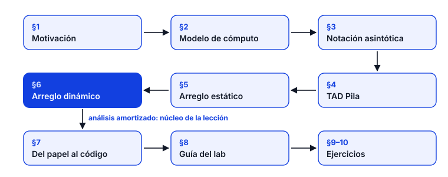
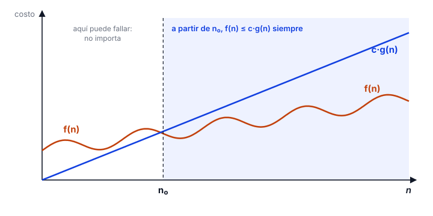
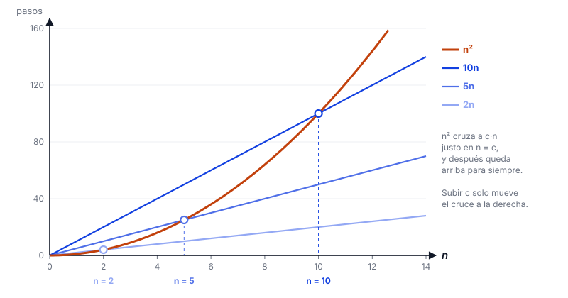
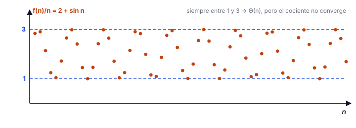
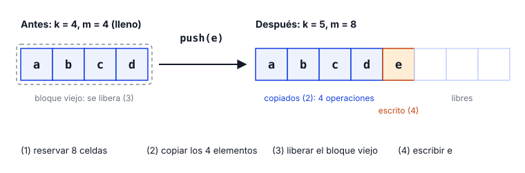
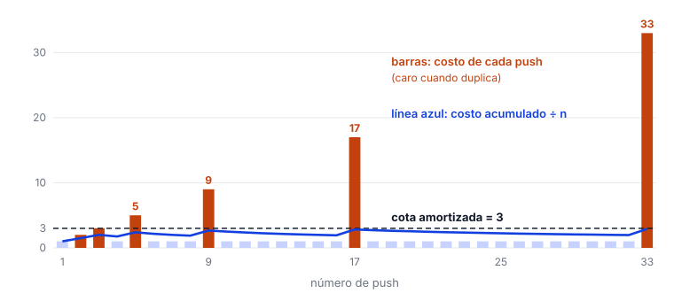
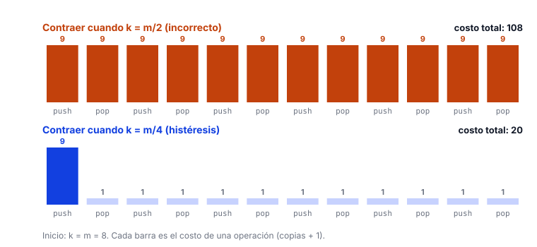

# Lección 1 — Modelo de cómputo, análisis asintótico y el TAD Pila

> **Prerrequisitos:** Lección 0 (§1 lógica y cuantificadores, donde también aparecen $O$, $\Omega$, $\Theta$ y $\prec$; §2 demostraciones; §3 inducción; §4 invariantes; §5 logaritmos; §6 pisos y techos; §7 sumatorias: aritmética §7.2, geométrica §7.3 y §7.4, telescópicas §7.6; §11–12 memoria y los tres lenguajes).
>
> **Cómo estudiar esta lección:** cada demostración está escrita paso a paso: un paso por párrafo, con lo que hago y por qué se vale. Antes de leer la solución de un ejemplo, intenta el siguiente paso tú mismo.
>
> **Lab asociado:** `lab01`: `ArrayStack<T>` y `MinStack<T>`.

## Objetivos de aprendizaje

Al terminar esta lección deberías poder:
1. Explicar qué es un **modelo de cómputo** y por qué sin él "es $O(n)$" no significa nada.
2. Usar las definiciones formales de $O, \Omega, \Theta, o, \omega$ para **demostrar** y **refutar** cotas.
3. Distinguir **interfaz (TAD)** de **estructura de datos**, y especificar un TAD con axiomas.
4. Demostrar que el arreglo dinámico tiene `push` en $O(1)$ **amortizado** por tres métodos distintos, y explicar por qué el crecimiento debe ser **geométrico**.
5. Implementar una pila sobre arreglo dinámico en C, C++ y Rust, enunciando su **invariante de representación** y reconociendo qué garantiza cada lenguaje.

## Mapa de la lección




---

## 1. Motivación

Quieres guardar elementos **sin saber de antemano cuántos serán**: los tokens que va leyendo un compilador, las llamadas pendientes de un intérprete, los vértices por visitar en un DFS. Necesitas dos cosas a la vez:

- acceso al último elemento en tiempo constante, y
- poder crecer sin límite.

Un arreglo da lo primero, pero tiene tamaño fijo. Una pregunta aparentemente inocente nos ocupará toda la lección:

> *Si cada vez que el arreglo se llena tenemos que copiarlo entero a uno más grande, ¿cuánto cuesta realmente agregar un elemento?*

La respuesta ("en promedio, una constante, **garantizado**") requiere precisar qué significa *costar*, qué significa *en promedio* y qué significa *garantizado*. Ese es el contenido de esta lección.

---

## 2. Modelo de cómputo

**Intuición.** Para comparar algoritmos necesitamos acordar qué operaciones cuestan "una unidad". Si sumar dos números de un millón de dígitos costara lo mismo que sumar dos `int`, cualquier análisis sería engañoso.

**Definición 2.1 (Word-RAM).** Una máquina con:
- memoria de celdas direccionables de $w$ bits (*palabras*);
- un número constante de registros;
- en tiempo $O(1)$: aritmética entera ($+,-,\times,\lfloor/\rfloor,\bmod$), comparaciones, operaciones de bits, y **lectura/escritura de la celda en cualquier dirección dada** (*acceso aleatorio*);
- la suposición $w \ge \lg n$, donde $n$ es el tamaño de la entrada. Sin ella no podríamos ni escribir la dirección del último elemento.

**Asignación de memoria.** Reservar un bloque contiguo de $k$ palabras cuesta $\Theta(k)$ y liberarlo cuesta $O(1)$.

**Lo que el modelo deja fuera** (a propósito): cachés, pipeline y paralelismo. Una lista ligada y un arreglo pueden tener el mismo costo asintótico y diferir en un factor de 10–100 en la práctica, por la localidad. Lo tendremos presente en cada lab.

---

## 3. Notación asintótica

### 3.1 Intuición

Queremos describir cómo **crece** el costo cuando $n\to\infty$, ignorando dos cosas que dependen de la máquina y no del algoritmo:
1. **constantes multiplicativas** (un procesador 2× más rápido no cambia el algoritmo);
2. **lo que pasa con $n$ pequeña** (solo nos importa el comportamiento a la larga).




### 3.2 Definiciones

Sean $f, g : \mathbb{N} \to \mathbb{R}_{\ge 0}$ (basta que sean $\ge0$ a partir de algún $n$; el Ejemplo C lo necesita, porque $n^2-10n<0$ para $1\le n\le9$).

**Definición 3.1.**

| Notación | Definición | Se lee | Análogo |
|---|---|---|---|
| $f \in O(g)$ | $\exists c>0,\ \exists n_0,\ \forall n\ge n_0:\ f(n)\le c\,g(n)$ | $f$ crece **a lo más** como $g$ | $\le$ |
| $f \in \Omega(g)$ | $\exists c>0,\ \exists n_0,\ \forall n\ge n_0:\ f(n)\ge c\,g(n)$ | **al menos** como $g$ | $\ge$ |
| $f \in \Theta(g)$ | $f\in O(g)$ y $f\in\Omega(g)$ | **igual** que $g$ | $=$ |
| $f \in o(g)$ | $\forall c>0,\ \exists n_0,\ \forall n\ge n_0:\ f(n) < c\,g(n)$ | **estrictamente** más lento | $<$ |
| $f \in \omega(g)$ | $g\in o(f)$ | estrictamente más rápido | $>$ |

> ⚠️ $O(g)$ es un **conjunto** de funciones. Escribir $f = O(g)$ es un abuso de notación aceptado, pero la "igualdad" es **asimétrica**: $n = O(n^2)$ es cierto y $n^2 = O(n)$ es falso.

> ⚠️ $O$ **no** significa "peor caso", ni $\Omega$ "mejor caso". Son cotas sobre *funciones*. "El peor caso de insertion sort es $\Theta(n^2)$" y "el mejor caso es $\Theta(n)$" son dos afirmaciones $\Theta$ sobre dos funciones distintas.

### 3.3 Taller: cómo se demuestra una cota asintótica, paso a paso

> **Por qué este taller.** La definición de $O$ dice *qué* hay que probar, pero no *cómo* encontrar $c$ y $n_0$. Aquí está el método completo: primero las reglas que puedes usar, luego una receta, y después ejemplos resueltos de menor a mayor dificultad, con cada paso algebraico escrito y justificado. Al final hay ejercicios con solución.

#### 3.3.1 Qué hay que demostrar exactamente

Para demostrar $f\in O(g)$ debes **exhibir** dos números concretos, $c>0$ y $n_0$, y demostrar que
$$\text{para todo } n\ge n_0:\qquad f(n)\ \le\ c\cdot g(n).$$
Nada más y nada menos. "Exhibir" significa escribir valores concretos ("$c = 8$, $n_0 = 1$"), no decir "existe una $c$ suficientemente grande".

**La idea central:** la desigualdad $f(n)\le c\,g(n)$ casi nunca se ve directamente. Lo que se hace es construir una **cadena** de desigualdades pequeñas, cada una justificada por una regla de la tabla siguiente, que va de $f(n)$ a $c\cdot g(n)$:
$$f(n) \;\le\; (\text{algo un poco más grande}) \;\le\; \dots \;\le\; c\cdot g(n).$$

#### 3.3.2 Las reglas que puedes usar

Todas son álgebra de bachillerato, pero conviene tenerlas a la vista y **citarlas** en cada paso.

| Regla | Enunciado | Ejemplo |
|---|---|---|
| **R1. Sumar desigualdades** | Si $a\le b$ y $p\le q$, entonces $a+p\le b+q$ | $3\le 3n$ (para $n\ge1$) y $5n\le5n$ implican $5n+3\le 8n$ |
| **R2. Multiplicar por un positivo** | Si $a\le b$ y $k>0$, entonces $ka\le kb$. **Si $k<0$, la desigualdad se invierte.** | $1\le n$ implica $7\le 7n$ |
| **R3. Transitividad** | Si $a\le b$ y $b\le c$, entonces $a\le c$ | encadenar pasos |
| **R4. Potencias, para $n\ge1$** | $1\le n\le n^2\le n^3\le\cdots$ | $7 \le 7n^2$ para $n\ge1$ |
| **R5. Logaritmo, para $n\ge1$** | $0\le \lg n\le n$ | $10n\lg n\le10n^2$ |
| **R6. Logaritmo, para $n\ge2$** | $\lg n \ge 1$ | $50n\le 50n\lg n$ para $n\ge2$ |
| **R7. Quitar un término $\ge0$ hace la expresión más chica** | Si $b\ge0$, entonces $a+b\ge a$ | $5n+3\ge5n$ |
| **R8. Quitar un término $\le0$ hace la expresión más grande** | Si $b\le0$, entonces $a+b\le a$ | $n^2-10n\le n^2$ para $n\ge0$ |

**¿Por qué valen R4, R5 y R6?**

- **R4.** Si $n\ge1$, multiplicamos ambos lados de $1\le n$ por $n^{k}$, que es positivo (R2): $n^k\le n^{k+1}$. Encadenando con R3 obtenemos $1\le n\le n^2\le\cdots$
- **R5.** $\lg n\ge0$ porque $n\ge1=2^0$ y $\lg$ es creciente. Para $\lg n\le n$ basta demostrar $n\le 2^n$: luego se aplica $\lg$, que es creciente, a ambos lados, y $\lg(2^n)=n$. La desigualdad $n\le2^n$ se demuestra por inducción; la demostración está abajo, plegada.
- **R6.** $\lg 2 = 1$ y $\lg$ es creciente, así que $n\ge2$ implica $\lg n\ge1$.

<details><summary>Demostración de n ≤ 2ⁿ (la usa R5)</summary>

Por inducción, con la forma de L00 §3.2.

**Paso 1. Pruebo con números chicos.** Calculo los dos lados para $n=1,2,3$:
$$
\begin{aligned}
n=1:&\quad 1\le2^1=2\ ✓\\
n=2:&\quad 2\le2^2=4\ ✓\\
n=3:&\quad 3\le2^3=8\ ✓
\end{aligned}
$$
Funciona, pero probar casos no es demostrar.

**Paso 2. La base.** El primer dominó es $n=1$, y en el paso 1 ya vimos que cae ✓.

**Paso 3. Supongo que vale para un $n=k$ cualquiera, con $k\ge1$.** Escribo la desigualdad con $k$ y la encierro en una caja. Es la hipótesis de inducción (HI); además sé que $k\ge1$.
$$\boxed{\,k\le2^k\,}\qquad\text{(HI)}$$

**Paso 4. Escribo lo que quiero: la desigualdad con $n=k+1$.** Cambio cada $n$ por $(k+1)$:
$$k+1\ \overset{?}{\le}\ 2^{k+1}$$

**Paso 5. Cambio el $1$ por $k$.** Como $1\le k$, sumo $k$ a los dos lados (R1); sumar lo mismo no voltea la desigualdad:
$$k+1\le k+k$$

**Paso 6. Junto $k+k$ en $2k$.** Algo más sí mismo es el doble: $x+x=2x$. Es una igualdad, así que el $\le$ se queda:
$$k+1\le2\cdot k$$

**Paso 7. Busco la caja de la HI.** El $k$ que multiplica al 2 es exactamente el lado izquierdo de la caja:
$$k+1\le2\cdot\boxed{\,k\,}$$

**Paso 8. Uso la HI.** La caja dice $k\le2^k$. Multiplico por $2>0$ (R2), sin voltear: $2k\le2\cdot2^k$. Lo encadeno con el paso 7 (R3):
$$k+1\le2\cdot2^k$$

**Paso 9. Escribo $2\cdot2^k$ como $2^{k+1}$**, por la ley de exponentes $a\cdot a^m=a^{m+1}$. Es una igualdad:
$$k+1\le2^{k+1}$$
Es la meta del paso 4 ✓.

**Paso 10. Compruebo con un número.** Con $k=3$, el lado izquierdo vale $4$. La derecha vale $3+3=6$ en el paso 5, $2\cdot3=6$ en el paso 6 y $2\cdot8=16$ en los pasos 8 y 9. Siempre es al menos $4$ ✓.

**Conclusión.** El paso 2 tiró el primer dominó ($n=1$). Los pasos 3 a 9 demostraron que cualquier dominó $k\ge1$ tumba al siguiente. Entonces $n\le2^n$ para todo $n\ge1$, y con eso R5 queda demostrada. $\square$

</details>

#### 3.3.3 La receta

**Para demostrar $f\in O(g)$ (cota superior):**

1. Escribe la meta: $f(n)\le c\cdot g(n)$.
2. Recorre $f$ **término por término**:
   - si el término es **negativo**, quítalo (R8): la expresión solo crece, así que la cota sigue siendo válida;
   - si es **positivo**, reemplázalo por un múltiplo de $g(n)$ **más grande o igual**, usando R2, R4, R5 o R6. **Anota a partir de qué $n$ vale** ese reemplazo.
3. Suma todas las cotas (R1). Queda $f(n)\le(\text{suma de coeficientes})\cdot g(n)$.
4. **Elige** $c$ = esa suma y $n_0$ = el **mayor** de los "a partir de qué $n$" que anotaste.
5. **Verifica** con un par de números concretos, para atrapar errores de álgebra.
6. Escribe la demostración limpia: "Sean $c=\dots$ y $n_0=\dots$. Para todo $n\ge n_0$: …"

**Para demostrar $f\in\Omega(g)$ (cota inferior):** es el espejo.

1. Meta: $f(n)\ge c\cdot g(n)$.
2. Los términos **positivos** que no sean el principal se pueden **quitar** (R7): la expresión solo decrece.
3. Los términos **negativos** **no** se pueden quitar, porque eso haría la expresión más grande, la dirección equivocada. Hay que "pagarlos" con una parte del término principal, eligiendo $n_0$ grande (lo vemos en el Ejemplo C).

> ⚠️ **El error más común:** usar la regla de la dirección equivocada. Para una cota **superior** se puede *agrandar* el lado derecho y *achicar* el izquierdo, nunca al revés. Antes de cada paso pregúntate: *¿este cambio hace mi expresión más grande o más chica? ¿Es la dirección que necesito?*

#### 3.3.4 Ejemplo A (calentamiento): $5n+3\in O(n)$

**Paso 1. La meta.** Encontrar $c$ y $n_0$ con $5n+3\le c\cdot n$ para todo $n\ge n_0$. El término $5n$ ya es un múltiplo de $n$; el que estorba es el $3$.

**Paso 2. Convierto el $3$ en algo por $n$.** Por R4, para $n\ge1$ se tiene $1\le n$. Multiplico por $3>0$ (R2), sin voltear. **Vale para $n\ge1$:**
$$3\le3n$$

**Paso 3. Sumo $5n$ a los dos lados.** Sumar lo mismo no voltea la desigualdad (R1):
$$5n+3\le5n+3n$$

**Paso 4. Junto términos semejantes.** $5n+3n$ es lo mismo que $(5+3)\,n$ (distributiva al revés). Es una igualdad, así que el $\le$ se queda:
$$5n+3\le8n$$

**Paso 5. Elijo.** $c=5+3=8$ y $n_0=1$ (el único "a partir de" que anoté, en el paso 2).

**Paso 6. Compruebo con números.** Con $n=1$: $5+3=8\le8\cdot1=8$ ✓ (justo en el borde). Con $n=10$: el paso 3 da $53\le50+30=80$ y el paso 4 da $53\le80$ ✓.

**Paso 7. Demostración limpia.**

> Sean $c=8$ y $n_0=1$. Para $n\ge1$ se cumple $1\le n$, por lo que $3\le3n$; sumando $5n$ a ambos lados, $5n+3\le 8n = c\cdot n$. Por lo tanto, $5n+3\in O(n)$. $\square$

**¿Es la única elección?** No. Si tomas $n_0=3$, entonces $3\le n$ (sin multiplicar por 3) y $5n+3\le 6n$, así que $c=6$ también sirve. **Hay infinitas parejas válidas**, y basta con encontrar una. Una $n_0$ más grande suele permitir una $c$ más chica.

#### 3.3.5 Ejemplo B: $5n+3\in\Omega(n)$, y por lo tanto $\Theta(n)$

**Meta:** $5n+3\ge c\cdot n$.
- El término $3$ es positivo y no es el principal: lo quitamos (R7). $5n+3\ge5n$.
- Elegimos $c=5$ y $n_0=1$.

> Para $n\ge1$, $5n+3\ge 5n$ porque $3\ge0$. Con $c=5$ y $n_0=1$, $5n+3\in\Omega(n)$. Junto con el Ejemplo A, $5n+3\in\Theta(n)$. $\square$

#### 3.3.6 Ejemplo C (con resta): $n^2-10n\in\Theta(n^2)$

Este ejemplo enseña qué hacer con los términos **negativos**, que es donde se atora la mayoría.

**Cota superior.** Meta: $n^2-10n\le c\,n^2$. El término $-10n$ es $\le0$ para $n\ge0$, así que por R8 se puede quitar:
$$n^2-10n\;\le\;n^2.$$
Elegimos $c=1$ y $n_0=1$. ✓

**Cota inferior.** Meta: $n^2-10n\ge c\,n^2$.

Aquí **no** podemos quitar $-10n$: eso daría $n^2-10n\ge n^2$, que es **falso** (estaríamos diciendo que algo menos $10n$ es mayor que ese mismo algo).

**Truco:** sacrificar una *fracción* del término principal para "pagar" el negativo. Probemos con la mitad, $c=\tfrac12$, y despejemos para qué $n$ se cumple. Para $n\ge1$ cada paso se puede deshacer, así que los pasos son **equivalentes**: cada desigualdad vale exactamente para las mismas $n\ge1$ que la anterior.

**Paso 1. Escribo la pregunta.** Todavía no sé para qué $n$ es cierta:
$$n^2-10n\ge\tfrac12n^2$$

**Paso 2. Sumo $10n$ a los dos lados.** A la izquierda, $-10n+10n=0$. Sumar lo mismo no voltea, y restándolo se regresa:
$$n^2\ge\tfrac12n^2+10n$$

**Paso 3. Resto $\tfrac12n^2$ a los dos lados.** A la derecha, $\tfrac12n^2-\tfrac12n^2=0$. Restar lo mismo no voltea, y sumándolo se regresa:
$$n^2-\tfrac12n^2\ge10n$$

**Paso 4. Simplifico la izquierda.** $n^2-\tfrac12n^2$ es lo mismo que $(1-\tfrac12)\,n^2$ (distributiva al revés). Es una igualdad:
$$\tfrac12n^2\ge10n$$

**Paso 5. Divido los dos lados entre $n$.** Como $n\ge1$, $n>0$, y dividir es multiplicar por $\frac1n>0$ (R2): no se voltea. Multiplicando por $n$ se regresa:
$$\tfrac12n\ge10$$

**Paso 6. Multiplico los dos lados por 2.** Como $2>0$ (R2), no se voltea. Dividiendo entre 2 se regresa:
$$n\ge20$$

**Paso 7. Compruebo con la frontera, $n=20$.** Ahí cada paso debe dar los dos lados **iguales**; si alguno no, ese paso movió la frontera y está mal. Paso 1: $400-200=200$ y $200$. Paso 2: $400$ y $200+200=400$. Paso 3: $200$ y $200$. Paso 4: $200$ y $200$. Paso 5: $10$ y $10$. Paso 6: $20$ y $20$ ✓.

Como los pasos son equivalentes, la desigualdad del paso 1 se cumple exactamente cuando $n\ge20$. Elegimos $c=\tfrac12$ y $n_0=20$.

**Verificar** fuera de la frontera: con $n=30$: $900-300=600\ge450$ ✓. Con $n=10$ (antes de $n_0$): $100-100=0\ge50$ ✗. Por eso necesitábamos $n_0$.

**¿Por qué $\tfrac12$?** Funciona cualquier fracción $0<c<1$: los mismos pasos, con $c$ en lugar de $\tfrac12$, dan $n\ge\frac{10}{1-c}$ (en el último divido entre $1-c>0$). Una $c$ más cerca de 1 exige una $n_0$ más grande: con $c=0.9$, $n\ge100$. Con $c\ge1$ no funciona ninguna: el paso 5 queda $(1-c)\,n\ge10$ con $1-c\le0$, y el lado izquierdo es $\le0$ para toda $n\ge1$.

#### 3.3.7 Ejemplo D (completo): $3n^2+10n\lg n+7\in\Theta(n^2)$

Ahora sí, el ejemplo de la lección, sin saltarse nada.

**Parte (i): cota superior.** Meta: $3n^2+10n\lg n+7\le c\,n^2$. Acoto cada término por un múltiplo de $n^2$.

**Paso 1. El término $3n^2$.** Ya es múltiplo de $n^2$. Vale para todo $n$:
$$3n^2\le3n^2$$

**Paso 2. El término $10n\lg n$.** Por R5, para $n\ge1$, $\lg n\le n$. Multiplico los dos lados por $10n$, que es positivo cuando $n\ge1$ (R2), sin voltear. **Vale para $n\ge1$:**
$$10n\lg n\;\le\;10n\cdot n\;=\;10n^2$$

**Paso 3. El término $7$.** Por R4, para $n\ge1$, $1\le n^2$. Multiplico por $7>0$ (R2). **Vale para $n\ge1$:**
$$7\le7n^2$$

**Paso 4. Sumo las tres cotas** (R1), lado izquierdo con lado izquierdo y lado derecho con lado derecho:
$$
\begin{array}{rcl}
3n^2 &\le& 3n^2\\
10n\lg n &\le& 10n^2\\
7 &\le& 7n^2\\ \hline
3n^2+10n\lg n+7 &\le& 3n^2+10n^2+7n^2 \;=\; 20n^2
\end{array}
$$

**Paso 5. Elijo** $c=3+10+7=20$ y $n_0=\max(1,1,1)=1$.

**Paso 6. Compruebo.** Con $n=1$, $f(1)=3+10\cdot1\cdot0+7=10\le20$ ✓. Con $n=4$, $f(4)=48+10\cdot4\cdot2+7=135\le20\cdot16=320$ ✓.

**Parte (ii): cota inferior.** Meta: $3n^2+10n\lg n+7\ge c\,n^2$. Para una cota inferior puedo **achicar** la expresión.

**Paso 1. Quito $10n\lg n$.** Para $n\ge1$ es $\ge0$, porque $n>0$ y $\lg n\ge0$ (R5). Quitar un término $\ge0$ achica (R7):
$$3n^2+10n\lg n+7\ge3n^2+7$$

**Paso 2. Quito el $7$.** Como $7\ge0$, quitarlo achica (R7):
$$3n^2+10n\lg n+7\ge3n^2$$

**Paso 3. Elijo** $c=3$ y $n_0=1$. Con $n=4$: $135\ge48$ ✓.

**Demostración limpia (así se entrega):**

> *(i)* Sean $c=20$ y $n_0=1$. Para $n\ge1$ se tiene $\lg n\le n$ y $1\le n^2$; por lo tanto $10n\lg n\le10n^2$ y $7\le7n^2$. Sumando estas dos desigualdades y $3n^2\le3n^2$ (R1), se obtiene $f(n)\le20n^2$.
>
> *(ii)* Sean $c=3$ y $n_0=1$. Para $n\ge1$, $10n\lg n\ge0$ y $7\ge0$, así que $f(n)\ge3n^2$.
>
> Por (i) y (ii), $f\in\Theta(n^2)$. $\square$

#### 3.3.8 Ejemplo E: refutar, $n^2\notin O(n)$

**Paso 1. Escribir qué significa "no".** Se niega la definición (L00 §1.3). Cada "existe" pasa a "para todo", cada "para todo" pasa a "existe", y la desigualdad final se invierte:
$$
\begin{aligned}
n^2\in O(n) &\iff \exists c>0\ \exists n_0\ \forall n\ge n_0:\ n^2\le c\,n\\
n^2\notin O(n) &\iff \forall c>0\ \forall n_0\ \exists n\ge n_0:\ n^2> c\,n
\end{aligned}
$$

**Paso 2. Leerlo como un juego.** Un adversario te da **cualquier** $c$ y **cualquier** $n_0$ (no los eliges tú). Tú debes responder con **una** $n\ge n_0$ en la que la cota falle.

**Paso 3. Buscar la $n$ que hace fallar la cota (trabajo en sucio).** ¿Cuándo pasa $n^2>c\,n$? Dividiendo entre $n>0$: cuando $n>c$. Entonces necesito una $n$ que sea (a) $\ge n_0$ y (b) $>c$, y además (c) entera.

**Paso 4. Construirla.** $n=\max(n_0,\ \lfloor c\rfloor+1)$.
- (a) $n\ge n_0$ por el $\max$.
- (b) $n\ge\lfloor c\rfloor+1>c$. *Por qué:* $\lfloor c\rfloor$ es el mayor entero $\le c$, así que a $c$ le falta menos de 1 para alcanzar el siguiente entero: $c-\lfloor c\rfloor<1$. Sumando $\lfloor c\rfloor$ a ambos lados, $c<\lfloor c\rfloor+1$. *Con números:* $c=3.7$ da $\lfloor c\rfloor+1=4>3.7$; $c=5$ da $6>5$.
- (c) es entero, porque $n_0$ y $\lfloor c\rfloor+1$ lo son.

**Paso 5. Verificar la desigualdad.** De $n>c$ y $n>0$, multiplicando por $n$ (R2): $n\cdot n>c\cdot n$, es decir, $n^2>c\,n$. ✓

**Para verlo:** cada recta $c\cdot n$ es una propuesta del adversario. La parábola la cruza en $n=c$ y queda arriba para siempre; por eso, en cuanto $n>c$, la cota falla.



**Ejemplo numérico:** si el adversario dice "$c=100$, $n_0=5$", respondes con $n=\max(5,101)=101$ y $101^2=10201>100\cdot101=10100$. ✓

> Sean $c>0$ y $n_0$ arbitrarios. Tomemos $n=\max(n_0,\lfloor c\rfloor+1)$. Entonces $n\ge n_0$ y $n>c>0$, de donde $n^2>c\,n$. Como esto vale para todos $c$ y $n_0$, $n^2\notin O(n)$. $\square$

#### 3.3.9 Ejercicios de práctica (resuélvelos antes de ver la respuesta)

**P1.** Demuestra $2n^3-5n^2+100\in\Theta(n^3)$.
<details><summary>Solución</summary>

Sea $f(n)=2n^3-5n^2+100$. Para comprobar uso $n=5$, donde $f(5)=250-125+100=225$.

*Superior.* Meta: $f(n)\le c\,n^3$. Para una cota superior puedo **agrandar** la derecha.

**Paso 1. Quito $-5n^2$.** Como $-5n^2\le0$, quitarlo agranda (R8):
$$f(n)\le2n^3+100$$

**Paso 2. Cambio $100$ por $100n^3$, que es mayor o igual.** Para $n\ge1$, $1\le n^3$ (R4); multiplico por $100>0$ (R2) y sale $100\le100n^3$. Sumo $2n^3$ a los dos lados (R1):
$$f(n)\le2n^3+100n^3$$

**Paso 3. Junto términos semejantes.** $2n^3+100n^3$ es lo mismo que $(2+100)\,n^3$:
$$f(n)\le102n^3$$

**Paso 4. Compruebo con $n=5$.** $225\le250+100=350$ (paso 1), $225\le250+12500=12750$ (paso 2) y $225\le102\cdot125=12750$ (paso 3) ✓.

Entonces $c=102$ y $n_0=1$.

*Inferior.* Meta: $f(n)\ge c\,n^3$. El $+100$ es positivo y se puede quitar (R7), pero el $-5n^2$ no: se paga con la mitad del término principal, es decir, con $c=1$ (la mitad de $2$). Eso funciona a partir de $n=5$.

**Paso 1. Quito el $+100$.** Como $100\ge0$, quitarlo achica (R7), y achicar la derecha conserva el $\ge$:
$$f(n)\ge2n^3-5n^2$$

**Paso 2. Para $n\ge5$, comparo $5n^2$ con $n^3$.** Multiplico $5\le n$ por $n^2>0$ (R2), sin voltear:
$$5n^2\le n^3$$

**Paso 3. Multiplico por $-1$, y se voltea** (R2: con un negativo la desigualdad se invierte):
$$-5n^2\ge-n^3$$

**Paso 4. Sumo $2n^3$ a los dos lados** (R1); sumar lo mismo no voltea:
$$2n^3-5n^2\ge n^3$$

**Paso 5. Encadeno con el paso 1** (R3):
$$f(n)\ge n^3$$

**Paso 6. Compruebo con $n=5$.** Paso 1: $225\ge250-125=125$. Paso 2: $125\le125$. Paso 3: $-125\ge-125$. Paso 4: $125\ge125$. Paso 5: $225\ge125$ ✓.

Entonces $c=1$ y $n_0=5$.
</details>

**P2.** Demuestra $n\lg n+50n\in O(n\lg n)$. ¿Por qué **no** funciona $n_0=1$?
<details><summary>Solución</summary>

Sea $f(n)=n\lg n+50n$. Para comprobar uso $n=4$, donde $\lg4=2$ y $f(4)=8+200=208$.

**Paso 1. Cambio $50n$ por $50n\lg n$, que es mayor o igual.** Para $n\ge2$, $1\le\lg n$ (R6); multiplico por $50n>0$ (R2) y sale $50n\le50n\lg n$. Sumo $n\lg n$ a los dos lados (R1):
$$f(n)\le n\lg n+50n\lg n$$

**Paso 2. Junto términos semejantes.** $1\cdot n\lg n+50\,n\lg n$ es lo mismo que $(1+50)\,n\lg n$:
$$f(n)\le51\,n\lg n$$

**Paso 3. Compruebo con $n=4$.** $208\le8+400=408$ (paso 1) y $208\le51\cdot8=408$ (paso 2) ✓.

Entonces $c=51$ y $n_0=2$.

Con $n_0=1$ falla porque en $n=1$ se tiene $g(1)=1\cdot\lg1=0$, pero $f(1)=0+50=50>0=c\cdot g(1)$ para **cualquier** $c$. Moraleja: si $g$ vale 0 en algún punto, $n_0$ debe saltárselo.
</details>

**P3.** Demuestra $n\notin O(\sqrt n)$.
<details><summary>Solución</summary>

**Paso 1. Niego la definición**, como en el Ejemplo E:
$$\forall c>0\ \forall n_0\ \exists n\ge n_0:\ n>c\sqrt n$$

**Paso 2. Busco cuándo falla la cota.** Divido $n>c\sqrt n$ entre $\sqrt n>0$ (R2), sin voltear, y queda $\sqrt n>c$. Como los dos lados son positivos, elevo al cuadrado:
$$n>c^2$$

**Paso 3. Construyo la $n$.** Dados $c$ y $n_0$, tomo
$$n=\max\!\big(n_0,\ \lfloor c^2\rfloor+1\big)$$
Por el $\max$, $n\ge n_0$; y $n\ge\lfloor c^2\rfloor+1>c^2$, con el mismo argumento del piso que en el Ejemplo E.

**Paso 4. Verifico.** De $n>c^2$ sale $\sqrt n>c$ (la raíz es creciente). Multiplico por $\sqrt n>0$ (R2):
$$n>c\sqrt n$$
Como $c$ y $n_0$ eran cualesquiera, $n\notin O(\sqrt n)$. $\square$
</details>

**P4.** Demuestra $2^{n+1}\in\Theta(2^n)$.
<details><summary>Solución</summary>

Por la ley de exponentes, $2^{n+1}=2^1\cdot2^n=2\cdot2^n$ exactamente, para todo $n$. Entonces $2^{n+1}\le2\cdot2^n$ (superior, $c=2$) y $2^{n+1}\ge2\cdot2^n$ (inferior, $c=2$; también sirve cualquier $0<c\le2$), ambas con $n_0=0$. Como es una igualdad, no hay nada que acotar.
</details>

**P5.** ¿Dónde está el error? *"$n^2-10n\ge n^2$ porque quité el término $-10n$; entonces $c=1$."*
<details><summary>Solución</summary>

Se usó R8 (quitar un negativo **agranda**) en una cota **inferior**, que es la dirección equivocada. Quitar $-10n$ produce algo **mayor o igual** que $f$, no menor. Ver Ejemplo C.
</details>

#### 3.3.10 El criterio del límite: un atajo (con su demostración)

Hacer todo lo anterior a mano cada vez es tedioso. Cuando el límite del cociente existe, hay un atajo.

**Proposición 3.4.** Si $L = \lim_{n\to\infty} f(n)/g(n)$ existe en $[0,\infty]$ (y $g(n)>0$ a partir de algún punto), entonces:
$L=0 \Rightarrow f\in o(g)$; $\ 0<L<\infty \Rightarrow f\in\Theta(g)$; $\ L=\infty \Rightarrow f\in\omega(g)$.

**Demostración del caso $0<L<\infty$, paso a paso.**

Recuerda la definición de límite: $\lim f(n)/g(n)=L$ significa que para **cada** tolerancia $\varepsilon>0$ existe $N$ tal que, para todo $n\ge N$, $\big|f(n)/g(n)-L\big|<\varepsilon$.

La hipótesis "$g(n)>0$ a partir de algún punto" da un $N'$ tal que $g(n)>0$ para todo $n\ge N'$; la uso en el paso 5.

**Paso 1. Elijo la tolerancia.** Quiero que el cociente quede **lejos de 0**, y la mitad de $L$ lo logra. Es positiva porque $L>0$:
$$\varepsilon=\frac L2$$

**Paso 2. Aplico la definición de límite** con ese $\varepsilon$. Me da un $N$ tal que, para todo $n\ge N$,
$$\Big|\frac{f(n)}{g(n)}-L\Big|<\frac L2$$

**Paso 3. Quito el valor absoluto.** Se vale porque $|x|<a$ equivale a $-a<x<a$:
$$-\frac L2<\frac{f(n)}{g(n)}-L<\frac L2$$

**Paso 4. Sumo $L$ a las tres partes.** Sumar lo mismo no voltea ningún $<$. A la izquierda, $-\frac L2+L=\frac L2$; a la derecha, $\frac L2+L=\frac{3L}{2}$:
$$\frac L2<\frac{f(n)}{g(n)}<\frac{3L}{2}$$

**Paso 5. Multiplico las tres partes por $g(n)$.** Para $n\ge N'$, $g(n)>0$ (R2), así que ningún $<$ se voltea. Desde aquí, $n\ge\max(N,N')$:
$$\frac L2\,g(n)<f(n)<\frac{3L}{2}\,g(n)$$

**Paso 6. Leo la mitad derecha.** $f(n)<\frac{3L}{2}\,g(n)$ es la definición de $O$: $f\in O(g)$ con $c=\frac{3L}2$ y $n_0=\max(N,N')$.

**Paso 7. Leo la mitad izquierda.** $f(n)>\frac L2\,g(n)$ es la definición de $\Omega$: $f\in\Omega(g)$ con $c=\frac L2$ y el mismo $n_0$. Con los pasos 6 y 7, $f\in\Theta(g)$.

**Paso 8. Compruebo con números.** Imagina que $L=2$ y que en cierta $n\ge\max(N,N')$ se tiene $f(n)=25$ y $g(n)=10$, así que el cociente es $2.5$. Paso 1: $\varepsilon=1$. Paso 2: $|2.5-2|=0.5<1$. Paso 3: $-1<0.5<1$. Paso 4: $1<2.5<3$. Paso 5: $10<25<30$. Pasos 6 y 7: $c=3$ y $c=1$ ✓. $\square$

**Ejemplo D con el atajo.**

**Paso 1. Divido cada término del numerador entre $n^2$.** $\frac{3n^2}{n^2}=3$ y $\frac{10n\lg n}{n^2}=\frac{10\lg n}{n}$:
$$\frac{3n^2+10n\lg n+7}{n^2}=3+\frac{10\lg n}{n}+\frac7{n^2}$$

**Paso 2. $\frac7{n^2}\to0$**, porque el numerador está fijo y el denominador crece sin límite.

**Paso 3. $\frac{\lg n}{n}\to0$.** Uso la regla de L'Hôpital (regla de cálculo, no vista en L00; se puede usar porque $\lg n\to\infty$ y $n\to\infty$), con $n$ como variable real. Como $\lg n=\frac{\ln n}{\ln 2}$ (cambio de base), su derivada es $\frac{1}{n\ln2}$:
$$\frac{(\lg n)'}{(n)'}=\frac{1/(n\ln2)}{1}=\frac{1}{n\ln2}\ \longrightarrow\ 0$$

**Paso 4. Junto los límites.**
$$3+\frac{10\lg n}{n}+\frac7{n^2}\ \longrightarrow\ 3+0+0=3$$
Como $0<3<\infty$, se concluye $f\in\Theta(n^2)$.

**Cuidado: el recíproco es falso.** $f(n)=n(2+\sin n)$ cumple $n\le f(n)\le3n$ (porque $-1\le\sin n\le1$), así que $f\in\Theta(n)$ con $c=1$ y $c=3$. Sin embargo $f(n)/n=2+\sin n$ oscila y **no tiene límite**. Si el límite no existe, el atajo no dice nada y hay que volver a la definición.




#### 3.3.11 Jerarquía

**Jerarquía que debes saber de memoria:**
$$\begin{aligned}&1 \prec \lg\lg n \prec \lg n \prec \lg^a n \prec n^{\varepsilon} \prec n \prec n\lg n\\ &\quad\prec n^2 \prec n^b \prec 2^n \prec n! \prec n^n\end{aligned}$$
con $a>1$ y $b>2$ constantes y $0<\varepsilon<1$. Recuerda que $f\prec g$ significa $f\in o(g)$.

---

## 4. Interfaz vs. estructura de datos

Esta es la distinción más importante del curso:

| | **Interfaz (TAD)** | **Estructura de datos** |
|---|---|---|
| Responde a | *¿qué* operaciones hay y qué significan? | *¿cómo* se representan y cuánto cuestan? |
| Ejemplos | Pila, Cola, Conjunto, Diccionario, Cola de prioridad | arreglo dinámico, lista ligada, heap, árbol AVL, tabla hash |
| Quién la elige | el problema | el diseñador, según los costos que necesite |

Una interfaz admite muchas implementaciones. La Pila de esta lección se implementará sobre un **arreglo dinámico**; en la L03 la implementaremos sobre una **lista ligada** y compararemos.

### 4.1 Ejemplo motivador: paréntesis balanceados

¿La cadena `{[()()]}` está balanceada? Se recorre de izquierda a derecha: cada apertura se **apila**, y cada cierre debe coincidir con el **tope**, que se **desapila**. La cadena está balanceada si y solo si nunca hay un desajuste y al final la pila queda vacía. Lo que se necesita es exactamente "el último que entró es el primero en salir".

En código, con la pila que ya trae cada lenguaje (en el lab01 construirás la tuya):

::: {.tabs}
```c
#include <stdbool.h>
#include <stdio.h>
#include <string.h>

// ¿La cadena tiene ( ) [ ] { } bien balanceados?  Usa una pila de aperturas.
bool balanceada(const char *s) {
    char pila[256];
    int tope = 0;                                    // número de elementos en la pila
    for (size_t i = 0; i < strlen(s); i++) {
        char c = s[i];
        if (c == '(' || c == '[' || c == '{') {
            pila[tope++] = c;                        // push
        } else {
            char esperado = c == ')' ? '(' : c == ']' ? '[' : '{';
            if (tope == 0 || pila[tope - 1] != esperado) return false;   // top
            tope--;                                  // pop
        }
    }
    return tope == 0;                                // al final, la pila debe quedar vacía
}

int main(void) {
    const char *casos[] = {"{[()()]}", "([)]", "((", "())", ""};
    for (int i = 0; i < 5; i++)
        printf("\"%s\" -> %s\n", casos[i], balanceada(casos[i]) ? "balanceada" : "NO balanceada");
    return 0;
}
```

```cpp
#include <iostream>
#include <stack>
#include <string>
#include <vector>

// ¿La cadena tiene ( ) [ ] { } bien balanceados?  Usa una pila de aperturas.
bool balanceada(const std::string& s) {
    std::stack<char> pila;
    for (char c : s) {
        if (c == '(' || c == '[' || c == '{') {
            pila.push(c);
        } else {
            char esperado = c == ')' ? '(' : c == ']' ? '[' : '{';
            if (pila.empty() || pila.top() != esperado) return false;
            pila.pop();
        }
    }
    return pila.empty();                 // al final, la pila debe quedar vacía
}

int main() {
    for (const std::string& s : std::vector<std::string>{"{[()()]}", "([)]", "((", "())", ""})
        std::cout << "\"" << s << "\" -> " << (balanceada(s) ? "balanceada" : "NO balanceada") << "\n";
}
```

```rust
/// ¿La cadena tiene ( ) [ ] { } bien balanceados?  Usa una pila de aperturas.
fn balanceada(s: &str) -> bool {
    let mut pila: Vec<char> = Vec::new(); // Vec sirve como pila: push / pop / last
    for c in s.chars() {
        match c {
            '(' | '[' | '{' => pila.push(c),
            _ => {
                let esperado = match c {
                    ')' => '(',
                    ']' => '[',
                    _ => '{',
                };
                // pop() devuelve Option<char>: None si la pila está vacía
                if pila.pop() != Some(esperado) {
                    return false;
                }
            }
        }
    }
    pila.is_empty() // al final, la pila debe quedar vacía
}

fn main() {
    for s in ["{[()()]}", "([)]", "((", "())", ""] {
        let r = if balanceada(s) { "balanceada" } else { "NO balanceada" };
        println!("\"{s}\" -> {r}");
    }
}
```
:::

```{.text .salida}
"{[()()]}" -> balanceada
"([)]" -> NO balanceada
"((" -> NO balanceada
"())" -> NO balanceada
"" -> balanceada
```

### 4.2 Especificación algebraica del TAD Pila

En vez de decir "LIFO" con palabras, lo especificamos con **axiomas**: ecuaciones que cualquier implementación correcta debe satisfacer.

Operaciones:
$$
\mathsf{new} : \to \textsf{Stack}\qquad
\mathsf{push} : \textsf{Stack} \times \textsf{Elem} \to \textsf{Stack}\qquad
\mathsf{isEmpty} : \textsf{Stack} \to \textsf{Bool}
$$
$$
\mathsf{pop} : \textsf{Stack} \rightharpoonup \textsf{Stack}\qquad
\mathsf{top} : \textsf{Stack} \rightharpoonup \textsf{Elem}\qquad (\rightharpoonup\ = \text{función parcial})
$$
Axiomas, para todo $S$ y todo $x$:
1. $\mathsf{isEmpty}(\mathsf{new}) = \mathsf{true}$
2. $\mathsf{isEmpty}(\mathsf{push}(S,x)) = \mathsf{false}$
3. $\mathsf{top}(\mathsf{push}(S,x)) = x$
4. $\mathsf{pop}(\mathsf{push}(S,x)) = S$
5. $\mathsf{top}(\mathsf{new})$ y $\mathsf{pop}(\mathsf{new})$ están **indefinidos**.

Los axiomas 3 y 4 **son** la disciplina LIFO. Por ejemplo, calculemos $\mathsf{top}(\mathsf{pop}(\mathsf{push}(\mathsf{push}(\mathsf{new},a),b)))$ de adentro hacia afuera, un axioma por paso:

1. Lo de adentro, $\mathsf{pop}(\mathsf{push}(\underbrace{\mathsf{push}(\mathsf{new},a)}_{S},\ \underbrace{b}_{x}))$, tiene la forma del axioma 4 con $S=\mathsf{push}(\mathsf{new},a)$ y $x=b$, así que vale $S=\mathsf{push}(\mathsf{new},a)$.
2. Queda $\mathsf{top}(\mathsf{push}(\mathsf{new},a))$: es el axioma 3 con $S=\mathsf{new}$ y $x=a$, así que vale $a$.

En palabras: apilar $a$, apilar $b$, quitar el de arriba ($b$) y mirar el tope da $a$.

**Primera diferencia de paradigma: ¿qué hacemos con el axioma 5?**

| C | C++ | Rust |
|---|---|---|
| `pop()` devuelve un **`bool`** (`false` si está vacía) y `top()` devuelve **`NULL`**. Nada obliga al llamador a revisarlo. | `pop()` en una pila vacía **lanza** `std::out_of_range`. (La STL elige otra cosa: en `std::stack` es **UB** y es una precondición del llamador.) | `pop()` devuelve `Option<T>`: la función parcial se vuelve **total** sobre $\textsf{Elem}\cup\{\bot\}$. El compilador **obliga** al llamador a manejar `None`. |

---

## 5. Arreglo estático

Un bloque contiguo `A[0..n)` que empieza en la dirección $b$ permite acceder a `A[i]` calculando $b + i\cdot s$, donde $s$ es el tamaño del elemento. Eso es $O(1)$ gracias al acceso aleatorio del modelo.

**Pila sobre un arreglo estático de capacidad $m$:** se guarda $k$ (el número de elementos); `push` escribe en `A[k]` y hace $k \gets k+1$; `pop` hace $k\gets k-1$. Todo es $O(1)$, pero **la capacidad está fija**. Si llega el elemento $m+1$, hay que crear un bloque más grande y copiar todo, lo que cuesta $\Theta(m)$.

---

## 6. Arreglo dinámico y análisis amortizado

### 6.1 La estructura

Se mantiene un bloque de capacidad $m$ y un tamaño $k\le m$. Para `push(x)`:
- si $k<m$: se escribe en la posición $k$ y se hace $k\gets k+1$;
- si $k=m$ (**lleno**): se reserva un bloque de capacidad $\max(1,\ 2m)$, se **copian** los $k$ elementos, se libera el bloque viejo y luego se escribe.




**Modelo de costo:** escribir o copiar un elemento cuesta 1. No contamos aparte la reserva del bloque nuevo, que según §2 cuesta $\Theta(\text{tamaño del bloque})$: reservar $2m$ celdas cuesta, salvo una constante, lo mismo que copiar los $m$ elementos, así que se paga igual que las copias y solo cambia la constante, no el crecimiento.

### 6.2 Experimento: sigamos los números

Hagamos 9 `push` desde la pila vacía:

| push # | cap. antes → después | copias | costo de este push | costo acumulado | acumulado / n |
|---:|:---:|---:|---:|---:|---:|
| 1 | 0 → 1 | 0 | 1 | 1 | 1.00 |
| 2 | 1 → 2 | 1 | 2 | 3 | 1.50 |
| 3 | 2 → 4 | 2 | 3 | 6 | 2.00 |
| 4 | 4 | 0 | 1 | 7 | 1.75 |
| 5 | 4 → 8 | 4 | 5 | 12 | 2.40 |
| 6 | 8 | 0 | 1 | 13 | 2.17 |
| 7 | 8 | 0 | 1 | 14 | 2.00 |
| 8 | 8 | 0 | 1 | 15 | 1.88 |
| 9 | 8 → 16 | 8 | 9 | 24 | 2.67 |



Puedes reproducir la tabla con este programa. Implementa una pila **de enteros** que duplica su capacidad y cuenta cada escritura y cada copia. Es la idea del lab01, sin la parte genérica:

::: {.tabs}
```c
#include <stdio.h>
#include <stdlib.h>

// Pila de enteros sobre arreglo dinámico que DUPLICA su capacidad.
typedef struct {
    int *datos;
    int k;      // número de elementos
    int m;      // capacidad
} Pila;

long costo_total = 0;   // escrituras + copias, como en el modelo de costo

void push(Pila *p, int x) {
    if (p->k == p->m) {                               // lleno: duplicar
        int nueva = p->m == 0 ? 1 : 2 * p->m;
        int *b = malloc(nueva * sizeof *b);
        if (b == NULL) exit(1);
        for (int i = 0; i < p->k; i++) b[i] = p->datos[i];   // copiar k elementos
        costo_total += p->k;
        free(p->datos);
        p->datos = b;
        p->m = nueva;
    }
    p->datos[p->k++] = x;                             // escribir: costo 1
    costo_total += 1;
}

int main(void) {
    Pila p = {NULL, 0, 0};
    printf("push  capacidad   copias  costo  acumulado  promedio\n");
    for (int n = 1; n <= 9; n++) {
        int m_antes = p.m;
        long antes = costo_total;
        push(&p, n);
        long costo = costo_total - antes;
        printf("%4d  %3d -> %-3d  %6ld  %5ld  %9ld  %8.2f\n",
               n, m_antes, p.m, costo - 1, costo, costo_total, (double)costo_total / n);
    }
    free(p.datos);
    return 0;
}
```

```cpp
#include <cstdio>
#include <memory>

// Pila de enteros sobre arreglo dinámico que DUPLICA su capacidad.
// (Solo enteros, para ilustrar; el lab01 la hace genérica y con memoria cruda.)
class Pila {
public:
    void push(int x) {
        if (k_ == m_) {                                   // lleno: duplicar
            int nueva = m_ == 0 ? 1 : 2 * m_;
            auto b = std::make_unique<int[]>(nueva);
            for (int i = 0; i < k_; ++i) b[i] = datos_[i];   // copiar k elementos
            costo_total += k_;
            datos_ = std::move(b);                        // el bloque viejo se libera solo
            m_ = nueva;
        }
        datos_[k_++] = x;                                 // escribir: costo 1
        costo_total += 1;
    }
    int capacidad() const { return m_; }
    long costo_total = 0;                                 // escrituras + copias

private:
    std::unique_ptr<int[]> datos_;
    int k_ = 0, m_ = 0;
};

int main() {
    Pila p;
    std::printf("push  capacidad   copias  costo  acumulado  promedio\n");
    for (int n = 1; n <= 9; ++n) {
        int m_antes = p.capacidad();
        long antes = p.costo_total;
        p.push(n);
        long costo = p.costo_total - antes;
        std::printf("%4d  %3d -> %-3d  %6ld  %5ld  %9ld  %8.2f\n",
                    n, m_antes, p.capacidad(), costo - 1, costo, p.costo_total,
                    static_cast<double>(p.costo_total) / n);
    }
}
```

```rust
/// Pila de enteros sobre arreglo dinámico que DUPLICA su capacidad.
/// (Solo enteros, para ilustrar; el lab01 la hace genérica.)
struct Pila {
    datos: Box<[i32]>,
    k: usize, // número de elementos
    costo_total: u64, // escrituras + copias
}

impl Pila {
    fn new() -> Self {
        Pila { datos: Box::new([]), k: 0, costo_total: 0 }
    }
    fn capacidad(&self) -> usize {
        self.datos.len()
    }
    fn push(&mut self, x: i32) {
        if self.k == self.capacidad() {
            // lleno: duplicar
            let nueva = if self.k == 0 { 1 } else { 2 * self.k };
            let mut b = vec![0; nueva].into_boxed_slice();
            b[..self.k].copy_from_slice(&self.datos[..self.k]); // copiar k elementos
            self.costo_total += self.k as u64;
            self.datos = b; // el bloque viejo se libera solo
        }
        self.datos[self.k] = x; // escribir: costo 1
        self.k += 1;
        self.costo_total += 1;
    }
}

fn main() {
    let mut p = Pila::new();
    println!("push  capacidad   copias  costo  acumulado  promedio");
    for n in 1..=9 {
        let m_antes = p.capacidad();
        let antes = p.costo_total;
        p.push(n);
        let costo = p.costo_total - antes;
        println!(
            "{:4}  {:3} -> {:<3}  {:6}  {:5}  {:9}  {:8.2}",
            n, m_antes, p.capacidad(), costo - 1, costo, p.costo_total,
            p.costo_total as f64 / n as f64
        );
    }
}
```
:::

```{.text .salida}
push  capacidad   copias  costo  acumulado  promedio
   1    0 -> 1         0      1          1      1.00
   2    1 -> 2         1      2          3      1.50
   3    2 -> 4         2      3          6      2.00
   4    4 -> 4         0      1          7      1.75
   5    4 -> 8         4      5         12      2.40
   6    8 -> 8         0      1         13      2.17
   7    8 -> 8         0      1         14      2.00
   8    8 -> 8         0      1         15      1.88
   9    8 -> 16        8      9         24      2.67
```

La misma cuenta extendida hasta 33 push: las barras naranjas son los push que duplican; la línea azul, el costo acumulado dividido entre $n$, nunca cruza la línea de 3.

**Observaciones:**
- Algunos `push` son **caros** (el 9 cuesta 9, es decir $\Theta(n)$ en el peor caso).
- Pero los caros son **raros**: ocurren en los push $2, 3, 5, 9, 17, \dots$ (justo cuando la pila ya tiene $1, 2, 4, 8, 16$ elementos), y entre dos caros hay cada vez más baratos.
- El **costo promedio por operación** se mantiene **por debajo de 3**.

La pregunta correcta, entonces, no es "¿cuánto cuesta *un* push?" sino "¿cuánto cuestan *n* push?".

### 6.3 Costo amortizado: la definición

**Definición 6.1.** Asignamos a cada operación $i$ un *costo amortizado* $\hat c_i$ tal que, **para toda secuencia** de operaciones que empiece en la estructura vacía,
$$\sum_{i=1}^{n} c_i \;\le\; \sum_{i=1}^{n} \hat c_i \qquad (c_i = \text{costo real}).$$

> Ojo: esto **no** es un promedio probabilístico. No hay azar. Es una cota de **peor caso sobre secuencias completas**: ningún adversario puede elegir una secuencia de $n$ operaciones que cueste más que $\sum \hat c_i$.

### 6.4 Teorema y tres demostraciones (desarrolladas paso a paso)

**Teorema 6.2.** Con duplicación, toda secuencia de $n$ operaciones `push`/`pop` desde la pila vacía cuesta **menos de $3n$**. Es decir, `push` es $O(1)$ amortizado.

Lo demostramos tres veces porque cada método es una herramienta distinta que volverá en el curso (heaps, Union-Find, tablas hash).

---

#### (a) Método agregado: "cuenta todo y divide"

**Idea:** calcular el costo **total** de la secuencia y dividir entre $n$. Resolvemos el caso de solo `push`; con `pop` intercalados, el conteo lo hacen (b) y (c).

**Paso 1. Separar el costo en dos partes.** Cada `push` hace exactamente una escritura; algunos, además, copian. Entonces:
$$T(n)=\underbrace{n}_{\text{escrituras}}+\underbrace{(\text{número total de copias})}_{\text{lo difícil}}.$$

**Paso 2. ¿Cuándo se copia y cuánto?** Se copia cuando el arreglo está lleno ($k=m$). La capacidad empieza en 0 y luego vale $1,2,4,8,\dots$: siempre una potencia de 2. Cuando hay $2^i$ elementos y la capacidad es $2^i$, el siguiente `push`, que es el número $2^i+1$, copia $2^i$ elementos.

Compruébalo con la tabla de §6.2: el push #2 copia $1=2^0$, el #3 copia $2=2^1$, el #5 copia $4=2^2$ y el #9 copia $8=2^3$. ✓

**Paso 3. ¿Cuántas duplicaciones hay en $n$ push?** Hay una por cada $i$ tal que el push número $2^i+1$ **ocurrió**, es decir, $2^i+1\le n$, es decir, $2^i<n$. Si $n=1$ no hay copias, y $T(1)=1<3$; de aquí en adelante $n\ge2$. Sea $j$ el **mayor** entero con $2^j<n$ (es un número fijo, que depende de $n$; con $n\ge2$, $j\ge0$). Entonces las copias son
$$2^0+2^1+2^2+\dots+2^j=\sum_{i=0}^{j}2^i.$$

**Paso 4. Calcular la suma.** Una suma de potencias de 2 consecutivas, empezando en 1, es *la siguiente potencia menos 1*:
$$\sum_{i=0}^{j}2^i=2^{j+1}-1.$$
*¿Por qué?* En binario, $1+2+4+8=1111_2$, y sumarle 1 da $10000_2=16$. Es el Ejercicio 0.2 de L00, que se demuestra por inducción.

Lo único que sé de $j$ es cómo se eligió en el paso 3, y lo encierro en una caja:
$$\boxed{\,2^j<n\,}$$

**Paso 5. Sustituyo las copias por su suma.** Por el paso 1, $T(n)=n+\text{copias}$, y por el paso 4 las copias valen $2^{j+1}-1$:
$$T(n)=n+(2^{j+1}-1)$$

**Paso 6. Quito el $-1$.** Quitar un término negativo da algo estrictamente más grande (R8, y $-1<0$), así que la relación pasa a ser $<$:
$$T(n)<n+2^{j+1}$$

**Paso 7. Escribo $2^{j+1}$ como $2\cdot2^j$ y aparece la caja.** Es la ley de exponentes; es una igualdad:
$$T(n)<n+2\cdot\boxed{\,2^j\,}$$

**Paso 8. Uso la caja.** Dice $2^j<n$; multiplico por $2>0$ (R2), sin voltear: $2\cdot2^j<2n$. Agrandar la cota de la derecha conserva el $<$:
$$T(n)<n+2n$$

**Paso 9. Junto términos semejantes:** $n+2n$ es lo mismo que $(1+2)\,n$.
$$T(n)<3n$$

**Paso 10. Compruebo con la tabla de §6.2.** Con $n=9$, el mayor $j$ con $2^j<9$ es $j=3$. Copias: $1+2+4+8=15=2^4-1$ ✓. Paso 5: $T(9)=9+15=24$, como en la tabla ✓. Paso 6: $24<9+16=25$. Paso 8: $24<9+18=27$. Paso 9: $24<27=3\cdot9$ ✓. Con solo `push`, el teorema queda demostrado. $\square$

**Paso 11. ¿Y con `pop`?** El conteo directo se complica; los métodos (b) y (c) lo resuelven sin esfuerzo.

---

#### (b) Método contable (del banquero): "cobra de más ahora para pagar después"

**Idea:** cada operación paga un precio fijo en monedas. Si paga más de lo que cuesta, el sobrante va a un **banco**; si cuesta más, saca del banco. **Regla:** el banco nunca puede quedar negativo. Si se cumple, el total pagado es mayor o igual que el costo real.

**Paso 1. Fijar precios.** `push` paga $\hat c=3$ y `pop` paga $\hat c=1$.

**Paso 2. Intuición del reparto.** De las 3 monedas de `push(x)`:
- 🪙 1 paga la escritura de $x$ ahora;
- 🪙 1 se ahorra para la **copia futura de $x$**;
- 🪙 1 se ahorra para la copia futura de un elemento **viejo**, que ya gastó su moneda en la duplicación anterior.

**Paso 3. Convertir la intuición en un invariante.** "Intuición" no es demostración. Necesitamos una fórmula para el saldo. La encierro en una caja, porque es lo que vamos a mantener y a usar:
$$\boxed{\,B\;\ge\;2\cdot\max\!\left(0,\ k-\tfrac m2\right)\,}\qquad\text{(invariante)}$$
En palabras: por cada elemento por **encima de la mitad** de la capacidad hay 2 monedas en el banco.

*¿De dónde sale?* Se diseña **hacia atrás**. En el momento de copiar ($k=m$) necesitamos $m$ monedas. La fórmula da $2\cdot(m-m/2)=m$. Exacto.

**Paso 4. Demostrar el invariante por inducción sobre las operaciones.**

*Base:* pila vacía, $k=m=0$, $B=0$. La cota es $2\max(0,0)=0\le0$ ✓.

*Paso inductivo:* supongo que la caja vale antes de una operación y demuestro que vale después. Hay cuatro casos.

*Caso 1: `push` sin duplicar ($k<m$).* Costo real 1 y pagó 3: el banco pasa de $B$ a $B+2$, $k$ pasa a $k+1$ y la capacidad no cambia.

- Si $k\ge\frac m2$: la cota pasa de $2(k-\frac m2)$ a $2(k+1-\frac m2)$, es decir, sube exactamente 2. El banco también sube 2 ✓.
- Si $k<\frac m2$: la cota antes era 0, y después $k+1-\frac m2<1$, así que la cota nueva es $<2$. Como $B\ge0$ (la caja), $2\le B+2$ ✓.

*Caso 2: `push` que duplica ($k=m\ge1$).* Costo real: $m$ copias más 1 escritura. Aquí el invariante se **usa** para pagar.

- *Pongo $k=m$ en la caja.* Como $m-\frac m2=\frac m2\ge0$, el $\max$ vale $\frac m2$:
  $$B\ge2\max\!\big(0,\ m-\tfrac m2\big)=2\cdot\tfrac m2=m$$
  **Hay suficiente** para pagar las $m$ copias, y queda $B-m\ge0$.
- *Pago la escritura y deposito.* La escritura se paga con 1 de las 3 monedas y las otras 2 van al banco: el saldo nuevo es $B-m+2\ge2$.
- *La cota en el estado nuevo.* Ahora $k=m+1$ y la capacidad es $2m$, cuya mitad es $m$: la cota es $2\max(0,(m+1)-m)=2$, y el saldo es $\ge2$ ✓.
- *Con números* (push #5 de §6.2, $m=4$). Si sigues los push 1 a 4 con estos precios, el banco queda en $2,3,3,5$. Antes del push #5, $B=5\ge4$ ✓; paga 4 copias y queda 1; paga la escritura, deposita 2 y queda $3\ge2$ ✓.

*Caso 3: el primer `push` ($k=m=0$).* Costo 1 (no hay nada que copiar) y el banco recibe $+2$, así que $B=2$. Estado: $k=1$, $m=1$. La cota es $2\max(0,1-\frac12)=1\le2$ ✓.

*Caso 4: `pop`.* Costo 1 y pagó 1: el banco no cambia y $k$ pasa a $k-1$. Si $k-1\ge\frac m2$, la cota baja 2; si no, vale 0. No sube, y $B$ no cambia ✓.

**Paso 5. El costo real es lo pagado menos lo que queda en el banco.** Por el paso 4, el banco nunca es negativo:
$$\text{costo real total}\;\le\;\text{total pagado}$$

**Paso 6. Acoto lo pagado.** Como $1\cdot\#\text{pop}\le3\cdot\#\text{pop}$ y $\#\text{push}+\#\text{pop}=n$:
$$\text{total pagado}\;=\;3\cdot\#\text{push}+1\cdot\#\text{pop}\;\le\;3n$$

**Paso 7. Y es menos de $3n$**, como dice el teorema.

- La primera operación es un push (un pop en la pila vacía no está definido).
- Después de cualquier push, $B\ge2$: en el caso 1 el banco tenía $B\ge0$ y recibe $+2$; el caso 2 termina con $B\ge2$; el caso 3 deja $B=2$.
- Los pop no cambian $B$. Entonces al final $B\ge2$, y como el costo real es lo pagado menos lo que queda en el banco:
$$\text{costo real total}\;\le\;3n-2\;<\;3n\qquad\square$$

> **Observa el patrón:** en los casos baratos (1, 3, 4) solo verificamos que el invariante **no se rompe**; en el caso caro (2) lo **usamos** para pagar. Así funcionan casi todas las demostraciones amortizadas.

---

#### (c) Método del potencial (del físico): "energía almacenada"

**Idea:** en lugar de repartir monedas entre los elementos, se asigna a la estructura completa un número $\Phi$ (su "energía potencial"). Las operaciones baratas la cargan y las caras la gastan.

**Paso 1. Definir el costo amortizado a partir de $\Phi$.**
$$\hat c_i\;=\;c_i\;+\;\underbrace{\Phi(D_i)-\Phi(D_{i-1})}_{\Delta\Phi\ \text{(cambio de energía)}}$$
donde $D_i$ es el estado después de la operación $i$.

**Paso 2. ¿Por qué esto da costos amortizados válidos?** Sumamos desde $i=1$ hasta $n$:
$$\sum_{i=1}^{n}\hat c_i=\sum_{i=1}^{n}c_i+\sum_{i=1}^{n}\big[\Phi(D_i)-\Phi(D_{i-1})\big].$$
La segunda suma es **telescópica**; escribiéndola completa se ve que casi todo se cancela:
$$\begin{aligned}&[\Phi(D_1)-\Phi(D_0)]+[\Phi(D_2)-\Phi(D_1)]+\dots+[\Phi(D_n)-\Phi(D_{n-1})]\\ &\qquad=\Phi(D_n)-\Phi(D_0).\end{aligned}$$
Por lo tanto
$$\sum\hat c_i=\sum c_i+\Phi(D_n)-\Phi(D_0).$$
Si $\Phi(D_0)=0$ y $\Phi\ge0$ siempre, entonces $\Phi(D_n)-\Phi(D_0)\ge0$ y se obtiene $\sum c_i\le\sum\hat c_i$, que es lo que exige la Definición 6.1.

**Paso 3. Elegir $\Phi$.**
$$\Phi(D)=\max(0,\ 2k-m).$$
- ¿$\Phi(D_0)=0$? Con $k=m=0$, $\max(0,0)=0$ ✓.
- ¿$\Phi\ge0$? Siempre, por el $\max$ ✓.

> 💡 Compárala con el invariante del banquero: $2\max(0,k-\frac m2)=\max(0,2k-m)$. Se vale porque $2\max(x,y)=\max(2x,2y)$ (multiplicar por $2>0$ no cambia cuál de los dos es mayor), con $2\cdot0=0$ y $2(k-\frac m2)=2k-m$ por la distributiva. **Es la misma fórmula.** El potencial es el saldo del banco visto desde fuera.

**Paso 4. Calcular $\hat c$ en cada caso, escribiendo $\Phi$ antes y después.**

*Caso 1: `push` sin duplicar ($k<m$).* Costo real $c=1$. $\Phi$ es la cota del banquero (💡 de arriba), y en (b), caso 1, vimos que sube a lo más 2:
$$\hat c=1+\Delta\Phi\le1+2=3$$

*Caso 2: `push` que duplica ($k=m\ge1$).*

- Costo real: $m$ copias más 1 escritura, $c=m+1$.
- Antes: $k=m$ y capacidad $m$, así que $\Phi=\max(0,\ 2m-m)=m$.
- Después: $k=m+1$ y capacidad $2m$, así que $\Phi'=\max(0,\ 2(m+1)-2m)=2$.
- *Sustituyo* $c=m+1$, $\Phi'=2$ y $\Phi=m$ en la definición $\hat c=c+(\Phi'-\Phi)$:
  $$\hat c=(m+1)+(2-m)$$
- *Hago las cuentas:* $m-m=0$ y $1+2=3$.
  $$\hat c=3$$

**La $m$ se cancela:** la caída de energía paga exactamente las copias. *Con números* (push #5 de §6.2, $m=4$): antes $k=4$, $m=4$, $\Phi=4$; después $k=5$, $m=8$, $\Phi'=\max(0,10-8)=2$; costo real 5; $\hat c=5+(2-4)=3$ ✓.

*Caso 3: primer `push` ($k=m=0$).* Real: $c=1$. Antes: $\Phi=0$. Después: $k=1$, $m=1$, $\Phi'=\max(0,1)=1$. Entonces:
$$\hat c=1+(1-0)=2\le3$$

*Caso 4: `pop`.* Real: $c=1$. $k$ baja en 1, así que el argumento $2k-m$ baja 2; el $\max$ no sube cuando su argumento baja (como en (b), caso 4), así que $\Delta\Phi\le0$:
$$\hat c=1+\Delta\Phi\le1$$

**Paso 5. Uso el paso 2.** Como $\Phi(D_0)=0$ y $\Phi\ge0$:
$$\sum c_i\;\le\;\sum\hat c_i$$

**Paso 6. Sumo las $n$ cotas.** Cada $\hat c_i$ es $\le3$ (un pop da $\le1$, que también es $\le3$):
$$\sum c_i\;\le\;3n$$

**Paso 7. Y es menos de $3n$**, como dice el teorema. La primera operación es un push (un pop en la pila vacía no está definido), y ese primer push tiene $\hat c=2$ (caso 3), uno menos que 3:
$$\sum c_i\;\le\;\sum\hat c_i\;\le\;3n-1\;<\;3n\qquad\square$$

---

> **Cuándo usar cada método.**
>
> **Agregado:** cuando todas las operaciones son del mismo tipo y puedes contar el total directamente.
>
> **Contable:** cuando quieres intuición de *quién paga qué*.
>
> **Potencial:** el más sistemático. Defines un $\Phi$ y verificas caso por caso; es el que escala a estructuras complejas (splay trees, Fibonacci heaps, Union-Find).


### 6.5 ¿Por qué duplicar? El crecimiento aritmético es una trampa

**Proposición 6.3.** Si se crece sumando una constante $c$ (capacidades $c, 2c, 3c, \dots$), entonces $n$ `push` cuestan $\Theta(n^2/c)$.

**Demostración paso a paso.**

*Las copias.*

**Paso 1. ¿Cuándo se copia y cuánto?** El arreglo se llena cuando $k=jc$ para $j=1,2,3,\dots$, y entonces el siguiente `push` (el número $jc+1$) copia $jc$ elementos.

**Paso 2. ¿Cuántas ampliaciones hay?** La ampliación $j$ ocurre si el push $jc+1$ existe, es decir, $jc+1\le n$, es decir, $j\le\frac{n-1}{c}$. El número de ampliaciones es entonces
$$q=\Big\lfloor\frac{n-1}{c}\Big\rfloor.$$

**Paso 3. Sumar las copias.** Factorizamos $c$ y usamos la suma aritmética $1+2+\dots+q=\frac{q(q+1)}2$ (L00 §3.2 y §7.2):
$$\text{copias}=c+2c+\dots+qc=c\,(1+2+\dots+q)=c\cdot\frac{q(q+1)}{2}.$$

Para comprobar uso $c=10$ y $n=101$: ahí $q=\lfloor100/10\rfloor=10$, $\frac nc=10.1$ y copias $=10\cdot\frac{10\cdot11}{2}=550$.

*Cota superior.* Lo único que necesito de $q$ es que $q\le\frac{n-1}{c}<\frac nc$:
$$\boxed{\,q<\frac nc\,}$$

**Paso 1. Si $n\ge c+1$, entonces $q\ge1$.** En ese caso $\frac{n-1}{c}\ge1$, y su piso también es $\ge1$. Sumo $q$ a los dos lados de $1\le q$ (R1):
$$q+1\le2q$$

**Paso 2. Lo uso en la fórmula de las copias.** Multiplico $q+1\le2q$ por $\frac{cq}{2}>0$ (R2), sin voltear:
$$\text{copias}=c\cdot\frac{q(q+1)}{2}\le c\cdot\frac{q\cdot2q}{2}=c\,q^2$$

**Paso 3. Uso la caja.** Como $0\le q<\frac nc$, al cuadrado se conserva: $q^2<\frac{n^2}{c^2}$. Multiplico por $c>0$ (R2):
$$\text{copias}\le c\,q^2<c\cdot\frac{n^2}{c^2}=\frac{n^2}{c}$$
Con números: $550\le10\cdot100=1000<1020.1$ ✓. Para $n\ge c+1$, copias $<\frac{n^2}{c}$: está en $O\!\left(\frac{n^2}{c}\right)$.

*Cota inferior.* Ahora necesito lo contrario: que $q$ no sea demasiado chico.

**Paso 1. El piso le quita a $x$ menos de 1**, así que $\lfloor x\rfloor>x-1$. Con $x=\frac{n-1}{c}$, y escribiendo $1=\frac cc$:
$$q>\frac{n-1}{c}-1=\frac{n-1-c}{c}$$

**Paso 2. Si $n\ge2c+1$, entonces $c\le\frac{n-1}{2}$** (resto 1 y divido entre $2>0$). Restar algo más chico deja más: $n-1-c\ge(n-1)-\frac{n-1}{2}=\frac{n-1}{2}$. Divido entre $c>0$ (R2) y encadeno con el paso 1 (R3):
$$\boxed{\,q\ge\frac{n-1}{2c}\,}$$

**Paso 3. Quito el $+q$ (R7) y uso la caja.** Por la distributiva, $q(q+1)=q^2+q$, y como $q\ge0$, quitarlo achica. Luego elevo la caja al cuadrado (los dos lados son $\ge0$) y multiplico por $\frac c2>0$ (R2):
$$\text{copias}\ge\frac c2\,q^2\ge\frac c2\cdot\frac{(n-1)^2}{4c^2}=\frac{(n-1)^2}{8c}$$

**Paso 4. Para $n\ge2$, $n-1\ge\frac n2$** (resto $\frac n2$ a los dos lados: queda $\frac n2-1\ge0$). Al cuadrado se conserva, $(n-1)^2\ge\frac{n^2}{4}$, y divido entre $8c>0$ (R2):
$$\text{copias}\ge\frac{(n-1)^2}{8c}\ge\frac{n^2}{32c}$$
Con números: $q=10>9\ge5$, y $550\ge500\ge125\ge\frac{10201}{320}\approx31.9$ ✓. Está en $\Omega\!\left(\frac{n^2}c\right)$, con $n_0=\max(2,\ 2c+1)$.

*Costo total.* La proposición habla del costo de los $n$ push, que es $T(n)=n+\text{copias}$ ($n$ escrituras, como en §6.4(a)).

- *Por arriba:* para $n\ge c$, multiplico $c\le n$ por $\frac nc>0$ (R2) y sale $n\le\frac{n^2}{c}$. Con la cota superior, $T(n)<\frac{n^2}{c}+\frac{n^2}{c}=\frac{2n^2}{c}$.
- *Por abajo:* $n\ge0$, así que quitarlo achica (R7): $T(n)\ge\text{copias}\ge\frac{n^2}{32c}$.
- *Condiciones:* $n\ge c+1$, $n\ge2$ y $n\ge2c+1$; como $c\ge1$, basta $n\ge2c+1$. Para esas $n$:
  $$\frac{n^2}{32c}\le T(n)<\frac{2n^2}{c}$$

Entonces $T(n)\in\Theta\!\left(\frac{n^2}c\right)$. $\square$ *Con números* ($c=10$, $n=101$): $T=101+550=651$, y $31.9\le651<2040.2$ ✓.

*Intuición:* sumar una constante en cada paso produce copias que crecen **linealmente** ($c, 2c, 3c, \dots$), y la suma de algo lineal es **cuadrática**. Al duplicar, las copias crecen **geométricamente**, y la suma la domina su último término.

**En números**, para $n=10^6$:

| Política | Copias totales |
|---|---|
| duplicar ($\times 2$) | $< 2\times10^{6}$ |
| sumar 10 ($+10$) | $\approx 5\times10^{10}$ (**más de 25 000 veces más**) |

### 6.6 ¿Y si el factor no es 2?

**Proposición 6.4.** Con un factor $\alpha>1$ (la capacidad pasa de $m$ a $\max(1,\lceil\alpha m\rceil)$, como en §6.1), el costo amortizado de `push` es a lo más $1+\frac{\alpha}{\alpha-1}$. Sin `pop`, la memoria desperdiciada es a lo más una fracción $1-\frac1\alpha$ de la capacidad.

**Demostración paso a paso (costo).**

**Paso 1. Nombrar las copias.** Sean $s_1<s_2<\dots<s_t$ los tamaños copiados en cada ampliación, en orden. Se copia justo cuando el arreglo está lleno, así que $s_i$ es también la capacidad en ese momento. La ampliación deja capacidad $\lceil\alpha s_i\rceil$, y la siguiente copia ocurre cuando esa capacidad se llena: $s_{i+1}=\lceil\alpha s_i\rceil\ge\alpha s_i$ (el techo nunca achica).

**Paso 2. La última copia es menor que $n$.** Lo que se copia ya estaba en la pila antes del push que dispara la ampliación, así que $s_t\le n-1<n$:
$$\boxed{\,s_t<n\,}$$

**Paso 3. Leer hacia atrás.** De $s_{i+1}\ge\alpha s_i$ se obtiene $s_i\le s_{i+1}/\alpha$. Aplicándolo $r$ veces desde el final ($s_{t-1}\le\frac{s_t}{\alpha}$, $s_{t-2}\le\frac{s_t}{\alpha^2}$, …):
$$\boxed{\,s_{t-r}\le\frac{s_t}{\alpha^r}\,}$$

**Paso 4. Escribo la suma de la última copia a la primera y acoto cada sumando con la caja del paso 3** (R1). Abrevio $\sum s_i=\sum_{i=1}^{t}s_i$:
$$\sum s_i=s_t+s_{t-1}+\dots+s_1\le s_t+\frac{s_t}{\alpha}+\dots+\frac{s_t}{\alpha^{t-1}}$$

**Paso 5. Saco el factor común $s_t$.** Es la distributiva al revés; es una igualdad:
$$\sum s_i\le s_t\left(1+\frac1\alpha+\dots+\frac1{\alpha^{t-1}}\right)$$

**Paso 6. Agrego los términos que faltan de la serie infinita.** Todos son positivos, así que la cota solo crece y el $\le$ se conserva. La razón es $\frac1\alpha<1$, así que la serie converge (L00 §7.3 y §7.4):
$$\sum s_i\le s_t\left(1+\frac1\alpha+\frac1{\alpha^2}+\cdots\right)$$

**Paso 7. Uso la fórmula de la geométrica infinita:** con razón $r=\frac1\alpha<1$, la suma es $\frac{1}{1-r}$.
$$\sum s_i\le s_t\cdot\frac{1}{1-\frac1\alpha}$$

**Paso 8. Multiplico arriba y abajo por $\alpha$.** Multiplicar por $\frac\alpha\alpha=1$ no cambia nada, y $\frac{1}{1-\frac1\alpha}=\frac{\alpha}{\alpha-1}$:
$$\sum s_i\le s_t\cdot\frac{\alpha}{\alpha-1}$$

**Paso 9. Uso la caja del paso 2: cambio $s_t$ por $n$, que es más grande.** Multiplico $s_t<n$ por $\frac{\alpha}{\alpha-1}>0$ (R2): no se voltea, y la relación pasa a ser $<$:
$$\sum s_i<n\cdot\frac{\alpha}{\alpha-1}$$

**Paso 10. Compruebo con $\alpha=2$ y $n=9$.** Las copias son $s=1,2,4,8$ (como en §6.2), así que $t=4$, $s_t=8$ y $\sum s_i=15$. La derecha vale $8+4+2+1=15$ en el paso 4, $8\cdot\frac{15}{8}=15$ en el 5, $8\cdot2=16$ en los pasos 6 a 8 y $9\cdot2=18$ en el 9: $15\le15\le16<18$ ✓.

**Paso 11. Total.** Con $n$ escrituras más las copias, el costo es menor que $n+n\frac{\alpha}{\alpha-1}=n\left(1+\frac{\alpha}{\alpha-1}\right)$ (factor común $n$). Al dividir entre $n$ queda el costo amortizado. Con $\alpha=2$: $1+2=3$ ✓, que coincide con el Teorema 6.2. $\square$

**Demostración (memoria).** Justo después de ampliar de $m\ge1$ a $\lceil\alpha m\rceil$ hay $m+1$ elementos. (La primera ampliación, de $0$ a $1$, deja el bloque lleno: fracción ocupada $1$.) La fracción ocupada en ese momento es $F=\frac{m+1}{\lceil\alpha m\rceil}$, y quiero ver que $F>\frac1\alpha$.

**Paso 1. El techo le suma a $\alpha m$ menos de 1:**
$$\lceil\alpha m\rceil<\alpha m+1$$

**Paso 2. Como $1<\alpha$**, sumo $\alpha m$ a los dos lados (R1), y luego saco $\alpha$ de factor común:
$$\alpha m+1<\alpha m+\alpha=\alpha(m+1)$$

**Paso 3. Un denominador más grande da una fracción más chica.** Por los pasos 1 y 2, $\lceil\alpha m\rceil<\alpha(m+1)$, y el numerador $m+1$ es positivo:
$$F=\frac{m+1}{\lceil\alpha m\rceil}>\frac{m+1}{\alpha(m+1)}=\frac1\alpha$$
Con $\alpha=1.5$ y $m=4$: $6<7<7.5$, y $\frac56>\frac23$ ✓.

Sin `pop`, $k$ solo crece hasta la siguiente ampliación, así que la fracción ocupada nunca baja de $\frac1\alpha$ y la vacía nunca supera $1-\frac1\alpha$. $\square$

| $\alpha$ | costo amortizado $\le$ | desperdicio $\le$ | quién lo usa |
|---|---|---|---|
| 2 | 3 | 50% | libstdc++ (GCC), `Vec` de Rust |
| 1.5 | 4 | 33% | MSVC, `folly::fbvector` |

Es un **compromiso tiempo-memoria**. Además, con $\alpha < \varphi \approx 1.618$ los bloques liberados llegan a sumar lo suficiente para que el asignador los reutilice (Problem Set, ej. 5).

### 6.7 Contracción: el error clásico

Si queremos devolver memoria al vaciar la pila, lo ingenuo es contraer a la mitad cuando $k = m/2$. **Es incorrecto:**




La secuencia alternada `push, pop, push, pop, …` cuesta $\Theta(m)$ **por operación**, es decir $\Theta(n^2)$ en total.

**Solución: histéresis.** Se contrae a $m/2$ solo cuando $k = m/4$. Así, entre dos realojamientos debe haber $\Omega(m)$ operaciones baratas (Problem Set, ej. 2).

### 6.8 Amortizado no es lo mismo que esperado ni que peor caso

| Garantía | Significado | Ejemplo |
|---|---|---|
| Peor caso por operación | *cada* operación cuesta $\le T$ | `pop` de la pila |
| **Amortizado** | *cada secuencia* de $n$ operaciones cuesta $\le nT$ | `push` del arreglo dinámico |
| Esperado | en promedio sobre el azar **del algoritmo** | tablas hash (L04), quicksort (L05) |

En sistemas con requisitos de **latencia** (tiempo real, el percentil p99 de un servicio), amortizado puede no bastar. Un arreglo dinámico se puede **desamortizar** para que `push` sea $O(1)$ en el peor caso (Problem Set, ej. 4).

---

## 7. Del papel al código

### 7.1 Invariante de representación y función de abstracción

Una implementación es correcta si (1) **toda operación pública preserva el invariante** y (2) **conmuta con la función de abstracción** $\mathcal A$, que traduce la representación concreta a la pila abstracta de §4.2:
$$\begin{aligned}\mathcal{A}(\texttt{data}, k) = \mathsf{push}(\cdots&\mathsf{push}(\mathsf{push}(\mathsf{new}, \texttt{data}[0]), \texttt{data}[1])\\ &\cdots, \texttt{data}[k-1]).\end{aligned}$$

| | Invariante de representación |
|---|---|
| **C++** | `size_ <= cap_`; en `[data_, data_+size_)` hay objetos **construidos**; en `[data_+size_, data_+cap_)` hay **memoria cruda**; `data_ == nullptr` si y solo si `cap_ == 0` |
| **Rust** | `len <= buf.len()`; `buf[i].is_some()` si y solo si `i < len` |

**Ejemplo:** verificar que `push` sin realojamiento conmuta con $\mathcal A$. Antes, $\mathcal A = S$. Se escribe `data[k] = x` y $k\gets k+1$, así que después $\mathcal A = \mathsf{push}(S, x)$, que es justo lo que pide la especificación. ✔

### 7.2 C++: memoria cruda vs. objetos

En C++, **reservar memoria** y **construir un objeto** son dos pasos distintos. El programa muestra los dos pasos en los tres lenguajes: en C "construir" es solo inicializar a mano; en C++ se usan `std::allocator` y `std::construct_at`; en Rust hace falta `unsafe` (`std::alloc` y `ptr::write`), que veremos a fondo en el lab02.

::: {.tabs}
```c
#include <stdio.h>
#include <stdlib.h>

// En C no hay constructores: "construir" es inicializar a mano.
typedef struct { int id; } Obj;
void obj_construir(Obj *o, int id) { o->id = id; printf("construyo %d\n", id); }
void obj_destruir(Obj *o) { printf("destruyo %d\n", o->id); }

int main(void) {
    Obj *p = malloc(3 * sizeof *p);          // bytes para 3 Obj; su contenido es basura
    if (p == NULL) return 1;
    printf("reservé espacio para 3, sin objetos\n");
    obj_construir(&p[0], 1);
    obj_construir(&p[1], 2);                 // p[2] sigue siendo memoria cruda
    obj_destruir(&p[1]);
    obj_destruir(&p[0]);
    free(p);
    printf("memoria devuelta\n");
    return 0;
}
```

```cpp
#include <cstdio>
#include <memory>

struct Obj {
    int id;
    explicit Obj(int i) : id(i) { std::printf("construyo %d\n", id); }
    ~Obj() { std::printf("destruyo %d\n", id); }
};

int main() {
    std::allocator<Obj> al;
    Obj* p = al.allocate(3);                 // bytes para 3 Obj, SIN construir ninguno
    std::printf("reservé espacio para 3, sin objetos\n");
    std::construct_at(p, 1);                 // ahora sí hay un Obj en p[0]
    std::construct_at(p + 1, 2);             // p[2] sigue siendo memoria cruda
    std::destroy_at(p + 1);                  // llama al destructor; la memoria sigue ahí
    std::destroy_at(p);
    al.deallocate(p, 3);                     // devuelve la memoria
    std::printf("memoria devuelta\n");
}
```

```rust
use std::alloc::{alloc, dealloc, Layout};
use std::ptr;

struct Obj {
    id: i32,
}
impl Obj {
    fn new(id: i32) -> Obj {
        println!("construyo {id}");
        Obj { id }
    }
}
impl Drop for Obj {
    fn drop(&mut self) {
        println!("destruyo {}", self.id);
    }
}

fn main() {
    let layout = Layout::array::<Obj>(3).unwrap();
    // SAFETY: layout no tiene tamaño cero; escribimos/destruimos solo p[0] y p[1],
    // cada uno exactamente una vez, y liberamos con el mismo layout.
    unsafe {
        let p = alloc(layout) as *mut Obj; // bytes para 3 Obj, SIN construir ninguno
        assert!(!p.is_null());
        println!("reservé espacio para 3, sin objetos");
        p.write(Obj::new(1)); // ahora sí hay un Obj en p[0]
        p.add(1).write(Obj::new(2)); // p[2] sigue siendo memoria cruda
        ptr::drop_in_place(p.add(1)); // llama a drop; la memoria sigue ahí
        ptr::drop_in_place(p);
        dealloc(p as *mut u8, layout); // devuelve la memoria
    }
    println!("memoria devuelta");
}
```
:::

```{.text .salida}
reservé espacio para 3, sin objetos
construyo 1
construyo 2
destruyo 2
destruyo 1
memoria devuelta
```

¿Por qué no `new T[n]`? Porque construiría $n$ objetos por defecto: exige que `T` tenga constructor por defecto (el test `stack_sin_constructor_por_defecto` lo prohíbe) y además rompe el modelo de costo.

### 7.3 C++: dos trampas sutiles

**Trampa 1: aliasing.** `s.push(s.top())` pasa una **referencia a un elemento del propio bloque**. Si al crecer se liberara el bloque viejo *antes* de construir el nuevo elemento, se leería memoria liberada (UB). **Regla:** se construye primero el nuevo elemento en el bloque nuevo y después se mueven los viejos. El test `stack_alias_push_top` lo verifica bajo AddressSanitizer.

**Trampa 2: excepciones a medio camino.** Si al copiar el elemento 37 de 64 se lanza una excepción, ¿en qué estado queda la pila? Abrahams define tres niveles de garantía:

| Garantía | Promesa |
|---|---|
| básica | sin fugas e invariantes intactos |
| **fuerte** | transaccional: o se completa o el estado no cambia |
| no-throw | nunca lanza |

Para la garantía fuerte se usa `std::move_if_noexcept`: si mover un `T` puede lanzar, se **copia** en su lugar, porque una copia fallida deja intacto el original y un movimiento fallido no.

### 7.4 Rust: lo que el compilador hace por ti y lo que no

- **Aliasing:** `s.push(*s.peek().unwrap())` **no compila**, porque necesitaría un préstamo inmutable (`peek`) vivo al mismo tiempo que uno mutable (`push`). La trampa 1 de C++ es imposible.
- **Excepciones:** no hay. `panic!` existe, pero el código seguro no puede dejar memoria en estado inválido.
- **Destrucción:** `Box<[Option<T>]>` libera todo automáticamente. No hay que escribir la regla de los cinco: el movimiento es la semántica por defecto y `Clone` solo existe si `T: Clone`.
- **El precio:** para sacar un `T` de una celda sin `unsafe` hay que dejar *algo* en su lugar. Por eso `Option<T>` y `take()`, que pueden ocupar más memoria que `T`. `std::Vec` evita ese costo con `MaybeUninit<T>` + `unsafe`, y lo haremos en el **lab02**.

### 7.5 Resumen de paradigmas en este lab

| Aspecto | C | C++ | Rust |
|---|---|---|---|
| Pila vacía | `bool` / `NULL` | excepción | `Option<T>` |
| Genérico | `void*` + `elem_size` (como `qsort`) | plantilla `template <class T>` | genérico `ArrayStack<T>` |
| Memoria no inicializada | natural (`malloc` da bytes; no hay constructores) | natural (`allocator` + `construct_at`) | requiere `unsafe` (`MaybeUninit`); en el lab01 la evitamos con `Option<T>` |
| Copia / movimiento | `memcpy` de bytes (copia superficial) | regla de los cinco, a mano | movimiento implícito; `Clone` opt-in |
| Aliasing `push(top())` | UB si usas `realloc` antes de copiar | UB si no se tiene cuidado | error de compilación |
| Si falla la memoria | devolver `false` sin tocar el estado | garantía fuerte, a mano | por construcción |
| Liberar | `array_stack_free`, a mano | destructor (RAII) | `Drop`, automático |
| Quién verifica el invariante | tú + sanitizers en ejecución | tú + sanitizers en ejecución | el compilador (fuera de `unsafe`) |

---

## 8. Guía del Lab 01

**Archivos:** `c/src/lab01/{array_stack,min_stack}.c` (la API está en `c/include/algolib/lab01/*.h`), `cpp/include/algolib/lab01/{array_stack,min_stack}.hpp` y `rust/src/lab01/{array_stack,min_stack}.rs`.

**Orden sugerido (C):**
1. Define tu `struct ArrayStack` (el `.c` trae una sugerencia) y escribe `array_stack_new` y `array_stack_free` (que acepte `NULL`).
2. `array_stack_push` sin crecer; luego el crecimiento. **No uses `realloc` directamente:** si `elem` apunta dentro de tu bloque (el test `stack_alias_push_top` lo hace), `realloc` puede liberarlo antes de que lo copies. Reserva el bloque nuevo, copia `elem` primero, luego los viejos, y solo entonces libera.
3. `pop`, `top`, `size`, `capacity`, `empty`, `clear`. Corre `make c-lab01`.
4. `MinStack` componiendo dos `ArrayStack` y usando el comparador `cmp`.
5. Cuando todo pase, corre `make c-fugas-lab01` para buscar fugas: si olvidas un `free`, verás qué `malloc` nunca se liberó y en qué línea. (En Linux usa LeakSanitizer; en macOS, donde LeakSanitizer no existe, usa la herramienta `leaks` del sistema.)

**Orden sugerido (C++):**
1. `empty`, `size` y `capacity` ya están hechos. Empieza por el **destructor** y `clear()`: destruir `[0, size_)` y liberar.
2. `emplace`: primero solo el caso $k<m$. Después el crecimiento, siguiendo la regla de la trampa 1.
3. `pop` y `top` con sus excepciones. Corre `make cpp-lab01`: deberían pasar `stack_lifo`, `stack_vacia_lanza` y `stack_crecimiento_geometrico`.
4. Constructor de copia (con limpieza si una copia lanza) y constructor de movimiento (`std::exchange`). `operator=` ya funciona vía *copy-and-swap*: ¿por qué?
5. `MinStack`: piensa primero el **invariante** en papel. Pista: el caso `push(3), push(3), pop()`.

**Orden sugerido (Rust):** `new` → `push` (con `grow` privado) → `pop` → `peek`/`peek_mut` → `len`/`is_empty`/`capacity`/`clear` → `iter` → `Clone` → `MinStack`.

**Errores frecuentes:**
- Crecer a `cap * 2` cuando `cap == 0` deja la capacidad en 0 para siempre.
- En C, olvidar multiplicar por `elem_size` al calcular direcciones: `data + i` avanza **bytes** si `data` es `unsigned char *`; el elemento `i` está en `data + i * elem_size`.
- En C++, usar `new T[n]` (falla el test sin constructor por defecto) o `memcpy` sobre tipos no triviales (es UB con `std::string`).
- En Rust, `peek_mut` con `self.len - 1` cuando `len == 0` desborda (`usize`). Usa `checked_sub`.
- En `MinStack`, usar `<` en lugar de `<=` al decidir si apilar en `mins`: falla con mínimos duplicados.

---

## 9. Comprueba tu comprensión

1. ¿Es cierto que $2^{n+1} \in O(2^n)$? ¿Y que $2^{2n} \in O(2^n)$?
2. Una pila con duplicación recibe $n$ `push` y luego $n$ `pop`. ¿Cuánta memoria ocupa al final? ¿Es un problema?
3. ¿Por qué en el método del potencial necesitamos $\Phi(D_n) \ge \Phi(D_0)$?
4. Si cada `push` copiara el arreglo completo (sin capacidad extra), ¿cuál sería el costo de $n$ `push`?
5. ¿Qué pasaría en C++ si el constructor de movimiento no fuera `noexcept`?

<details><summary>Respuestas</summary>

1. Sí, porque $2^{n+1} = 2\cdot 2^n$ (con $c=2$). No, porque $2^{2n}/2^n = 2^n \to \infty$.
2. $\Theta(n)$ capacidad con 0 elementos: sin contracción, la memoria no se recupera (§6.7). Para una pila de corta vida no importa; para un servicio de larga vida, sí.
3. Porque $\sum c_i = \sum\hat c_i - (\Phi(D_n)-\Phi(D_0))$. Si $\Phi$ bajara de su valor inicial, la cota amortizada podría **subestimar** el costo real.
4. $\sum_{i=1}^n i = \Theta(n^2)$: es el caso aritmético con $c=1$.
5. `std::move_if_noexcept` **copiaría** en lugar de mover al crecer (y no compilaría si `T` no es copiable). Por eso `std::vector` es mucho más lento con tipos cuyo movimiento no es `noexcept`.
</details>

---

## 10. Problem Set 1

**Teoría**
1. Explica por qué $\Phi = 2k - m$ (sin $\max$) **no** es una función potencial válida para la pila sin contracción. Da una secuencia concreta en la que $\Phi(D_n) < \Phi(D_0)$.
2. Política de contracción: contraer a $m/2$ cuando $k = m/4$. Con $\Phi(D) = 2k - m$ si $k \ge m/2$ y $\Phi(D) = m/2 - k$ si $k < m/2$, demuestra que toda operación cuesta $O(1)$ amortizado y da la constante.
3. Demuestra o refuta: $f\in O(g) \Rightarrow 2^{f} \in O(2^{g})$.
4. **Desamortización.** Diseña un arreglo dinámico con `push` en $O(1)$ **en el peor caso**, usando dos bloques y copia incremental. Demuestra que la copia termina antes de que el bloque nuevo se llene.
5. Con $\alpha = 2$, demuestra que el bloque $j$-ésimo nunca cabe en la unión de los bloques liberados $0..j-2$. ¿Cuál es el $\alpha$ máximo para el que eventualmente sí cabe? (Respuesta: $\varphi$; demuéstralo.)

**Implementación (C, C++ y Rust)**

6. Agrega `reserve(n)` y `shrink_to_fit()` a `ArrayStack`, con tests propios.
7. Implementa la contracción del ej. 2 y escribe un test que demuestre que la secuencia de §6.7 provoca $O(1)$ realojamientos por cada $\Omega(m)$ operaciones.
8. *(Incluido en el lab01)* `MinStack`: enuncia el invariante y demuéstralo por inducción sobre la secuencia de operaciones.
9. Implementa `IntoIterator` en Rust (por valor, `&` y `&mut`) e iteradores en C++ que cumplan `std::random_access_iterator`.

---

## Referencias
- CLRS, *Introduction to Algorithms*, 4ª ed.: Cap. 3 (asintótica), Cap. 16 (análisis amortizado).
- MIT 6.006 (Spring 2020), Lectures 1–2. — MIT 6.046 (Spring 2015), Lecture 5 (amortización).
- Tarjan, R. E. (1985). *Amortized computational complexity*. SIAM J. Algebraic Discrete Methods 6(2).
- Abrahams, D. (2000). *Exception-Safety in Generic Components*.
