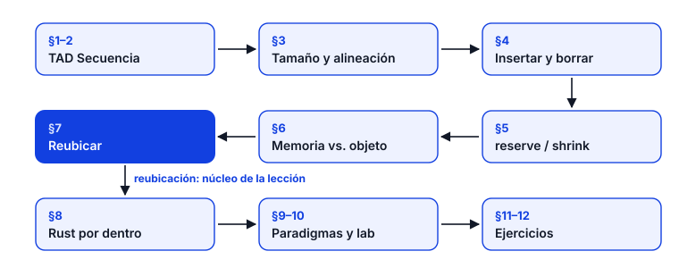
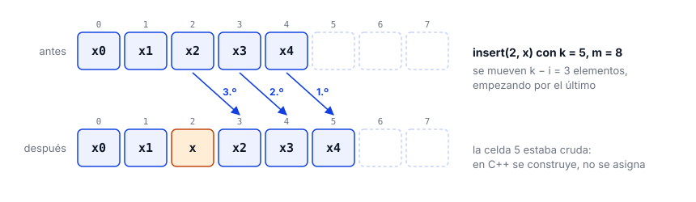

# Lección 2 — Memoria cruda y el TAD Secuencia: Vector

> **Prerrequisitos:** Lección 0 (§6 pisos y techos, §7 sumatorias, §9.2 probabilidad y linealidad de la esperanza, §11–12 memoria y los tres lenguajes) y Lección 1 completa (en especial §6 análisis amortizado y §7 invariante de representación).
>
> **Cómo estudiar esta lección:** la lección 1 te dio la herramienta (análisis amortizado); esta te pide usarla sobre una interfaz más rica y, sobre todo, **escribir código que maneja memoria sin red de seguridad**. Cada afirmación sobre memoria viene con un programa que puedes correr.
>
> **Lab asociado:** `lab02`: `Vector<T>` (C, C++ y Rust).

## Objetivos de aprendizaje

Al terminar esta lección deberías poder:
1. Especificar el **TAD Secuencia** y comparar sus implementaciones por costo de cada operación.
2. Explicar **tamaño, alineación y relleno** (*padding*) de un tipo, y calcular el *layout* de un arreglo.
3. Demostrar el costo de `insert`/`erase` en posición arbitraria, en el peor caso, en esperanza y amortizado, y explicar por qué `reserve` es seguro y `shrink_to_fit` es peligroso.
4. Distinguir **memoria reservada** de **objeto vivo**, y razonar sobre **invalidación** de punteros e iteradores.
5. Implementar la **reubicación** (*relocation*) de elementos con la garantía fuerte de excepciones (C++) o con seguridad ante `panic` (Rust), y justificar cada bloque `unsafe`.
6. Explicar qué son `NonNull<T>`, `PhantomData<T>` y los tipos de tamaño cero, y por qué Rust puede usar `realloc` donde C++ no.

## Mapa de la lección



---

## 1. Motivación: de la pila a la secuencia

En la lección 1 construimos una pila: solo se toca el **último** elemento. Casi todo programa real necesita más: leer el elemento $i$ (un búfer de texto, una tabla de un compilador, la fila de una matriz), insertar en medio (un editor), quitar de en medio (una lista de tareas). Esa interfaz se llama **secuencia** y es la estructura más usada de toda la programación: `std::vector`, `Vec`, `ArrayList`, `list` de Python.

La pregunta de la lección es doble:

- **Algorítmica:** ¿cuánto cuesta cada operación, y por qué no podemos tener todo en $O(1)$?
- **De ingeniería:** el arreglo dinámico de la lección 1 en Rust usaba `Option<T>` para no tocar memoria sin inicializar. Eso desperdicia espacio. `std::Vec` no lo hace. ¿Cómo se escribe un contenedor que maneja **memoria cruda** sin causar comportamiento indefinido?

---

## 2. El TAD Secuencia

### 2.1 Interfaz

Una **secuencia** representa una lista finita $\langle x_0, x_1, \dots, x_{n-1}\rangle$ en la que el **orden lo decide el usuario** (no se ordena por clave; eso será el TAD Conjunto, lección 7).

| Operación | Efecto |
|---|---|
| `len()` | $n$ |
| `get(i)` / `set(i, x)` | leer / reemplazar $x_i$, para $0\le i<n$ |
| `insert(i, x)` | $\langle x_0,\dots,x_{i-1}, x, x_i,\dots,x_{n-1}\rangle$, para $0\le i\le n$ |
| `erase(i)` | $\langle x_0,\dots,x_{i-1}, x_{i+1},\dots,x_{n-1}\rangle$, para $0\le i<n$; devuelve $x_i$ |
| `push_back(x)` / `pop_back()` | `insert(n, x)` / `erase(n-1)` |

### 2.2 Especificación

Igual que con la pila (L01 §4.2), fijamos el significado sin hablar de implementación. Con $S = \langle x_0,\dots,x_{n-1}\rangle$:

$$\mathsf{get}(\mathsf{insert}(S, i, x), j) = \begin{cases} \mathsf{get}(S, j) & j < i \\ x & j = i \\ \mathsf{get}(S, j-1) & j > i \end{cases}
\qquad
\mathsf{len}(\mathsf{insert}(S,i,x)) = \mathsf{len}(S)+1$$

y análogamente para `erase`. Estas ecuaciones son exactamente lo que comprueba el test aleatorio del lab (`vector_aleatorio_vs_std`): ejecuta la misma secuencia de operaciones en tu `Vector` y en un **oráculo** (`std::vector`, `Vec` o un arreglo de C manipulado a mano) y exige que coincidan.

### 2.3 Tres implementaciones, tres perfiles de costo

| Operación | Arreglo estático | Lista ligada (L03) | **Arreglo dinámico** |
|---|---|---|---|
| `get(i)`, `set(i,x)` | $O(1)$ | $O(i)$ | $O(1)$ |
| `insert(i,x)` / `erase(i)` | $\Theta(n)$ (reconstruye) | $O(i)$ | $O(n-i+1)$ + amortizado |
| `push_back` / `pop_back` | $\Theta(n)$ | $O(n)$, $O(1)$ con cola | $O(1)$ amortizado |
| `insert(0, x)` | $\Theta(n)$ | $O(1)$ | $\Theta(n)$ |

Ninguna gana en todo. El arreglo dinámico gana donde más importa en la práctica (acceso aleatorio y agregar al final) y además es **contiguo en memoria**, lo que lo hace mucho más rápido de lo que su tabla sugiere: el modelo RAM de L01 §2 trata todos los accesos igual, pero el hardware real no (§5.4).

> **Teorema (cota inferior informal).** Ninguna estructura que guarde los elementos en un arreglo contiguo, en el orden de la secuencia, puede hacer `insert(0, x)` en $o(n)$ en el peor caso: tras insertar, los $n$ elementos viejos deben ocupar posiciones distintas a las que ocupaban, y cada uno requiere al menos una escritura.

*Por qué.* Antes de insertar, el elemento $x_j$ está en la celda $j$, para $j=0,\dots,n-1$. Después de `insert(0, x)`, la especificación de §2.2 (caso $j>i$ con $i=0$) dice que $x_j$ es el elemento número $j+1$ de la secuencia; como el arreglo guarda la secuencia en orden, $x_j$ tiene que estar en la celda $j+1$. La celda $j+1$ no es la celda $j$, así que cada uno de los $n$ elementos viejos se tiene que escribir en una celda donde antes no estaba: al menos $n$ escrituras. Una operación que hace al menos $n$ escrituras no puede costar $o(n)$. (Es "informal" porque supone que el único modo de cambiar el contenido de una celda es escribir en ella, que es lo que hace el modelo RAM de L01 §2.)

Romper esa cota exige abandonar la contigüidad (listas, L03) o el orden físico (buffer circular, L04; árboles de secuencia, problem set).

---

## 3. Memoria: tamaño, alineación y *layout*

Para manejar memoria cruda hay que saber exactamente **cuántos bytes** ocupa un `T` y **dónde puede empezar**.

### 3.1 Definiciones

- **Tamaño** $s(T)$: bytes entre el inicio de un `T` y el inicio del siguiente en un arreglo (`sizeof`, `size_of`).
- **Alineación** $a(T)$: una potencia de 2; un `T` solo puede vivir en direcciones múltiplo de $a(T)$ (`alignof`, `align_of`). En la mayoría de las plataformas de 64 bits, $a(\texttt{int}) = 4$, $a(\texttt{double}) = 8$.
- **Invariante:** $a(T) \mid s(T)$ ("$a(T)$ divide a $s(T)$": el tamaño es múltiplo de la alineación). *Por qué tiene que ser así:* en un arreglo `T[2]` que empieza en $p$, el elemento 0 empieza en $p$ (múltiplo de $a(T)$) y el elemento 1 en $p+s(T)$. Para que $p+s(T)$ también sea múltiplo de $a(T)$, sabiendo que $p$ ya lo es, hace falta que $s(T)$ lo sea. *Con números:* si un `struct` con un `int` ($a=4$) midiera 5 bytes, con $p=0$ el segundo elemento empezaría en 5, que no es múltiplo de 4. Por eso el compilador agrega **relleno** al final de un `struct`.

**Layout de un `struct` con orden fijo (C, C++, `#[repr(C)]` en Rust).** Los campos se colocan en el orden declarado; cada uno en el primer desplazamiento múltiplo de su alineación; el tamaño total se redondea hacia arriba a un múltiplo de la mayor alineación.

$$\text{offset}_k = \Big\lceil \frac{\text{offset}_{k-1} + s_{k-1}}{a_k} \Big\rceil a_k,\qquad s(\texttt{struct}) = \Big\lceil \frac{\text{offset}_{\text{último}} + s_{\text{último}}}{a_{\max}} \Big\rceil a_{\max}.$$

**Cómo leer la fórmula.** $\text{offset}_{k-1}+s_{k-1}$ es el primer byte libre después del campo anterior (donde empieza, más lo que ocupa). Y $\lceil x/a\rceil\,a$ es el **menor múltiplo de $a$ que es $\ge x$**: $x/a$ dice cuántos bloques de $a$ bytes caben en $x$; redondear hacia arriba (L00 §6) da el menor número entero de bloques que cubren $x$; multiplicar por $a$ lo vuelve a convertir en bytes. *Con números:* $x=5$, $a=4$: $5/4=1.25$, $\lceil1.25\rceil=2$, $2\cdot4=8$, y en efecto 8 es el primer múltiplo de 4 que no es menor que 5. Si $x$ ya es múltiplo de $a$, no cambia: $\lceil8/4\rceil\cdot4=8$.

**Ejemplo.** `struct A { char a; int b; char c; }`, aplicando la fórmula campo por campo:

| Campo | $s$ | $a$ | primer byte libre | offset $=\lceil\text{libre}/a\rceil\,a$ | relleno antes |
|---|---|---|---|---|---|
| `a` | 1 | 1 | 0 (es el primero) | $\lceil0/1\rceil\cdot1=0$ | 0 |
| `b` | 4 | 4 | $0+1=1$ | $\lceil1/4\rceil\cdot4=4$ | 3 (bytes 1, 2, 3) |
| `c` | 1 | 1 | $4+4=8$ | $\lceil8/1\rceil\cdot1=8$ | 0 |
| total | | $a_{\max}=4$ | $8+1=9$ | $\lceil9/4\rceil\cdot4=12$ | 3 al final |

En cambio `struct B { int b; char a; char c; }`: `b` en 0; el primer libre es $0+4=4$ y `a` va en 4; luego $4+1=5$ y `c` va en 5; el fin es $5+1=6$ y $\lceil6/4\rceil\cdot4=8$. Ocupa $8$. **El orden de los campos cambia el tamaño.**

::: {.tabs}
```c
#include <stdalign.h>
#include <stddef.h>
#include <stdio.h>

struct A { char a; int b; char c; };
struct B { int b; char a; char c; };

int main(void) {
    printf("A: tamaño %zu, alineación %zu, offset de b %zu\n",
           sizeof(struct A), alignof(struct A), offsetof(struct A, b));
    printf("B: tamaño %zu, alineación %zu, offset de b %zu\n",
           sizeof(struct B), alignof(struct B), offsetof(struct B, b));
    printf("A[10]: %zu bytes\n", sizeof(struct A[10]));
    return 0;
}
```

```cpp
#include <cstddef>
#include <cstdio>

struct A { char a; int b; char c; };
struct B { int b; char a; char c; };

int main() {
    std::printf("A: tamaño %zu, alineación %zu, offset de b %zu\n",
                sizeof(A), alignof(A), offsetof(A, b));
    std::printf("B: tamaño %zu, alineación %zu, offset de b %zu\n",
                sizeof(B), alignof(B), offsetof(B, b));
    std::printf("A[10]: %zu bytes\n", sizeof(A[10]));
}
```

```rust
use std::mem::{align_of, offset_of, size_of};

#[repr(C)] // orden fijo, igual que en C
struct A { a: u8, b: i32, c: u8 }
#[repr(C)]
struct B { b: i32, a: u8, c: u8 }

fn main() {
    println!("A: tamaño {}, alineación {}, offset de b {}",
             size_of::<A>(), align_of::<A>(), offset_of!(A, b));
    println!("B: tamaño {}, alineación {}, offset de b {}",
             size_of::<B>(), align_of::<B>(), offset_of!(B, b));
    println!("A[10]: {} bytes", size_of::<[A; 10]>());
}
```
:::

```{.text .salida}
A: tamaño 12, alineación 4, offset de b 4
B: tamaño 8, alineación 4, offset de b 0
A[10]: 120 bytes
```

### 3.2 Rust reordena por ti

Sin `#[repr(C)]`, Rust **no promete** ningún orden de campos y en la práctica los reordena para minimizar el relleno. El mismo `A` ocupa 8 bytes:

::: {.tabs}
```rust
use std::alloc::Layout;
use std::mem::size_of;

struct A { a: u8, b: i32, c: u8 } // repr(Rust): el compilador elige el orden

fn main() {
    println!("A (repr Rust): tamaño {}", size_of::<A>());
    // Layout::array calcula n * size_of::<T>() y FALLA si desborda isize.
    println!("Layout::array::<u64>(10) = {:?} bytes", Layout::array::<u64>(10).map(|l| l.size()));
    println!("¿desborda con usize::MAX / 4? {}", Layout::array::<u64>(usize::MAX / 4).is_err());
}
```
:::

```{.text .salida}
A (repr Rust): tamaño 8
Layout::array::<u64>(10) = Ok(80) bytes
¿desborda con usize::MAX / 4? true
```

Esa última línea importa: en C, `malloc(n * sizeof(T))` con un `n` gigante **desborda silenciosamente** y reserva un bloque diminuto; las escrituras siguientes corrompen el heap. Es una vulnerabilidad real y frecuente (CWE-190). En la solución de C del lab verás `if (cap > SIZE_MAX / elem_size) return false;` antes de cada reserva. En Rust, `Layout::array` hace esa comprobación por ti.

### 3.3 El arreglo como función de direcciones

Un bloque que empieza en la dirección $p$ (alineada a $a(T)$) guarda el elemento $i$ en
$$\text{dir}(i) = p + i\cdot s(T).$$
Esto es lo que hace que `get(i)` sea $O(1)$ en el modelo RAM: una multiplicación y una suma. En C, con `unsigned char *data`, **tú** escribes `data + i * elem_size`; en C++ y Rust, la aritmética de punteros tipados (`data_ + i`, `ptr.add(i)`) multiplica por $s(T)$ automáticamente.

---

## 4. Costo de insertar y borrar en medio

### 4.1 El corrimiento

Para `insert(i, x)` en un bloque con espacio libre, los elementos $x_i, \dots, x_{n-1}$ deben moverse una posición a la derecha, **empezando por el último** (si empezaras por $x_i$ lo pisarías antes de moverlo). `erase(i)` mueve $x_{i+1},\dots,x_{n-1}$ una posición a la izquierda, empezando por el primero.



> **Lema 1.** Si hay espacio libre, `insert(i, x)` hace exactamente $n - i$ movimientos y una escritura; `erase(i)` hace exactamente $n - i - 1$ movimientos.

*Demostración.* Contamos qué celdas del arreglo tienen que cambiar de contenido. Antes de la operación, la celda $j$ guarda $x_j$ ($0\le j<n$). Después, la celda $j$ debe guardar $\mathsf{get}(S',j)$, donde $S'$ es la secuencia nueva que fija la especificación de §2.2. Comparamos celda por celda para `insert(i, x)`:

| Celdas | Antes | Después (§2.2) | Trabajo |
|---|---|---|---|
| $j<i$ | $x_j$ | $\mathsf{get}(S,j)=x_j$ | ninguno: ya está ahí |
| $j=i$ | $x_i$ (o libre, si $i=n$) | $x$ | 1 escritura |
| $i<j\le n$ | $x_j$ (o libre, si $j=n$) | $\mathsf{get}(S,j-1)=x_{j-1}$ | 1 movimiento cada una |

Las celdas de la última fila son $i+1,\,i+2,\,\dots,\,n$. ¿Cuántas son? Los enteros de $a$ a $b$ son $b-a+1$ (de 1 a 3 hay $3-1+1=3$), así que son $n-(i+1)+1=n-i$. Cada una recibe exactamente un movimiento, porque su contenido nuevo es distinto del viejo; y ninguna otra celda se toca. Total: exactamente $n-i$ movimientos y una escritura.

Para `erase(i)`, la secuencia nueva tiene $n-1$ elementos: $\mathsf{get}(S',j)=x_j$ si $j<i$, y $\mathsf{get}(S',j)=x_{j+1}$ si $i\le j\le n-2$. Las celdas $j<i$ no cambian; las celdas $i,\dots,n-2$ reciben un movimiento cada una, y son $(n-2)-i+1=n-i-1$. ($x_i$ se devuelve, no se escribe en el arreglo, y la celda $n-1$ queda fuera de la secuencia.)

*Con números* ($n=5$, $i=2$): `insert` escribe $x$ en la celda 2 y mueve a las celdas 3, 4, 5 los elementos $x_2,x_3,x_4$: $3=5-2$ movimientos ✓. `erase` llena las celdas 2 y 3 con $x_3,x_4$: $2=5-2-1$ ✓. $\blacksquare$

### 4.2 Peor caso, mejor caso y un patrón cuadrático

> **Teorema 2.** $n$ llamadas `insert(0, ·)` sobre una secuencia vacía hacen $\binom{n}{2} = \Theta(n^2)$ movimientos; $n$ llamadas `push_back` hacen 0 movimientos de corrimiento (y $<2n$ copias por realojamiento, L01 §6.4).

*Demostración.* *Parte 1: `insert(0, ·)`.* Numeramos las inserciones $k=0,1,\dots,n-1$. Antes de la inserción $k$ ya se hicieron $k$ inserciones, así que hay $k$ elementos: en el Lema 1 el tamaño es $k$ (hace el papel de $n$) y la posición es $i=0$, de modo que se mueven $k-0=k$ elementos. Sumando las $n$ inserciones:
$$\sum_{k=0}^{n-1}k=0+1+\dots+(n-1)=\frac{(n-1)\,n}{2},$$
que es la suma de Gauss (L00 §7.2) con $n-1$ en el lugar de $n$ (el término $k=0$ no aporta nada). Y $\binom n2=\frac{n(n-1)}{2}$ por definición (pares que se pueden formar con $n$ cosas). Como $\frac{n(n-1)}2=\frac{n^2}2-\frac n2$, el término dominante es $\frac{n^2}2$ y la suma es $\Theta(n^2)$ (L01 §3). *Con números* ($n=1000$): $\frac{1000\cdot999}{2}=499\,500$, exactamente lo que imprime el programa de abajo.

*Parte 2: `push_back`.* `push_back` con $k$ elementos es `insert(k, ·)`: la posición es $i=k$, y el Lema 1 da $k-k=0$ movimientos. Las copias por realojamiento son otra cuenta, ya hecha en L01 §6.4. $\blacksquare$

Insertar siempre **a la mitad**: la inserción $k$ (con $k$ elementos) va en la posición $i=\lfloor k/2\rfloor$ y, por el Lema 1, mueve $k-\lfloor k/2\rfloor$ elementos. Ese número es $\lceil k/2\rceil$, por casos: si $k=2j$ es par, $k-\lfloor k/2\rfloor=2j-j=j=\lceil k/2\rceil$; si $k=2j+1$ es impar, $\lfloor k/2\rfloor=j$ y $k-j=j+1=\lceil k/2\rceil$.

Para sumar $\sum_{k=0}^{n-1}\lceil k/2\rceil$ con $n$ par, juntamos cada par $k=2j$ con el impar que le sigue, $k=2j+1$. Juntos aportan $j+(j+1)=2j+1$, y $j$ recorre $0,1,\dots,n/2-1$ (el último par es $k=n-2$, que es $2j$ con $j=n/2-1$):
$$\sum_{k=0}^{n-1}\Big\lceil\frac k2\Big\rceil=\sum_{j=0}^{n/2-1}(2j+1)=2\cdot\frac{(n/2-1)(n/2)}{2}+\frac n2=\Big(\frac n2\Big)^2.$$
El segundo signo separa la suma en $2\sum j$ (Gauss hasta $n/2-1$) más $\sum 1$ ($n/2$ términos que valen 1). El tercero desarrolla: el 2 se cancela con el $\frac12$ y queda $(n/2)^2-n/2+n/2=(n/2)^2$. *Con números:* $n=4$: $0+1+1+2=4=2^2$ ✓; $n=1000$: $500^2=250\,000$, lo que imprime el programa.

Sigue siendo $\Theta(n^2)$: **la mitad de cuadrático sigue siendo cuadrático.** El programa lo cuenta:

::: {.tabs}
```c
#include <stdio.h>

#define N 1000
static int a[N];
static long movimientos;

/* Inserta x antes de la posición i en a[0..n): corre a la derecha desde el final. */
static void insertar(int n, int i, int x) {
    for (int j = n; j > i; j--) { a[j] = a[j - 1]; movimientos++; }
    a[i] = x;
}

static long experimento(int modo) {
    movimientos = 0;
    for (int k = 0; k < N; k++) insertar(k, modo == 0 ? 0 : modo == 1 ? k / 2 : k, k);
    return movimientos;
}

int main(void) {
    printf("al frente:  %ld movimientos\n", experimento(0));
    printf("a la mitad: %ld movimientos\n", experimento(1));
    printf("al final:   %ld movimientos\n", experimento(2));
    return 0;
}
```

```cpp
#include <cstdio>
#include <vector>

long movimientos = 0;

// Inserta x antes de la posición i en a[0..n): corre a la derecha desde el final.
void insertar(std::vector<int>& a, int n, int i, int x) {
    for (int j = n; j > i; --j) { a[j] = a[j - 1]; ++movimientos; }
    a[i] = x;
}

long experimento(int modo) {
    const int N = 1000;
    std::vector<int> a(N);
    movimientos = 0;
    for (int k = 0; k < N; ++k) insertar(a, k, modo == 0 ? 0 : modo == 1 ? k / 2 : k, k);
    return movimientos;
}

int main() {
    std::printf("al frente:  %ld movimientos\n", experimento(0));
    std::printf("a la mitad: %ld movimientos\n", experimento(1));
    std::printf("al final:   %ld movimientos\n", experimento(2));
}
```

```rust
const N: usize = 1000;

// Inserta x antes de la posición i en a[0..n): corre a la derecha desde el final.
fn insertar(a: &mut [i32], n: usize, i: usize, x: i32, movimientos: &mut u64) {
    for j in (i + 1..=n).rev() {
        a[j] = a[j - 1];
        *movimientos += 1;
    }
    a[i] = x;
}

fn experimento(modo: u8) -> u64 {
    let mut a = [0i32; N];
    let mut m = 0;
    for k in 0..N {
        let i = match modo { 0 => 0, 1 => k / 2, _ => k };
        insertar(&mut a, k, i, k as i32, &mut m);
    }
    m
}

fn main() {
    println!("al frente:  {} movimientos", experimento(0));
    println!("a la mitad: {} movimientos", experimento(1));
    println!("al final:   {} movimientos", experimento(2));
}
```
:::

```{.text .salida}
al frente:  499500 movimientos
a la mitad: 250000 movimientos
al final:   0 movimientos
```

### 4.3 Costo esperado con posición aleatoria

> **Teorema 3.** Si cada inserción elige su posición de manera uniforme e independiente entre las $k+1$ posibles, el número esperado de movimientos de $n$ inserciones desde la secuencia vacía es $n(n-1)/4$.

*Demostración.* Sea $M_k$ el número de movimientos de la inserción $k$ (con $k$ elementos presentes) e $I_k$ su posición, uniforme en $\{0,\dots,k\}$: cada una de las $k+1$ posiciones sale con probabilidad $\frac1{k+1}$. Por el Lema 1, con tamaño $k$ y posición $I_k$, $M_k = k - I_k$.

*Paso 1: una inserción.* La esperanza es el promedio ponderado por la probabilidad (L00 §9.2):
$$\mathbb{E}[I_k]=\sum_{i=0}^{k} i\cdot\frac{1}{k+1}=\frac{1}{k+1}\cdot\frac{k(k+1)}{2}=\frac k2.$$
El segundo signo saca el factor común $\frac1{k+1}$ y usa Gauss para $0+1+\dots+k$; el tercero cancela $k+1$ arriba y abajo. Como $k$ es un número fijo (no es aleatorio), la linealidad da $\mathbb{E}[k-I_k]=k-\mathbb{E}[I_k]$, así que $\mathbb{E}[M_k]=k-\frac k2=\frac k2$. *Con números* ($k=2$): $I_2\in\{0,1,2\}$ da $2,1,0$ movimientos; el promedio es $\frac{2+1+0}{3}=1=\frac22$ ✓.

*Paso 2: las $n$ inserciones.* Por **linealidad de la esperanza** (L00 §9.2), que no requiere independencia,
$$\mathbb{E}\Big[\sum_{k=0}^{n-1} M_k\Big]=\sum_{k=0}^{n-1}\mathbb{E}[M_k]=\sum_{k=0}^{n-1}\frac{k}{2}=\frac12\cdot\frac{(n-1)\,n}{2}=\frac{n(n-1)}{4}.$$
El tercer signo saca el $\frac12$ de la suma; lo que queda es Gauss hasta $n-1$, como en el Teorema 2. *Con números* ($n=3$): $0+\frac12+1=\frac32=\frac{3\cdot2}{4}$ ✓. $\blacksquare$

Observa que **esperado** ($n^2/4$, promedio sobre el azar de las entradas) y **amortizado** (garantía sobre toda secuencia, L01 §6.8) son conceptos distintos, y aquí ambos dan $\Theta(n^2)$ para $n$ inserciones en medio: no hay contabilidad que salve un corrimiento.

### 4.4 Análisis amortizado con `insert` y `erase` mezclados

Del L01 sabemos que $\Phi(D) = \max(0, 2k - m)$ (con $k$ = tamaño, $m$ = capacidad) demuestra `push_back` en $O(1)$ amortizado. ¿Sigue valiendo con `insert` y `erase` arbitrarios?

> **Teorema 4.** Con duplicación y sin contracción, y la misma $\Phi$, el costo amortizado de `insert(i, x)` es a lo más $(k - i) + 3$ y el de `erase(i)` a lo más $k - i$, donde $k$ es el tamaño antes de la operación.

*Demostración.* Contamos como costo cada escritura de un elemento (movimiento, copia o escritura del nuevo). Recuerda (L01 §6.4) que el costo amortizado es $\hat c=c+\Delta\Phi$, con $\Delta\Phi=\Phi_{\text{después}}-\Phi_{\text{antes}}$. En cada caso calculamos $c$, luego $\Delta\Phi$, y sumamos.

*Un hecho sobre $\max$ que usaremos dos veces.* Para cualquier número $y$ y cualquier $d\ge0$:

- $\max(0,y+d)\le\max(0,y)+d$. Si $y+d\le0$, el lado izquierdo es $0$, y $0\le\max(0,y)+d$ porque ambos sumandos son $\ge0$. Si no, el lado izquierdo es $y+d$, y $y+d\le\max(0,y)+d$ porque $y\le\max(0,y)$.
- $\max(0,y-d)\le\max(0,y)$. Los dos candidatos del máximo izquierdo no pasan de $\max(0,y)$: $0\le\max(0,y)$, y $y-d\le y\le\max(0,y)$.

*Caso 1: `insert` sin realojar* ($k<m$). Costo real: $c=(k-i)+1$ ($k-i$ movimientos y una escritura, Lema 1). Potencial: antes, $\Phi=\max(0,2k-m)$. Después el tamaño es $k+1$ y la capacidad sigue siendo $m$:
$$\Phi'=\max\big(0,\,2(k+1)-m\big)=\max\big(0,\,(2k-m)+2\big)\le\max(0,\,2k-m)+2,$$
por el primer hecho con $y=2k-m$ y $d=2$. Entonces $\Delta\Phi\le2$ y $\hat c\le(k-i)+1+2=(k-i)+3$.

*Caso 2: `insert` con realojamiento* ($k=m$). Costo real: se reserva un bloque de $2m$, se reubican los $k$ viejos y se escribe $x$. Si la reubicación deja cada elemento **ya en su posición final** (los de antes de $i$ en su lugar, los demás corridos uno, como hacen las soluciones de C y C++), el costo real es $c=k+1$; si primero se reubica y luego se corre (como la de Rust), es $c=k+(k-i)+1$. En ambos casos $c\le k+(k-i)+1$, porque $k-i\ge0$ (la posición cumple $i\le k$). Potencial: antes, como $m=k$, $\Phi=\max(0,2k-k)=\max(0,k)=k$. Después la capacidad es $2m=2k$ y el tamaño $k+1$, así que $\Phi'=\max\big(0,2(k+1)-2k\big)=\max(0,2)=2$. Entonces $\Delta\Phi=2-k$ y
$$\hat c\le\big(k+(k-i)+1\big)+(2-k)=(k-i)+3,$$
porque el $k$ de la reubicación se cancela con el $-k$ del potencial: **la caída del potencial paga la reubicación**. *Con números* ($k=m=8$, $i=3$, reubicando y luego corriendo): $c=8+5+1=14$; $\Phi$ pasa de 8 a 2, $\Delta\Phi=-6$; $\hat c=14-6=8=(8-3)+3$ ✓. (Caso borde $m=0$: la primera reserva no es de $2\cdot0$ sino de 1 elemento. Ahí $k=i=0$, $c=1$, $\Phi$ pasa de 0 a $\max(0,2\cdot1-1)=1$, y $\hat c=2\le3$.)

*Caso 3: `erase`.* Costo real: $c=k-i-1$ (Lema 1). Potencial: el tamaño baja a $k-1$ y $m$ no cambia:
$$\Phi'=\max\big(0,\,2(k-1)-m\big)=\max\big(0,\,(2k-m)-2\big)\le\max(0,\,2k-m),$$
por el segundo hecho con $d=2$. Entonces $\Delta\Phi\le0$ y $\hat c\le k-i-1\le k-i$.

*Por qué esto acota el costo real.* Sumando $\hat c_t=c_t+\Phi_t-\Phi_{t-1}$ sobre las operaciones $t=1,\dots,T$, los potenciales se cancelan en cadena (suma telescópica, L00 §7.6): $\sum_t\hat c_t=\sum_t c_t+\Phi_T-\Phi_0$. Como $\Phi_0=\max(0,0-0)=0$ (vector vacío) y $\Phi_T\ge0$ (es un máximo con 0), queda $\sum_t c_t\le\sum_t\hat c_t$. $\blacksquare$

En palabras: **el realojamiento sigue siendo gratis amortizado; lo único que cuesta es el corrimiento**, y ese no se amortiza.

---

## 5. `reserve`, `shrink_to_fit` y la interacción con el análisis

### 5.1 `reserve`: pagar por adelantado

`reserve(N)` garantiza $m \ge N$ y **nunca encoge**. Si realoja, cuesta $\Theta(k)$: no es $O(1)$ amortizado, y no pretende serlo.

> **Proposición 5.** Después de `reserve(N)`, las siguientes $N - k$ llamadas a `push_back` cuestan exactamente 1 cada una **en el peor caso** (no solo amortizado), y no invalidan ningún puntero.

*Demostración.* Sea $k_0$ el tamaño justo después de `reserve(N)`, y $m\ge N$ la capacidad. Numeramos los `push_back` $t=1,\dots,N-k_0$. Antes del `push_back` número $t$ ya se hicieron $t-1$, así que el tamaño es $k_0+t-1$. Como $t\le N-k_0$:
$$k_0+t-1\;\le\;k_0+(N-k_0)-1\;=\;N-1\;<\;N\;\le\;m.$$
Es decir, cada uno encuentra $k<m$: hay espacio y no realoja. Falta ver que $m$ no cambia por el camino: lo único que cambia $m$ es un realojamiento, así que, yendo en orden $t=1,2,\dots$ (inducción sobre $t$), si los anteriores no realojaron $m$ sigue igual y el $t$-ésimo tampoco realoja. Sin realojamiento, cada `push_back` es una escritura y el bloque no se mueve, así que ningún puntero se invalida. *Con números:* vector vacío y `reserve(100)` con $m=100$: los `push_back` 1 a 100 encuentran tamaños $0,\dots,99$, todos $<100$; el 101 encuentra tamaño $100=m$ y realoja. $\blacksquare$

Úsalo cuando conoces el tamaño final: ahorra $\approx 2N$ copias y $\lg N$ reservas, y vuelve predecible la latencia (importante en sistemas de tiempo real, donde un `push_back` ocasional de $\Theta(n)$ es inaceptable aunque el promedio sea bueno).

### 5.2 `shrink_to_fit`: el adversario

`shrink_to_fit()` deja $m = k$. Parece inofensivo; no lo es.

> **Proposición 6.** La secuencia `(push_back; shrink_to_fit)` repetida $n$ veces cuesta $\Theta(n^2)$.

*Demostración.* Numeramos las vueltas $t=0,1,\dots,n-1$. Antes de la vuelta $t$ hay $t$ elementos y, por el `shrink_to_fit` de la vuelta anterior, capacidad $m=t$ (en la vuelta 0, el vector vacío tiene $m=0$). El `push_back` encuentra $k=m=t$: realoja, copia los $t$ elementos y escribe el nuevo, $t+1$ escrituras. Después, `shrink_to_fit` deja $m=t+1$, copiando a lo más los $t+1$ elementos.

*Cota inferior:* contando solo las copias de los `push_back`, $\sum_{t=0}^{n-1}t=\frac{n(n-1)}{2}$ (Gauss, como en el Teorema 2), que es $\Omega(n^2)$.

*Cota superior:* la vuelta $t$ cuesta a lo más $(t+1)+(t+1)\le 2n$, porque $t\le n-1$. Con $n$ vueltas, el total es $\le2n^2=O(n^2)$.

Las dos cotas juntas dan $\Theta(n^2)$. *Con números* ($n=4$): los `push_back` copian $0+1+2+3=6=\frac{4\cdot3}{2}$ elementos. $\blacksquare$

Esto viola la intuición de L01, y el potencial $\Phi=\max(0,2k-m)$ dice exactamente por qué. Justo después de duplicar, $m=2k$ y $\Phi=\max(0,2k-2k)=0$. Si ahora `shrink_to_fit` baja $m$ a $k$, el potencial pasa a $\max(0,2k-k)=k$: **sube** $k$ unidades sin que el usuario haya pagado por ellas. El costo amortizado de ese `shrink_to_fit` es su costo real ($k$ copias) más $\Delta\Phi=k$: $\Theta(k)$, no $O(1)$. Por eso `std::vector::shrink_to_fit` está especificada como una **petición no vinculante** y por eso `Vec::shrink_to_fit` documenta que puede realojar: son operaciones de $\Theta(k)$ que el usuario debe invocar con conocimiento de causa (típicamente una sola vez, cuando el contenedor deja de crecer).

### 5.3 Contracción automática

La solución robusta a la memoria desperdiciada es la contracción a $m/2$ cuando $k = m/4$ que analizaste en el Problem Set 1 (ej. 2). El lab02, como `std::vector` y `Vec`, **no** contrae automáticamente: prefiere que el usuario decida.

### 5.4 Por qué el arreglo gana en la práctica

El modelo RAM cobra igual cada acceso. El hardware no: un acceso a memoria principal cuesta del orden de 100 ns; uno a caché L1, alrededor de 1 ns. Los procesadores traen memoria en **líneas** de 64 bytes y adivinan accesos secuenciales. Un recorrido de un arreglo contiguo aprovecha ambas cosas; uno de una lista ligada (L03), cuyos nodos están dispersos, no. Es habitual que recorrer un `Vec<i64>` sea un orden de magnitud más rápido que recorrer una lista con el mismo número de elementos, aunque ambos sean $\Theta(n)$. El modelo asintótico es correcto, pero esconde constantes que a veces deciden.

---

## 6. Memoria reservada no es lo mismo que objeto vivo

### 6.1 Los cuatro estados de una celda

Cada celda del bloque de un `Vector` está en uno de estos estados:

| Estado | Contiene | Se puede |
|---|---|---|
| no reservada | — | nada |
| reservada, **cruda** | bytes basura | construir un objeto (`construct_at`, `ptr::write`) |
| **viva** | un objeto válido | leer, asignar, destruir |
| destruida | bytes basura | volver a construir, o liberar el bloque |

El **invariante de representación** del lab es exactamente una afirmación sobre estos estados:
$$\text{celdas } [0, k)\ \text{vivas},\qquad \text{celdas } [k, m)\ \text{crudas},\qquad k\le m.$$

Las operaciones válidas sobre cada estado son distintas en cada lenguaje:

| | crear objeto en celda cruda | destruir sin liberar | mover bit a bit |
|---|---|---|---|
| **C** | `memcpy` (no hay constructores) | nada que hacer | `memcpy`, `memmove`, `realloc` |
| **C++** | `std::construct_at(p, args...)` | `std::destroy_at(p)` | solo si `T` es *trivially copyable* |
| **Rust** | `ptr::write(p, x)` | `ptr::drop_in_place(p)` | **siempre** (`ptr::copy`, `realloc`) |

La última columna es la diferencia más profunda entre C++ y Rust en esta lección (§7.2).

### 6.2 Invalidación

Si `push_back` realoja, el bloque viejo se libera, y **todo puntero, referencia o iterador a un elemento queda colgante**. Usarlo es comportamiento indefinido (UB).

::: {.tabs .no-compare}
```{.c .no-ejecutar}
#include <stdio.h>
#include <stdlib.h>

int main(void) {
    int *v = malloc(1 * sizeof *v);
    if (v == NULL) return 1;
    v[0] = 42;
    int *p = &v[0];                       /* puntero a un elemento */
    int *w = realloc(v, 1000 * sizeof *w); /* puede mover el bloque */
    if (w == NULL) { free(v); return 1; }
    printf("%d\n", *p);                    /* UB si se movió: p apunta al bloque viejo */
    free(w);
    return 0;
}
```

```{.cpp .no-ejecutar}
#include <cstdio>
#include <vector>

int main() {
    std::vector<int> v{42};
    int& r = v[0];               // referencia a un elemento
    for (int i = 0; i < 1000; ++i) v.push_back(i);  // realoja
    std::printf("%d\n", r);      // UB: r apunta al bloque liberado
}
```

```{.rust .no-compila}
fn main() {
    let mut v = vec![42];
    let r = &v[0];        // préstamo inmutable de v
    for i in 0..1000 {
        v.push(i);        // ERROR: préstamo mutable mientras `r` vive
    }
    println!("{r}");
}
```
:::

En C y C++ el programa compila y, con suerte, AddressSanitizer lo detecta en ejecución (`heap-use-after-free`). En Rust **no compila**: el préstamo `r` vive hasta el `println!`, y `push` necesita `&mut v`. La regla "un `&mut` o varios `&`, nunca ambos" (L00 §11.3 y §12) es exactamente la regla de invalidación de `std::vector`, verificada por el compilador.

### 6.3 Aliasing al insertar

Una variante sutil de la invalidación: `v.insert(0, v[0])` (C++) o `vector_insert(v, 0, vector_get(v, 0))` (C) pasan una **referencia a un elemento del propio bloque**. Hay dos formas de romperlo:

1. **Con realojamiento:** si liberas el bloque viejo antes de copiar `x`, lees memoria liberada. Regla de L01: construye primero el nuevo elemento en el bloque nuevo.
2. **Sin realojamiento:** el corrimiento **mueve** el objeto al que apunta `x`. Si `x` apuntaba a $x_j$ con $j \ge i$, después del corrimiento esa celda contiene $x_{j-1}$ (o un objeto *movido*, vacío). Insertarías el valor equivocado.

Cada lenguaje lo resuelve distinto:

- **C++** (solución de referencia): hacer una copia local `T tmp(x)` **antes** del corrimiento. Cuesta una copia extra, pero es simple y correcto para todo `T`.
- **C**: el elemento es un bloque de `elem_size` bytes y no queremos un `malloc` por inserción. La solución detecta el alias comparando direcciones y, si `x` está en $[i, k)$, sabe que tras el `memmove` estará `elem_size` bytes más adelante. La comparación `<` entre punteros a objetos distintos es UB en C; por eso se comparan como enteros (`uintptr_t`), que es comportamiento *definido por la implementación* y funciona en todas las plataformas planas.
- **Rust**: el problema no existe. `insert(i, x: T)` recibe `x` **por valor**: `v.insert(0, v[0])` compila solo si `T: Copy` (y entonces la copia se hace antes de la llamada), y `v.insert(0, v[0].clone())` clona antes de la llamada. No hay forma de pasar una referencia al interior del vector a un método que lo muta.

El lab tiene tests para ambos casos (`vector_insert_alias` con realojamiento y `vector_insert_alias_sin_realojar` sin él).

---

## 7. Reubicar elementos

Al crecer (y en `reserve` y `shrink_to_fit`) hay que **reubicar** los $k$ elementos vivos del bloque viejo al nuevo. Es la operación central del lab y es donde los tres lenguajes difieren más.

### 7.1 C++: reubicar es construir y destruir

En C++ un objeto puede guardar **un puntero a sí mismo**. La implementación de `std::string` de libstdc++ lo hace: para cadenas cortas guarda los caracteres en un búfer interno y un puntero a ese búfer. Copiar sus bytes a otra dirección produce un objeto cuyo puntero apunta al **original**:

::: {.tabs}
```c
#include <stdio.h>
#include <stdlib.h>
#include <string.h>

/* Como el "small string" de libstdc++: un búfer interno y un puntero a él. */
typedef struct { char buf[8]; char *p; } Cadena;

int main(void) {
    Cadena s;
    strcpy(s.buf, "hola");
    s.p = s.buf;
    printf("original: p apunta a su propio buf = %d\n", s.p == s.buf);

    Cadena *t = malloc(sizeof *t);
    if (t == NULL) return 1;
    memcpy(t, &s, sizeof s);                       /* reubicación bit a bit */
    printf("copia:    p apunta a su propio buf = %d\n", t->p == t->buf);
    printf("copia:    p apunta al buf del original = %d\n", t->p == s.buf);
    free(t);
    return 0;
}
```

```cpp
#include <cstdio>
#include <cstring>
#include <memory>

// Trivialmente copiable (solo un arreglo y un puntero): memcpy es legal,
// pero NO preserva el significado del objeto.
struct Cadena { char buf[8]; char* p; };

int main() {
    Cadena s;
    std::strcpy(s.buf, "hola");
    s.p = s.buf;
    std::printf("original: p apunta a su propio buf = %d\n", s.p == s.buf);

    auto t = std::make_unique<Cadena>();
    std::memcpy(t.get(), &s, sizeof s);           // reubicación bit a bit
    std::printf("copia:    p apunta a su propio buf = %d\n", t->p == t->buf);
    std::printf("copia:    p apunta al buf del original = %d\n", t->p == s.buf);
}
```

```rust
// En Rust, mover SIEMPRE es copiar bits. Un struct que apunta a sí mismo
// solo se puede construir con punteros crudos, y moverlo lo rompe igual.
struct Cadena {
    buf: [u8; 8],
    p: *const u8,
}

fn main() {
    let mut s = Cadena { buf: *b"hola\0\0\0\0", p: std::ptr::null() };
    s.p = s.buf.as_ptr();
    let viejo = s.buf.as_ptr();
    println!("original: p apunta a su propio buf = {}", (s.p == s.buf.as_ptr()) as i32);

    let t = Box::new(s); // movimiento = memcpy al heap
    println!("copia:    p apunta a su propio buf = {}", (t.p == t.buf.as_ptr()) as i32);
    println!("copia:    p apunta al buf del original = {}", (t.p == viejo) as i32);
}
```
:::

```{.text .salida}
original: p apunta a su propio buf = 1
copia:    p apunta a su propio buf = 0
copia:    p apunta al buf del original = 1
```

Por eso C++ **no puede** usar `realloc` ni `memcpy` para reubicar un `T` arbitrario: tiene que **construir** cada elemento en el bloque nuevo (con su constructor de movimiento o de copia, que corrige el puntero interno) y **destruir** el viejo. Son $k$ llamadas a funciones definidas por el usuario, y cualquiera puede lanzar una excepción.

### 7.2 Rust: todo tipo se puede mover con `memcpy`

Rust toma la decisión opuesta: **no existen los constructores de movimiento**. Mover un valor es, por definición del lenguaje, copiar sus bytes y olvidar el original. Un tipo que se rompería al moverse (como el `Cadena` de arriba) solo se puede escribir con punteros crudos y `unsafe`, y el lenguaje ofrece `Pin` para prometer que no se moverá.

Consecuencia práctica: en Rust, **`realloc` es una reubicación válida para todo `T`**. La solución de referencia la usa en `realloc_to`, y también `ptr::copy` (un `memmove`) para el corrimiento de `insert`/`remove`. No se ejecuta ningún código del usuario durante la reubicación, así que no hay nada que pueda fallar a la mitad.

### 7.3 La garantía fuerte en C++

Recuerda los tres niveles de Abrahams (L01 §7.3). Queremos que `push_back`, `reserve` e `insert` al final den la **garantía fuerte**: si lanzan, el vector queda exactamente como estaba.

**Algoritmo** (`relocate_into` en la solución de referencia):
1. Reservar el bloque nuevo `nd`. Si falla, lanza y nada cambió.
2. Construir en `nd` el elemento nuevo (si lo hay). Si lanza, liberar `nd` y relanzar.
3. Para $j = 0, \dots, k-1$: construir `nd[j']` a partir de `std::move_if_noexcept(data_[j])`. Si la construcción $j$ lanza: destruir los $j$ objetos ya construidos en `nd` y el elemento nuevo, liberar `nd` y relanzar.
4. *Punto de compromiso:* destruir los $k$ objetos viejos, liberar el bloque viejo, y solo entonces `data_ = nd`.

> **Proposición 7.** Si el constructor de movimiento de `T` es `noexcept` o `T` es copiable, el algoritmo da la garantía fuerte.

*Demostración.* Dividimos en dos casos según lo que elige `move_if_noexcept`.

*(a) Mover es `noexcept`:* el paso 3 no puede lanzar. Las únicas excepciones posibles están en los pasos 1 y 2, antes de tocar `data_`.

*(b) Mover puede lanzar:* `move_if_noexcept` devuelve una referencia a `const` y se **copia**. Copiar no modifica el original, así que mientras el paso 3 avanza, las celdas $[0,k)$ de `data_` siguen intactas. Si la copia $j$ lanza, el paso de limpieza destruye exactamente los objetos construidos en `nd` (los $j$ copiados y el nuevo) y libera `nd`: el estado observable (`data_`, `size_`, `cap_` y los valores) es el de antes.

En ambos casos, el paso 4 solo contiene operaciones que no lanzan (destructores, que en C++ son `noexcept` por defecto, y `deallocate`). $\blacksquare$

¿Por qué no basta con mover siempre? Si un movimiento lanza a la mitad, los primeros $j$ objetos viejos **ya fueron movidos** (vaciados): no hay vuelta atrás. Este es el motivo de que `std::vector` copie en lugar de mover si tu constructor de movimiento no es `noexcept`, y es un problema de rendimiento real: **declara `noexcept` tus constructores de movimiento**. El test `vector_garantia_fuerte` usa un tipo `Bomba` con movimiento sin `noexcept` y una copia que lanza a propósito.

`insert` en medio solo da la **garantía básica**, igual que `std::vector`: el corrimiento usa asignaciones por movimiento sobre objetos vivos, y si una lanza a la mitad, algunos elementos ya cambiaron de lugar. El vector queda válido (sin fugas, invariante intacto), pero con un contenido distinto.

### 7.4 Rust: seguridad ante `panic`

Rust no tiene excepciones, pero sí `panic!`, que **desenrolla la pila** ejecutando los `Drop` de los valores vivos, y que el programa puede atrapar con `catch_unwind`. Un contenedor con `unsafe` debe garantizar que un `panic` en código del usuario (un `clone`, un `drop`, un comparador) **nunca** deje al contenedor en un estado que viole su invariante, porque ese estado se observaría desde código seguro. Esto se llama *panic safety* o *exception safety* (Rustonomicon, cap. 7).

Dos lugares del lab02 donde importa:

- **`clear`** (y por tanto `Drop`): la solución pone `len = 0` **antes** de destruir los elementos. Si el `drop` del elemento 5 hace `panic`, el desenrollado no vuelve a destruir los elementos 0–4: a lo más se **fugan** los 6–$(k-1)$. Una fuga es segura en Rust (`mem::forget` es una función segura); un doble `drop` es UB. Esta técnica se llama **amplificación de fugas** (*leak amplification*).
- **`Clone`**: la solución construye el clon con `push` sobre un `Vector` nuevo. Si el `clone` del elemento 7 hace `panic`, ese `Vector` parcial es un valor normal con un invariante válido ($k = 7$), y el desenrollado lo destruye como a cualquier otro. El test `vector_clone_con_panic_sin_fugas` lo verifica contando referencias de un `Rc`.

**Regla general:** dentro de una función `unsafe`, actualiza `len` de modo que, en todo punto donde se pueda ejecutar código del usuario, `[0, len)` sean exactamente las celdas vivas.

---

## 8. Rust por dentro: lo que necesitas para escribir `Vec`

### 8.1 `NonNull<T>`

Un `*mut T` puede ser nulo y es **invariante** en `T`. `NonNull<T>` es un `*mut T` que promete no ser nulo y es **covariante** en `T`, como `Box<T>` y `Vec<T>`. Dos consecuencias:

- **Optimización de nicho:** como el puntero nunca es 0, `Option<Vector<T>>` ocupa lo mismo que `Vector<T>` (el `None` se codifica con el 0).
- **Varianza:** un `Vector<&'static str>` se puede usar donde se espera un `Vector<&'a str>`, igual que con `Vec`. Con `*mut T` no se podría.

Cuando $m = 0$ (o `T` es de tamaño cero) no hay bloque, y se usa `NonNull::dangling()`: un puntero no nulo, bien alineado, que **no se puede desreferenciar**. Es válido para crear slices vacíos (`from_raw_parts(dangling, 0)`), que es justo lo que necesita `as_slice()` sobre un vector vacío.

### 8.2 `PhantomData<T>`

`Vector<T>` guarda `NonNull<T>`, que para el compilador es solo un puntero: no dice que el vector **posee** valores `T`. `PhantomData<T>` es un campo de tamaño cero que dice "este tipo se comporta como si contuviera un `T`". Importa para el **drop check**: el compilador debe saber que destruir un `Vector<T>` puede destruir valores `T`, para impedir que `T` contenga referencias que mueran antes que el vector. (`std::Vec` además usa el atributo inestable `#[may_dangle]` para relajar esto; el lab no lo necesita.)

### 8.3 Tipos de tamaño cero (ZST)

`()`, `struct Vacia;` o `[u8; 0]` ocupan **0 bytes** en Rust. Un `Vector<()>` no necesita memoria: puede "guardar" `usize::MAX` elementos con un puntero colgante. La solución trata este caso con la constante `IS_ZST`: `capacity()` devuelve `usize::MAX`, `push` nunca realoja, y `ptr::write`/`ptr::read` sobre un puntero colgante bien alineado de un ZST son válidos (leen y escriben 0 bytes). Pedir a `alloc` un bloque de 0 bytes, en cambio, es UB: por eso `realloc_to` nunca se llama con ZST.

En C++ no existen: todo objeto ocupa al menos un byte, para que dos objetos distintos tengan direcciones distintas. En C, un `struct` vacío ni siquiera es válido en C17. Por eso el API de C del lab rechaza `elem_size == 0`.

::: {.tabs .no-compare}
```cpp
#include <cstdio>
#include <vector>

struct Vacia {};

int main() {
    std::printf("sizeof(Vacia) = %zu\n", sizeof(Vacia));
    std::printf("sizeof(Vacia[1000]) = %zu\n", sizeof(Vacia[1000]));
    std::vector<Vacia> v(1000);
    std::printf("capacidad tras 1000 elementos: %zu\n", v.capacity());
}
```

```rust
use std::mem::size_of;

struct Vacia;

fn main() {
    println!("size_of::<Vacia>() = {}", size_of::<Vacia>());
    println!("size_of::<[Vacia; 1000]>() = {}", size_of::<[Vacia; 1000]>());
    let v: Vec<Vacia> = (0..1000).map(|_| Vacia).collect();
    println!("capacidad tras 1000 elementos: {}", v.capacity());
}
```
:::

```{.text .salida}
(C++)  sizeof(Vacia) = 1, sizeof(Vacia[1000]) = 1000, capacidad = 1000
(Rust) size_of::<Vacia>() = 0, size_of::<[Vacia; 1000]>() = 0, capacidad = 18446744073709551615
```

### 8.4 `// SAFETY:` y Miri

Cada bloque `unsafe` de la solución lleva un comentario `// SAFETY:` que enuncia **qué precondición exige** la operación (`ptr::write` exige un puntero válido para escritura y alineado; `from_raw_parts` exige `len` elementos inicializados…) y **por qué se cumple**, casi siempre citando el invariante de representación. Es la versión en código de "demostrar que la operación preserva el invariante" (L01 §7.1).

El compilador no verifica esos comentarios. **Miri**, un intérprete del lenguaje intermedio de Rust, sí detecta en ejecución la mayoría de las formas de UB: lecturas de memoria sin inicializar, accesos fuera del bloque, uso después de liberar, violaciones de las reglas de préstamo en punteros crudos. Correr los tests del lab bajo Miri es la versión Rust de AddressSanitizer + UBSan:

```bash
rustup +nightly component add miri
cd rust && cargo +nightly miri test --test lab02
```

### 8.5 C: genericidad con `void *`

El `Vector` de C es genérico al estilo de `qsort`: guarda `elem_size` y trata los elementos como bloques de bytes. No hay constructores, así que todo elemento es *trivially copyable* por definición y `realloc`, `memcpy` y `memmove` son reubicaciones válidas (con la excepción del aliasing, §6.3). El precio es que el compilador no verifica tipos: `vector_get` devuelve `void *` y el usuario hace el cast.

---

## 9. Resumen de paradigmas en este lab

| Aspecto | C | C++ | Rust |
|---|---|---|---|
| Memoria cruda | `malloc`/`realloc` de bytes | `std::allocator<T>` | `std::alloc` + `Layout` |
| Crear un elemento | `memcpy` | `std::construct_at` | `ptr::write` |
| Reubicar al crecer | `realloc` (si no hay alias) | construir + destruir uno por uno | `realloc` (siempre válido) |
| Corrimiento | `memmove` | `std::move_backward` + asignación | `ptr::copy` (memmove) |
| Fallo a la mitad | no hay (todo es `memcpy`) | garantía fuerte con `move_if_noexcept` | sin código de usuario: nada que falle |
| Invalidación | UB, la detecta ASan | UB, la detecta ASan | error de compilación |
| Alias en `insert` | comparar direcciones (`uintptr_t`) | copia local antes del corrimiento | imposible: `x` llega por valor |
| Tamaño cero | prohibido (`elem_size > 0`) | no existe | `capacity() == usize::MAX` |
| Desbordamiento de tamaño | `SIZE_MAX / elem_size` a mano | `allocator` lanza `bad_array_new_length` | `Layout::array` devuelve `Err` |
| Quién verifica | tú + ASan/UBSan | tú + ASan/UBSan | compilador fuera de `unsafe`; Miri dentro |

---

## 10. Guía del Lab 02

**Archivos:** `c/src/lab02/vector.c` (API en `c/include/algolib/lab02/vector.h`), `cpp/include/algolib/lab02/vector.hpp` y `rust/src/lab02/mod.rs`.

**Orden sugerido (C):**
1. `vector_new` (rechaza `elem_size == 0`), `vector_free` (acepta `NULL`), los consultores (`size`, `capacity`, `get`, `data`).
2. Una función privada que cambie la capacidad a exactamente $N$ con `realloc`, comprobando `N > SIZE_MAX / elem_size`. Con ella salen `reserve` y `shrink_to_fit`.
3. `vector_insert`, que te da `push_back` gratis como `insert(v, size, x)`. Distingue el caso con realojamiento (bloque nuevo con `malloc`, el nuevo elemento primero) del caso sin él (`memmove` + cuidado con el alias).
4. `vector_erase`, que te da `pop_back`.

**Orden sugerido (C++):** destructor y `clear` → constructor de copia y de movimiento (calca tu `ArrayStack`) → `operator[]`, `at`, `front`, `back` → `emplace_back` → una función privada de reubicación con la garantía fuerte, que reutilizarás en `reserve`, `shrink_to_fit` e `insert` → `insert` sin realojar (copia local primero) → `erase` → constructor con `initializer_list`.

**Orden sugerido (Rust):** `new`, `len`, `capacity` (con el caso ZST) → `as_slice`/`as_mut_slice` (con eso funcionan `v[i]`, `iter()`, `sort()`) → una función privada que realoje a exactamente $N$ con `alloc`/`realloc`/`dealloc` → `push`/`pop` → `reserve`/`shrink_to_fit`/`with_capacity` → `insert`/`remove` con `ptr::copy` → `clear` y `Drop` → `Clone`. Escribe el `// SAFETY:` **antes** que el bloque `unsafe`.

**Errores frecuentes:**
- En C, `memcpy` para el corrimiento: las regiones se solapan, hay que usar `memmove`.
- En C, usar `realloc` en `insert` cuando el bloque está lleno: si `x` apunta dentro del bloque, `realloc` puede liberarlo antes de que lo copies.
- En C++, `memcpy`/`memmove` sobre `T` no trivial (con `std::string` es UB y ASan suele detectarlo).
- En C++, olvidar que `insert` sin realojar debe **construir** la última celda (estaba cruda) y **asignar** las demás (estaban vivas): `construct_at(data_+k, std::move(data_[k-1]))` y luego `move_backward`.
- En Rust, llamar `alloc` con un `Layout` de tamaño 0 (cuando `cap == 0` o `T` es ZST): es UB.
- En Rust, `dealloc` con un `Layout` distinto al de la reserva.
- En Rust, aumentar `len` **antes** de `ptr::write` y que algo entre ambos pueda hacer `panic`.

Cuando todo pase, corre también `make c-fugas-lab02` (fugas en C) y Miri (§8.4).

---

## 11. Comprueba tu comprensión

1. ¿Cuánto ocupa `struct { double d; char c; }`? ¿Y un arreglo de 10?
2. Tras `v.reserve(100)` con `v` vacío, ¿cuántas reservas de memoria hacen los siguientes 100 `push_back`? ¿Y los siguientes 101?
3. ¿Por qué `erase` no necesita el cuidado de aliasing que necesita `insert`?
4. ¿Qué devolvería `capacity()` de un `Vector<()>` si no tratáramos el caso ZST, y qué pasaría al primer `push`?
5. En la solución de Rust, `clear` baja `len` a 0 antes de destruir. ¿Qué pasaría si lo hiciera después y un `drop` hiciera `panic`?
6. ¿Por qué `std::vector<std::string>` puede usar movimiento al crecer, pero un `std::vector<T>` cuyo `T` tiene un constructor de movimiento sin `noexcept` copia?

<details><summary>Respuestas</summary>

1. 16 bytes. `d` va en 0 y ocupa los bytes 0–7; el primer byte libre es 8, y `c` (alineación 1) va ahí; el fin es $8+1=9$, y se redondea al múltiplo de $a_{\max}=8$: $\lceil9/8\rceil\cdot8=16$. El arreglo de 10 ocupa $10\cdot16=160$, porque $s(T)$ ya incluye el relleno del final (§3.1).
2. Ninguna (Proposición 5: antes de cada uno el tamaño es $0,\dots,99$, siempre menor que $100\le m$). El 101 encuentra tamaño $100$; si la capacidad era exactamente 100, realoja una vez, a capacidad 200.
3. Porque `erase` no recibe un elemento: el valor que devuelve se copia **antes** del corrimiento, y nada externo apunta a una celda que se vaya a sobrescribir.
4. Devolvería 0 y el primer `push` intentaría `alloc` con un `Layout` de 0 bytes: UB.
5. El desenrollado ejecutaría `Drop for Vector`, que llamaría `clear` otra vez y destruiría de nuevo los elementos ya destruidos: doble `drop`, UB.
6. El constructor de movimiento de `std::string` es `noexcept`, así que `move_if_noexcept` mueve. Si no lo es, mover podría lanzar a la mitad y romper la garantía fuerte (§7.3), así que copia.
</details>

---

## 12. Problem Set 2

**Teoría**
1. Demuestra la fórmula de *layout* de §3.1: que con esos desplazamientos todo campo queda alineado en **todo** elemento de un arreglo del `struct`, y que el orden de campos por alineación decreciente minimiza el tamaño.
2. Una secuencia mezcla `push_back` y `erase(0)` ($n$ de cada una, en cualquier orden válido). Da una cota ajustada del costo total en el peor caso y demuéstrala.
3. Diseña un potencial que demuestre que, con contracción a $m/2$ cuando $k = m/4$, `insert` y `erase` en posición arbitraria cuestan $O(k - i + 1)$ amortizado.
4. **Buffer de hueco** (*gap buffer*, lo que usan los editores de texto): un arreglo con un hueco de celdas libres en la posición del cursor. Mover el cursor $d$ posiciones cuesta $O(d)$; insertar en el cursor cuesta $O(1)$ amortizado. Especifica el invariante, demuestra ambas cotas y compara con `Vector` para un patrón de edición "teclear 1000 caracteres en la posición 10".
5. Demuestra que `std::move_if_noexcept` no es suficiente para dar la garantía fuerte en `insert` **en medio** sin realojar, construyendo una secuencia concreta de excepciones que deje el vector con un contenido distinto.

**Implementación (C, C++ y Rust)**

6. Agrega `insert_range(i, a, b)` que inserte $n$ elementos en la posición $i$ con **un solo** corrimiento de $k - i$ elementos (no $n$ corrimientos). Demuestra que cuesta $O(k - i + n)$ más amortizado y escribe un test que lo compruebe contando movimientos.
7. Agrega `retain(pred)` (`erase_if` en C++): borra todos los elementos que no cumplen `pred` en $O(k)$ total, preservando el orden. En Rust, hazlo seguro ante `panic` de `pred`.
8. En C++, agrega iteradores propios (en vez de punteros crudos) que en modo depuración detecten el uso tras invalidación, guardando un "número de generación" que cambia en cada realojamiento.
9. En Rust, implementa `IntoIterator` por valor (`vector::IntoIter<T>`) con `Drop` correcto si el iterador no se consume completo, y verifícalo con Miri.

---

## Referencias
- CLRS, *Introduction to Algorithms*, 4ª ed.: Cap. 16.4 (tablas dinámicas).
- MIT 6.006 (Spring 2020), Lecture 2: *Data Structures and Dynamic Arrays* (interfaz de secuencia).
- The Rustonomicon, cap. 9: *Implementing Vec*; cap. 7: *Unwinding / Exception Safety*.
- Abrahams, D. (2000). *Exception-Safety in Generic Components*.
- Stroustrup, B. *The C++ Programming Language*, 4ª ed., §13 (garantías de excepción) y §31.3 (`vector`).
- Drepper, U. (2007). *What Every Programmer Should Know About Memory* (caché y localidad, §5.4).
