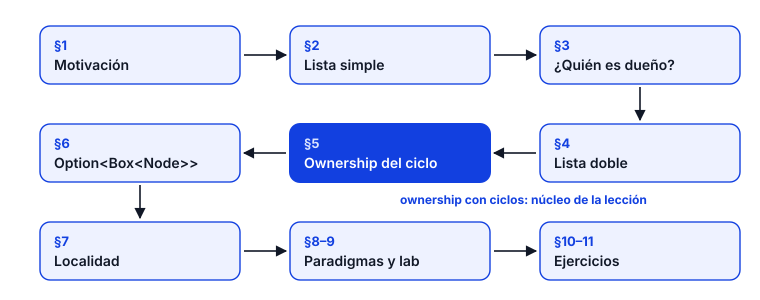
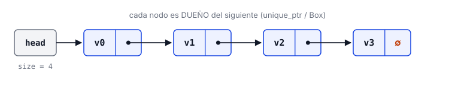
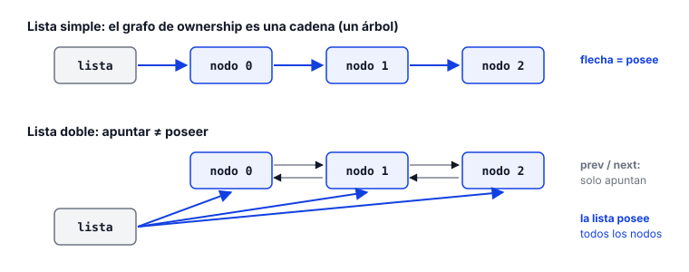

# Lección 3 — Listas ligadas y ownership

> **Prerrequisitos:** Lección 0 (§1 inducción e invariantes de ciclo, §7–9 memoria, C++ y Rust), Lección 1 (§7 invariante de representación) y Lección 2 (§6 memoria vs. objeto, §8 `NonNull` y `PhantomData`).
>
> **Cómo estudiar esta lección:** las listas son la estructura más simple con **punteros entre nodos**. Por eso son el mejor laboratorio para la pregunta central de la gestión de memoria: *¿quién es dueño de qué?* Dibuja cada operación en papel, con cajas y flechas, antes de escribirla.
>
> **Lab asociado:** `lab03`: `ForwardList`/`LinkedStack` (simplemente ligada) y `DList` (doblemente ligada).

## Objetivos de aprendizaje

Al terminar esta lección deberías poder:
1. Implementar listas simple y doblemente ligadas, enunciar sus invariantes y demostrar que cada operación los preserva.
2. Demostrar la corrección de algoritmos sobre listas con **invariantes de ciclo** (inversión in-place).
3. Modelar la memoria de un programa como un **grafo de ownership** y reconocer cuándo es un árbol y cuándo no.
4. Explicar por qué la destrucción por defecto de una lista es **recursiva** y cómo hacerla iterativa en los tres lenguajes.
5. Explicar por qué una lista doble no se puede expresar con `Box` en Rust, y comparar las tres salidas: punteros crudos, `Rc`/`Weak` y `NonNull` + `unsafe`.
6. Explicar por qué el conteo de referencias **no** recupera ciclos.

## Mapa de la lección



---

## 1. Motivación: romper la cota del arreglo

En L02 demostramos que en un arreglo contiguo `insert(0, x)` cuesta $\Theta(n)$: los $n$ elementos tienen que cambiar de celda. La única salida es **dejar de exigir que el orden lógico coincida con el orden físico**. Una lista ligada guarda cada elemento en su propio **nodo**, en cualquier lugar del heap, y cada nodo sabe cuál es el siguiente. Insertar al frente ya no mueve a nadie: solo se escribe un puntero.

El precio es igual de claro: para llegar al elemento $i$ hay que seguir $i$ punteros. La tabla de L02 §2.3 se lee ahora de la otra columna:

| Operación | Arreglo dinámico | Lista simple | Lista doble |
|---|---|---|---|
| `get(i)` | $O(1)$ | $O(i)$ | $O(\min(i, n-i))$ |
| `push_front` / `pop_front` | $\Theta(n)$ | $O(1)$ | $O(1)$ |
| `push_back` | $O(1)$ amort. | $O(1)$ con puntero a la cola | $O(1)$ |
| `pop_back` | $O(1)$ | $\Theta(n)$ | $O(1)$ |
| insertar/borrar **junto a un nodo que ya tienes** | $\Theta(n)$ | $O(1)$ después; $\Theta(n)$ antes | $O(1)$ |
| memoria extra por elemento | $\le$ 1 celda (amort.) | 1 puntero + cabecera de `malloc` | 2 punteros + cabecera |

La última fila de operaciones es la razón de ser de las listas: si un algoritmo ya **tiene en la mano** un nodo (porque lo encontró antes, o porque lo guardó en otra estructura), puede quitarlo o insertar junto a él en $O(1)$. Así funcionan la caché LRU (lista doble + tabla hash, L04), el *free list* de un `malloc`, y las listas de adyacencia de los grafos (L09).

---

## 2. Lista simplemente ligada

### 2.1 Representación e invariante

Cada nodo guarda un valor y un puntero al siguiente; la lista guarda un puntero al primero (`head`) y, por conveniencia, el tamaño.



**Invariante de representación.** Partiendo de `head` y siguiendo `next`:
1. se llega a `NULL` después de exactamente `size` nodos (la cadena es **finita y acíclica**), y
2. ningún nodo es alcanzable desde otra lista.

**Función de abstracción.** $\mathcal A(\texttt{head}) = \langle v_0, v_1, \dots, v_{n-1}\rangle$, donde $v_j$ es el valor del nodo alcanzado tras $j$ pasos.

### 2.2 `push_front` y `pop_front`

```
push_front(x):  n ← nodo_nuevo(x);  n.next ← head;  head ← n;  size ← size + 1
pop_front():    n ← head;  head ← n.next;  liberar(n);  size ← size − 1
```

*Preservan el invariante.* `push_front`: la nueva cadena es `n` seguida de la vieja, que era finita y acíclica con `size` nodos; `n` es nuevo, así que no aparece en la vieja: la nueva tiene `size + 1` nodos y es acíclica. `pop_front` es el caso simétrico. Ambas cuestan $O(1)$: un número fijo de asignaciones, sin importar $n$.

*Conmutan con $\mathcal A$.* Si $\mathcal A(\texttt{head}) = S$, tras `push_front(x)` la cadena empieza en un nodo con $x$ seguido de la cadena vieja: $\mathcal A = \langle x\rangle \cdot S$, que es la especificación de `push_front`.

### 2.3 Inversión in-place

Queremos invertir la lista **sin crear nodos** y con $O(1)$ memoria extra: solo reescribiendo los `next`.

```
reverse():
    prev ← NULL;  cur ← head
    mientras cur ≠ NULL:
        sig ← cur.next
        cur.next ← prev
        prev ← cur
        cur ← sig
    head ← prev
```

> **Teorema 1.** `reverse` termina tras exactamente $n$ iteraciones y deja $\mathcal A(\texttt{head}) = \langle v_{n-1},\dots,v_0\rangle$.

*Demostración.* Sea $S = \langle v_0,\dots,v_{n-1}\rangle$ la lista original. Invariante de ciclo, antes de la iteración $j$ ($0 \le j \le n$):

> $\mathcal{A}(\texttt{prev}) = \langle v_{j-1}, \dots, v_0\rangle$ (las primeras $j$, invertidas) y $\mathcal A(\texttt{cur}) = \langle v_j,\dots,v_{n-1}\rangle$ (el resto, en orden), y las dos cadenas no comparten nodos.

*Inicialización* ($j = 0$): `prev = NULL` representa $\langle\rangle$ y `cur = head` representa $S$. ✔

*Mantenimiento:* si vale antes de la iteración $j < n$, entonces `cur` apunta al nodo de $v_j$. El cuerpo guarda su sucesor (`sig`, que representa $\langle v_{j+1},\dots\rangle$), lo engancha delante de `prev` (ahora `cur` representa $\langle v_j, v_{j-1},\dots,v_0\rangle$) y avanza: `prev` pasa a representar $\langle v_j,\dots,v_0\rangle$ y `cur` a $\langle v_{j+1},\dots,v_{n-1}\rangle$. Es el invariante para $j+1$. Las cadenas siguen sin compartir nodos porque el nodo de $v_j$ pasó de una a la otra. ✔

*Terminación:* la longitud de la cadena de `cur` baja en 1 por iteración, así que tras $n$ iteraciones `cur = NULL`. Con $j = n$ el invariante dice $\mathcal A(\texttt{prev}) = \langle v_{n-1},\dots,v_0\rangle$, y la última línea lo asigna a `head`. $\blacksquare$

Este es el formato de demostración que pediremos en todo el curso para cualquier ciclo: **inicialización, mantenimiento y terminación** (CLRS §2.1).

---

## 3. ¿Quién es dueño de qué?

### 3.1 El grafo de ownership

Llamemos **dueño** de un bloque de memoria a quien tiene la responsabilidad de liberarlo. Si dibujamos una flecha de cada dueño a lo que posee, obtenemos el **grafo de ownership** del programa. Una gestión de memoria correcta exige:

- **Cada bloque tiene exactamente un dueño** en cada momento (cero dueños = fuga; dos dueños = doble liberación).
- Por lo tanto, el grafo es un **bosque**: un conjunto de árboles cuyas raíces son variables locales o globales.

En una lista simple, el grafo es una **cadena**: la lista posee al primer nodo, cada nodo posee al siguiente. Es un árbol (degenerado), así que se puede expresar con punteros únicos: `std::unique_ptr<Node>` en C++, `Box<Node>` en Rust. Al destruir la raíz, el árbol entero se destruye solo.

En una lista **doble**, cada nodo interno es apuntado por **dos** nodos (su anterior y su siguiente). Las flechas ya no forman un árbol sino un **ciclo** (dos flechas opuestas entre cada par de vecinos). Pero **apuntar no es lo mismo que poseer**: podemos declarar que solo una de las dos flechas posee, o que ninguna lo hace y el dueño de todos los nodos es la lista. Cómo se expresa esa decisión en cada lenguaje es el tema de §5.



### 3.2 La destrucción por defecto es recursiva

Con `unique_ptr`/`Box`, destruir el nodo 0 destruye su campo `next`, que destruye el nodo 1, que destruye su `next`… Cada destrucción ocurre **dentro** de la anterior: es una recursión de profundidad $n$.

> **Proposición 2.** La destrucción por defecto de una lista con `unique_ptr<Node> next` (o `Option<Box<Node>>`) usa $\Theta(n)$ marcos de pila. Con una pila de 8 MiB y marcos de unas decenas de bytes, desborda alrededor de $10^5$–$10^6$ nodos.

*Demostración.* El destructor del nodo $j$ llama al del nodo $j+1$ antes de retornar, así que en el momento en que se destruye el último nodo hay $n$ destructores activos en la pila, cada uno con un marco de tamaño constante $c > 0$: $c\,n$ bytes. $\blacksquare$

La solución es **desenganchar antes de destruir**: tomar el `next` del nodo actual (dejándolo vacío) y solo entonces destruir el nodo, que ya no tiene sucesor que arrastrar. El programa siguiente mide la profundidad máxima de las dos versiones; las listas de los tres lenguajes se liberan a mano para poder contar:

::: {.tabs}
```c
#include <stdio.h>
#include <stdlib.h>

typedef struct Nodo { int v; struct Nodo *next; } Nodo;
static int prof = 0, max_prof = 0;

static void liberar_rec(Nodo *n) {       /* como el destructor por defecto */
    if (n == NULL) return;
    if (++prof > max_prof) max_prof = prof;
    liberar_rec(n->next);                /* primero el resto... */
    free(n);                             /* ...luego este */
    prof--;
}

static void liberar_iter(Nodo *n) {      /* desenganchar y luego liberar */
    max_prof = 1;
    while (n != NULL) { Nodo *sig = n->next; free(n); n = sig; }
}

static Nodo *construir(int n) {
    Nodo *h = NULL;
    for (int i = 0; i < n; i++) {
        Nodo *x = malloc(sizeof *x);
        if (x == NULL) exit(1);
        x->v = i; x->next = h; h = x;
    }
    return h;
}

int main(void) {
    liberar_rec(construir(1000));
    printf("recursiva: profundidad máxima %d\n", max_prof);
    liberar_iter(construir(1000));
    printf("iterativa: profundidad máxima %d\n", max_prof);
    return 0;
}
```

```cpp
#include <cstdio>
#include <memory>

struct Nodo { int v; std::unique_ptr<Nodo> next; };
int prof = 0, max_prof = 0;

void liberar_rec(std::unique_ptr<Nodo> n) {   // como el destructor por defecto
    if (!n) return;
    if (++prof > max_prof) max_prof = prof;
    liberar_rec(std::move(n->next));          // primero el resto...
    prof--;
}                                              // ...luego este (al salir n)

void liberar_iter(std::unique_ptr<Nodo> n) {  // desenganchar y luego liberar
    max_prof = 1;
    while (n) n = std::move(n->next);          // el viejo n muere con next vacío
}

std::unique_ptr<Nodo> construir(int n) {
    std::unique_ptr<Nodo> h;
    for (int i = 0; i < n; ++i) h = std::make_unique<Nodo>(Nodo{i, std::move(h)});
    return h;
}

int main() {
    liberar_rec(construir(1000));
    std::printf("recursiva: profundidad máxima %d\n", max_prof);
    liberar_iter(construir(1000));
    std::printf("iterativa: profundidad máxima %d\n", max_prof);
}
```

```rust
struct Nodo { _v: i32, next: Option<Box<Nodo>> }

fn liberar_rec(n: Option<Box<Nodo>>, prof: usize, max: &mut usize) {
    // como el Drop derivado
    if let Some(mut b) = n {
        *max = (*max).max(prof + 1);
        liberar_rec(b.next.take(), prof + 1, max); // primero el resto...
    } // ...luego este (al salir b)
}

fn liberar_iter(mut n: Option<Box<Nodo>>, max: &mut usize) {
    *max = 1;
    while let Some(mut b) = n {
        n = b.next.take(); // desenganchar; b muere sin sucesor
    }
}

fn construir(n: i32) -> Option<Box<Nodo>> {
    let mut h = None;
    for i in 0..n { h = Some(Box::new(Nodo { _v: i, next: h })); }
    h
}

fn main() {
    let mut max = 0;
    liberar_rec(construir(1000), 0, &mut max);
    println!("recursiva: profundidad máxima {max}");
    liberar_iter(construir(1000), &mut max);
    println!("iterativa: profundidad máxima {max}");
}
```
:::

```{.text .salida}
recursiva: profundidad máxima 1000
iterativa: profundidad máxima 1
```

El test `flist_destructor_iterativo_un_millon` (y `lstack_drop_iterativo_un_millon` en Rust) construye un millón de nodos: con la destrucción recursiva, el programa termina con *stack overflow*.

⚠️ **La misma trampa se esconde en el movimiento.** En C++, `ForwardList& operator=(ForwardList&&) = default` hace `head_ = std::move(o.head_)`, y eso **destruye la lista vieja con el destructor recursivo de `unique_ptr`**, no con el tuyo. Además, el movimiento por defecto copia `size_`, así que la lista movida queda vacía pero con `size() != 0`, violando el invariante. El lab te pide escribir el constructor de movimiento a mano, y el `operator=` se implementa con *move-and-swap* para que la lista vieja muera por tu destructor iterativo.

---

## 4. Lista doblemente ligada

### 4.1 Representación e invariante

Cada nodo guarda `prev` y `next`; la lista guarda `head`, `tail` y `size`.

**Invariante de representación.**
1. `size == 0` $\iff$ `head == tail == NULL`.
2. `head->prev == NULL` y `tail->next == NULL`.
3. Para todo nodo `n` con `n->next != NULL`: `n->next->prev == n` (**simetría**).
4. Siguiendo `next` desde `head` se llega a `tail` tras exactamente `size − 1` pasos.

La simetría es lo que permite recorrer en los dos sentidos y lo que hace $O(1)$ a `pop_back`: desde `tail` llegamos a su anterior sin recorrer.

### 4.2 `push_front` por casos

```
push_front(x):
    n ← nodo_nuevo(x);  n.prev ← NULL;  n.next ← head
    si head ≠ NULL:  head.prev ← n          (caso A: no vacía)
    si no:           tail ← n               (caso B: vacía)
    head ← n;  size ← size + 1
```

*Preserva el invariante.* **Caso B** (`size = 0`): tras la operación, `head = tail = n`, `n.prev = n.next = NULL`, `size = 1`: se cumplen 1–4. **Caso A**: el viejo `head` (llamémoslo $h$) cumplía `h.prev = NULL`; ahora `h.prev = n` y `n.next = h`, así que la simetría vale para el nuevo par $(n, h)$; los demás pares no cambian; `head = n` con `n.prev = NULL`; `tail` no cambia y es alcanzable en `size` pasos (uno más que antes). ✔

`pop_back` es el mismo análisis al revés, con un cuidado: si la lista queda vacía hay que poner **también** `head = NULL` (de lo contrario `head` apuntaría al nodo liberado y la condición 1 fallaría). Es el error más común del lab: el test `dlist_deque_basico` vacía la lista y la vuelve a usar.

### 4.3 El nodo centinela

Los casos A y B existen porque `head` y `tail` pueden ser `NULL`. La técnica del **centinela** los elimina: un nodo ficticio `s`, que no guarda dato, con la lista organizada como un **ciclo** `s ⇄ n_0 ⇄ … ⇄ n_{k-1} ⇄ s`. Vacía, `s.next = s.prev = s`. Entonces `push_front(x)` es insertar entre `s` y `s.next`, `push_back(x)` es insertar entre `s.prev` y `s`, y ambas son la misma función sin casos:

```
insertar_entre(a, b, x):  n ← nodo_nuevo(x);  n.prev ← a;  n.next ← b;  a.next ← n;  b.prev ← n
```

Es lo que usa `std::list` de libstdc++. El precio: un nodo extra y que el valor del centinela no existe (en C++ obliga a separar el tipo del nodo base, sin `value`, del nodo con dato). El problem set te pide reescribir `DList` con centinela.

---

## 5. Ownership de la lista doble en los tres lenguajes

### 5.1 C y C++: punteros crudos y un invariante

En C, todo puntero es "crudo" y el dueño es una convención documentada. En C++ podríamos usar `unique_ptr` para `next` y un puntero crudo para `prev` (el dueño de cada nodo es su anterior), pero eso devuelve la destrucción recursiva y no simplifica nada. La solución de referencia, como `std::list`, hace que **la lista sea dueña de todos los nodos** y use punteros crudos para ambos enlaces: `new` en cada `push`, `delete` en cada `pop` y un destructor iterativo. Copiar la lista está prohibido (`= delete`) porque una copia de bits tendría dos dueños para los mismos nodos.

### 5.2 Rust: `Box` no puede expresarlo

En Rust, `Box<T>` **es** la propiedad única: no hay forma segura de que dos `Box` apunten al mismo nodo. Un intento ingenuo no compila:

::: {.tabs}
```{.rust .no-compila}
struct Nodo {
    v: i32,
    prev: Option<Box<Nodo>>,
    next: Option<Box<Nodo>>,
}

fn main() {
    let a = Box::new(Nodo { v: 1, prev: None, next: None });
    let mut b = Box::new(Nodo { v: 2, prev: None, next: None });
    b.prev = Some(a);                  // b es dueño de a...
    let mut a2 = b.prev.take().unwrap();
    a2.next = Some(b);                 // ...y a es dueño de b
    println!("{}", b.v);               // ERROR: b se movió dentro de a2
}
```
:::

Hay tres salidas:

| Opción | Cómo | Costo |
|---|---|---|
| (a) `Rc<RefCell<Node>>` + `Weak` | `next` fuerte, `prev` débil; préstamos verificados en ejecución | un contador y una bandera por nodo, `borrow()` en cada acceso, código verboso; `front()` no puede devolver `&T` |
| (b) `NonNull<Node>` + `unsafe` | la lista es dueña de todos los nodos, como en C++ | cada acceso a un nodo es `unsafe`; tú demuestras el invariante |
| (c) arena + índices | nodos en un `Vec`, enlaces como `usize` | sin `unsafe`; los índices pueden quedar colgantes (pero no hay UB) |

El lab usa (b), que es lo que hace `std::collections::LinkedList`. La idea clave es **encapsular** el `unsafe`: la API pública (`push_front`, `pop_back`, `front`, `iter`…) es segura, y la responsabilidad de no causar UB recae en una sola estructura con un invariante documentado.

### 5.3 Cómo se escribe `unsafe` correcto aquí

Tres reglas que la solución sigue y que cada `// SAFETY:` invoca:

1. **Creación y destrucción emparejadas.** Cada nodo nace con `Box::into_raw(Box::new(...))` y muere con exactamente un `Box::from_raw`, en el `pop` que lo desengancha. Como `pop` lo quita de la lista antes de liberarlo, ningún otro puntero lo usará después.
2. **Referencias de vida corta.** Para escribir un enlace se usa `(*p.as_ptr()).prev = ...` directamente sobre el puntero crudo, sin crear un `&mut Node` que viva mientras existe otro puntero al mismo nodo. Crear dos `&mut` al mismo objeto es UB aunque nunca se usen a la vez; Miri lo detecta.
3. **Préstamos ligados a la lista.** `front(&self) -> Option<&T>` y el iterador devuelven referencias cuya vida está atada al préstamo de `&self`: mientras existan, el compilador impide `push`/`pop` (que piden `&mut self`), así que los nodos no pueden desaparecer.

El campo `_marker: PhantomData<Box<Node<T>>>` le dice al compilador que `DList<T>` **posee** nodos (y por tanto valores `T`), igual que en L02 §8.2.

### 5.4 El conteo de referencias no recupera ciclos

La opción (a) merece una advertencia que vale para todo lenguaje con conteo de referencias (`shared_ptr` en C++, `Rc`/`Arc` en Rust, Swift, CPython…): **un ciclo de referencias fuertes nunca se libera**. Cada nodo del ciclo tiene contador $\ge 1$ porque lo apunta el anterior, aunque nadie desde fuera pueda alcanzarlo.

> **Proposición 3.** Si un conjunto de objetos con conteo de referencias forma un ciclo de referencias fuertes, ninguno de ellos se libera, aunque no sean alcanzables desde ninguna raíz.

*Demostración.* Un objeto se libera solo cuando su contador llega a 0. En el ciclo, el contador de cada objeto incluye la referencia de su predecesor en el ciclo, que solo desaparecería si el predecesor se liberara antes. Ninguno puede ser el primero. $\blacksquare$

La solución es que una de las direcciones sea **débil** (`Weak`/`weak_ptr`): no cuenta para la liberación. El programa compara las dos variantes; en C escribimos el conteo a mano para ver la mecánica:

::: {.tabs}
```c
#include <stdio.h>
#include <stdlib.h>

/* Conteo de referencias a mano: liberar cuando el contador fuerte llega a 0. */
typedef struct Obj { const char *nombre; int fuertes; struct Obj *otro; int otro_es_fuerte; } Obj;

static Obj *nuevo(const char *nombre) {
    Obj *o = malloc(sizeof *o);
    if (o == NULL) exit(1);
    *o = (Obj){nombre, 1, NULL, 0};
    return o;
}
static void soltar(Obj *o) {
    if (--o->fuertes > 0) return;
    printf("destruyo %s\n", o->nombre);
    if (o->otro && o->otro_es_fuerte) soltar(o->otro);
    free(o);
}

int main(void) {
    {   /* a → b fuerte, b → a fuerte */
        Obj *a = nuevo("a"), *b = nuevo("b");
        a->otro = b; a->otro_es_fuerte = 1; b->fuertes++;
        b->otro = a; b->otro_es_fuerte = 1; a->fuertes++;
        printf("ciclo fuerte: a=%d b=%d\n", a->fuertes, b->fuertes);
        soltar(b); soltar(a);              /* fin del ámbito */
        printf("fin del ámbito (nadie se destruyó: fuga)\n");
        a->otro = NULL; soltar(b);         /* limpieza: romper el ciclo desde fuera */
    }
    {   /* a → b fuerte, b → a débil */
        Obj *a = nuevo("a"), *b = nuevo("b");
        a->otro = b; a->otro_es_fuerte = 1; b->fuertes++;
        b->otro = a; b->otro_es_fuerte = 0;
        printf("con débil: a=%d b=%d\n", a->fuertes, b->fuertes);
        soltar(b); soltar(a);
        printf("fin del ámbito\n");
    }
    return 0;
}
```

```cpp
#include <cstdio>
#include <memory>

struct Obj {
    const char* nombre;
    std::shared_ptr<Obj> fuerte;
    std::weak_ptr<Obj> debil;
    explicit Obj(const char* n) : nombre(n) {}
    ~Obj() { std::printf("destruyo %s\n", nombre); }
};

int main() {
    {
        auto a = std::make_shared<Obj>("a");
        auto b = std::make_shared<Obj>("b");
        a->fuerte = b;
        b->fuerte = a;
        std::printf("ciclo fuerte: a=%ld b=%ld\n", a.use_count(), b.use_count());
        std::weak_ptr<Obj> wa = a;
        b.reset(); a.reset();                       // fin del ámbito
        std::printf("fin del ámbito (nadie se destruyó: fuga)\n");
        if (auto sa = wa.lock()) sa->fuerte.reset(); // limpieza: romper el ciclo desde fuera
    }
    {
        auto a = std::make_shared<Obj>("a");
        auto b = std::make_shared<Obj>("b");
        a->fuerte = b;
        b->debil = a;
        std::printf("con débil: a=%ld b=%ld\n", a.use_count(), b.use_count());
        b.reset(); a.reset();
        std::printf("fin del ámbito\n");
    }
}
```

```rust
use std::cell::RefCell;
use std::rc::{Rc, Weak};

struct Obj {
    nombre: &'static str,
    fuerte: RefCell<Option<Rc<Obj>>>,
    debil: RefCell<Weak<Obj>>,
}
impl Drop for Obj {
    fn drop(&mut self) { println!("destruyo {}", self.nombre); }
}
fn nuevo(nombre: &'static str) -> Rc<Obj> {
    Rc::new(Obj { nombre, fuerte: RefCell::new(None), debil: RefCell::new(Weak::new()) })
}

fn main() {
    {
        let a = nuevo("a");
        let b = nuevo("b");
        *a.fuerte.borrow_mut() = Some(Rc::clone(&b));
        *b.fuerte.borrow_mut() = Some(Rc::clone(&a));
        println!("ciclo fuerte: a={} b={}", Rc::strong_count(&a), Rc::strong_count(&b));
        let pa = Rc::downgrade(&a);
        drop(b);
        drop(a);
        println!("fin del ámbito (nadie se destruyó: fuga)");
        // limpieza para no fugar de verdad: romper el ciclo desde fuera
        if let Some(a) = pa.upgrade() { a.fuerte.borrow_mut().take(); }
    }
    {
        let a = nuevo("a");
        let b = nuevo("b");
        *a.fuerte.borrow_mut() = Some(Rc::clone(&b));
        *b.debil.borrow_mut() = Rc::downgrade(&a);
        println!("con débil: a={} b={}", Rc::strong_count(&a), Rc::strong_count(&b));
        drop(b);
        drop(a);
        println!("fin del ámbito");
    }
}
```
:::

```{.text .salida}
ciclo fuerte: a=2 b=2
fin del ámbito (nadie se destruyó: fuga)
destruyo b
destruyo a
con débil: a=1 b=2
destruyo a
destruyo b
fin del ámbito
```

Las dos líneas `destruyo` entre los bloques son la **limpieza manual** que hicimos para no dejar una fuga real en el programa de ejemplo: rompemos el ciclo desde fuera y entonces `b` (que ya solo tenía a `a` como dueño) se destruye y suelta a `a`. Sin esa limpieza, `a` y `b` nunca se destruirían. En el segundo bloque, soltar `a` (su único dueño fuerte) la destruye, y al destruirse suelta su referencia fuerte a `b`.

Los recolectores de basura con trazado (Java, Go, C#) sí recuperan ciclos, porque deciden por **alcanzabilidad** desde las raíces y no por contadores.

---

## 6. Rust: el idioma `Option<Box<Node>>`

La lista simple del lab es 100% código seguro. Las piezas que hay que dominar:

| Expresión | Tipo | Para qué |
|---|---|---|
| `self.head.take()` | `Option<Box<Node>>` | sacar el valor dejando `None`: mover sin dejar un hueco inválido |
| `self.head.as_ref()` | `Option<&Box<Node>>` | mirar sin mover |
| `self.head.as_deref()` | `Option<&Node>` | igual, quitando el `Box` |
| `self.head.as_mut()` | `Option<&mut Box<Node>>` | modificar en su lugar |
| `opt.map(\|n\| …)` | `Option<U>` | transformar si existe |

`take` es la herramienta central: en Rust no se puede "mover fuera" de un campo de `&mut self` y dejarlo vacío, porque el campo quedaría inválido. `take` mueve el valor **y** deja `None` en una sola operación. Es el equivalente seguro del `std::exchange(p, nullptr)` de C++.

El iterador por referencia usa un tiempo de vida explícito:
```rust
struct Iter<'a, T> { next: Option<&'a Node<T>> }
```
`'a` ata cada referencia que devuelve el iterador al préstamo de la lista: mientras el iterador viva, la lista no puede modificarse. Es la misma regla de invalidación de L02 §6.2, verificada por el compilador.

---

## 7. El costo oculto: localidad

En el modelo RAM, recorrer una lista y un arreglo cuesta lo mismo, $\Theta(n)$. En hardware real, los nodos de una lista están dispersos por el heap y cada `next` es probablemente un fallo de caché (~100 ns), mientras que un arreglo se recorre a la velocidad de la memoria secuencial (L02 §5.4). Además, cada nodo paga la cabecera de `malloc` (8–16 bytes) y uno o dos punteros: una `DList<int>` gasta unos 32 bytes por cada `int` de 4.

**Regla práctica:** usa una lista cuando de verdad necesitas insertar o quitar junto a nodos que ya tienes, o cuando los elementos no deben moverse nunca de dirección (porque otros los apuntan). Para todo lo demás, un arreglo dinámico suele ganar, incluso en inserciones en medio de tamaño moderado.

---

## 8. Resumen de paradigmas en este lab

| Aspecto | C | C++ | Rust |
|---|---|---|---|
| Nodo genérico | `unsigned char value[]` (flexible array member), un solo `malloc` | plantilla `Node<T>` | genérico `Node<T>` |
| Ownership lista simple | convención | `unique_ptr<Node> next` | `Option<Box<Node>>` |
| Destrucción | `free` en un ciclo, a mano | destructor iterativo (el por defecto recursa) | `Drop` iterativo (el derivado recursa) |
| Lista doble | punteros crudos | punteros crudos; la lista es dueña | `NonNull` + `unsafe`, encapsulado |
| Copiar la lista | — | `= delete` | no se implementa `Clone` |
| Mover la lista | copiar el `struct` | constructor de movimiento a mano + move-and-swap | implícito (copia de bits) |
| Acceso a nodo tras `pop` | UB (ASan lo detecta) | UB (ASan lo detecta) | imposible desde código seguro |
| Fugas | `make c-fugas-lab03` | contador de objetos vivos en los tests | `Rc::strong_count` en los tests |

---

## 9. Guía del Lab 03

**Archivos:** `c/src/lab03/{forward_list,dlist}.c`, `cpp/include/algolib/lab03/{forward_list,dlist}.hpp`, `rust/src/lab03/{linked_stack,dlist}.rs`.

**Orden sugerido (todos los lenguajes):**
1. Lista simple: `new`, `push_front`, `front`/`peek`, `size`, `to_array`/`iter`. Corre los tests.
2. `pop_front`, y luego la **destrucción iterativa** (`free`, destructor, `Drop`). El test del millón de nodos te dirá si quedó recursiva.
3. `reverse`, escribiendo antes el invariante de ciclo de §2.3.
4. C++: el constructor de movimiento (`std::exchange` para `size_`). El `operator=` ya está hecho: entiende por qué no es `= default`.
5. Lista doble: `push_front`/`push_back` con sus dos casos; `pop_front`/`pop_back` con el caso "queda vacía"; `front`/`back`; recorridos en ambos sentidos.
6. Rust `DList`: escribe los `// SAFETY:` primero. Al terminar, corre Miri: `cd rust && cargo +nightly miri test --test lab03` (tarda unos minutos por el millón de nodos).
7. C: `make c-fugas-lab03`.

**Errores frecuentes:**
- Liberar un nodo y después leer su `next` (`free(n); n = n->next;`): uso después de liberar.
- En `pop_back` de la lista doble, olvidar `head = NULL` cuando la lista queda vacía.
- En `push_front`, olvidar `tail = n` cuando la lista estaba vacía.
- En C++, dejar el movimiento como `= default` (ver la advertencia de §3.2).
- En Rust, intentar `let node = self.head.unwrap()` en vez de `self.head.take()`: no compila porque mueve fuera de `&mut self`.
- En Rust `DList`, crear `&mut *ptr` de larga vida y luego escribir por otro puntero al mismo nodo: Miri lo reporta como violación de préstamos.

---

## 10. Comprueba tu comprensión

1. ¿Por qué `pop_back` en una lista simple cuesta $\Theta(n)$ aunque guardes un puntero a la cola?
2. En la inversión in-place, ¿qué pasa si olvidas guardar `sig` antes de reescribir `cur.next`?
3. ¿Cuántos marcos de pila usa destruir una lista de $n$ nodos con `Option<Box<Node>>` y el `Drop` derivado? ¿Y un árbol binario balanceado de $n$ nodos?
4. ¿Por qué un ciclo de `Rc` es una fuga pero no es UB?
5. Con centinela, ¿cuántos casos tiene `pop_front`? ¿Qué devuelve `front()` si la lista está vacía?

<details><summary>Respuestas</summary>

1. Porque para quitar la cola hay que actualizar el `next` del **penúltimo**, y llegar a él exige recorrer desde `head`: la lista simple no tiene `prev`.
2. Se pierde el resto de la lista: `cur.next` ya apunta a `prev` y no hay forma de llegar a $v_{j+1}$. Además los nodos perdidos se fugan.
3. $\Theta(n)$ para la lista. Para el árbol, la recursión baja por una rama a la vez: la profundidad es la **altura**, $\Theta(\lg n)$. Por eso la destrucción recursiva es aceptable en árboles balanceados (L07) y no en listas.
4. Porque la memoria nunca se libera: no hay acceso a memoria liberada ni doble liberación, solo memoria que el programa ya no puede usar. Rust considera las fugas seguras (`mem::forget` es una función segura).
5. Uno solo: quitar `s.next` (si no es `s`). Si `s.next == s` la lista está vacía y `front()` debe devolver "nada" (`NULL`, excepción o `None`): el centinela no guarda dato.
</details>

---

## 11. Problem Set 3

**Teoría**
1. Demuestra con un invariante de ciclo que el algoritmo de Floyd (liebre y tortuga) detecta si una lista simple tiene un ciclo en $O(n)$ tiempo y $O(1)$ memoria, y que además puede encontrar el nodo donde empieza el ciclo.
2. Demuestra que **mergesort** sobre una lista simple ordena $n$ elementos en $O(n\lg n)$ tiempo y $O(\lg n)$ memoria extra (la pila de recursión), sin crear nodos. ¿Se puede hacer con $O(1)$ memoria extra? (Pista: mergesort de abajo hacia arriba.)
3. Una **lista XOR** guarda en cada nodo un solo campo `link = prev XOR next`. Demuestra que permite recorrer en ambos sentidos conociendo dos nodos consecutivos. ¿Por qué es imposible implementarla en Rust seguro y por qué es problemática con un recolector de basura?
4. Demuestra que con un centinela circular, `insertar_entre(a, b, x)` preserva el invariante "para todo nodo $n$: `n.next.prev == n` y `n.prev.next == n`" si `a.next == b` antes de la operación.
5. Da una secuencia de operaciones sobre una caché LRU de capacidad $k$ (lista doble + tabla hash) y demuestra que `get` y `put` cuestan $O(1)$ esperado. ¿Qué parte de la cota depende de la tabla hash (L04)?

**Implementación (C, C++ y Rust)**

6. Reescribe `DList` con nodo centinela circular. Compara el número de ramas (`if`) contra tu versión original.
7. Agrega a `DList` un **cursor** con `insert_before`, `insert_after` y `remove` en $O(1)$. En Rust, diseña el API para que un cursor no pueda sobrevivir a una modificación de la lista por otro camino (pista: `CursorMut<'a, T>` toma `&'a mut DList<T>`).
8. Implementa `DList` en Rust con la opción (a), `Rc<RefCell<Node>>` + `Weak`, y compara su API (`front` ya no puede devolver `&T`: ¿qué devuelve?) y su rendimiento contra la versión con `NonNull`.
9. Implementa `ForwardList::sort` con mergesort de abajo hacia arriba (ej. 2) y verifica con un oráculo que es **estable**.

---

## Referencias
- CLRS, *Introduction to Algorithms*, 4ª ed.: §10.2 (listas ligadas, centinelas), §2.1 (invariantes de ciclo).
- MIT 6.006 (Spring 2020), Lecture 2: *Data Structures and Dynamic Arrays* (listas ligadas como secuencia).
- Beingessner, A. *Learning Rust With Entirely Too Many Linked Lists*. https://rust-unofficial.github.io/too-many-lists/
- The Rustonomicon: *Ownership*, *PhantomData*.
- Stroustrup, B. *The C++ Programming Language*, 4ª ed., §34.3 (`unique_ptr`, `shared_ptr`, `weak_ptr`).
- Knuth, D. E. *The Art of Computer Programming*, Vol. 1, §2.2 (listas, Floyd en los ejercicios de §3.1).
