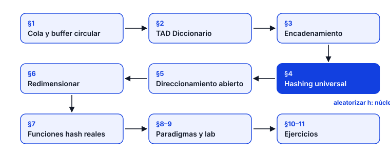
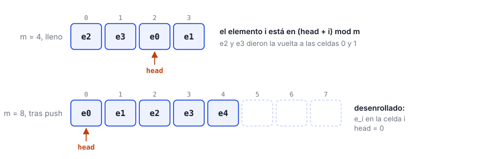

# Lección 4 — Colas circulares y tablas hash

> **Prerrequisitos:** Lección 0 (§4 probabilidad: variables indicadoras y linealidad de la esperanza; aritmética modular), Lección 1 (§6 análisis amortizado) y Lección 2 (§6–7 memoria cruda y reubicación).
>
> **Cómo estudiar esta lección:** la primera mitad es un truco de representación (el buffer circular); la segunda es la primera vez en el curso que una cota depende del **azar**. Distingue en cada teorema qué es aleatorio: ¿las claves, o la función hash?
>
> **Lab asociado:** `lab04`: `RingQueue` y `HashMap` (C, C++ y Rust).

## Objetivos de aprendizaje

Al terminar esta lección deberías poder:
1. Implementar una cola FIFO sobre un **buffer circular** que crece, y demostrar que todas sus operaciones son $O(1)$ (amortizado para `push`).
2. Especificar el **TAD Diccionario** y explicar por qué una tabla de acceso directo no basta.
3. Demostrar el costo esperado de búsqueda con **encadenamiento** bajo hashing uniforme simple.
4. Definir **familia universal** de funciones hash, demostrar que $h_{a,b}(k) = ((ak+b)\bmod p)\bmod m$ lo es, y explicar por qué esto elimina las entradas "malas".
5. Implementar **direccionamiento abierto** con sondeo lineal y borrado por corrimiento hacia atrás, y demostrar que el borrado preserva el invariante.
6. Elegir una función hash en la práctica: identidad, Fibonacci, SipHash; y explicar el ataque de **HashDoS**.

## Mapa de la lección



---

## 1. La cola FIFO

### 1.1 El problema

Una **cola** (*queue*) es la secuencia restringida a `push_back` y `pop_front`: el primero en entrar es el primero en salir. La usan el recorrido en amplitud de un grafo (L09), los buffers de red y de teclado, los planificadores de procesos.

¿Sobre qué estructura? Con lo que ya tenemos:

| Implementación | `push_back` | `pop_front` | Problema |
|---|---|---|---|
| `Vector` (L02) | $O(1)$ amort. | $\Theta(n)$ | `erase(0)` corre todo (PS2 ej. 2) |
| Lista simple con cola (L03) | $O(1)$ | $O(1)$ | un `malloc` por elemento, sin localidad |
| **Buffer circular** | $O(1)$ amort. | $O(1)$ | — |

### 1.2 El buffer circular

Idea: en vez de correr los elementos cuando sale el primero, **movemos el inicio**. Guardamos un índice `head` al frente y el tamaño `size`; el elemento $i$ (con $0$ = frente) vive en
$$\text{celda}(i) = (\texttt{head} + i) \bmod m,$$
donde $m$ es la capacidad. Cuando el final llega a la última celda, el siguiente elemento se escribe en la celda 0: el arreglo se lee **en círculo**.



**Invariante de representación.** $0 \le \texttt{size} \le m$; si $m > 0$, $0 \le \texttt{head} < m$; las celdas $\text{celda}(0), \dots, \text{celda}(\texttt{size}-1)$ contienen los elementos y las demás están libres.

**Operaciones.**
```
push_back(x):  si size = m: crecer()
               data[celda(size)] ← x;  size ← size + 1
pop_front():   x ← data[head];  head ← (head + 1) mod m;  size ← size − 1
get(i):        data[celda(i)]            (precondición: i < size)
```

> **Proposición 1.** Cada operación sin crecimiento preserva el invariante y cuesta $O(1)$.

*Demostración (`pop_front`).* Antes, los elementos ocupan $\text{celda}(0..\texttt{size}-1)$ con el `head` viejo. Tras `head` $\gets$ `head` $+1 \bmod m$, la celda $i$ nueva es $(\texttt{head}+1+i) \bmod m$, que es la celda $i+1$ vieja. Los `size`$-1$ elementos restantes son exactamente los viejos $1..\texttt{size}-1$, en orden. La celda del viejo frente queda libre. $\blacksquare$

**Detalle de implementación.** El operador `%` es una división entera (decenas de ciclos). Como `head` $< m$ e $i < m$, la suma es menor que $2m$ y basta una resta condicional: `j = head + i; if (j >= m) j -= m;`. Con $m$ potencia de 2, también sirve `j & (m - 1)`.

### 1.3 Crecer: desenrollar

Cuando `size = m` hay que crecer a $2m$. **No** basta con copiar el bloque tal cual: si `head` $\ne 0$, los elementos están "partidos" en dos tramos, $[\texttt{head}, m)$ y $[0, \texttt{head})$, y en un bloque de $2m$ la fórmula $(\texttt{head} + i)\bmod 2m$ ya no los encuentra. Hay que **desenrollar**: copiar el elemento $i$ a la celda $i$ del bloque nuevo y poner `head` $= 0$. En C son dos `memcpy`; en C++ y Rust, un ciclo de $\texttt{size}$ reubicaciones.

El test `ring_envuelve_y_crece` fuerza exactamente este caso: llena la cola, saca dos (ahora `head` $= 2$), mete dos (dan la vuelta) y luego una más (crece con `head` $\ne 0$).

El análisis amortizado es **idéntico** al de L01 §6: el potencial $\Phi = \max(0, 2\,\texttt{size} - m)$ da `push_back` en $O(1)$ amortizado; `pop_front` no cambia $m$ y baja `size`, así que $\Delta\Phi\le 0$.

`std::deque` (C++) y `VecDeque` (Rust) son colas dobles (*deques*) sobre esta idea; `VecDeque` es exactamente un buffer circular.

---

## 2. El TAD Diccionario

### 2.1 Interfaz

Un **diccionario** (o *mapa*, o *tabla de símbolos*) guarda pares clave–valor con claves distintas:

| Operación | Efecto |
|---|---|
| `insert(k, v)` | asocia $v$ a $k$ (reemplaza si ya existía) |
| `find(k)` | el valor asociado a $k$, o "no existe" |
| `erase(k)` | quita $k$ si existía |

A diferencia de la secuencia, el orden lo determinan las **claves**, no el usuario. Hay dos familias de implementaciones: las que solo usan **igualdad** de claves (tablas hash, esta lección) y las que usan **orden** (árboles de búsqueda, L07), que además permiten mínimo, sucesor y rangos.

### 2.2 Tabla de acceso directo

Si las claves son enteros en un universo pequeño $U = \{0, \dots, u-1\}$, un arreglo `T[0..u)` con `T[k]` = valor de $k$ (o vacío) da las tres operaciones en $O(1)$ **en el peor caso**. El problema: la memoria es $\Theta(u)$, no $\Theta(n)$. Para claves de 64 bits, $u = 2^{64}$; para cadenas, $U$ es infinito.

### 2.3 Hashing

Una **función hash** $h: U \to \{0, \dots, m-1\}$ comprime el universo a $m$ celdas, con $m = \Theta(n)$. Guardamos el par de clave $k$ en la celda $h(k)$.

Como $|U| > m$, por el **principio del palomar** hay claves distintas $k \ne k'$ con $h(k) = h(k')$: una **colisión**. Peor: para **toda** función $h$ fija y todo $n \le |U|/m$, existe un conjunto de $n$ claves que caen todas en la misma celda (el palomar, aplicado a la celda más poblada). Ninguna función hash fija es buena para todas las entradas. Hay dos respuestas:

1. **Suponer** que las claves "se comportan bien" (hashing uniforme simple, §3.2): útil para entender, pero un adversario puede romperlo.
2. **Elegir $h$ al azar** de una familia, después de que el adversario elige las claves (hashing universal, §4): la garantía es sobre el azar de *nuestra* elección, no sobre la entrada.

Y dos formas de manejar las colisiones: **encadenamiento** (§3) y **direccionamiento abierto** (§5).

---

## 3. Encadenamiento separado

### 3.1 Estructura

Cada celda (*cubo*, *bucket*) guarda una lista de los pares cuya clave cae ahí. `insert` busca en la lista de $h(k)$ y, si no está, agrega; `find` y `erase` recorren esa lista. El **factor de carga** es
$$\alpha = \frac{n}{m}$$
(pares por cubo, en promedio). El costo de una operación es $\Theta(1 + \text{largo de la lista recorrida})$.

**Peor caso:** todas las claves en un cubo: $\Theta(n)$ por operación. El test `hash_colisiones_totales` usa un hash constante: tu tabla debe ser **correcta** (aunque lenta) también ahí.

### 3.2 Hashing uniforme simple

**Supuesto (HUS).** Cada clave cae en cada uno de los $m$ cubos con probabilidad $1/m$, independientemente de dónde caen las demás.

> **Teorema 2 (búsqueda fallida).** Bajo HUS, buscar una clave que no está en la tabla examina en esperanza $\alpha$ elementos; el costo esperado es $\Theta(1 + \alpha)$.

*Demostración.* La clave buscada $k$ cae en un cubo $j$ y recorremos toda su lista. Sea $X_i$ la indicadora de que la clave almacenada $k_i$ ($i = 1..n$) está en el cubo $h(k)$. Por HUS, $\Pr[X_i = 1] = 1/m$. El número de elementos examinados es $\sum_i X_i$ y, por linealidad,
$$\mathbb E\Big[\sum_{i=1}^n X_i\Big] = \sum_{i=1}^n \frac1m = \frac nm = \alpha. \qquad\blacksquare$$

> **Teorema 3 (búsqueda exitosa).** Bajo HUS, si la clave buscada es una de las $n$ almacenadas, elegida uniformemente, y cada `insert` agrega al **frente** de su lista, el número esperado de elementos examinados es $1 + \frac{\alpha}{2} - \frac{\alpha}{2n} = \Theta(1+\alpha)$.

*Demostración.* Numeremos las claves en orden de inserción $k_1, \dots, k_n$. Al buscar $k_i$ examinamos $k_i$ más las claves de su lista insertadas **después** de ella (que quedaron delante). Sea $X_{ij}$ ($j > i$) la indicadora de $h(k_j) = h(k_i)$, con $\Pr = 1/m$. Promediando sobre $i$:
$$\mathbb E = \frac1n\sum_{i=1}^n\Big(1 + \sum_{j=i+1}^n \frac1m\Big) = 1 + \frac{1}{nm}\sum_{i=1}^n (n-i) = 1 + \frac{1}{nm}\cdot\frac{n(n-1)}{2} = 1 + \frac{\alpha}{2} - \frac{\alpha}{2n}. \qquad\blacksquare$$

**Consecuencia.** Si mantenemos $\alpha \le c$ constante (redimensionando, §6), todas las operaciones cuestan $O(1)$ esperado. El lab exige $\alpha \le 1$.

---

## 4. Hashing universal

### 4.1 La idea

HUS es un supuesto sobre la **entrada**. Si un adversario conoce $h$, elige claves que colisionan todas y lo rompe. La alternativa (Carter y Wegman, 1979): fijar una **familia** $\mathcal H$ de funciones y, al crear la tabla, elegir $h \in \mathcal H$ **al azar**. El adversario elige las claves sin saber cuál $h$ tocó.

**Definición.** Una familia $\mathcal H$ de funciones $U \to \{0..m-1\}$ es **universal** si para todo par de claves distintas $k \ne \ell$:
$$\Pr_{h \in \mathcal H}\big[h(k) = h(\ell)\big] \le \frac1m.$$

Es exactamente la probabilidad de colisión que tendría una función totalmente aleatoria, pero exigida solo **por pares**.

> **Teorema 4.** Si $h$ se elige de una familia universal y la tabla tiene $n$ claves, para **toda** clave $k$ el número esperado de claves almacenadas en el cubo de $k$ es a lo más $\alpha$ si $k$ no está en la tabla, y a lo más $1 + \alpha$ si está.

*Demostración.* Para cada clave almacenada $\ell \ne k$, sea $X_\ell$ la indicadora de $h(\ell) = h(k)$. Por universalidad, $\mathbb E[X_\ell] \le 1/m$. Si $k$ no está, el cubo tiene $\sum_\ell X_\ell$ claves, con esperanza $\le n/m = \alpha$. Si está, son $1 + \sum_{\ell \ne k} X_\ell$, con esperanza $\le 1 + (n-1)/m < 1 + \alpha$. $\blacksquare$

Compara con el Teorema 2: la misma cota, pero ahora vale **para toda entrada**; lo aleatorio es la elección de $h$.

### 4.2 Una familia universal concreta

Sea $p$ un primo mayor que toda clave ($U \subseteq \{0..p-1\}$) y $m < p$. Para $a \in \{1..p-1\}$ y $b \in \{0..p-1\}$:
$$h_{a,b}(k) = \big((a k + b) \bmod p\big) \bmod m, \qquad \mathcal H_{p,m} = \{h_{a,b}\}.$$

> **Teorema 5 (CLRS 11.5).** $\mathcal H_{p,m}$ es universal.

*Demostración.* Fijemos $k \ne \ell$ y escribamos $r = (ak+b)\bmod p$, $s = (a\ell+b)\bmod p$.

*Paso 1: $r \ne s$.* $r - s \equiv a(k - \ell) \pmod p$. Como $p$ es primo, $a \not\equiv 0$ y $k - \ell\not\equiv 0$, su producto no es $\equiv 0$: $r \ne s$. Así que **antes** del $\bmod m$ no hay colisiones.

*Paso 2: $(a, b) \mapsto (r, s)$ es una biyección* entre los $p(p-1)$ pares con $a \ne 0$ y los $p(p-1)$ pares $(r, s)$ con $r\ne s$. Dado $(r, s)$ con $r \ne s$, el sistema $a \equiv (r-s)(k-\ell)^{-1}$, $b \equiv r - ak \pmod p$ tiene solución única (el inverso existe porque $p$ es primo), y da $a \ne 0$ porque $r\ne s$. Por lo tanto, si $(a, b)$ es uniforme, $(r, s)$ es uniforme entre los pares de valores distintos.

*Paso 3: contar.* $h(k) = h(\ell)$ si y solo si $r \equiv s \pmod m$. Fijado $r$, ¿cuántos $s \ne r$ en $\{0..p-1\}$ cumplen $s\equiv r\pmod m$? A lo más $\lceil p/m\rceil - 1 \le (p + m - 1)/m - 1 = (p-1)/m$. Como $s$ es uniforme entre $p - 1$ valores,
$$\Pr[h(k) = h(\ell)] \le \frac{(p-1)/m}{p-1} = \frac1m. \qquad\blacksquare$$

### 4.3 En la práctica

Los lenguajes no usan exactamente $h_{a,b}$, pero la idea de **aleatorizar** sí está:

- **Rust:** `std::collections::HashMap` usa `RandomState`, que crea un `SipHash-1-3` con una **semilla aleatoria por tabla**. SipHash es una función pseudoaleatoria con clave: sin conocer la semilla, encontrar colisiones es computacionalmente difícil.
- **C++:** `std::hash` **no** está aleatorizado, y para enteros es la **identidad** en libstdc++ y libc++. Por eso la solución de C++ del lab aplica una mezcla (§7).
- **C:** no hay nada; la función hash la pasa el usuario (en el lab, `algolib_hash_int`, una mezcla de *splitmix64*).

**HashDoS** (Crosby y Wallach, 2003; Klink y Wälde, 2011): un servidor web que mete los parámetros de una petición en una tabla hash con función conocida puede recibir miles de claves que colisionan todas, y cada petición cuesta $\Theta(n^2)$. Así se tumbaron servidores en PHP, Java, Python y Ruby en 2011. Las defensas: semillas aleatorias (Rust, Python ≥ 3.3), o árboles en vez de listas en los cubos muy largos (Java 8).

---

## 5. Direccionamiento abierto

### 5.1 Idea y sondeo lineal

Sin listas: **todos** los pares viven en el arreglo de $m$ celdas. Para insertar $k$ se prueba la celda $h(k)$; si está ocupada, la siguiente, y así (cíclicamente) hasta encontrar una libre. Para buscar, se recorre la misma secuencia hasta encontrar $k$ o una celda **vacía**. Esto se llama **sondeo lineal**. Requiere $\alpha < 1$ (no caben más de $m$ pares).

Ventajas: sin punteros ni `malloc` por elemento, y recorrer celdas consecutivas es lo más amigable con la caché que existe. Es lo que usan las tablas más rápidas en la práctica (`absl::flat_hash_map`, `hashbrown`, que es la base del `HashMap` de Rust).

Desventaja: **agrupamiento primario**. Las claves forman cúmulos (*clusters*) de celdas ocupadas consecutivas, y una clave que cae en cualquier celda de un cúmulo lo alarga. Los cúmulos largos crecen más rápido que los cortos.

**Costo esperado (Knuth, 1963).** Bajo el supuesto de que $h$ es totalmente aleatoria, con factor de carga $\alpha$:
$$\text{búsqueda exitosa} \approx \frac12\Big(1 + \frac1{1-\alpha}\Big), \qquad \text{búsqueda fallida} \approx \frac12\Big(1 + \frac1{(1-\alpha)^2}\Big).$$
Con $\alpha = 1/2$: 1.5 y 2.5 sondeos. Con $\alpha = 0.9$: 5.5 y 50.5. El costo explota cuando $\alpha \to 1$; por eso la solución de C++ mantiene $\alpha \le 1/2$. (La demostración es un análisis combinatorio largo; ver Knuth Vol. 3 §6.4.)

### 5.2 El problema del borrado

No se puede simplemente vaciar la celda de la clave borrada. El invariante que hace funcionar la búsqueda es:

> **Invariante de sondeo.** Si la clave $k$ está en la celda $j$, entonces todas las celdas del camino $h(k), h(k)+1, \dots, j$ (cíclicamente) están ocupadas.

Si borramos una clave del medio de un cúmulo dejando la celda vacía, cualquier clave más adelante cuyo camino pase por ahí se vuelve **inalcanzable**: la búsqueda se detiene en el hueco.

**Solución 1: lápidas.** Marcar la celda como "borrada": la búsqueda la salta y la inserción puede reutilizarla. Problema: las lápidas **no desaparecen**; tras muchas inserciones y borrados la tabla se llena de lápidas, las búsquedas fallidas recorren casi toda la tabla y, si no se cuentan en el factor de carga, pueden no terminar. El test `hash_muchos_borrados` hace pasar 200 000 claves distintas por la tabla con solo 64 vivas a la vez.

**Solución 2: corrimiento hacia atrás** (Knuth Vol. 3, Algoritmo 6.4R). Tras vaciar la celda $i$ (el **hueco**), recorremos el cúmulo que sigue. Para cada clave $x$ en la celda $j$ con hogar $h = h(x)$: si el hueco está en el camino de $x$, es decir, si $h$ **no** está en el intervalo cíclico $(i, j]$, movemos $x$ al hueco y el hueco pasa a $j$. Nos detenemos en la primera celda vacía.

> **Teorema 6.** El borrado por corrimiento hacia atrás preserva el invariante de sondeo.

*Demostración.* Sea $C$ el cúmulo que empieza justo después del hueco inicial. Las claves fuera de $C$ y antes del hueco no se ven afectadas: sus caminos terminan antes del hueco o no lo cruzan (los caminos son tramos consecutivos de celdas ocupadas que terminan en la celda de la clave). Para una clave $x$ en $C$, en la celda $j$, distinguimos:
- *Su hogar $h$ está en $(i, j]$:* su camino $h..j$ no incluye el hueco $i$, y todas las celdas de $h$ a $j$ siguen ocupadas (solo se vacían celdas cuyo contenido se movió **hacia atrás**, a una posición anterior a ellas; ninguna celda entre $h$ y $j$ queda vacía mientras $x$ esté en $j$, porque el hueco siempre está antes de la clave que examinamos). $x$ se queda y su invariante vale.
- *Su hogar no está en $(i, j]$:* su camino pasa por $i$. La movemos a $i$; su nuevo camino $h..i$ es un prefijo del viejo, todo ocupado. Ahora el hueco está en $j$, y continuamos con la misma situación desplazada.

El proceso termina en la primera celda vacía después del cúmulo, porque ningún camino cruza una celda vacía. Al final, cada clave cumple el invariante y hay exactamente una celda vacía más que antes: la tabla es exactamente la que se obtendría insertando solo las claves vivas. $\blacksquare$

La solución de C++ del lab implementa este algoritmo (función `erase` y el predicado `entre`).

---

## 6. Redimensionar

Para mantener $\alpha \le c$, cuando una inserción lo violaría se crea una tabla de $2m$ celdas y se **reinsertan** todos los pares (sus posiciones cambian, porque dependen de $m$). Cuesta $\Theta(n + m)$.

> **Proposición 7.** Con duplicación al superar $\alpha = c$, una secuencia de $n$ inserciones cuesta $O(n)$ esperado en total: $O(1)$ amortizado esperado por inserción.

*Demostración (esquema).* Es el argumento agregado de L01: los redimensionamientos ocurren cuando $n$ pasa por $c m_0, 2cm_0, 4cm_0, \dots$, y cada uno cuesta $O(n_\text{actual})$; la suma geométrica es $O(n)$. Cada reinserción cuesta $O(1)$ esperado (Teoremas 2 y 4), y por linealidad de la esperanza el total esperado es $O(n)$. $\blacksquare$

Observa la combinación de los dos tipos de análisis: **amortizado** (sobre la secuencia) y **esperado** (sobre el azar de $h$).

---

## 7. Funciones hash en la práctica

### 7.1 El peligro de la identidad

Con $m$ potencia de 2 y "cubo $= h(k) \bmod m$", solo importan los **bits bajos** de $h(k)$. Si $h$ es la identidad y las claves son múltiplos de 1024, todas tienen sus 10 bits bajos en cero: en una tabla de 1024 cubos, **todas** caen en el cubo 0. Patrones así son comunes (direcciones de memoria alineadas, identificadores con pasos fijos).

### 7.2 Mezclar

Una **mezcla** dispersa la información de todos los bits a todos los bits. Dos clásicas:

- **Hashing de Fibonacci** (Knuth §6.4): multiplicar por $\lfloor 2^{64}/\varphi\rfloor$ = `0x9E3779B97F4A7C15` (módulo $2^{64}$) y tomar los $b$ bits **altos** para una tabla de $2^b$ cubos. Una multiplicación y un corrimiento.
- **splitmix64**: tres rondas de `x ^= x >> s; x *= c`, más robusta. Es la que usa `algolib_hash_int` en el lab de C.

El programa cuenta el cubo más poblado al meter las claves $0, 1024, 2048, \dots$ en 1024 cubos:

::: {.tabs}
```c
#include <stdint.h>
#include <stdio.h>

#define M 1024 /* 2^10 cubos */

static uint64_t identidad(uint64_t k) { return k % M; }
static uint64_t fibonacci(uint64_t k) { return (k * 0x9E3779B97F4A7C15ULL) >> (64 - 10); }

static int peor_cubo(uint64_t (*h)(uint64_t)) {
    int cuenta[M] = {0}, peor = 0;
    for (uint64_t i = 0; i < 1000; i++) {
        int c = ++cuenta[h(i * 1024)];
        if (c > peor) peor = c;
    }
    return peor;
}

int main(void) {
    printf("identidad: el cubo más lleno tiene %d claves\n", peor_cubo(identidad));
    printf("fibonacci: el cubo más lleno tiene %d claves\n", peor_cubo(fibonacci));
    return 0;
}
```

```cpp
#include <array>
#include <cstdint>
#include <cstdio>

constexpr std::uint64_t M = 1024;  // 2^10 cubos

std::uint64_t identidad(std::uint64_t k) { return k % M; }
std::uint64_t fibonacci(std::uint64_t k) { return (k * 0x9E3779B97F4A7C15ULL) >> (64 - 10); }

int peor_cubo(std::uint64_t (*h)(std::uint64_t)) {
    std::array<int, M> cuenta{};
    int peor = 0;
    for (std::uint64_t i = 0; i < 1000; ++i) {
        int c = ++cuenta[h(i * 1024)];
        if (c > peor) peor = c;
    }
    return peor;
}

int main() {
    std::printf("identidad: el cubo más lleno tiene %d claves\n", peor_cubo(identidad));
    std::printf("fibonacci: el cubo más lleno tiene %d claves\n", peor_cubo(fibonacci));
}
```

```rust
const M: u64 = 1024; // 2^10 cubos

fn identidad(k: u64) -> u64 { k % M }
fn fibonacci(k: u64) -> u64 { k.wrapping_mul(0x9E3779B97F4A7C15) >> (64 - 10) }

fn peor_cubo(h: fn(u64) -> u64) -> u32 {
    let mut cuenta = [0u32; M as usize];
    let mut peor = 0;
    for i in 0..1000u64 {
        let c = &mut cuenta[h(i * 1024) as usize];
        *c += 1;
        peor = peor.max(*c);
    }
    peor
}

fn main() {
    println!("identidad: el cubo más lleno tiene {} claves", peor_cubo(identidad));
    println!("fibonacci: el cubo más lleno tiene {} claves", peor_cubo(fibonacci));
}
```
:::

```{.text .salida}
identidad: el cubo más lleno tiene 1000 claves
fibonacci: el cubo más lleno tiene 2 claves
```

Observa el `wrapping_mul` de Rust: en modo debug, `*` hace `panic` si desborda; aquí el desbordamiento (aritmética módulo $2^{64}$) es **intencional**, y hay que decirlo. En C y C++ la multiplicación de enteros sin signo siempre es modular.

Con Fibonacci, las 1000 claves se reparten en 1024 cubos sin que ninguno tenga más de 2: casi lo mejor posible.

⚠️ Que Fibonacci funcione aquí no significa que sea perfecta: es una función **fija**, y para toda función fija existe un conjunto malo de claves (§2.3). Mezclar protege contra patrones accidentales, no contra un adversario.

### 7.3 Igualdad y hash deben ser consistentes

Toda tabla hash exige: **si $a = b$ entonces $h(a) = h(b)$**. Si defines tu propia igualdad (por ejemplo, cadenas sin distinguir mayúsculas), la función hash debe respetarla (convertir a minúsculas antes de hashear). En Rust esto es un contrato documentado de los traits `Hash` y `Eq`; `#[derive(Hash, PartialEq, Eq)]` lo cumple automáticamente. En C++ hay que especializar `std::hash<T>` y `operator==` en concordancia. En C, el usuario pasa `hash` y `eq` como punteros a función y nadie verifica nada.

---

## 8. Resumen de paradigmas en este lab

| Aspecto | C | C++ | Rust |
|---|---|---|---|
| Cola: memoria | `malloc` de bytes; desenrollar con 2 `memcpy` | `allocator` + `construct_at`; garantía fuerte | `Box<[Option<T>]>`, 100% seguro |
| Tabla: estrategia en la solución | encadenamiento (listas) | sondeo lineal + corrimiento hacia atrás | encadenamiento (`Vec<Vec<(K,V)>>`) |
| Función hash | puntero a función del usuario | functor `Hash` (por defecto `std::hash`, identidad en enteros) | `BuildHasher` → `Hasher`; el tipo aporta `Hash` |
| Igualdad | puntero a función `eq` | `operator==` | trait `Eq` |
| Aleatorización | ninguna | ninguna | `RandomState`: SipHash con semilla por tabla |
| Valor de retorno de `insert` | `bool` (¿era nueva?) | `bool` | `Option<V>` (el valor anterior) |
| Búsqueda | `void *` o `NULL` | `V*` o `nullptr` | `Option<&V>` |

---

## 9. Guía del Lab 04

**Archivos:** `c/src/lab04/{ring_queue,hash_map}.c`, `cpp/include/algolib/lab04/{ring_queue,hash_map}.hpp`, `rust/src/lab04/{ring_queue,hash_map}.rs`.

**Orden sugerido:**
1. `RingQueue`: una función privada `idx(i)` que calcule la celda del elemento $i$. Con ella, `get`, `front` y `back` son triviales. Luego `push` sin crecer y `pop`. Por último `grow`, desenrollando. El test `ring_envuelve_y_crece` es el que distingue una implementación correcta.
2. `HashMap`: elige estrategia. **Recomendación:** encadenamiento primero (es más difícil equivocarse); si te sobra tiempo, reescríbela con sondeo lineal en el problem set.
3. `find` → `insert` sin redimensionar → redimensionar → `erase`.
4. Corre `hash_colisiones_totales` (corrección con hash pésimo) y `hash_muchos_borrados` (lápidas).
5. C: `make c-fugas-lab04`.

**Errores frecuentes:**
- Crecer copiando el bloque tal cual sin desenrollar (falla `ring_envuelve_y_crece`).
- En C++, usar `cap_` como divisor cuando vale 0 (`% 0` es UB).
- Calcular el cubo con el número de cubos **viejo** al reinsertar durante el redimensionamiento.
- En C, olvidar que el valor dentro de la entrada debe quedar **alineado**: si la clave mide 1 byte y el valor es un `double`, el valor no puede empezar en el byte 1. La solución redondea el desplazamiento del valor a `_Alignof(max_align_t)`.
- Sondeo lineal: borrar vaciando la celda sin corrimiento (falla `hash_colisiones_totales`), o lápidas que nunca se limpian (no termina `hash_muchos_borrados`).
- En Rust, intentar `self.buckets[self.index(&k)].push(...)`: el préstamo mutable de `self.buckets` choca con el inmutable de `self.index`. Calcula el índice primero en una variable.

---

## 10. Comprueba tu comprensión

1. En un buffer circular con $m = 8$, `head` $= 6$ y `size` $= 5$, ¿en qué celdas están los elementos? ¿Dónde irá el siguiente `push`?
2. ¿Por qué el Teorema 4 no necesita suponer nada sobre las claves?
3. Con encadenamiento y $\alpha = 3$, ¿cuántos elementos examina en esperanza una búsqueda fallida? ¿Es $O(1)$?
4. Con sondeo lineal, ¿por qué no se puede tener $\alpha > 1$? ¿Y con encadenamiento?
5. ¿Qué pasa si una clase define `operator==` comparando solo un campo pero `std::hash` usa dos?
6. ¿Por qué la solución de C++ toma los bits **altos** del producto de Fibonacci y no los bajos?

<details><summary>Respuestas</summary>

1. Celdas 6, 7, 0, 1, 2. El siguiente `push` va a la celda $(6 + 5) \bmod 8 = 3$.
2. Porque la probabilidad es sobre la elección aleatoria de $h$, que ocurre después de que las claves están fijas. Vale para cualquier conjunto de claves.
3. $\alpha = 3$. Es $O(1)$ porque 3 es una constante; lo que importa es que $\alpha$ esté acotado.
4. Cada par ocupa una celda del arreglo, así que $n \le m$. Con encadenamiento, las listas pueden tener cualquier largo: $\alpha > 1$ es válido (pero más lento).
5. Dos objetos iguales podrían tener hashes distintos, caer en cubos distintos y la tabla tendría "duplicados" o no encontraría claves que sí están.
6. En el producto $k\cdot A \bmod 2^{64}$, los bits bajos solo dependen de los bits bajos de $k$ (los altos de $k$ no pueden "bajar" en una multiplicación). Los bits altos dependen de todos los bits de $k$.
</details>

---

## 11. Problem Set 4

**Teoría**
1. Demuestra que con encadenamiento, HUS y $n = m$, el largo esperado de la lista **más larga** es $\Theta(\lg n / \lg\lg n)$. (Basta la cota superior: usa $\Pr[\text{un cubo tiene} \ge t] \le \binom{n}{t} m^{-t}$ y una cota de unión.)
2. Demuestra que la familia $h_a(k) = \big((a k) \bmod 2^w\big) \gg (w - b)$ con $a$ impar aleatorio (multiplicar y desplazar, Dietzfelbinger et al. 1997) cumple $\Pr[h(k) = h(\ell)] \le 2/2^b$ (es "casi universal"). Puedes suponer el lema: si $x \ne 0$ y $a$ es impar uniforme, los bits $w - b .. w-1$ de $a x$ son casi uniformes.
3. **Hashing perfecto (FKS).** Demuestra que si se elige $h$ de una familia universal con $m = n^2$, la probabilidad de que no haya **ninguna** colisión entre $n$ claves es al menos $1/2$. Usa esto para diseñar un diccionario **estático** con búsqueda $O(1)$ en el peor caso y espacio $O(n)$ esperado.
4. Demuestra que si se borran claves con lápidas y se reconstruye la tabla cuando (claves + lápidas) $> m/2$, todas las operaciones siguen siendo $O(1)$ amortizado esperado.
5. **Cuckoo hashing.** Con dos tablas y dos funciones hash, cada clave vive en $T_1[h_1(k)]$ o en $T_2[h_2(k)]$. Explica por qué la búsqueda es $O(1)$ en el peor caso y describe qué hace la inserción cuando ambas celdas están ocupadas.

**Implementación (C, C++ y Rust)**

6. Reescribe tu `HashMap` con la otra estrategia (si usaste encadenamiento, sondeo lineal con corrimiento hacia atrás, y viceversa). Mide con un *benchmark* el tiempo de $10^6$ inserciones y búsquedas para $\alpha \in \{0.25, 0.5, 0.75, 0.9\}$ y compara con las fórmulas de Knuth.
7. Implementa la familia $h_{a,b}$ de §4.2 para claves enteras con $p = 2^{61} - 1$ (primo de Mersenne: $x \bmod p$ se calcula sin división). Escribe un test que verifique empíricamente la universalidad para pares de claves fijos.
8. Agrega `RingQueue::push_front` y `pop_back` (cola doble) y un iterador. En Rust, implementa `Iterator` y `DoubleEndedIterator`.
9. Implementa una caché LRU de capacidad $k$ con tu `HashMap` y una lista doble (reutiliza la del lab03 o adapta la de C++). Test contra un oráculo ingenuo.

---

## Referencias
- CLRS, *Introduction to Algorithms*, 4ª ed.: §10.1 (colas sobre arreglos circulares), Cap. 11 (tablas hash; Teoremas 11.1, 11.2, 11.5), §11.5 (hashing perfecto).
- MIT 6.006 (Spring 2020), Lecture 4: *Hashing*. MIT 6.046 (Spring 2015), Lecture 8: *Randomization: Universal & Perfect Hashing*.
- Knuth, D. E. *The Art of Computer Programming*, Vol. 3, §6.4 (sondeo lineal, Algoritmo R, hashing multiplicativo).
- Carter, J. L. y Wegman, M. N. (1979). *Universal classes of hash functions*. JCSS 18(2).
- Crosby, S. A. y Wallach, D. S. (2003). *Denial of Service via Algorithmic Complexity Attacks*. USENIX Security.
- Aumasson, J.-P. y Bernstein, D. J. (2012). *SipHash: a fast short-input PRF*.
