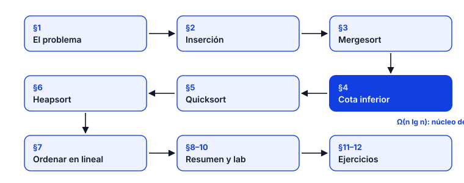
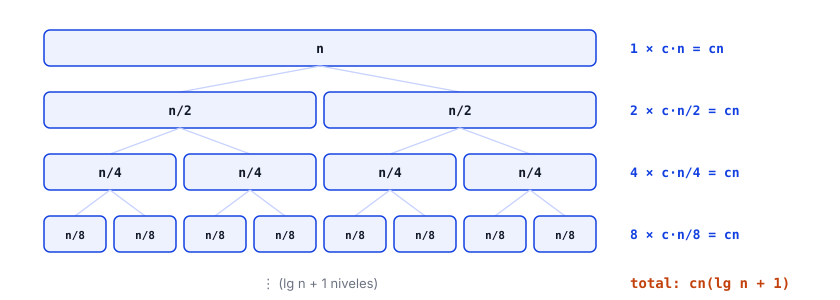

# Lección 5 — Ordenamiento

> **Prerrequisitos:** Lección 0 (§1 inducción fuerte, §2 logaritmos, §3 sumas, §4 probabilidad e indicadoras), Lección 1 (§3 asintótica), Lección 3 (§2.3 invariantes de ciclo) y Lección 4 (§4 algoritmos aleatorizados).
>
> **Cómo estudiar esta lección:** es la lección con más demostraciones del curso, y todas usan cuatro herramientas que ya tienes: invariantes de ciclo, inducción, recurrencias y linealidad de la esperanza. Para cada algoritmo, identifica cuál de las cuatro demuestra su corrección y cuál su costo.
>
> **Lab asociado:** `lab05`: inserción, mezcla, quicksort, heapsort, conteo y radix (C, C++ y Rust).

## Objetivos de aprendizaje

Al terminar esta lección deberías poder:
1. Especificar el problema de ordenamiento, y definir **estabilidad** e **in-place**.
2. Demostrar la corrección de inserción con un invariante de ciclo y relacionar su costo con el número de **inversiones**.
3. Demostrar la corrección de mergesort por inducción y resolver su recurrencia con un **árbol de recursión** y con el **teorema maestro**.
4. Demostrar la cota inferior $\Omega(n\lg n)$ para todo ordenamiento por comparaciones (**árboles de decisión**).
5. Demostrar que quicksort con pivote aleatorio hace $2n\ln n + O(n)$ comparaciones esperadas, y que con recursión en la parte menor usa $O(\lg n)$ de pila.
6. Explicar cómo counting sort y radix sort rompen la cota inferior, y demostrar la corrección de radix por inducción.

## Mapa de la lección



---

## 1. El problema

**Entrada:** una secuencia $\langle a_0, \dots, a_{n-1}\rangle$ y un orden total $\le$ sobre sus elementos.
**Salida:** una **permutación** $\langle a_{\pi(0)}, \dots, a_{\pi(n-1)}\rangle$ de la entrada tal que $a_{\pi(0)} \le a_{\pi(1)} \le \dots \le a_{\pi(n-1)}$.

Las dos condiciones importan: un algoritmo que devuelve $\langle 0, 0, \dots, 0\rangle$ produce algo ordenado pero no es permutación. Los tests del lab comparan contra el ordenamiento de la biblioteca estándar, lo que verifica ambas.

**Estable:** elementos con claves iguales conservan su orden relativo de la entrada. Importa cuando se ordena por una clave un registro que tiene más datos (ordenar alumnos por calificación, conservando el orden alfabético previo). Los tests `*_estable` ordenan pares `(clave, id)` comparando solo la clave y exigen que los `id` de claves iguales queden en orden.

**In-place:** usa $O(1)$ memoria extra (a veces se acepta $O(\lg n)$ de pila).

**El contrato del comparador.** Todo el lab usa solo `<` (o `cmp(a, b) < 0`). Debe ser un **orden débil estricto**: irreflexivo ($a \not< a$), transitivo, y con "incomparable" transitivo. Si no lo es (por ejemplo, si usas `<=`), en C++ `std::sort` tiene **comportamiento indefinido**: puede leer fuera del arreglo. En Rust, `sort` con un `Ord` inconsistente puede producir un orden arbitrario o hacer `panic`, pero **nunca** UB. En C, `qsort` con un comparador inconsistente tampoco está definido.

---

## 2. Ordenamiento por inserción

```
insertion_sort(a):
    para i = 1 .. n−1:
        x ← a[i];  j ← i
        mientras j > 0 y x < a[j−1]:
            a[j] ← a[j−1];  j ← j − 1
        a[j] ← x
```

> **Teorema 1.** `insertion_sort` ordena, es estable y es in-place.

*Demostración.* Invariante de ciclo: *al empezar la iteración $i$, $a[0..i)$ contiene los $i$ primeros elementos originales, ordenados.*
- *Inicialización* ($i = 1$): $a[0..1)$ tiene un elemento: ordenado. ✔
- *Mantenimiento:* el ciclo interno corre una posición a la derecha cada elemento de $a[0..i)$ que es **estrictamente mayor** que $x$ y se detiene en el primero que no lo es. Como $a[0..i)$ estaba ordenado, los que se corrieron forman un sufijo de elementos $> x$ y los que quedan antes son $\le x$. Poner $x$ en el hueco deja $a[0..i+1)$ ordenado. ✔
- *Terminación:* con $i = n$, el invariante dice que $a[0..n)$ está ordenado. ✔

*Estabilidad:* $x$ solo rebasa elementos estrictamente mayores, nunca uno igual; así que entre iguales se conserva el orden de llegada. $\blacksquare$

### 2.1 Costo e inversiones

Una **inversión** es un par $(i, j)$ con $i < j$ y $a_i > a_j$. Una secuencia ordenada tiene 0; una ordenada al revés, $\binom n2$.

> **Teorema 2.** Inserción hace exactamente $I$ movimientos y entre $I$ y $I + n - 1$ comparaciones, donde $I$ es el número de inversiones de la entrada. Su costo es $\Theta(n + I)$.

*Demostración.* Cada iteración del ciclo interno intercambia (corre) un par adyacente invertido $(a[j-1], x)$ y eso elimina **exactamente una** inversión (las demás posiciones relativas no cambian). El algoritmo termina con 0 inversiones, así que hay exactamente $I$ corrimientos. Cada iteración del ciclo externo hace una comparación por corrimiento más, a lo sumo, una que falla: entre $I$ y $I + n - 1$ comparaciones. $\blacksquare$

**Consecuencias.** Peor caso (al revés): $\Theta(n^2)$. Mejor caso (ordenada): $\Theta(n)$. En esperanza, sobre una permutación uniforme, cada par está invertido con probabilidad $1/2$: $\mathbb E[I] = \binom n2/2$, así que $\Theta(n^2)$ en promedio. Pero en entradas **casi ordenadas** (pocas inversiones) inserción es lineal, y en arreglos pequeños ($n \lesssim 16$) es el algoritmo más rápido en la práctica por sus constantes diminutas. Por eso las soluciones de quicksort la usan para los subarreglos pequeños.

::: {.tabs}
```c
#include <stdio.h>

#define N 1000
static long comparaciones;

static void insercion(int *a, int n) {
    for (int i = 1; i < n; i++) {
        int x = a[i], j = i;
        while (j > 0 && (comparaciones++, x < a[j - 1])) { a[j] = a[j - 1]; j--; }
        a[j] = x;
    }
}

static long inversiones(const int *a, int n) {
    long inv = 0;
    for (int i = 0; i < n; i++)
        for (int j = i + 1; j < n; j++) inv += a[i] > a[j];
    return inv;
}

static void probar(const char *nombre, int *a) {
    long inv = inversiones(a, N);
    comparaciones = 0;
    insercion(a, N);
    printf("%-10s inversiones %6ld   comparaciones %6ld\n", nombre, inv, comparaciones);
}

int main(void) {
    static int a[N];
    unsigned long long s = 42;
    for (int i = 0; i < N; i++) a[i] = i;
    probar("ordenado", a);
    for (int i = 0; i < N; i++) a[i] = N - i;
    probar("invertido", a);
    for (int i = 0; i < N; i++) {
        s = s * 6364136223846793005ULL + 1442695040888963407ULL;
        a[i] = (int)(s >> 33) % 1000;
    }
    probar("aleatorio", a);
    return 0;
}
```

```cpp
#include <cstdint>
#include <cstdio>
#include <vector>

long comparaciones = 0;

void insercion(std::vector<int>& a) {
    for (std::size_t i = 1; i < a.size(); ++i) {
        int x = a[i];
        std::size_t j = i;
        while (j > 0 && (++comparaciones, x < a[j - 1])) { a[j] = a[j - 1]; --j; }
        a[j] = x;
    }
}

long inversiones(const std::vector<int>& a) {
    long inv = 0;
    for (std::size_t i = 0; i < a.size(); ++i)
        for (std::size_t j = i + 1; j < a.size(); ++j) inv += a[i] > a[j];
    return inv;
}

void probar(const char* nombre, std::vector<int> a) {
    long inv = inversiones(a);
    comparaciones = 0;
    insercion(a);
    std::printf("%-10s inversiones %6ld   comparaciones %6ld\n", nombre, inv, comparaciones);
}

int main() {
    const int N = 1000;
    std::vector<int> a(N);
    for (int i = 0; i < N; ++i) a[i] = i;
    probar("ordenado", a);
    for (int i = 0; i < N; ++i) a[i] = N - i;
    probar("invertido", a);
    std::uint64_t s = 42;
    for (int i = 0; i < N; ++i) {
        s = s * 6364136223846793005ULL + 1442695040888963407ULL;
        a[i] = (int)(s >> 33) % 1000;
    }
    probar("aleatorio", a);
}
```

```rust
const N: usize = 1000;

fn insercion(a: &mut [i32], comparaciones: &mut u64) {
    for i in 1..a.len() {
        let x = a[i];
        let mut j = i;
        while j > 0 && { *comparaciones += 1; x < a[j - 1] } {
            a[j] = a[j - 1];
            j -= 1;
        }
        a[j] = x;
    }
}

fn inversiones(a: &[i32]) -> u64 {
    let mut inv = 0;
    for i in 0..a.len() {
        for j in i + 1..a.len() { inv += (a[i] > a[j]) as u64; }
    }
    inv
}

fn probar(nombre: &str, mut a: Vec<i32>) {
    let inv = inversiones(&a);
    let mut c = 0;
    insercion(&mut a, &mut c);
    println!("{:<10} inversiones {:>6}   comparaciones {:>6}", nombre, inv, c);
}

fn main() {
    probar("ordenado", (0..N as i32).collect());
    probar("invertido", (0..N as i32).map(|i| N as i32 - i).collect());
    let mut s: u64 = 42;
    let a = (0..N)
        .map(|_| {
            s = s.wrapping_mul(6364136223846793005).wrapping_add(1442695040888963407);
            ((s >> 33) as i32) % 1000
        })
        .collect();
    probar("aleatorio", a);
}
```
:::

```{.text .salida}
ordenado   inversiones      0   comparaciones    999
invertido  inversiones 499500   comparaciones 499500
aleatorio  inversiones 238849   comparaciones 239845
```

Observa las tres filas contra el Teorema 2: ordenado, 0 inversiones y $n - 1$ comparaciones; invertido, $\binom{n}{2}$ de ambas; aleatorio, muy cerca de $\binom n2/2 = 249\,750$ y entre $I$ e $I + n - 1$.

⚠️ Para alinear columnas, `%-10s` en C y C++ cuenta **bytes**, mientras que `{:<10}` en Rust cuenta **caracteres**: con una etiqueta como "al revés" (la `é` ocupa 2 bytes en UTF-8) las columnas se desalinean distinto en cada lenguaje. Por eso las etiquetas del programa no llevan acentos. Volveremos a UTF-8 en la L12.

---

## 3. Divide y vencerás: mergesort

### 3.1 El algoritmo

**Divide y vencerás:** partir el problema en subproblemas del mismo tipo, resolverlos recursivamente y **combinar** las soluciones.

```
merge_sort(a[0..n)):
    si n < 2: regresar
    m ← ⌊n/2⌋
    merge_sort(a[0..m));  merge_sort(a[m..n))
    merge(a, m)           -- mezcla las dos mitades ordenadas
```

`merge` recorre las dos mitades con dos índices y en cada paso toma el menor de los dos frentes. **En empate toma de la izquierda**: eso, y solo eso, hace al algoritmo estable.

> **Lema 3.** Si $a[0..m)$ y $a[m..n)$ están ordenados, `merge` los deja ordenados en $a[0..n)$, es estable, y hace a lo más $n - 1$ comparaciones.

*Demostración (esquema).* Invariante: el prefijo ya escrito contiene, ordenados, los $k$ menores elementos de la unión, y si dos son iguales el de la izquierda va primero. Cada paso agrega el menor de los dos frentes, que es el menor de lo que falta (cada mitad está ordenada). Cada comparación coloca al menos un elemento y el último no requiere comparación: $\le n - 1$. $\blacksquare$

> **Teorema 4.** `merge_sort` ordena.

*Demostración.* Inducción fuerte sobre $n$. Base: $n < 2$ ya está ordenado. Paso: las dos mitades tienen tamaño $< n$, así que por hipótesis de inducción quedan ordenadas; por el Lema 3, `merge` produce $a[0..n)$ ordenado. $\blacksquare$

**Detalle de implementación.** La solución de referencia copia solo la **mitad izquierda** a un búfer auxiliar y mezcla de vuelta sobre el arreglo: el índice de escritura $k = i + (j - m)$ nunca rebasa el de lectura $j$ de la derecha, así que no se pisa nada sin leer. Memoria extra: $n/2$. Además, si $a[m-1] \le a[m]$ las mitades ya están en orden y la mezcla se omite: mergesort cuesta $\Theta(n)$ en entradas ordenadas.

### 3.2 La recurrencia

Sea $T(n)$ el peor costo. Dividir es $O(1)$, mezclar $\Theta(n)$:
$$T(n) = T(\lfloor n/2\rfloor) + T(\lceil n/2\rceil) + \Theta(n), \qquad T(1) = \Theta(1).$$

**Árbol de recursión.** Para $n$ potencia de 2 y costo $cn$ de la mezcla: el nivel $k$ del árbol tiene $2^k$ nodos de tamaño $n/2^k$, cada uno con costo $c\,n/2^k$: **$cn$ por nivel**. Hay $\lg n + 1$ niveles. Total: $cn(\lg n + 1) = \Theta(n\lg n)$.



**Verificación por sustitución** (para todo $n$): supongamos $T(k) \le c\,k\lg k$ para $2 \le k < n$. Con $m_1 = \lfloor n/2\rfloor$, $m_2 = \lceil n/2\rceil \le (n+1)/2$:
$$T(n) \le c\,m_1\lg m_1 + c\,m_2\lg m_2 + dn \le c\,n\lg\tfrac{n+1}{2} + dn = cn\lg(n+1) - cn + dn.$$
Para $n \ge 2$, $\lg(n+1) \le \lg n + 0.59$, así que $T(n) \le cn\lg n + (0.59c - c + d)n \le cn\lg n$ si $c \ge d/0.41$. $\blacksquare$

### 3.3 El teorema maestro

Muchas recurrencias de divide y vencerás tienen la forma $T(n) = a\,T(n/b) + f(n)$ con $a \ge 1$, $b > 1$. Comparando $f(n)$ con $n^{\log_b a}$ (el número de hojas del árbol):

| Caso | Condición | Resultado | Intuición |
|---|---|---|---|
| 1 | $f(n) = O(n^{\log_b a - \varepsilon})$ | $T(n) = \Theta(n^{\log_b a})$ | dominan las hojas |
| 2 | $f(n) = \Theta(n^{\log_b a}\lg^k n)$, $k\ge 0$ | $T(n) = \Theta(n^{\log_b a}\lg^{k+1} n)$ | todos los niveles pesan igual |
| 3 | $f(n) = \Omega(n^{\log_b a + \varepsilon})$ y $a f(n/b) \le c f(n)$, $c<1$ | $T(n) = \Theta(f(n))$ | domina la raíz |

Mergesort: $a = b = 2$, $n^{\log_2 2} = n$, $f(n) = \Theta(n)$: caso 2 con $k = 0$, $\Theta(n\lg n)$. Búsqueda binaria: $a = 1$, $b = 2$, $f = \Theta(1) = \Theta(n^0)$: caso 2, $\Theta(\lg n)$. (Demostración: CLRS §4.6; es el árbol de recursión hecho en general.)

---

## 4. La cota inferior

¿Se puede ordenar en menos de $\Theta(n\lg n)$? **No**, si el algoritmo solo obtiene información **comparando** elementos.

**Modelo de árbol de decisión.** Fijemos $n$. Cualquier algoritmo de comparaciones se puede ver como un árbol binario: cada nodo interno es una comparación "$a_i < a_j$?", cada rama una respuesta, y cada hoja la permutación que el algoritmo aplica. Ejecutar el algoritmo sobre una entrada es seguir un camino de la raíz a una hoja; el número de comparaciones es la longitud de ese camino.

> **Teorema 5.** Todo algoritmo de ordenamiento por comparaciones hace $\Omega(n\lg n)$ comparaciones en el peor caso.

*Demostración.* Para entradas con elementos distintos, cada una de las $n!$ permutaciones de entrada requiere una permutación de salida distinta, así que debe llegar a una hoja distinta: el árbol tiene al menos $n!$ hojas. Un árbol binario de altura $h$ tiene a lo más $2^h$ hojas. Entonces $2^h \ge n!$, es decir,
$$h \ge \lg(n!) \ge \lg\Big(\big(\tfrac n2\big)^{n/2}\Big) = \tfrac n2\lg\tfrac n2 = \Omega(n\lg n),$$
donde usamos que $n!$ tiene al menos $n/2$ factores $\ge n/2$. $\blacksquare$

Más fino: por la aproximación de Stirling, $\lg(n!) = n\lg n - n\lg e + O(\lg n) \approx n\lg n - 1.44n$. Mergesort hace a lo más $n\lceil\lg n\rceil - 2^{\lceil \lg n\rceil} + 1$ comparaciones: está a un término lineal del óptimo.

El teorema vale también **en esperanza** (incluso para algoritmos aleatorizados): la profundidad promedio de las $n!$ hojas de un árbol binario es al menos $\lg(n!)$.

::: {.tabs}
```c
#include <math.h>
#include <stdio.h>

int main(void) {
    for (int n = 10; n <= 100000; n *= 10) {
        double lg_fact = 0;
        for (int i = 2; i <= n; i++) lg_fact += log2((double)i);
        printf("n = %6d   lg(n!) = %10.1f   n lg n = %10.1f\n", n, lg_fact, n * log2((double)n));
    }
    return 0;
}
```

```cpp
#include <cmath>
#include <cstdio>

int main() {
    for (int n = 10; n <= 100000; n *= 10) {
        double lg_fact = 0;
        for (int i = 2; i <= n; ++i) lg_fact += std::log2((double)i);
        std::printf("n = %6d   lg(n!) = %10.1f   n lg n = %10.1f\n", n, lg_fact, n * std::log2((double)n));
    }
}
```

```rust
fn main() {
    let mut n = 10;
    while n <= 100_000 {
        let lg_fact: f64 = (2..=n).map(|i| (i as f64).log2()).sum();
        println!("n = {:6}   lg(n!) = {:10.1}   n lg n = {:10.1}", n, lg_fact, n as f64 * (n as f64).log2());
        n *= 10;
    }
}
```
:::

```{.text .salida}
n =     10   lg(n!) =       21.8   n lg n =       33.2
n =    100   lg(n!) =      524.8   n lg n =      664.4
n =   1000   lg(n!) =     8529.4   n lg n =     9965.8
n =  10000   lg(n!) =   118458.1   n lg n =   132877.1
n = 100000   lg(n!) =  1516704.2   n lg n =  1660964.0
```

---

## 5. Quicksort

### 5.1 El algoritmo

Quicksort también es divide y vencerás, pero el trabajo está en **dividir**, no en combinar: se elige un **pivote** $p$, se **particiona** el arreglo en "menores que $p$", "iguales a $p$" y "mayores que $p$", y se ordenan recursivamente las partes de los extremos. No hay que combinar nada.

**Partición en 3 vías** (bandera holandesa, Dijkstra). Tres índices `lt`, `i`, `gt` con el invariante:
$$a[0..\texttt{lt}) < p,\quad a[\texttt{lt}..i) = p,\quad a[i..\texttt{gt})\ \text{sin clasificar},\quad a[\texttt{gt}..n) > p.$$
Cada paso clasifica $a[i]$: si es menor, se intercambia con $a[\texttt{lt}]$ y avanzan ambos; si es mayor, se intercambia con $a[\texttt{gt}-1]$ y retrocede `gt` (sin avanzar $i$: el que llegó está sin clasificar); si es igual, avanza $i$. Termina cuando $i = \texttt{gt}$, tras exactamente $n$ clasificaciones.

¿Por qué 3 vías? Con la partición clásica de 2 vías ("$\le p$" y "$> p$"), un arreglo de $n$ elementos **iguales** se parte en $n-1$ y $0$ en cada nivel: $\Theta(n^2)$. Con 3 vías, todos caen en el centro y se termina en una pasada: $\Theta(n)$. El test `quick_sort_adversarial` usa 200 000 elementos iguales.

### 5.2 El pivote

Si el pivote es siempre el primer elemento y la entrada ya está ordenada, cada partición separa 0 y $n - 1$: $T(n) = T(n-1) + \Theta(n) = \Theta(n^2)$. Lo mismo para cualquier regla **determinista**: para cada una existe una entrada que la hace cuadrática. La solución es la de L04: **aleatorizar**. Elegir el pivote uniformemente al azar hace que el peor caso dependa de nuestra suerte, no de la entrada.

> **Teorema 6.** Con pivote uniforme e independiente en cada llamada, quicksort hace en esperanza a lo más $2n\ln n$ comparaciones sobre cualquier entrada de $n$ elementos distintos.

*Demostración.* Sean $z_1 < z_2 < \dots < z_n$ los elementos **en orden**. Sea $X_{ij}$ ($i < j$) la indicadora de que $z_i$ y $z_j$ se comparan alguna vez. Dos elementos se comparan solo si uno de ellos es el pivote en el momento en que ambos están todavía en el mismo subarreglo, y después de eso el pivote no vuelve a compararse con nadie; así que cada par se compara a lo más una vez y el total de comparaciones es $X = \sum_{i<j} X_{ij}$.

Consideremos $Z_{ij} = \{z_i, z_{i+1}, \dots, z_j\}$. Mientras no se elija como pivote ningún elemento de $Z_{ij}$, todo $Z_{ij}$ permanece en el mismo subarreglo (un pivote fuera de $Z_{ij}$ es menor o mayor que todos ellos). El **primer** pivote elegido de $Z_{ij}$ decide: si es $z_i$ o $z_j$, se comparan; si es uno intermedio, los separa y nunca se compararán. Como el pivote es uniforme dentro de su subarreglo, que contiene a todo $Z_{ij}$, cada uno de los $j - i + 1$ elementos de $Z_{ij}$ tiene la misma probabilidad de ser el primero elegido:
$$\Pr[X_{ij} = 1] = \frac{2}{j - i + 1}.$$
Por linealidad de la esperanza, con $k = j - i$:
$$\mathbb E[X] = \sum_{i=1}^{n-1}\sum_{j=i+1}^{n}\frac{2}{j-i+1} = \sum_{i=1}^{n-1}\sum_{k=1}^{n-i}\frac{2}{k+1} < \sum_{i=1}^{n}2\sum_{k=1}^{n}\frac1k = 2nH_n \le 2n(\ln n + 1).$$
Con un análisis exacto, $\mathbb E[X] = 2(n+1)H_n - 4n = 2n\ln n + O(n) \approx 1.39\,n\lg n$. $\blacksquare$

Comparado con el óptimo $\lg(n!) \approx n\lg n$, quicksort hace 39% más comparaciones en promedio, pero cada una es baratísima (recorre el arreglo secuencialmente, sin búfer auxiliar), y por eso suele ser el más rápido en la práctica.

### 5.3 La pila

En el peor caso (con probabilidad minúscula, pero posible), las particiones son $0$ y $n-1$ y la recursión tiene profundidad $n$: desborda la pila igual que la destrucción de una lista (L03). La solución de referencia lo evita:

> **Proposición 7.** Si quicksort hace la llamada recursiva sobre la parte **menor** y continúa con un ciclo sobre la mayor, la profundidad de recursión es a lo más $\lg n$.

*Demostración.* Cada llamada recursiva recibe la parte menor de una partición de un subarreglo de tamaño $m$, que tiene tamaño $\le m/2$. A lo largo de cualquier cadena de llamadas anidadas el tamaño se reduce al menos a la mitad en cada nivel, así que hay a lo más $\lg n$ niveles. El ciclo sobre la parte mayor no agrega marcos de pila. $\blacksquare$

`std::sort` en C++ es *introsort*: quicksort que, si la recursión pasa de $2\lg n$ niveles, cambia a heapsort, garantizando $O(n\lg n)$ en el peor caso. El `sort_unstable` de Rust es *pattern-defeating quicksort* (pdqsort), una evolución de la misma idea.

---

## 6. Heapsort

Un **max-heap** es un arreglo en el que cada $a[i] \ge a[2i+1], a[2i+2]$ (sus "hijos"). La estructura completa es tema de la L06; aquí basta con:

- `sift_down(i)`: si $a[i]$ es menor que algún hijo, intercambiarlo con el mayor de ellos y repetir desde ahí. $O(\text{altura}) = O(\lg n)$.
- **heapify** de abajo hacia arriba: `sift_down(i)` para $i = \lfloor n/2\rfloor - 1, \dots, 0$.

> **Proposición 8.** heapify cuesta $O(n)$, no $O(n\lg n)$.

*Demostración.* Un nodo a altura $h$ cuesta $O(h)$, y hay a lo más $\lceil n/2^{h+1}\rceil$ nodos de altura $h$. Total: $\sum_{h=0}^{\lg n}\frac{n}{2^{h+1}}O(h) = O\big(n\sum_{h\ge0} h/2^h\big) = O(2n) = O(n)$, porque $\sum_{h \ge 0} h x^h = x/(1-x)^2$, que vale 2 en $x = 1/2$. $\blacksquare$

Heapsort: heapify, y luego $n-1$ veces "intercambiar la raíz (el máximo) con el último elemento del heap y hacer `sift_down` en el heap reducido". $\Theta(n\lg n)$ en el peor caso, in-place, pero no estable y con mal uso de caché (salta entre $i$ y $2i$).

---

## 7. Ordenar en tiempo lineal

El Teorema 5 solo aplica a algoritmos que **comparan**. Si las claves son enteros pequeños, se pueden usar como **índices**.

### 7.1 Counting sort

Con claves en $\{0, \dots, k-1\}$:
1. Contar: $c[v]$ = número de claves iguales a $v$. $\Theta(n)$.
2. Sumas prefijas: $c[v] \gets c[0] + \dots + c[v]$ = número de claves $\le v$. $\Theta(k)$.
3. Recorrer la entrada **de atrás hacia adelante**, colocando cada $x$ en la posición $c[x] - 1$ de la salida y decrementando $c[x]$. $\Theta(n)$.

Costo $\Theta(n + k)$, lineal si $k = O(n)$. **Estable**: entre claves iguales, la que aparece última en la entrada se coloca primero en la posición más alta, y así hacia atrás.

### 7.2 Radix sort

Para claves de $d$ dígitos en base $b$: ordenar **establemente** por el dígito menos significativo, luego por el siguiente, …, hasta el más significativo (*LSD*).

> **Teorema 9.** Radix sort LSD ordena correctamente si cada pasada es estable.

*Demostración.* Inducción sobre el número de pasadas $t$: *tras la pasada $t$, los elementos están ordenados por sus $t$ dígitos menos significativos.* Base $t = 1$: la pasada ordena por el dígito 0. Paso: tras la pasada $t + 1$ (por el dígito $t$), dos elementos con dígitos $t$ distintos quedan en el orden de ese dígito, que es el más significativo de los $t+1$ considerados; dos con el mismo dígito $t$ conservan, por **estabilidad**, el orden de la pasada anterior, que por hipótesis es el de sus $t$ dígitos bajos. Así quedan ordenados por los $t+1$ dígitos bajos. Con $t = d$, ordenados por la clave completa. $\blacksquare$

Costo: $d$ pasadas de counting sort con $k = b$: $\Theta(d(n + b))$. Para enteros de 32 bits, el lab usa $b = 256$ y $d = 4$: $\Theta(4n + 1024)$. Con $b = 2^{16}$ serían 2 pasadas, pero con un arreglo de conteo de 64K entradas que no cabe en la caché L1.

**¿Rompe la cota inferior?** Sí, porque no es un algoritmo de comparaciones: usa los bits de la clave como índices. El precio: solo sirve para claves con estructura de "dígitos" (enteros, cadenas de longitud acotada), no para un orden arbitrario dado por un comparador.

---

## 8. Resumen de algoritmos

| Algoritmo | Peor caso | Esperado | Memoria extra | Estable | Técnica de la demostración |
|---|---|---|---|---|---|
| Inserción | $\Theta(n^2)$ | $\Theta(n^2)$ | $O(1)$ | sí | invariante de ciclo; inversiones |
| Mergesort | $\Theta(n\lg n)$ | $\Theta(n\lg n)$ | $\Theta(n)$ | sí | inducción; recurrencia |
| Quicksort (aleatorio, 3 vías) | $\Theta(n^2)$ | $\Theta(n\lg n)$ | $O(\lg n)$ | no | indicadoras $X_{ij}$ |
| Heapsort | $\Theta(n\lg n)$ | $\Theta(n\lg n)$ | $O(1)$ | no | suma $\sum h/2^h$ |
| Counting | $\Theta(n+k)$ | $\Theta(n+k)$ | $\Theta(n+k)$ | sí | conteo directo |
| Radix LSD | $\Theta(d(n+b))$ | $\Theta(d(n+b))$ | $\Theta(n+b)$ | sí | inducción + estabilidad |

## 9. Resumen de paradigmas en este lab

| Aspecto | C | C++ | Rust |
|---|---|---|---|
| Vista del arreglo | `void *base, size_t n, size_t size` | `std::span<T>` | `&mut [T]` |
| Comparación | `int (*cmp)(const void*, const void*)` | `operator<` | trait `Ord` |
| Mover elementos | `memcpy` de `size` bytes | `std::move` | `swap` / `clone` (o `unsafe`) |
| Dividir el arreglo | aritmética de punteros | `first(m)`, `subspan(m)` | `split_at_mut(m)`: dos `&mut` disjuntos |
| Comparador inconsistente | UB | UB en `std::sort` | resultado arbitrario o `panic`, nunca UB |
| Aleatoriedad | escrita a mano (xorshift) | escrita a mano | escrita a mano (no hay en `std`) |

---

## 10. Guía del Lab 05

**Archivos:** `c/src/lab05/sorting.c`, `cpp/include/algolib/lab05/sorting.hpp`, `rust/src/lab05/mod.rs`.

**Orden sugerido:** inserción → mergesort → heapsort → quicksort → counting → radix. Después de cada uno, `make labNN` y mira que pasen su `*_correcto` y, si aplica, su `*_estable`.

**Consejos:**
- **Mergesort:** escribe `merge` por separado y pruébalo en papel con empates. Es estable solo si en empate tomas de la izquierda (`if (der < izq) tomar der; else tomar izq;`).
- **Quicksort:** escribe la partición en 3 vías con su invariante en un comentario. Recursión en la parte menor (Prop. 7). Para subarreglos de $\le 16$ elementos, usa inserción.
- **Rust:** `split_at_mut` para recursar sobre las dos mitades; en quicksort, `let (izq, resto) = a.split_at_mut(lt); let der = &mut resto[gt - lt..];`.
- **C:** escribe primero `swap_bytes(a, b, size)` y la macro `AT(base, i, size)`; todo lo demás se construye con ellas.
- **Radix:** usa un búfer auxiliar y alterna origen y destino entre pasadas; con 4 pasadas el resultado vuelve al arreglo original.

**Errores frecuentes:**
- Quicksort con pivote fijo o partición de 2 vías: `quick_sort_adversarial` no termina.
- Mergesort que en empate toma de la derecha: falla `merge_sort_estable`.
- heapify recorriendo de $0$ hacia arriba en vez de $\lfloor n/2\rfloor - 1$ hacia abajo: no construye un heap.
- Counting sort recorriendo la entrada hacia adelante en el paso 3: deja de ser estable, y radix (que depende de ello) da resultados incorrectos.
- En C, `size_t i = n - 1; i >= 0; i--`: un `size_t` nunca es negativo, el ciclo no termina. Usa `for (size_t i = n; i-- > 0;)`.

---

## 11. Comprueba tu comprensión

1. ¿Cuántas inversiones tiene $\langle 3, 1, 2\rangle$? ¿Cuántos corrimientos hará inserción?
2. ¿Por qué la cota inferior no contradice que counting sort sea $\Theta(n + k)$?
3. ¿Cuál es la probabilidad de que quicksort compare el mínimo con el máximo?
4. ¿Qué devuelve el teorema maestro para $T(n) = 4T(n/2) + n$? ¿Y para $T(n) = 2T(n/2) + n^2$?
5. ¿Es estable heapsort? Da un contraejemplo de 3 elementos o argumenta por qué sí.

<details><summary>Respuestas</summary>

1. Dos: $(3,1)$ y $(3,2)$. Inserción hace exactamente 2 corrimientos (Teorema 2).
2. La cota inferior es para algoritmos que solo **comparan**. Counting sort usa las claves como índices de un arreglo, operación que el modelo de árbol de decisión no permite.
3. $z_1$ y $z_n$: $2/(n - 1 + 1) = 2/n$. Solo se comparan si alguno de los dos es el primer pivote elegido de todo el arreglo.
4. $n^{\log_2 4} = n^2$ domina a $n$: caso 1, $\Theta(n^2)$. Para la segunda, $f(n) = n^2$ domina a $n^{\log_2 2} = n$ y cumple la regularidad ($2(n/2)^2 = n^2/2$): caso 3, $\Theta(n^2)$.
5. No. Con $\langle 1_a, 1_b, 0\rangle$ (ya es max-heap), el primer intercambio manda $1_a$ al final y deja $\langle 0, 1_b\rangle$; tras `sift_down` y el segundo intercambio, $1_b$ queda en la posición 1: resultado $\langle 0, 1_b, 1_a\rangle$, con $1_a$ y $1_b$ invertidos.
</details>

---

## 12. Problem Set 5

**Teoría**
1. Demuestra que el número esperado de inversiones de una permutación uniforme es $n(n-1)/4$, y concluye que **todo** algoritmo que solo intercambia elementos adyacentes hace $\Omega(n^2)$ intercambios en promedio.
2. Demuestra el Lema 3 con todo detalle (invariante de ciclo de `merge`, incluida la estabilidad).
3. Resuelve con el teorema maestro, o explica por qué no aplica: (a) $T(n) = 3T(n/4) + n\lg n$; (b) $T(n) = 2T(n/2) + n/\lg n$; (c) $T(n) = 7T(n/2) + n^2$.
4. **Selección en tiempo esperado lineal (quickselect).** Modifica quicksort para encontrar el $k$-ésimo menor recursando solo en la parte que lo contiene. Demuestra que el número esperado de comparaciones es a lo más $4n$.
5. Demuestra que encontrar el máximo **y** el mínimo de $n$ elementos requiere solo $\lceil 3n/2\rceil - 2$ comparaciones, y que eso es óptimo.
6. Demuestra que cualquier algoritmo de comparaciones que **combine** dos listas ordenadas de tamaño $n$ cada una hace al menos $2n - 1$ comparaciones en el peor caso.

**Implementación (C, C++ y Rust)**

7. Implementa *introsort*: quicksort que cambia a heapsort si la profundidad pasa de $2\lfloor\lg n\rfloor$. Construye una entrada que active el cambio con un pivote determinista (mediana de 3) y verifica que se mantiene $O(n\lg n)$.
8. Implementa mergesort de abajo hacia arriba (sin recursión) y compara su tiempo con el recursivo para $n = 10^6$.
9. Instrumenta tus implementaciones para contar comparaciones y verifica empíricamente: inserción $\approx n^2/4$, mergesort $\le n\lceil\lg n\rceil$, quicksort $\approx 1.39\,n\lg n$, heapsort $\approx 2n\lg n$, para entradas aleatorias de tamaño $2^{10}, \dots, 2^{16}$.
10. Implementa `nth_element` (quickselect del ej. 4) con la misma interfaz que el lab en los tres lenguajes, con tests contra un oráculo.

---

## Referencias
- CLRS, *Introduction to Algorithms*, 4ª ed.: Cap. 2 (inserción, mergesort), Cap. 4 (recurrencias, teorema maestro), Cap. 6 (heapsort), Cap. 7 (quicksort; §7.4 análisis), Cap. 8 (cota inferior, counting, radix), §9.2 (selección).
- MIT 6.006 (Spring 2020), Lectures 3 (*Sorting*) y 5 (*Linear Sorting*).
- Sedgewick, R. y Wayne, K. *Algorithms*, 4ª ed., §2.3 (quicksort de 3 vías, Dijkstra).
- Musser, D. (1997). *Introspective Sorting and Selection Algorithms*. Software: Practice and Experience.
- Peters, O. (2021). *Pattern-defeating Quicksort*. arXiv:2106.05123.
