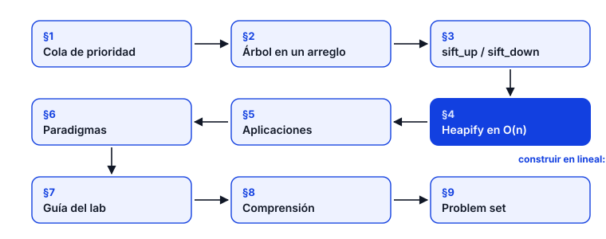
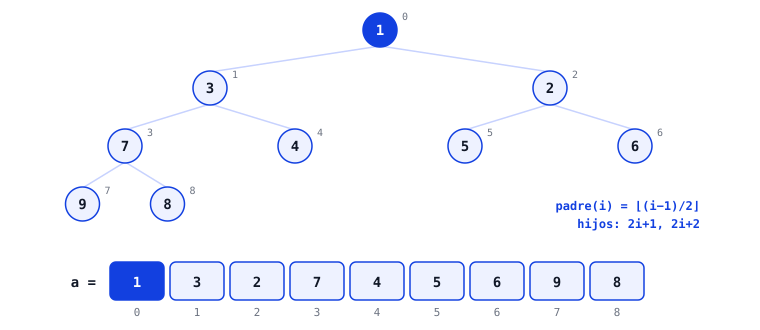

# Lección 6 — Colas de prioridad y heaps binarios

> **Prerrequisitos:** Lección 1 (§6 análisis amortizado), Lección 2 (arreglo dinámico) y Lección 5 (§6 heapsort y heapify).
>
> **Cómo estudiar esta lección:** un heap es un árbol que **no se guarda como árbol**: vive en un arreglo y la forma se deduce de los índices. Dibuja siempre las dos vistas, el árbol y el arreglo, una debajo de la otra.
>
> **Lab asociado:** `lab06`: `BinaryHeap` (C, C++ y Rust). Lo reutilizarás en los labs 10 (Dijkstra) y 11 (Prim).

## Objetivos de aprendizaje

Al terminar esta lección deberías poder:
1. Especificar el **TAD Cola de prioridad** y comparar sus implementaciones.
2. Explicar la **representación implícita** de un árbol binario casi completo en un arreglo y demostrar que su altura es $\lfloor\lg n\rfloor$.
3. Demostrar la corrección de `sift_up` y `sift_down` con el lema de la **violación local**.
4. Demostrar que construir un heap cuesta a lo más $2n$ comparaciones, y que hacerlo con $n$ inserciones puede costar $\Theta(n\lg n)$.
5. Resolver problemas con heaps: top-$k$, mezcla de $k$ listas, mediana en línea.
6. Comparar cómo C, C++ y Rust parametrizan el orden: puntero a función, parámetro de plantilla `Compare`, y el envoltorio `Reverse<T>`.

## Mapa de la lección



---

## 1. El TAD Cola de prioridad

Una **cola de prioridad** guarda elementos con una prioridad y permite sacar siempre el de **mejor** prioridad (en este curso, el **mínimo**):

| Operación | Efecto |
|---|---|
| `push(x)` | agrega $x$ |
| `top()` | el mínimo, sin quitarlo |
| `pop()` | quita el mínimo |
| `build(a)` | construye desde $n$ elementos |

Aparece en todas partes: el planificador de un sistema operativo (el proceso de mayor prioridad), la simulación de eventos (el próximo evento en el tiempo), Dijkstra y Prim (el vértice más cercano, L10–L11), la compresión de Huffman (los dos símbolos menos frecuentes).

| Implementación | `push` | `top` | `pop` | `build` |
|---|---|---|---|---|
| Arreglo sin ordenar | $O(1)$ amort. | $\Theta(n)$ | $\Theta(n)$ | $O(n)$ |
| Arreglo ordenado | $\Theta(n)$ | $O(1)$ | $O(1)$ | $O(n\lg n)$ |
| Árbol balanceado (L07) | $O(\lg n)$ | $O(\lg n)$ | $O(\lg n)$ | $O(n\lg n)$ |
| **Heap binario** | $O(\lg n)$ | $O(1)$ | $O(\lg n)$ | $O(n)$ |

El heap gana porque exige **menos orden** que un arreglo ordenado o un árbol de búsqueda: no le importa el orden entre hermanos, solo que cada padre sea menor que sus hijos. Menos orden que mantener, menos trabajo.

> **Observación.** Una cola de prioridad permite ordenar: $n$ `push` y $n$ `pop`. Por la cota inferior de L05, si sus operaciones solo comparan, $\max(\text{push}, \text{pop})$ no puede ser $o(\lg n)$ amortizado. El heap binario es asintóticamente óptimo.

---

## 2. El árbol casi completo en un arreglo

### 2.1 La forma

Un **árbol binario casi completo** tiene todos sus niveles llenos excepto quizá el último, que se llena de izquierda a derecha. Numerando los nodos por niveles, de izquierda a derecha, empezando en 0:
$$\text{padre}(i) = \Big\lfloor\frac{i-1}{2}\Big\rfloor, \qquad \text{izq}(i) = 2i + 1, \qquad \text{der}(i) = 2i + 2.$$

No hay punteros: el arreglo $a[0..n)$ **es** el árbol. Agregar un nodo en la única posición que preserva la forma es `a.push_back(x)`; quitar el último es `a.pop_back()`.



*¿Por qué funcionan las fórmulas?* El nivel $d$ tiene los índices $2^d - 1, \dots, 2^{d+1} - 2$. El nodo $i = 2^d - 1 + t$ (el $t$-ésimo de su nivel) tiene como hijos a los nodos $2t$ y $2t + 1$ del nivel $d + 1$, cuyos índices son $2^{d+1} - 1 + 2t = 2i + 1$ y $2i + 2$. ✔

> **Lema 1.** Un árbol casi completo de $n \ge 1$ nodos tiene altura $h = \lfloor\lg n\rfloor$.

*Demostración.* Con altura $h$, los niveles $0..h-1$ están llenos ($2^h - 1$ nodos) y el nivel $h$ tiene entre 1 y $2^h$: $2^h \le n \le 2^{h+1} - 1 < 2^{h+1}$. Tomando $\lg$: $h \le \lg n < h + 1$. $\blacksquare$

### 2.2 El invariante de heap

> **Invariante (min-heap).** Para todo $i > 0$: $a[\text{padre}(i)] \le a[i]$.

Por transitividad a lo largo del camino a la raíz, todo nodo es $\ge$ que todos sus ancestros; en particular $a[0]$ es un mínimo. `top()` es $O(1)$.

**El orden como parámetro.** El lab usa un min-heap. En C el orden lo da el comparador `cmp`; en C++, el parámetro de plantilla `Compare` (con `std::greater<T>` se obtiene un max-heap); en Rust, el tipo debe ser `Ord` y para invertir el orden se envuelve en `std::cmp::Reverse<T>`, cuyo `Ord` es el inverso. Ojo: `std::priority_queue` (C++) y `std::collections::BinaryHeap` (Rust) son **max**-heaps.

---

## 3. Restaurar el invariante

Las dos operaciones primitivas reparan **una sola violación**.

### 3.1 `sift_up`

```
sift_up(i):
    mientras i > 0 y a[i] < a[padre(i)]:
        intercambiar a[i] y a[padre(i)];  i ← padre(i)
```

> **Lema 2 (violación local hacia arriba).** Si el invariante vale en todo el arreglo excepto, quizá, entre $i$ y su padre, `sift_up(i)` lo restablece con a lo más $\lfloor\lg n\rfloor$ comparaciones.

*Demostración.* Invariante del ciclo: *el único par que puede violar el invariante es $(i, \text{padre}(i))$, y además $a[i] \le$ todos los descendientes de $i$.* Al principio vale (el elemento recién agregado es hoja). Si $a[i] < a[p]$ con $p = \text{padre}(i)$, intercambiamos: ahora $a[p]$ es el valor menor, que es menor que el viejo $a[p]$ y por lo tanto que todos los descendientes de $p$ (el viejo $a[p]$ lo era, por el invariante en el resto del heap); y la nueva $a[i]$ (el viejo $a[p]$) cumple $\le$ sus hijos, porque antes ya era $\le$ los nodos de ese subárbol. La única posible violación se movió a $(p, \text{padre}(p))$. El ciclo termina en la raíz o cuando no hay violación. Cada iteración sube un nivel: $\le h = \lfloor\lg n\rfloor$ iteraciones. $\blacksquare$

### 3.2 `sift_down`

```
sift_down(i):
    repetir:
        c ← el hijo de i con el valor MENOR (si existe)
        si no hay hijos o a[i] ≤ a[c]: terminar
        intercambiar a[i] y a[c];  i ← c
```

> **Lema 3 (violación local hacia abajo).** Si los subárboles de los dos hijos de $i$ son heaps, `sift_down(i)` convierte el subárbol de $i$ en heap con a lo más $2\cdot\text{altura}(i)$ comparaciones.

*Demostración.* Si $a[i]$ es $\le$ ambos hijos, ya es heap. Si no, el menor hijo $c$ es $\le$ el otro hijo y $< a[i]$: al subirlo, la nueva $a[i] = a[c]$ es $\le$ ambos hijos (el otro hijo y el viejo $a[i]$ que bajó a $c$). El subárbol del otro hijo no cambió. El de $c$ tiene ahora en su raíz el viejo $a[i]$, con sus dos subárboles todavía heaps: es la misma situación, un nivel más abajo. Cada nivel cuesta 2 comparaciones (elegir el menor hijo y compararlo con $a[i]$). $\blacksquare$

**¿Por qué el menor hijo?** Si subiéramos el mayor, quedaría como padre del menor: violación inmediata.

### 3.3 Las operaciones

```
push(x):  a.push_back(x);  sift_up(n − 1)
pop():    a[0] ← a[n − 1];  a.pop_back();  sift_down(0)
```

En `push`, el nuevo elemento ocupa la única posición que preserva la forma y la violación posible es con su padre: Lema 2. En `pop`, mover el último a la raíz preserva la forma, y los subárboles de los hijos de la raíz siguen siendo heaps: Lema 3. Ambas $O(\lg n)$.

**Detalle de implementación: el hueco.** En vez de intercambiar en cada nivel (3 asignaciones), las soluciones de C y C++ sacan el elemento a una variable y van **moviendo** padres o hijos hacia el hueco; al final escriben el elemento una sola vez. Es 1 asignación por nivel en vez de 3. En Rust seguro no se puede dejar una celda vacía; la solución usa `swap`, y `std` implementa el hueco con `unsafe` (su tipo interno `Hole`).

---

## 4. Construir un heap en tiempo lineal

Dos formas de construir un heap con $n$ elementos dados:

1. **De arriba hacia abajo:** $n$ veces `push`. Cada `push` cuesta $O(\lg n)$: total $O(n\lg n)$.
2. **De abajo hacia arriba (*heapify*):** poner los elementos en el arreglo tal cual y llamar `sift_down(i)` para $i = \lfloor n/2\rfloor - 1, \dots, 1, 0$.

*Corrección de heapify.* Invariante: *antes de procesar $i$, todo nodo $j > i$ es raíz de un heap.* Los nodos $j \ge \lfloor n/2\rfloor$ son hojas (su hijo izquierdo $2j+1 \ge n$), heaps triviales. Al procesar $i$, sus hijos $2i+1, 2i+2 > i$ son raíces de heaps, que es la precondición del Lema 3. Al terminar con $i = 0$, el arreglo completo es heap. ✔

> **Teorema 4.** heapify hace a lo más $2n$ comparaciones.

*Demostración.* Por el Lema 3, `sift_down(i)` hace a lo más $2\,\text{alt}(i)$ comparaciones, donde $\text{alt}(i)$ es la altura del nodo $i$ (largo del camino más largo de $i$ a una hoja). Basta demostrar que $S(n) = \sum_i \text{alt}(i) \le n - 1$.

Contemos por niveles: hay a lo más $\lceil n/2^{h+1}\rceil$ nodos de altura $h$, así que
$$S(n) \le \sum_{h \ge 1}\frac{n}{2^{h+1}}\cdot h \;+\; (\text{redondeos}) \;=\; \frac n2\sum_{h\ge1}\frac{h}{2^h} = \frac n2\cdot 2 = n,$$
usando $\sum_{h\ge 0} h x^h = x/(1-x)^2$ con $x = 1/2$. Un conteo exacto (por inducción sobre la altura del árbol, CLRS Ej. 6.3-4) da $S(n) \le n - 1$. Total: $2S(n) \le 2n$. $\blacksquare$

**¿Por qué tan barato?** La mitad de los nodos son hojas y no cuestan nada; un cuarto tiene altura 1 y cuesta 2 comparaciones; solo la raíz paga $2\lg n$. En la construcción de arriba hacia abajo es al revés: los últimos $n/2$ elementos, que se insertan en el nivel más profundo, pueden subir $\lg n$ niveles cada uno.

> **Proposición 5.** La construcción con $n$ `push` hace $\Theta(n\lg n)$ comparaciones en el peor caso.

*Demostración.* Con la entrada en orden **descendente**, cada elemento nuevo es el menor visto hasta ahora y sube hasta la raíz: el `push` del elemento $k$ (con $k$ elementos ya en el heap) hace $\lfloor\lg(k+1)\rfloor$ comparaciones. $\sum_{k=1}^{n}\lfloor\lg k\rfloor \ge \sum_{k = n/2}^{n}(\lg n - 1) = \Theta(n\lg n)$. $\blacksquare$

El programa cuenta las comparaciones de las dos construcciones sobre la entrada descendente. El test `heap_heapify_es_lineal` del lab exige exactamente $\le 2n$:

::: {.tabs}
```c
#include <stdio.h>

#define N 65536
static int a[N];
static long comparaciones;

static int menor(int x, int y) { comparaciones++; return x < y; }
static void swap(int *x, int *y) { int t = *x; *x = *y; *y = t; }

static void sift_up(int i) {
    while (i > 0 && menor(a[i], a[(i - 1) / 2])) { swap(&a[i], &a[(i - 1) / 2]); i = (i - 1) / 2; }
}
static void sift_down(int i, int n) {
    for (;;) {
        int c = 2 * i + 1;
        if (c >= n) return;
        if (c + 1 < n && menor(a[c + 1], a[c])) c++;
        if (!menor(a[c], a[i])) return;
        swap(&a[i], &a[c]);
        i = c;
    }
}

int main(void) {
    comparaciones = 0;
    for (int k = 0; k < N; k++) { a[k] = N - k; sift_up(k); }
    printf("n push:   %ld comparaciones (%.1f por elemento)\n", comparaciones, (double)comparaciones / N);
    for (int k = 0; k < N; k++) a[k] = N - k;
    comparaciones = 0;
    for (int i = N / 2 - 1; i >= 0; i--) sift_down(i, N);
    printf("heapify:  %ld comparaciones (%.1f por elemento)\n", comparaciones, (double)comparaciones / N);
    return 0;
}
```

```cpp
#include <cstdio>
#include <utility>
#include <vector>

long comparaciones = 0;
bool menor(int x, int y) { ++comparaciones; return x < y; }

void sift_up(std::vector<int>& a, std::size_t i) {
    while (i > 0 && menor(a[i], a[(i - 1) / 2])) { std::swap(a[i], a[(i - 1) / 2]); i = (i - 1) / 2; }
}
void sift_down(std::vector<int>& a, std::size_t i) {
    for (;;) {
        std::size_t c = 2 * i + 1;
        if (c >= a.size()) return;
        if (c + 1 < a.size() && menor(a[c + 1], a[c])) ++c;
        if (!menor(a[c], a[i])) return;
        std::swap(a[i], a[c]);
        i = c;
    }
}

int main() {
    const int N = 65536;
    std::vector<int> a;
    for (int k = 0; k < N; ++k) { a.push_back(N - k); sift_up(a, a.size() - 1); }
    std::printf("n push:   %ld comparaciones (%.1f por elemento)\n", comparaciones, (double)comparaciones / N);
    a.clear();
    for (int k = 0; k < N; ++k) a.push_back(N - k);
    comparaciones = 0;
    for (std::size_t i = N / 2; i-- > 0;) sift_down(a, i);
    std::printf("heapify:  %ld comparaciones (%.1f por elemento)\n", comparaciones, (double)comparaciones / N);
}
```

```rust
const N: usize = 65536;

fn menor(x: i32, y: i32, c: &mut u64) -> bool { *c += 1; x < y }

fn sift_up(a: &mut [i32], mut i: usize, c: &mut u64) {
    while i > 0 && menor(a[i], a[(i - 1) / 2], c) { a.swap(i, (i - 1) / 2); i = (i - 1) / 2; }
}
fn sift_down(a: &mut [i32], mut i: usize, c: &mut u64) {
    loop {
        let mut h = 2 * i + 1;
        if h >= a.len() { return; }
        if h + 1 < a.len() && menor(a[h + 1], a[h], c) { h += 1; }
        if !menor(a[h], a[i], c) { return; }
        a.swap(i, h);
        i = h;
    }
}

fn main() {
    let mut c = 0;
    let mut a: Vec<i32> = Vec::new();
    for k in 0..N {
        a.push((N - k) as i32);
        let i = a.len() - 1;
        sift_up(&mut a, i, &mut c);
    }
    println!("n push:   {} comparaciones ({:.1} por elemento)", c, c as f64 / N as f64);
    let mut a: Vec<i32> = (0..N).map(|k| (N - k) as i32).collect();
    c = 0;
    for i in (0..N / 2).rev() { sift_down(&mut a, i, &mut c); }
    println!("heapify:  {} comparaciones ({:.1} por elemento)", c, c as f64 / N as f64);
}
```
:::

```{.text .salida}
n push:   917522 comparaciones (14.0 por elemento)
heapify:  131040 comparaciones (2.0 por elemento)
```

---

## 5. Problemas que se resuelven con un heap

### 5.1 Los $k$ mayores de un flujo

Recibimos $n$ números (quizá más de los que caben en memoria) y queremos los $k$ mayores. Ordenar cuesta $O(n\lg n)$ y $\Theta(n)$ memoria. Con un **min**-heap de tamaño $k$: para cada número, si el heap tiene menos de $k$ o el número es mayor que `top()`, se inserta (y si pasa de $k$, `pop()`). Invariante: *el heap contiene los $k$ mayores vistos hasta ahora*, y su mínimo es el umbral para entrar. Costo $O(n\lg k)$, memoria $O(k)$.

### 5.2 Mezclar $k$ listas ordenadas

Un heap con el frente de cada lista: `pop` da el menor de todos; se reemplaza por el siguiente de su lista. $N$ elementos en total, cada uno entra y sale una vez: $O(N\lg k)$. Es la fase de mezcla del ordenamiento externo (archivos que no caben en memoria) y de los motores de búsqueda que combinan listas de documentos.

### 5.3 Mediana en línea

Dos heaps: un **max**-heap con la mitad menor y un **min**-heap con la mitad mayor, con tamaños que difieren en a lo más 1. La mediana está en la cima de alguno. Cada inserción: meter en el heap que corresponda y, si los tamaños se desequilibran, pasar una cima al otro. $O(\lg n)$ por inserción, $O(1)$ por consulta.

### 5.4 `decrease_key` y lo que viene

Dijkstra y Prim (L10–L11) necesitan **bajar** la prioridad de un elemento que ya está en el heap. El heap binario lo hace en $O(\lg n)$ con `sift_up`, **si sabe dónde está el elemento**: requiere un arreglo auxiliar `pos[elemento] = índice` que se actualiza en cada intercambio (*heap indexado*). La alternativa, que usaremos en el lab10, es más simple: insertar un duplicado con la prioridad nueva e ignorar los viejos al sacarlos (*lazy deletion*).

| Heap | `push` | `pop` | `decrease_key` | Nota |
|---|---|---|---|---|
| Binario | $O(\lg n)$ | $O(\lg n)$ | $O(\lg n)$ | el del lab |
| $d$-ario | $O(\log_d n)$ | $O(d\log_d n)$ | $O(\log_d n)$ | árbol más bajo; mejor caché |
| Fibonacci | $O(1)$ amort. | $O(\lg n)$ amort. | $O(1)$ amort. | Dijkstra en $O(E + V\lg V)$; constantes grandes |
| Pairing | $O(1)$ | $O(\lg n)$ amort. | $o(\lg n)$ amort. | rápido en la práctica |

---

## 6. Resumen de paradigmas en este lab

| Aspecto | C | C++ | Rust |
|---|---|---|---|
| El orden | `algolib_cmp cmp` (puntero a función) | parámetro de plantilla `Compare`, por defecto `std::less<T>` | el `Ord` del tipo; invertir con `Reverse<T>` |
| ¿Cuándo se elige? | en ejecución | en compilación (se genera código por cada `Compare`) | en compilación (por cada tipo) |
| Costo de comparar | llamada indirecta | normalmente se *inlinea* | normalmente se *inlinea* |
| El hueco en `sift_*` | búfer `tmp` de `elem_size` bytes | `T x = std::move(a[i])` | `swap` (el hueco exige `unsafe`) |
| `std` es… | no hay | `priority_queue`: max-heap | `BinaryHeap`: max-heap |
| Heap vacío | `NULL` / `false` | excepción | `Option` |

---

## 7. Guía del Lab 06

**Archivos:** `c/src/lab06/binary_heap.c`, `cpp/include/algolib/lab06/binary_heap.hpp`, `rust/src/lab06/mod.rs`.

**Orden sugerido:** `sift_up` → `push`, `top` → `sift_down` → `pop` → construcción desde arreglo (heapify) → `drain_sorted`/`into_sorted_vec`. Escribe los Lemas 2 y 3 como comentarios encima de cada función.

**Errores frecuentes:**
- En `sift_down`, comparar con el hijo **izquierdo** siempre en vez del menor de los dos: viola el invariante.
- Olvidar que el hijo derecho puede no existir (`c + 1 < n`).
- En C, `int i = (n / 2) - 1` con `n` de tipo `size_t`: si $n = 0$, desborda. Usa `for (size_t i = n / 2; i-- > 0;)`.
- Construir desde un arreglo con $n$ `push`: pasa los tests de corrección pero no `heap_heapify_es_lineal`.
- En C++, en `pop`, escribir `a_[0] = a_.back()` cuando el heap tiene un solo elemento y después `pop_back()`: funciona, pero si usas el hueco con `std::move`, asegúrate de no hacer `sift_down` sobre un arreglo vacío.

---

## 8. Comprueba tu comprensión

1. ¿Cuáles son el padre y los hijos del índice 6? ¿En qué nivel está?
2. ¿Es un min-heap el arreglo $\langle 1, 3, 2, 7, 4, 5, 6\rangle$? ¿Y $\langle 1, 3, 2, 2, 4\rangle$?
3. ¿Dónde puede estar el **máximo** de un min-heap? ¿Cuánto cuesta encontrarlo?
4. ¿Por qué heapify empieza en $\lfloor n/2\rfloor - 1$ y no en $n - 1$?
5. Para los $k$ mayores, ¿por qué se usa un **min**-heap y no un max-heap?

<details><summary>Respuestas</summary>

1. Padre $\lfloor 5/2\rfloor = 2$; hijos 13 y 14. Nivel 2 (índices 3 a 6).
2. El primero sí. El segundo no: el índice 3 (valor 2) tiene padre 1 (valor 3) y $3 > 2$.
3. En una hoja (si tuviera un hijo, el hijo sería $\ge$). Hay $\lceil n/2\rceil$ hojas y no hay orden entre ellas: $\Theta(n)$.
4. Los índices $\ge \lfloor n/2\rfloor$ son hojas: ya son heaps y `sift_down` no haría nada.
5. Porque necesitamos acceso rápido al **menor** de los $k$ guardados: es el que sale cuando llega uno mayor.
</details>

---

## 9. Problem Set 6

**Teoría**
1. Demuestra por inducción que $\sum_i \text{alt}(i) \le n - 1$ en un árbol casi completo de $n$ nodos.
2. En un heap $d$-ario (cada nodo con $d$ hijos), da las fórmulas de padre e hijos, y demuestra que `push` cuesta $O(\log_d n)$ y `pop` $O(d\log_d n)$. ¿Qué $d$ minimiza el costo de Dijkstra, que hace $V$ `pop` y $E$ `decrease_key`?
3. Demuestra que el $k$-ésimo menor de un min-heap se puede encontrar en $O(k\lg k)$ sin modificar el heap (pista: un segundo heap con la "frontera").
4. Demuestra que la mezcla de $k$ listas con un heap hace $O(N\lg k)$ comparaciones y que es óptimo en el modelo de comparaciones (pista: cuenta las formas de intercalar $k$ listas de tamaño $N/k$).
5. Demuestra que la mediana en línea con dos heaps mantiene su invariante de balance y devuelve la mediana correcta.

**Implementación (C, C++ y Rust)**

6. Agrega `decrease_key` con un heap **indexado**: cada elemento tiene un identificador en $\{0..n-1\}$ y el heap mantiene `pos[id]`. Tests contra un oráculo.
7. Implementa top-$k$ (§5.1) y mezcla de $k$ listas (§5.2) usando tu `BinaryHeap`.
8. Implementa la mediana en línea (§5.3). En Rust, el max-heap es tu `BinaryHeap<Reverse<T>>`.
9. Mide `push`/`pop` para heaps 2-, 4- y 8-arios con $10^6$ elementos y explica los resultados con el modelo de caché de L02 §5.4.

---

## Referencias
- CLRS, *Introduction to Algorithms*, 4ª ed.: Cap. 6 (heaps; Ej. 6.3-4), §19 (heaps de Fibonacci).
- MIT 6.006 (Spring 2020), Lecture 8: *Binary Heaps*.
- Williams, J. W. J. (1964). *Algorithm 232: Heapsort*. Communications of the ACM 7(6).
- Floyd, R. W. (1964). *Algorithm 245: Treesort 3* (heapify de abajo hacia arriba).
- Fredman, M. L. y Tarjan, R. E. (1987). *Fibonacci heaps and their uses in improved network optimization algorithms*. JACM 34(3).
