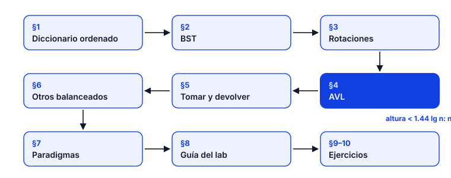
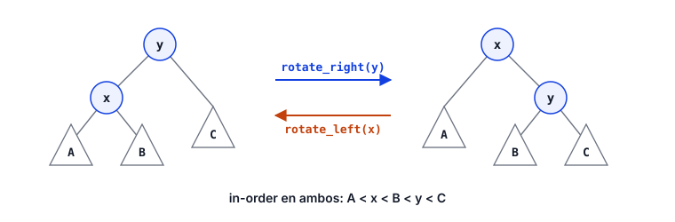
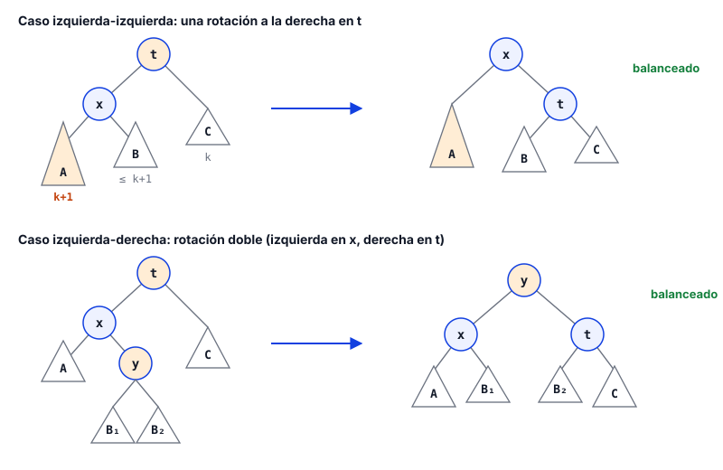

# Lección 7 — Árboles binarios de búsqueda y árboles AVL

> **Prerrequisitos:** Lección 0 (§1 inducción, §3 recurrencias lineales), Lección 3 (ownership y `Option<Box>`), Lección 4 (TAD Diccionario) y Lección 6 (árboles binarios).
>
> **Cómo estudiar esta lección:** todo gira alrededor de **una** operación, la rotación, y de **un** número, la altura. Antes de leer cada demostración, dibuja la rotación en papel con subárboles $A$, $B$, $C$ como triángulos y anota sus alturas.
>
> **Lab asociado:** `lab07`: `AvlMap` (C, C++ y Rust). Lo extenderás en el lab08.

## Objetivos de aprendizaje

Al terminar esta lección deberías poder:
1. Especificar el **TAD Diccionario ordenado** (con mínimo, sucesor y rangos) y explicar qué ofrece que una tabla hash no.
2. Demostrar que el recorrido **in-order** de un BST produce las claves en orden, e implementar búsqueda, inserción, borrado y sucesor en $O(h)$.
3. Demostrar que una **rotación** preserva el invariante BST.
4. Demostrar que un árbol AVL de $n$ nodos tiene altura $h < 1.4405\lg(n+2) - 0.3277$ usando los números de Fibonacci.
5. Demostrar que `rebalance` repara cualquier nodo con factor de balance $\pm 2$ cuyos hijos son AVL, distinguiendo los cuatro casos.
6. Implementar un árbol balanceado con el estilo "tomar y devolver el subárbol" en C, C++ (`unique_ptr`) y Rust (`Option<Box>`).

## Mapa de la lección



---

## 1. El diccionario ordenado

La tabla hash de L04 da `insert`, `find` y `erase` en $O(1)$ esperado, pero destruye el orden de las claves. Muchas aplicaciones lo necesitan:

| Operación | Tabla hash | Diccionario ordenado |
|---|---|---|
| `insert`, `find`, `erase` | $O(1)$ esperado | $O(\lg n)$ peor caso |
| `min`, `max` | $\Theta(n)$ | $O(\lg n)$ |
| `sucesor(k)`: la menor clave $> k$ | $\Theta(n)$ | $O(\lg n)$ |
| rango $[a, b]$ con $r$ resultados | $\Theta(n)$ | $O(\lg n + r)$ |
| recorrer en orden | $\Theta(n\lg n)$ (ordenar) | $\Theta(n)$ |

Ejemplos: el planificador de un calendario ("¿qué evento sigue después de las 10:00?"), un índice de base de datos (`WHERE precio BETWEEN 100 AND 200`), las tablas de rutas de red (prefijo más largo), un libro de órdenes de bolsa (mejor precio de compra y de venta).

Además, la cota es de **peor caso**, sin hipótesis sobre la función hash ni sobre el azar.

---

## 2. Árboles binarios de búsqueda

### 2.1 Invariante

Un **árbol binario de búsqueda** (BST) guarda una clave en cada nodo y cumple:

> **Invariante BST.** Para todo nodo $x$: todas las claves del subárbol izquierdo de $x$ son $<$ `x.key`, y todas las del subárbol derecho son $>$ `x.key`.

Observa que dice **todas** las claves del subárbol, no solo las de los hijos. Un árbol donde cada hijo izquierdo es menor que su padre pero un nieto no lo es **no** es BST.

> **Teorema 1.** El recorrido in-order (izquierdo, nodo, derecho) de un BST visita las claves en orden creciente.

*Demostración.* Inducción sobre la altura. Un árbol vacío no visita nada. Si la raíz es $x$, el recorrido visita primero el subárbol izquierdo (en orden, por hipótesis de inducción, y todas sus claves $<$ `x.key` por el invariante), luego `x.key`, luego el derecho (en orden, todas $>$ `x.key`). La concatenación está en orden. $\blacksquare$

Consecuencia: un BST "es" una secuencia ordenada; la forma del árbol solo decide cuánto cuesta llegar a cada clave.

### 2.2 Operaciones en $O(h)$

Sea $h$ la altura (número de nodos del camino más largo de la raíz a una hoja; vacío $= 0$).

- **`find(k)`**: desde la raíz, ir a la izquierda si $k <$ clave, a la derecha si $k >$, parar si es igual. Por el invariante, si $k$ está en el árbol, está en el subárbol al que bajamos. $O(h)$.
- **`insert(k)`**: buscar $k$; si no está, la búsqueda termina en un hijo vacío, y ahí se cuelga un nodo nuevo. El invariante se preserva porque el nodo nuevo queda en el único lugar consistente con todas las comparaciones del camino. $O(h)$.
- **`min`/`max`**: bajar siempre a la izquierda / derecha. $O(h)$.
- **`sucesor(k)`**: buscar $k$ guardando el último nodo en el que se bajó a la **izquierda**; si el nodo de $k$ tiene subárbol derecho, el sucesor es el mínimo de ese subárbol; si no, es el último ancestro guardado. $O(h)$.
- **`erase(k)`**: tres casos según los hijos del nodo $z$ con clave $k$:
  1. *Sin hijos:* quitarlo.
  2. *Un hijo:* el hijo ocupa el lugar de $z$.
  3. *Dos hijos:* el **sucesor** $s$ de $z$ (mínimo del subárbol derecho) no tiene hijo izquierdo; se desengancha $s$ de su lugar (caso 1 o 2) y $s$ ocupa el lugar de $z$. Como $s$ es la menor clave mayor que `z.key`, es mayor que todo el subárbol izquierdo y menor que el resto del derecho: el invariante se preserva.

### 2.3 El problema: la altura

Todo cuesta $O(h)$, y $h$ depende del orden de inserción. Si las claves llegan **ordenadas**, cada una se cuelga a la derecha de la anterior y el árbol es una lista: $h = n$. Con un orden aleatorio, la altura esperada es $O(\lg n)$ (con constante $\approx 4.311$; Devroye 1986), pero no podemos elegir el orden de llegada de las claves.

::: {.tabs}
```c
#include <stdio.h>

#define N 1000
static int clave[N], izq[N], der[N], nodos;

/* BST sin balancear en arreglos (índice -1 = vacío). Inserción iterativa. */
static void insertar(int k) {
    int nuevo = nodos++;
    clave[nuevo] = k; izq[nuevo] = der[nuevo] = -1;
    if (nuevo == 0) return;
    for (int t = 0;;) {
        int *hijo = k < clave[t] ? &izq[t] : &der[t];
        if (*hijo < 0) { *hijo = nuevo; return; }
        t = *hijo;
    }
}

static int altura(int t) {
    if (t < 0) return 0;
    int a = altura(izq[t]), b = altura(der[t]);
    return 1 + (a > b ? a : b);
}

int main(void) {
    for (int i = 0; i < N; i++) insertar(i);
    printf("claves en orden:     altura %d\n", altura(0));
    nodos = 0;
    unsigned long long s = 7;
    for (int i = 0; i < N; i++) {
        s = s * 6364136223846793005ULL + 1442695040888963407ULL;
        insertar((int)(s >> 33));
    }
    printf("claves aleatorias:   altura %d\n", altura(0));
    printf("AVL (cualquier orden): altura <= %d\n", 14);
    return 0;
}
```

```cpp
#include <cstdint>
#include <cstdio>
#include <vector>

// BST sin balancear en arreglos (índice -1 = vacío). Inserción iterativa.
struct Bst {
    std::vector<int> clave, izq, der;
    void insertar(int k) {
        int nuevo = (int)clave.size();
        clave.push_back(k); izq.push_back(-1); der.push_back(-1);
        if (nuevo == 0) return;
        for (int t = 0;;) {
            int& hijo = k < clave[t] ? izq[t] : der[t];
            if (hijo < 0) { hijo = nuevo; return; }
            t = hijo;
        }
    }
    int altura(int t) const {
        if (t < 0) return 0;
        int a = altura(izq[t]), b = altura(der[t]);
        return 1 + (a > b ? a : b);
    }
};

int main() {
    const int N = 1000;
    Bst ordenado, aleatorio;
    for (int i = 0; i < N; ++i) ordenado.insertar(i);
    std::printf("claves en orden:     altura %d\n", ordenado.altura(0));
    std::uint64_t s = 7;
    for (int i = 0; i < N; ++i) {
        s = s * 6364136223846793005ULL + 1442695040888963407ULL;
        aleatorio.insertar((int)(s >> 33));
    }
    std::printf("claves aleatorias:   altura %d\n", aleatorio.altura(0));
    std::printf("AVL (cualquier orden): altura <= %d\n", 14);
}
```

```rust
/// BST sin balancear en arreglos (`usize::MAX` = vacío). Inserción iterativa.
struct Bst { clave: Vec<i64>, izq: Vec<usize>, der: Vec<usize> }
const VACIO: usize = usize::MAX;

impl Bst {
    fn insertar(&mut self, k: i64) {
        let nuevo = self.clave.len();
        self.clave.push(k);
        self.izq.push(VACIO);
        self.der.push(VACIO);
        if nuevo == 0 { return; }
        let mut t = 0;
        loop {
            let hijo = if k < self.clave[t] { &mut self.izq[t] } else { &mut self.der[t] };
            if *hijo == VACIO { *hijo = nuevo; return; }
            t = *hijo;
        }
    }
    fn altura(&self, t: usize) -> i32 {
        if t == VACIO { return 0; }
        1 + self.altura(self.izq[t]).max(self.altura(self.der[t]))
    }
}

fn main() {
    const N: i64 = 1000;
    let mut ordenado = Bst { clave: vec![], izq: vec![], der: vec![] };
    for i in 0..N { ordenado.insertar(i); }
    println!("claves en orden:     altura {}", ordenado.altura(0));
    let mut aleatorio = Bst { clave: vec![], izq: vec![], der: vec![] };
    let mut s: u64 = 7;
    for _ in 0..N {
        s = s.wrapping_mul(6364136223846793005).wrapping_add(1442695040888963407);
        aleatorio.insertar((s >> 33) as i32 as i64);
    }
    println!("claves aleatorias:   altura {}", aleatorio.altura(0));
    println!("AVL (cualquier orden): altura <= {}", 14);
}
```
:::

```{.text .salida}
claves en orden:     altura 1000
claves aleatorias:   altura 19
AVL (cualquier orden): altura <= 14
```

(El 14 de la última línea es la cota del Teorema 3 para $n = 1000$: $\lfloor 1.4405\lg 1002 - 0.3277\rfloor = 14$.)

Un **árbol balanceado** garantiza $h = O(\lg n)$ sin importar el orden, reorganizándose con **rotaciones**.

---

## 3. Rotaciones



```
        y                    x
       / \                  / \
      x   C     ──der──▶   A   y
     / \       ◀──izq──       / \
    A   B                    B   C
```

`rotate_right(y)`: $x$ = hijo izquierdo de $y$; el subárbol $B$ (hijo derecho de $x$) pasa a ser hijo izquierdo de $y$; $y$ pasa a ser hijo derecho de $x$; $x$ es la nueva raíz. Son tres asignaciones de punteros: $O(1)$.

> **Lema 2.** Una rotación preserva el invariante BST y el recorrido in-order.

*Demostración.* Antes de rotar, por el invariante en $x$ y en $y$: $A < x < B < y < C$ (cada letra representa todas las claves de ese subárbol). Después, $x$ tiene a $A$ a su izquierda ($A < x$ ✔) y a $y$ a su derecha, que contiene $B$ e $y$ y $C$, todos $> x$ ✔; $y$ tiene a $B$ a la izquierda ($B < y$ ✔) y a $C$ a la derecha ✔. Los subárboles $A$, $B$, $C$ no cambiaron internamente. El in-order es $A, x, B, y, C$ en ambos casos. $\blacksquare$

Lo que **sí** cambia son las alturas: $A$ sube un nivel y $C$ baja uno. Rotar es la herramienta para mover peso de un lado a otro.

---

## 4. Árboles AVL

### 4.1 Definición

Adelson-Velsky y Landis (1962): un BST es **AVL** si en todo nodo las alturas de los dos subárboles difieren en a lo más 1. El **factor de balance** de un nodo es $\text{bf} = h(\text{izq}) - h(\text{der}) \in \{-1, 0, 1\}$.

Cada nodo guarda su altura (o su factor de balance) para no recalcularla: `height = 1 + max(h(izq), h(der))`, con $h(\text{vacío}) = 0$.

### 4.2 La altura es logarítmica

Sea $N(h)$ el **mínimo** número de nodos de un árbol AVL de altura $h$.

> **Lema.** $N(0) = 0$, $N(1) = 1$ y $N(h) = N(h-1) + N(h-2) + 1$ para $h \ge 2$.

*Demostración.* Un AVL de altura $h \ge 2$ con el mínimo de nodos tiene una raíz y dos subárboles AVL. Uno debe tener altura $h - 1$ (si no, la altura no sería $h$). El otro tiene altura $h - 1$ o $h - 2$ (por la condición AVL); para minimizar, $h - 2$. Cada subárbol, a su vez, debe tener el mínimo de nodos para su altura. $\blacksquare$

Con los números de Fibonacci $F_0 = 0$, $F_1 = 1$, $F_{k} = F_{k-1} + F_{k-2}$: si $M(h) = N(h) + 1$, entonces $M(h) = M(h-1) + M(h-2)$ con $M(0) = 1 = F_2$ y $M(1) = 2 = F_3$. Así que $N(h) = F_{h+2} - 1$.

> **Teorema 3.** Un árbol AVL con $n$ nodos tiene altura $h < 1.4405\lg(n+2) - 0.3277$.

*Demostración.* Por la fórmula cerrada de Fibonacci, $F_k = \frac{\varphi^k - \psi^k}{\sqrt 5}$ con $\varphi = \frac{1+\sqrt5}2 \approx 1.618$ y $|\psi| < 1$, se tiene $F_k > \frac{\varphi^k}{\sqrt5} - 1$. Entonces
$$n \ge N(h) = F_{h+2} - 1 > \frac{\varphi^{h+2}}{\sqrt5} - 2 \quad\Longrightarrow\quad \varphi^{h+2} < \sqrt5\,(n + 2).$$
Tomando $\log_\varphi$:
$$h + 2 < \log_\varphi\sqrt5 + \log_\varphi(n+2) = \frac{\lg\sqrt5}{\lg\varphi} + \frac{\lg(n+2)}{\lg\varphi}.$$
Con $1/\lg\varphi \approx 1.4405$ y $\lg\sqrt5/\lg\varphi \approx 1.6723$:
$$h < 1.4405\lg(n+2) + 1.6723 - 2 = 1.4405\lg(n+2) - 0.3277. \qquad\blacksquare$$

En palabras: **un AVL es a lo más un 44% más alto que el árbol perfectamente balanceado**. Los tests `avl_cota_de_altura_*` verifican exactamente esta desigualdad.

::: {.tabs}
```c
#include <math.h>
#include <stdio.h>

int main(void) {
    long n_min[25] = {0, 1};
    for (int h = 2; h < 25; h++) n_min[h] = n_min[h - 1] + n_min[h - 2] + 1;
    printf(" h   N(h) mínimo   cota(N(h))\n");
    for (int h = 4; h <= 24; h += 4)
        printf("%2d %13ld %12.4f\n", h, n_min[h], 1.4405 * log2((double)n_min[h] + 2) - 0.3277);
    return 0;
}
```

```cpp
#include <cmath>
#include <cstdio>

int main() {
    long n_min[25] = {0, 1};
    for (int h = 2; h < 25; ++h) n_min[h] = n_min[h - 1] + n_min[h - 2] + 1;
    std::printf(" h   N(h) mínimo   cota(N(h))\n");
    for (int h = 4; h <= 24; h += 4)
        std::printf("%2d %13ld %12.4f\n", h, n_min[h], 1.4405 * std::log2((double)n_min[h] + 2) - 0.3277);
}
```

```rust
fn main() {
    let mut n_min = [0i64; 25];
    n_min[1] = 1;
    for h in 2..25 { n_min[h] = n_min[h - 1] + n_min[h - 2] + 1; }
    println!(" h   N(h) mínimo   cota(N(h))");
    for h in (4..=24).step_by(4) {
        println!("{:2} {:13} {:12.4}", h, n_min[h], 1.4405 * ((n_min[h] + 2) as f64).log2() - 0.3277);
    }
}
```
:::

```{.text .salida}
 h   N(h) mínimo   cota(N(h))
 4             7       4.2386
 8            54       8.0378
12           376      12.0062
16          2583      16.0017
20         17710      20.0013
24        121392      24.0014
```

Observa que en los árboles mínimos la cota supera a la altura real por apenas milésimas ($h = 16$ contra $16.0017$): la cota del Teorema 3 es prácticamente ajustada, y por eso se escribe con cuatro decimales.

### 4.3 Rebalancear

Tras insertar o borrar, las alturas cambian a lo más en 1 a lo largo del camino a la raíz, así que un nodo puede quedar con $|\text{bf}| = 2$. La función `rebalance(t)` lo repara, suponiendo que los hijos de $t$ **ya son AVL**. Hay cuatro casos; por simetría basta analizar $\text{bf}(t) = +2$ (izquierdo más alto). Sea $x$ el hijo izquierdo, con altura $k + 2$, y el derecho de $t$ con altura $k$.

**Caso izquierda-izquierda** ($h(x.\text{izq}) \ge h(x.\text{der})$): rotación simple a la derecha en $t$.

**Caso izquierda-derecha** ($h(x.\text{izq}) < h(x.\text{der})$): rotación a la izquierda en $x$, y luego a la derecha en $t$ (**rotación doble**).



> **Teorema 4.** Si los hijos de $t$ son AVL y $\text{bf}(t) = +2$, `rebalance(t)` devuelve un árbol AVL con las mismas claves, de altura $k+2$ o $k+3$.

*Demostración.* Sea $A = x.\text{izq}$, $B = x.\text{der}$, $C = t.\text{der}$, con $h(C) = k$ y $\max(h(A), h(B)) = k + 1$.

*Caso izquierda-izquierda:* $h(A) = k + 1$ y $h(B) \in \{k, k+1\}$. Tras rotar a la derecha, $t$ tiene hijos $B$ y $C$: alturas $\le k+1$ y $k$, diferencia $\le 1$ ✔, y $h(t) \in \{k+1, k+2\}$. La nueva raíz $x$ tiene hijos $A$ ($k + 1$) y $t$ ($k+1$ o $k+2$): diferencia $\le 1$ ✔.

*Caso izquierda-derecha:* $h(B) = k + 1$ y $h(A) = k$. Sea $y$ la raíz de $B$ con subárboles $B_1, B_2$ de alturas $k$ o $k-1$ (al menos uno $k$). Tras la doble rotación, $y$ es la raíz con hijos $x$ (sobre $A$ y $B_1$) y $t$ (sobre $B_2$ y $C$). $x$: alturas $k$ y $\ge k - 1$ ✔, $h(x) = k+1$. $t$: alturas $\ge k - 1$ y $k$ ✔, $h(t) = k + 1$. $y$: dos hijos de altura $k+1$ ✔, $h(y) = k+2$.

En ambos casos las rotaciones preservan el invariante BST (Lema 2). $\blacksquare$

*¿Por qué la rotación simple no basta en el caso izquierda-derecha?* Porque rotar a la derecha en $t$ mueve $B$ (el subárbol alto) al lado de $C$ a la **misma** profundidad: el desbalance pasa al otro lado.

### 4.4 Inserción y borrado

Ambos se escriben recursivamente: bajar como en un BST, hacer la modificación, y **al volver** de la recursión llamar `rebalance` en cada nodo del camino. Por inducción sobre la recursión, cuando se llama `rebalance(t)` los hijos de $t$ ya son AVL y $|\text{bf}(t)| \le 2$ (una inserción o un borrado cambia una altura en a lo más 1), que es la precondición del Teorema 4.

- **Inserción:** basta **una** rotación (simple o doble): la que se hace devuelve el subárbol a la altura que tenía antes de insertar, así que los ancestros ya no cambian.
- **Borrado:** puede requerir una rotación en cada nivel, $O(\lg n)$ en total: tras rotar, el subárbol puede quedar **más bajo** que antes, y el desbalance se propaga.

Ambas cuestan $O(h) = O(\lg n)$. El test `avl_borrar_rebalancea` borra 65 000 de 65 536 claves consecutivas: un borrado que no rebalancea deja un árbol de altura $\approx 16$ con 536 claves, cuando la cota es $\approx 12.7$.

---

## 5. Tomar y devolver el subárbol

Rotar cambia **qué nodo es la raíz** de un subárbol, y el padre tiene que enterarse. Hay dos estilos:

1. **Punteros al padre** en cada nodo: la rotación actualiza el hijo del padre. Más memoria, más punteros que mantener consistentes, y en Rust imposible con `Box` (ciclos padre ⇄ hijo, como en la L03).
2. **Tomar y devolver** (estilo funcional): cada función recursiva recibe la raíz de un subárbol y **devuelve la nueva raíz**; el que llama reasigna su puntero: `t->left = insert(std::move(t->left), k, v)`.

Las tres soluciones de referencia usan el estilo 2:

| | firma de `insert` | rotación |
|---|---|---|
| C | `AvlNode *insertar(AvlMap *m, AvlNode *t, ...)` | reasignar punteros crudos |
| C++ | `static Link insert(Link t, ...)` con `Link = unique_ptr<Node>` | `std::move` de `unique_ptr` |
| Rust | `fn insert(t: Link<K,V>, k, v) -> (Box<Node<K,V>>, Option<V>)` | `take()` y reasignar `Box` |

En Rust el estilo 2 es la forma natural: la función es **dueña** del subárbol mientras lo reorganiza, así que el compilador no tiene nada que objetar. Y no hace falta ni una línea de `unsafe`.

**Recursión y pila.** A diferencia de las listas (L03), aquí la recursión (y el destructor por defecto, que también es recursivo) tiene profundidad $h = O(\lg n)$: con $10^9$ nodos, menos de 45 niveles. No hay riesgo de desbordar la pila.

---

## 6. Otros árboles balanceados

| Estructura | Garantía | Rotaciones por inserción | Dónde se usa |
|---|---|---|---|
| AVL | $h < 1.44\lg n$ | $\le 2$ | bases de datos en memoria; búsquedas frecuentes |
| Rojinegro | $h \le 2\lg(n+1)$ | $\le 2$ (y $\le 3$ al borrar) | `std::map` (C++), `TreeMap` (Java), el planificador de Linux |
| B-árbol | $h = O(\log_B n)$ | divisiones de nodos | bases de datos en disco; **`BTreeMap` de Rust** |
| Treap | $O(\lg n)$ esperado | aleatorias | simple de implementar; división y unión |
| Splay | $O(\lg n)$ amortizado | muchas | cachés: lo reciente queda arriba |

Rust eligió un **B-árbol** para su `BTreeMap` y no un árbol binario: cada nodo guarda hasta 11 claves contiguas, así que una búsqueda toca $\log_{12} n$ nodos y cada nodo cabe en pocas líneas de caché (L02 §5.4). C++ eligió rojinegro porque el estándar exige que las referencias a elementos de `std::map` nunca se invaliden, y en un B-árbol las claves se mueven dentro de los nodos.

---

## 7. Resumen de paradigmas en este lab

| Aspecto | C | C++ | Rust |
|---|---|---|---|
| Hijos | `AvlNode *left, *right` | `std::unique_ptr<Node>` | `Option<Box<Node>>` |
| Rotar | reasignar punteros | `std::move` | `take()` + reasignar |
| Comparación | `algolib_cmp` | `operator<` | `Ord::cmp` → `Ordering` (un `match` con 3 ramas) |
| `insert` devuelve | `bool` (¿nueva?) | `bool` | `Option<V>` (el valor viejo) |
| Liberar | recursivo, a mano | destructor por defecto (recursivo, $O(\lg n)$ de pila) | `Drop` derivado (recursivo) |
| Mínimo de un vacío | `false` | `std::nullopt` | `None` |

---

## 8. Guía del Lab 07

**Archivos:** `c/src/lab07/avl_map.c`, `cpp/include/algolib/lab07/avl_map.hpp`, `rust/src/lab07/mod.rs`.

**Orden sugerido:**
1. Escribe primero un **BST sin balancear**: `find`, `insert` (estilo tomar y devolver), `keys` (in-order), `min_key`/`max_key`, `height`. Pasarán `avl_basico` y el test aleatorio, pero no los de altura.
2. Agrega el campo `height`, la función `update` y las dos rotaciones. Pruébalas a mano con 3 nodos.
3. `rebalance` con los cuatro casos, llamada al volver de cada `insert`. Ahora pasa `avl_secuencial_es_perfecto` (insertar 1..7 da el árbol perfecto de altura 3) y `avl_cota_de_altura_insercion_ordenada`.
4. `erase` con el caso de dos hijos (`remove_min` del subárbol derecho), con `rebalance` al volver. Pasa `avl_borrar_rebalancea`.

**Errores frecuentes:**
- Olvidar `update` del nodo de abajo **antes** que el de arriba en una rotación (la altura de la nueva raíz depende de la del nodo que bajó).
- Decidir entre rotación simple y doble con `bf(x) < 0` vs. `bf(x) <= 0`: en el caso izquierda-izquierda con $h(A) = h(B)$ (que solo ocurre al borrar), la rotación doble deja un desbalance. La regla correcta: doble solo si el hijo está inclinado **hacia el lado contrario** estrictamente.
- En `erase` con dos hijos, copiar la clave y el valor del sucesor sobre $z$ y luego borrar el sucesor: funciona, pero copia `K` y `V` (en C++ y Rust exige `Clone`). Las soluciones de referencia **mueven el nodo** del sucesor en su lugar.
- En Rust, `match key.cmp(&t.key) { Equal => return (t, Some(mem::replace(&mut t.value, v))) }` no compila: `t` se mueve antes de tomar el préstamo. Haz el `replace` en una línea previa.

---

## 9. Comprueba tu comprensión

1. ¿Es BST el árbol con raíz 10, hijo izquierdo 5 y, como hijo derecho de 5, el 12?
2. ¿Cuál es la altura máxima de un AVL con 20 nodos? ¿Y con $N(6) = 20$ exactamente?
3. Inserta 3, 2, 1 en un AVL vacío. ¿Qué rotación ocurre? ¿Y con 3, 1, 2?
4. ¿Por qué después de una rotación en una inserción ya no hacen falta más rotaciones arriba?
5. ¿Qué devuelve el recorrido in-order de un AVL tras insertar 5, 3, 8, 1, 4?

<details><summary>Respuestas</summary>

1. No. 12 está en el subárbol izquierdo de 10 y $12 > 10$.
2. $N(h) = F_{h+2} - 1$: $N(6) = F_8 - 1 = 20$ y $N(7) = 33$. Con 20 nodos la altura máxima es 6.
3. 3, 2, 1: caso izquierda-izquierda, rotación simple a la derecha en 3; queda 2 con hijos 1 y 3. 3, 1, 2: caso izquierda-derecha, doble rotación; también queda 2 con hijos 1 y 3.
4. Porque la inserción subió la altura del subárbol en 1 y la rotación la devuelve a la altura que tenía **antes** de insertar (Teorema 4: $k + 2$), así que para los ancestros nada cambió.
5. $\langle 1, 3, 4, 5, 8\rangle$ (Teorema 1), sin importar la forma.
</details>

---

## 10. Problem Set 7

**Teoría**
1. Demuestra que la altura esperada de un BST construido insertando una permutación uniforme de $n$ claves es $O(\lg n)$. (Pista: la profundidad esperada de un nodo se relaciona con el análisis de quicksort de L05: ¿cuándo es $z_i$ ancestro de $z_j$?)
2. Demuestra que la inserción en AVL hace a lo más una rotación (simple o doble), y que el borrado puede necesitar $\Theta(\lg n)$ rotaciones (construye el ejemplo con un árbol de Fibonacci).
3. **Rojinegros.** Con las reglas (raíz negra, hijos de un rojo son negros, todos los caminos a hojas nulas tienen el mismo número de negros), demuestra que $h \le 2\lg(n+1)$. Demuestra que todo AVL se puede colorear como rojinegro.
4. Diseña `range(a, b)` que devuelva las $r$ claves en $[a, b]$ en $O(\lg n + r)$ y demuéstralo.
5. Demuestra que dos BST con las mismas claves se pueden transformar uno en el otro con a lo más $2n - 2$ rotaciones (pista: convierte ambos a una "espina" derecha).

**Implementación (C, C++ y Rust)**

6. Agrega `successor(k)` y `predecessor(k)` en $O(\lg n)$, con tests contra `std::map::upper_bound` / `BTreeMap::range`.
7. Agrega un iterador in-order con pila explícita ($O(h)$ memoria). En Rust, implementa `Iterator` para `Iter<'a, K, V>` y verifica que no se puede modificar el mapa mientras el iterador vive.
8. Implementa un **treap** (BST por clave + heap por prioridad aleatoria) con `split` y `merge`, y compara su altura promedio con la del AVL.
9. Escribe un verificador `check_invariants()` que recorra el árbol y verifique BST, AVL y alturas cacheadas, y úsalo en el test aleatorio después de cada operación.

---

## Referencias
- CLRS, *Introduction to Algorithms*, 4ª ed.: Cap. 12 (BST; §12.4 altura de BST aleatorios), Cap. 13 (rojinegros).
- MIT 6.006 (Spring 2020), Lectures 6–7: *Binary Trees* y *AVL Trees*.
- Adelson-Velsky, G. M. y Landis, E. M. (1962). *An algorithm for the organization of information*. Soviet Math. Doklady 3.
- Knuth, D. E. *The Art of Computer Programming*, Vol. 3, §6.2.3 (árboles balanceados; la cota $1.4405\lg(n+2) - 0.3277$).
- Devroye, L. (1986). *A note on the height of binary search trees*. JACM 33(3).
