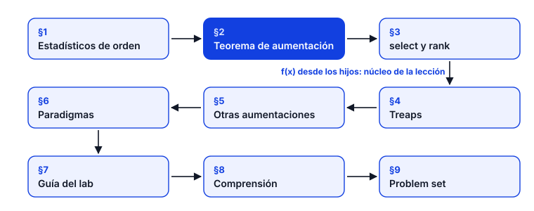
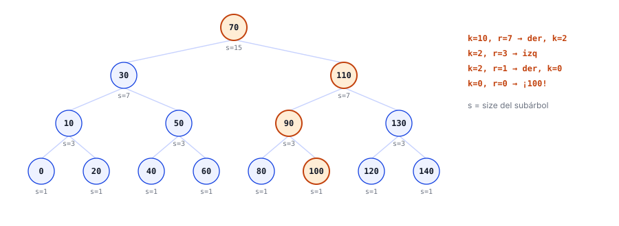

# Lección 8 — Árboles aumentados y estadísticos de orden

> **Prerrequisitos:** Lección 5 (§5.2 análisis de quicksort aleatorizado) y Lección 7 completa (BST, rotaciones, AVL).
>
> **Cómo estudiar esta lección:** es una lección de **diseño**: no inventa una estructura nueva, sino un método para agregar información a una que ya funciona sin romper sus garantías. Para cada campo aumentado pregúntate: *¿lo puedo calcular mirando solo al nodo y a sus dos hijos?*
>
> **Lab asociado:** `lab08`: `OrderStatSet` (C, C++ y Rust).

## Objetivos de aprendizaje

Al terminar esta lección deberías poder:
1. Enunciar y demostrar el **teorema de aumentación**: qué campos se pueden mantener en un árbol balanceado sin cambiar su costo asintótico.
2. Implementar `select(k)` y `rank(x)` en $O(\lg n)$ con el campo `size`, y demostrar su corrección con invariantes de ciclo.
3. Definir un **treap**, demostrar que su forma está determinada por claves y prioridades, y que su altura esperada es $O(\lg n)$.
4. Implementar un treap con `split` y `merge`, y expresar inserción y borrado en términos de ellas.
5. Diseñar otras aumentaciones (suma, mínimo, máximo extremo de intervalos) para problemas nuevos.

## Mapa de la lección



---

## 1. Estadísticos de orden dinámicos

El **$k$-ésimo estadístico de orden** de un conjunto es su $k$-ésimo menor elemento (en el lab, 0-indexado: `select(0)` es el mínimo). El **rango** de $x$ es el número de elementos estrictamente menores que $x$. Son inversos: si $x$ está en el conjunto, `select(rank(x)) == x`.

| Estructura | `insert` | `select(k)` | `rank(x)` |
|---|---|---|---|
| Arreglo ordenado | $\Theta(n)$ | $O(1)$ | $O(\lg n)$ (búsqueda binaria) |
| Arreglo sin ordenar | $O(1)$ | $O(n)$ esperado (quickselect, PS5) | $\Theta(n)$ |
| AVL del lab07 | $O(\lg n)$ | $\Theta(n)$ (recorrido in-order) | $\Theta(n)$ |
| **AVL aumentado** | $O(\lg n)$ | $O(\lg n)$ | $O(\lg n)$ |

Ejemplos: la mediana o el percentil 99 de un flujo de latencias que cambia; el lugar de un jugador en una tabla de posiciones; contar inversiones de una secuencia en $O(n\lg n)$ (para cada elemento, cuántos de los ya vistos son mayores: `i − rank(x)`).

---

## 2. El teorema de aumentación

**Aumentar** una estructura es guardar en cada nodo un campo extra $f(x)$ que resume algo de su subárbol. La pregunta es cuándo ese campo se puede mantener barato.

> **Teorema 1 (aumentación; CLRS 17.1).** Sea $f$ un campo tal que $f(x)$ se puede calcular en $O(1)$ a partir de `x.key`, $f(x.\text{izq})$ y $f(x.\text{der})$ (con un valor fijo para el árbol vacío). Entonces, en un árbol AVL (o rojinegro), $f$ se puede mantener en todos los nodos durante `insert` y `erase` sin cambiar su costo $O(\lg n)$.

*Demostración.* $f(x)$ depende solo del subárbol de $x$. Una operación cambia el subárbol de un nodo solo si (a) el nodo está en el camino de la raíz al punto modificado, o (b) participa en una rotación.

(a) En la inserción y el borrado recursivos (estilo "tomar y devolver", L07 §5), cada nodo del camino se recalcula al volver de la recursión, **después** de que sus hijos ya están actualizados: $O(1)$ por nodo, $O(h) = O(\lg n)$ en total.

(b) Una rotación solo cambia los hijos de dos nodos ($x$ e $y$ en el dibujo de L07 §3), y los subárboles $A$, $B$, $C$ no cambian internamente. Basta recalcular primero el nodo que baja y después el que sube: $O(1)$ por rotación, y hay $O(\lg n)$ rotaciones. $\blacksquare$

En las soluciones de referencia, la aumentación es **una línea**: la función `update`, que ya recalculaba la altura, ahora también recalcula el tamaño:

```cpp
static void update(Node& t) {
    t.height = 1 + std::max(h(t.left), h(t.right));
    t.size   = 1 + sz(t.left) + sz(t.right);      // ← la aumentación
}
```

Como `update` ya se llamaba en todos los lugares que exige la demostración (en cada rotación y en `rebalance` al volver de la recursión), el código del lab07 queda intacto.

**Qué campos cumplen la hipótesis:** tamaño, suma, mínimo, máximo, altura, cualquier operación asociativa sobre las claves del subárbol. **Qué campos no:** la profundidad de un nodo (depende de sus **ancestros**, que cambian con cada rotación arriba), el rango de un nodo guardado explícitamente (insertar el mínimo cambiaría el rango de **todos** los nodos: $\Theta(n)$).

---

## 3. `select` y `rank`

Sea `size(x)` el número de nodos del subárbol de $x$ ($0$ para el vacío).

### 3.1 `select(k)`

```
select(k):
    x ← raíz
    mientras x ≠ vacío:
        r ← size(x.izq)            -- x es el r-ésimo (0-indexado) de su subárbol
        si k < r:  x ← x.izq
        si k = r:  devolver x.key
        si k > r:  k ← k − r − 1;  x ← x.der
    devolver "no existe"           -- k ≥ n
```

> **Teorema 2.** `select(k)` devuelve el $k$-ésimo menor elemento en $O(h)$.

*Demostración.* Invariante: *la respuesta buscada es el $k$-ésimo menor del subárbol de $x$* (con el $k$ actual). Al inicio, $x$ es la raíz y $k$ el original ✔. Por el Teorema 1 de L07 (in-order ordenado), en el subárbol de $x$ hay exactamente $r$ claves menores que `x.key`: las de su subárbol izquierdo. Si $k < r$, el $k$-ésimo está entre ellas, y es el $k$-ésimo del subárbol izquierdo ✔. Si $k = r$, es `x.key` ✔. Si $k > r$, está en el subárbol derecho, y como $r + 1$ elementos del subárbol de $x$ (el izquierdo y $x$) son menores que todos los del derecho, es el $(k - r - 1)$-ésimo del derecho ✔. Cada iteración baja un nivel: $O(h)$. Si $x$ llega a vacío, el subárbol no tenía $k+1$ elementos: $k \ge n$. $\blacksquare$

### 3.2 `rank(x)`

```
rank(clave):
    acum ← 0;  x ← raíz
    mientras x ≠ vacío:
        si x.key < clave:  acum ← acum + size(x.izq) + 1;  x ← x.der
        si no:             x ← x.izq
    devolver acum
```

> **Teorema 3.** `rank(c)` devuelve el número de claves $< c$ en $O(h)$, aunque $c$ no esté en el conjunto.

*Demostración.* Invariante: *`acum` es el número de claves $< c$ que **no** están en el subárbol de $x$.* Al inicio vale 0 ✔. Si `x.key` $< c$: todas las claves del subárbol izquierdo de $x$ y `x.key` son $< c$ ($\text{size}(x.\text{izq}) + 1$ claves que salen de consideración al bajar a la derecha) ✔. Si no, `x.key` $\ge c$ y todo el subárbol derecho también: ninguna es $< c$, y al bajar a la izquierda no se pierde nada ✔. Cuando $x$ es vacío, `acum` cuenta todas. $\blacksquare$

El programa construye un BST perfectamente balanceado sobre $\{0, 10, 20, \dots\}$ con el campo `size`, y ejecuta los dos algoritmos:

::: {.tabs}
```c
#include <stdio.h>

#define N 15
static int clave[N], izq[N], der[N], tam[N], nodos;

/* Árbol balanceado sobre las claves 10·lo .. 10·(hi−1), en arreglos (−1 = vacío). */
static int construir(int lo, int hi) {
    if (lo >= hi) return -1;
    int m = (lo + hi) / 2, x = nodos++;
    clave[x] = 10 * m;
    izq[x] = construir(lo, m);
    der[x] = construir(m + 1, hi);
    tam[x] = 1 + (izq[x] >= 0 ? tam[izq[x]] : 0) + (der[x] >= 0 ? tam[der[x]] : 0);
    return x;
}
static int sz(int x) { return x >= 0 ? tam[x] : 0; }

static int select_k(int x, int k) {
    while (x >= 0) {
        int r = sz(izq[x]);
        if (k < r) x = izq[x];
        else if (k == r) return clave[x];
        else { k -= r + 1; x = der[x]; }
    }
    return -1;
}

static int rank_de(int x, int c) {
    int acum = 0;
    while (x >= 0) {
        if (clave[x] < c) { acum += sz(izq[x]) + 1; x = der[x]; }
        else x = izq[x];
    }
    return acum;
}

int main(void) {
    int raiz = construir(0, N);
    printf("size(raíz) = %d\n", tam[raiz]);
    printf("select(0) = %d, select(7) = %d, select(14) = %d\n",
           select_k(raiz, 0), select_k(raiz, 7), select_k(raiz, 14));
    printf("rank(70) = %d, rank(75) = %d, rank(1000) = %d\n",
           rank_de(raiz, 70), rank_de(raiz, 75), rank_de(raiz, 1000));
    return 0;
}
```

```cpp
#include <cstdio>
#include <vector>

// Árbol balanceado sobre las claves 10·lo .. 10·(hi−1), en arreglos (−1 = vacío).
struct Arbol {
    std::vector<int> clave, izq, der, tam;
    int construir(int lo, int hi) {
        if (lo >= hi) return -1;
        int m = (lo + hi) / 2, x = (int)clave.size();
        clave.push_back(10 * m); izq.push_back(-1); der.push_back(-1); tam.push_back(0);
        int l = construir(lo, m), r = construir(m + 1, hi);
        izq[x] = l; der[x] = r;
        tam[x] = 1 + sz(l) + sz(r);
        return x;
    }
    int sz(int x) const { return x >= 0 ? tam[x] : 0; }
    int select_k(int x, int k) const {
        while (x >= 0) {
            int r = sz(izq[x]);
            if (k < r) x = izq[x];
            else if (k == r) return clave[x];
            else { k -= r + 1; x = der[x]; }
        }
        return -1;
    }
    int rank_de(int x, int c) const {
        int acum = 0;
        while (x >= 0) {
            if (clave[x] < c) { acum += sz(izq[x]) + 1; x = der[x]; }
            else x = izq[x];
        }
        return acum;
    }
};

int main() {
    Arbol t;
    int raiz = t.construir(0, 15);
    std::printf("size(raíz) = %d\n", t.tam[raiz]);
    std::printf("select(0) = %d, select(7) = %d, select(14) = %d\n",
                t.select_k(raiz, 0), t.select_k(raiz, 7), t.select_k(raiz, 14));
    std::printf("rank(70) = %d, rank(75) = %d, rank(1000) = %d\n",
                t.rank_de(raiz, 70), t.rank_de(raiz, 75), t.rank_de(raiz, 1000));
}
```

```rust
/// Árbol balanceado sobre las claves 10·lo .. 10·(hi−1), en arreglos (None = vacío).
struct Arbol { clave: Vec<i32>, izq: Vec<Option<usize>>, der: Vec<Option<usize>>, tam: Vec<usize> }

impl Arbol {
    fn sz(&self, x: Option<usize>) -> usize { x.map_or(0, |i| self.tam[i]) }
    fn construir(&mut self, lo: i32, hi: i32) -> Option<usize> {
        if lo >= hi { return None; }
        let m = (lo + hi) / 2;
        let x = self.clave.len();
        self.clave.push(10 * m); self.izq.push(None); self.der.push(None); self.tam.push(0);
        let (l, r) = (self.construir(lo, m), self.construir(m + 1, hi));
        self.izq[x] = l;
        self.der[x] = r;
        self.tam[x] = 1 + self.sz(l) + self.sz(r);
        Some(x)
    }
    fn select_k(&self, mut x: Option<usize>, mut k: usize) -> Option<i32> {
        while let Some(i) = x {
            let r = self.sz(self.izq[i]);
            if k < r { x = self.izq[i]; }
            else if k == r { return Some(self.clave[i]); }
            else { k -= r + 1; x = self.der[i]; }
        }
        None
    }
    fn rank_de(&self, mut x: Option<usize>, c: i32) -> usize {
        let mut acum = 0;
        while let Some(i) = x {
            if self.clave[i] < c { acum += self.sz(self.izq[i]) + 1; x = self.der[i]; }
            else { x = self.izq[i]; }
        }
        acum
    }
}

fn main() {
    let mut t = Arbol { clave: vec![], izq: vec![], der: vec![], tam: vec![] };
    let raiz = t.construir(0, 15);
    println!("size(raíz) = {}", t.sz(raiz));
    let s = |k| t.select_k(raiz, k).unwrap();
    println!("select(0) = {}, select(7) = {}, select(14) = {}", s(0), s(7), s(14));
    println!("rank(70) = {}, rank(75) = {}, rank(1000) = {}",
             t.rank_de(raiz, 70), t.rank_de(raiz, 75), t.rank_de(raiz, 1000));
}
```
:::

```{.text .salida}
size(raíz) = 15
select(0) = 0, select(7) = 70, select(14) = 140
rank(70) = 7, rank(75) = 8, rank(1000) = 15
```



---

## 4. Treaps: balance por azar

El AVL garantiza la altura con reglas locales y casos. Hay una alternativa mucho más corta de programar que garantiza altura $O(\lg n)$ **en esperanza**.

### 4.1 Definición

Un **treap** (*tree + heap*; Seidel y Aragon, 1989) guarda en cada nodo una clave y una **prioridad** elegida al azar al insertar, y cumple dos invariantes a la vez:
- **BST** por clave, y
- **heap** (máximo) por prioridad: la prioridad de cada nodo es mayor que las de sus hijos.

> **Lema 4.** Si las claves y las prioridades son distintas, existe **exactamente un** treap con ellas, y es el BST que resulta de insertar las claves en orden decreciente de prioridad.

*Demostración.* Inducción sobre $n$. La raíz debe ser la de mayor prioridad (invariante de heap). Las claves menores que la raíz forman el subárbol izquierdo y las mayores el derecho (invariante BST); por hipótesis de inducción, cada uno es el único treap con sus claves y prioridades. Insertar en orden de prioridad produce exactamente esto: la primera insertada queda en la raíz y parte a las demás. $\blacksquare$

**Consecuencia.** Como las prioridades son aleatorias e independientes de las claves, el orden "decreciente de prioridad" es una **permutación uniforme**, y el treap tiene la forma de un **BST construido con inserciones en orden aleatorio**, sin importar en qué orden llegaron las claves. Por el análisis de L05 §5.2 (y PS7 ej. 1), la profundidad esperada de cada nodo es $\le 2H_n = O(\lg n)$. El adversario que inserta claves ordenadas ya no puede hacer nada: el azar es nuestro.

### 4.2 `split` y `merge`

Todo el treap se programa con dos funciones recursivas:

- **`split(t, k)`** → $(L, R)$ con las claves $< k$ en $L$ y las $\ge k$ en $R$. Si la raíz es $< k$, ella y su subárbol izquierdo van a $L$, y se parte recursivamente su subárbol derecho; si no, simétrico. Cada nivel baja una vez: $O(h)$.
- **`merge(L, R)`**, con toda clave de $L$ menor que toda de $R$ → un treap. La raíz es la de mayor prioridad entre las dos raíces; si es la de $L$, su subárbol derecho se mezcla con $R$, y simétrico. $O(h_L + h_R)$.

Ambas preservan los dos invariantes: el BST porque solo se cuelgan subárboles en el lado que les corresponde por clave, y el heap porque la raíz elegida tiene la mayor prioridad del resultado.

Con ellas:
```
insert(k):  (L, R) ← split(t, k);  t ← merge(merge(L, nodo(k, prioridad aleatoria)), R)
erase(k):   (L, R) ← split(t, k);  quitar el mínimo de R (que es k);  t ← merge(L, R)
```

La aumentación con `size` es la misma: recalcular `size` en cada nodo al que se le cambia un hijo dentro de `split` y `merge`. La solución de Rust del lab es un treap aumentado; las de C y C++ aumentan el AVL del lab07.

| | AVL | Treap |
|---|---|---|
| Garantía de altura | peor caso, $< 1.44\lg n$ | esperada, $\approx 2\ln n \approx 1.39\lg n$ por nodo |
| Código | rotaciones + 4 casos | `split` + `merge` |
| Unión/partición de conjuntos | difícil | natural (son `merge`/`split`) |
| Memoria por nodo | altura (1 byte basta) | prioridad (8 bytes) |

---

## 5. Otras aumentaciones

El método es siempre el mismo: **¿qué resumen del subárbol responde la pregunta, y se puede calcular desde los hijos?**

| Problema | Campo aumentado | `update` |
|---|---|---|
| $k$-ésimo, rango | `size` | `1 + size(izq) + size(der)` |
| suma de valores con clave en $[a, b]$ | `suma` | `valor + suma(izq) + suma(der)` |
| mínimo de valores en un rango de claves | `min` | `min(valor, min(izq), min(der))` |
| **árbol de intervalos**: ¿algún intervalo guardado se cruza con $[a, b]$? | `max_fin` | `max(fin, max_fin(izq), max_fin(der))` |

**Árbol de intervalos** (CLRS 17.3). Se guardan intervalos $[\ell, r]$ ordenados por $\ell$, con `max_fin` = el mayor extremo derecho del subárbol. Para buscar un intervalo que se cruce con $q = [a, b]$: si el nodo actual se cruza, listo; si el subárbol izquierdo existe y su `max_fin` $\ge a$, ir a la izquierda (si hay solución, hay una ahí); si no, a la derecha. $O(\lg n)$. Se usa en calendarios ("¿choca esta cita con alguna?"), en genómica y en detección de colisiones.

Las sumas sobre rangos vuelven en la L13, donde los árboles de Fenwick y de segmentos las resuelven con menos memoria cuando las posiciones son fijas.

---

## 6. Resumen de paradigmas en este lab

| Aspecto | C | C++ | Rust |
|---|---|---|---|
| Estructura de la solución | AVL aumentado | AVL aumentado | treap aumentado |
| Campo aumentado | `size_t size` en el nodo | `std::size_t size` | `usize size` |
| `select` fuera de rango | `false` | `std::nullopt` | `None` |
| Aleatoriedad (treap) | — | — | xorshift propio en un `thread_local!` |
| Recursión | profundidad $O(\lg n)$ | profundidad $O(\lg n)$ | profundidad $O(\lg n)$ esperada |

---

## 7. Guía del Lab 08

**Archivos:** `c/src/lab08/order_stat_set.c`, `cpp/include/algolib/lab08/order_stat_set.hpp`, `rust/src/lab08/mod.rs`.

**Opción A (recomendada si tu lab07 funciona):** copia tu AVL, cambia el mapa por un conjunto (sin valores), agrega `size` al nodo y a `update`, y escribe `select` y `rank` iterativos.

**Opción B:** implementa un treap con `split` y `merge` (§4.2). Es menos código, pero escribe con cuidado las precondiciones de `merge`.

**Errores frecuentes:**
- Recalcular `size` en el padre antes que en el hijo en una rotación (el padre suma un `size` viejo).
- En `select`, olvidar restar $r + 1$ (y no solo $r$) al bajar a la derecha.
- En `rank`, sumar `size(x.izq) + 1` cuando `x.key == c`: las claves **iguales** no son estrictamente menores.
- Guardar el rango de cada nodo explícitamente: insertar un mínimo obliga a actualizar todos los nodos.
- Treap: comparar prioridades con `<` en `merge` y con `>` en otro lado: el invariante de heap queda inconsistente.

El test `ostat_select_rank_logaritmicos` inserta 200 000 claves **en orden** (exige balanceo) y hace 200 000 consultas: con `select` o `rank` lineales no termina.

---

## 8. Comprueba tu comprensión

1. En un árbol con raíz de `size` 15 y subárbol izquierdo de `size` 7, ¿dónde está `select(10)`? ¿Con qué $k$ se sigue?
2. ¿Por qué el campo "profundidad del nodo" no cumple la hipótesis del Teorema 1?
3. ¿Qué devuelve `rank(x)` si $x$ es mayor que todas las claves? ¿Y si es menor que todas?
4. Si dos nodos de un treap tuvieran la misma prioridad, ¿qué parte del Lema 4 fallaría?
5. ¿Cómo responderías "¿cuántas claves hay en $[a, b)$?" con `rank`?

<details><summary>Respuestas</summary>

1. En el subárbol derecho ($10 > 7$), buscando el $10 - 7 - 1 = 2$.
2. Porque depende de los ancestros, no del subárbol: una rotación arriba de un nodo cambia la profundidad de todos sus descendientes, que pueden ser $\Theta(n)$.
3. $n$ y $0$.
4. La unicidad: dos nodos de igual prioridad podrían intercambiarse como padre e hijo, y habría dos treaps válidos. Con prioridades aleatorias de 64 bits, la probabilidad de empate es despreciable.
5. `rank(b) − rank(a)`, en $O(\lg n)$.
</details>

---

## 9. Problem Set 8

**Teoría**
1. Demuestra que `rank` y `select` son inversos: si $x$ está en el conjunto, `select(rank(x)) = x`, y para $0 \le k < n$, `rank(select(k)) = k`.
2. Demuestra que contar las inversiones de una secuencia de $n$ números con un árbol de estadísticos de orden cuesta $O(n\lg n)$. Compara con el método de mergesort (L05).
3. Demuestra la corrección de la búsqueda en el árbol de intervalos: si el subárbol izquierdo tiene `max_fin` $\ge a$ y no hay solución en él, tampoco la hay en el derecho.
4. Demuestra que el número esperado de rotaciones de una inserción en un treap (implementado con rotaciones en vez de `split`/`merge`) es menor que 2.
5. **Josefo.** $n$ personas en círculo; se elimina a cada $m$-ésima. Da un algoritmo $O(n\lg n)$ con un árbol de estadísticos de orden para el orden de eliminación.

**Implementación (C, C++ y Rust)**

6. Agrega `count_range(a, b)` en $O(\lg n)$ y `erase_kth(k)` en $O(\lg n)$.
7. Implementa un árbol de intervalos con `insert`, `erase` y `find_overlap(a, b)`, con tests contra un oráculo lineal.
8. Implementa conteo de inversiones con tu `OrderStatSet` y verifica contra el conteo de L05 §2 en entradas aleatorias.
9. Convierte tu treap (o AVL) en un **árbol implícito** que represente una secuencia (L02) con `insert(i, x)`, `erase(i)` y `get(i)` en $O(\lg n)$, usando `size` como índice en lugar de la clave.

---

## Referencias
- CLRS, *Introduction to Algorithms*, 4ª ed.: Cap. 17 (aumentación; 17.1 estadísticos de orden, 17.2 teorema, 17.3 árboles de intervalos).
- MIT 6.046 (Spring 2015), Lecture 3 (*Treaps*) y Recitation (*Augmentation*).
- Seidel, R. y Aragon, C. R. (1996). *Randomized search trees*. Algorithmica 16.
- Sedgewick, R. y Wayne, K. *Algorithms*, 4ª ed., §3.3 (BST con `size`, `rank` y `select`).
