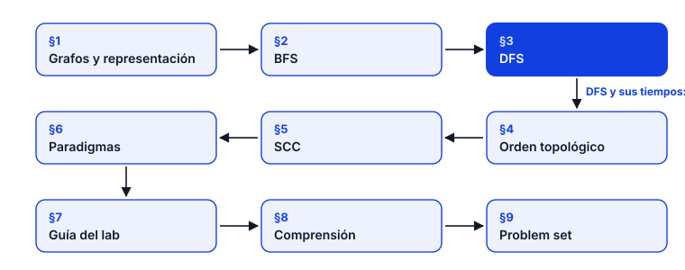
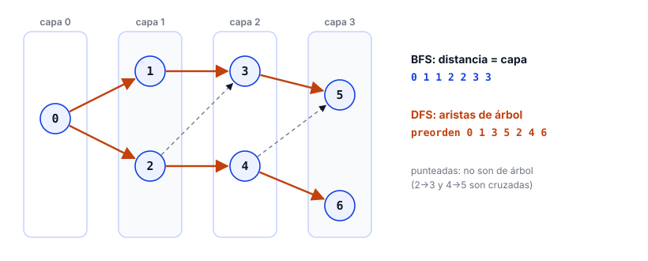

# Lección 9 — Grafos: representación y recorridos

> **Prerrequisitos:** Lección 0 (§1 inducción, relaciones de equivalencia), Lección 3 (por qué la recursión profunda desborda la pila), Lección 4 (cola circular).
>
> **Cómo estudiar esta lección:** casi todo algoritmo de grafos de este curso (y de la vida real) es un BFS o un DFS con algo extra anotado en cada vértice. Ejecuta cada algoritmo a mano sobre un grafo de 6 vértices dibujado en papel, anotando los tiempos y el contenido de la cola o la pila en cada paso.
>
> **Lab asociado:** `lab09`: `Graph`, BFS, DFS, orden topológico y componentes fuertemente conexas (C, C++ y Rust).

## Objetivos de aprendizaje

Al terminar esta lección deberías poder:
1. Definir grafos dirigidos y no dirigidos, caminos, ciclos y DAGs, y elegir entre **matriz** y **listas de adyacencia**.
2. Demostrar que **BFS** calcula distancias mínimas (en número de aristas) en $O(V + E)$.
3. Enunciar el **teorema del paréntesis** y la **clasificación de aristas** del DFS, y demostrar que un grafo dirigido tiene un ciclo si y solo si el DFS encuentra una arista de retroceso.
4. Implementar DFS **iterativo** con la misma semántica que el recursivo, y explicar por qué hace falta.
5. Demostrar la corrección de dos algoritmos de **orden topológico** (Kahn y DFS).
6. Definir las **componentes fuertemente conexas** y explicar los algoritmos de Kosaraju y Tarjan.

## Mapa de la lección



---

## 1. Grafos

### 1.1 Definiciones

Un **grafo** $G = (V, E)$ es un conjunto de **vértices** $V$ y un conjunto de **aristas** $E$. En un grafo **dirigido**, cada arista es un par ordenado $(u, v)$, que se dibuja $u \to v$; en uno **no dirigido**, un par no ordenado $\{u, v\}$. En el lab los vértices son $0, \dots, n-1$, y un grafo no dirigido se representa con las dos aristas dirigidas.

- Un **camino** de $u$ a $v$ es una secuencia de vértices $u = x_0, x_1, \dots, x_k = v$ con $(x_{i-1}, x_i) \in E$; su **longitud** es $k$ (el número de aristas). Un camino es **simple** si no repite vértices.
- Un **ciclo** es un camino de longitud $\ge 1$ con $x_0 = x_k$. Un **lazo** es la arista $(u, u)$.
- Un **DAG** (*directed acyclic graph*) es un grafo dirigido sin ciclos.
- $v$ es **alcanzable** desde $u$ si existe un camino de $u$ a $v$.

Grafos en todas partes: redes de carreteras (L10), dependencias entre tareas o paquetes (este orden topológico es el que calcula `make`), la web, las redes sociales, las llamadas entre funciones de un programa, el autómata de una expresión regular.

> **Lema del apretón de manos.** En un grafo no dirigido, $\sum_v \deg(v) = 2|E|$. En uno dirigido, $\sum_v \deg^+(v) = \sum_v \deg^-(v) = |E|$.

*Demostración.* Cada arista $\{u, v\}$ aporta 1 a $\deg(u)$ y 1 a $\deg(v)$. En el caso dirigido, cada arista aporta exactamente 1 a un grado de salida y 1 a un grado de entrada. $\blacksquare$

Este lema es la razón de que "recorrer todas las listas de adyacencia" cueste $\Theta(V + E)$ y no $\Theta(V^2)$.

### 1.2 Representación

| | Matriz de adyacencia | Listas de adyacencia |
|---|---|---|
| Memoria | $\Theta(V^2)$ | $\Theta(V + E)$ |
| ¿existe $(u, v)$? | $O(1)$ | $O(\deg u)$ |
| recorrer los vecinos de $u$ | $\Theta(V)$ | $\Theta(\deg u)$ |
| recorrer todo el grafo | $\Theta(V^2)$ | $\Theta(V + E)$ |
| Conviene si | el grafo es denso ($E \approx V^2$) | el grafo es disperso ($E \ll V^2$) |

La mayoría de los grafos reales son **dispersos**: una red de carreteras tiene $E \approx 3V$; la web, decenas de enlaces por página entre miles de millones. Con $V = 10^6$, una matriz ocupa $10^{12}$ bits; las listas, unos pocos MB. El lab usa listas: `vector<vector<size_t>>` en C++, `Vec<Vec<usize>>` en Rust, y en C un arreglo dinámico por vértice.

Una variante compacta es el formato **CSR** (*compressed sparse row*): todas las listas concatenadas en un solo arreglo, más un arreglo `inicio[u]` con dónde empieza la lista de $u$. Es inmutable, pero tiene la mejor localidad posible. La solución de C del lab lo usa para el grafo transpuesto.

---

## 2. Búsqueda en amplitud (BFS)

### 2.1 El algoritmo

```
BFS(G, s):
    d[v] ← ∞ para todo v;   d[s] ← 0
    Q ← cola con s
    mientras Q no esté vacía:
        u ← Q.sacar()
        para cada v vecino de u:
            si d[v] = ∞:
                d[v] ← d[u] + 1;   Q.meter(v)
```

BFS explora el grafo por **capas**: primero $s$, luego todos los vértices a distancia 1, luego los de distancia 2… como una onda que se expande.

> **Teorema 1.** Al terminar BFS, $d[v] = \delta(s, v)$ para todo $v$, donde $\delta(s, v)$ es la longitud del camino más corto de $s$ a $v$ ($\infty$ si $v$ no es alcanzable). BFS cuesta $O(V + E)$.

*Demostración.* **Costo:** cada vértice entra a la cola a lo más una vez (cuando pasa de $\infty$ a finito, cosa que ocurre una sola vez), así que cada lista de adyacencia se recorre a lo más una vez: $O(V)$ por la cola y $O(E)$ por las listas, por el lema del apretón de manos.

**Corrección.** Primero, $d[v] \ge \delta(s, v)$ siempre: por inducción sobre las asignaciones, $d[v] = d[u] + 1$ con $u$ alcanzable en $d[u]$ pasos, así que hay un camino de $s$ a $v$ de longitud $d[v]$.

Segundo, un **invariante de la cola**: si contiene $u_1, \dots, u_r$ (del frente al final), entonces $d[u_1] \le d[u_2] \le \dots \le d[u_r] \le d[u_1] + 1$. Vale al inicio (solo $s$). Al sacar $u_1$ y meter vecinos $v$ con $d[v] = d[u_1] + 1$: los nuevos van al final con el valor $d[u_1] + 1$, que es $\ge d[u_r]$ (por el invariante) y $\le d[u_2] + 1$ (porque $d[u_1] \le d[u_2]$). ✔ Consecuencia: los vértices se **sacan** de la cola en orden no decreciente de $d$.

Ahora, por contradicción: sea $v$ el vértice con $d[v] > \delta(s, v)$ de **menor** $\delta(s, v) = k$ (con $k \ge 1$, porque $d[s] = 0$ es correcto). Sea $u$ el penúltimo vértice de un camino mínimo a $v$: $\delta(s, u) = k - 1$ y, por la minimalidad de $v$, $d[u] = k - 1$. Cuando BFS sacó a $u$ de la cola, examinó la arista $(u, v)$:
- si $d[v]$ era $\infty$, se asignó $d[v] = k$: contradicción;
- si no, $v$ ya había sido descubierto desde un vértice $w$ sacado **antes** que $u$, así que $d[w] \le d[u]$ y $d[v] = d[w] + 1 \le k$: contradicción. $\blacksquare$

**El árbol BFS.** Si además se guarda `padre[v] = u` al descubrir $v$, los punteros forman un árbol con raíz $s$, y el camino de cada $v$ a la raíz es un camino mínimo. Así se reconstruyen las rutas, no solo sus longitudes.

---

## 3. Búsqueda en profundidad (DFS)

### 3.1 El algoritmo recursivo

```
DFS(G):                          visitar(u):
    para cada u ∈ V:                 tiempo ← tiempo + 1;  d[u] ← tiempo   -- descubrir
        si u no visto:               para cada v vecino de u:
            visitar(u)                   si v no visto: padre[v] ← u;  visitar(v)
                                     tiempo ← tiempo + 1;  f[u] ← tiempo   -- terminar
```

DFS avanza todo lo que puede por un camino y solo retrocede cuando se atora. A cada vértice le asigna un **tiempo de descubrimiento** $d[u]$ y uno de **terminación** $f[u]$. Cuesta $\Theta(V + E)$: cada vértice se visita una vez y cada lista se recorre una vez.

> **Teorema 2 (del paréntesis).** Para todo par de vértices $u, v$, los intervalos $[d[u], f[u]]$ y $[d[v], f[v]]$ son **disjuntos** o uno está **contenido** en el otro; y $[d[v], f[v]] \subset [d[u], f[u]]$ si y solo si $v$ es descendiente de $u$ en el bosque DFS.

*Demostración (esquema).* Si $d[u] < d[v]$ y $v$ se descubre mientras `visitar(u)` está activa, $v$ es descendiente de $u$ y su llamada termina antes que la de $u$ (la pila de llamadas es LIFO): contención. Si $v$ se descubre después de que `visitar(u)` terminó, $d[v] > f[u]$: disjuntos. Nunca se cruzan, igual que los paréntesis bien balanceados de L01 §4.1. $\blacksquare$

> **Teorema 3 (del camino blanco).** $v$ es descendiente de $u$ en el bosque DFS si y solo si, en el momento $d[u]$, existe un camino de $u$ a $v$ formado solo por vértices **no visitados**.

(CLRS 20.9. La idea: todo vértice no visitado alcanzable por ese camino será descubierto antes de que `visitar(u)` termine.)

### 3.2 Clasificación de aristas

Durante el DFS, cada arista $(u, v)$ de un grafo dirigido cae en una de cuatro clases:

| Clase | Cuándo | En términos de tiempos |
|---|---|---|
| **de árbol** | $v$ se descubre por esta arista | $d[u] < d[v] < f[v] < f[u]$ |
| **de retroceso** | $v$ es ancestro de $u$ (incluye lazos) | $d[v] \le d[u] < f[u] \le f[v]$ |
| **de avance** | $v$ es descendiente no hijo de $u$ | $d[u] < d[v] < f[v] < f[u]$ |
| **cruzada** | todas las demás | $d[v] < f[v] < d[u] < f[u]$ |

> **Teorema 4.** Un grafo dirigido tiene un ciclo si y solo si un DFS encuentra una arista de retroceso.

*Demostración.* ($\Leftarrow$) Una arista de retroceso $(u, v)$ va a un ancestro $v$ de $u$; el camino del árbol de $v$ a $u$ más esa arista es un ciclo. ($\Rightarrow$) Sea $C$ un ciclo y $v$ su primer vértice descubierto; sea $(u, v)$ la arista de $C$ que entra a $v$. En el tiempo $d[v]$, el resto de $C$ es un camino de vértices no visitados de $v$ a $u$; por el Teorema 3, $u$ es descendiente de $v$, y $(u, v)$ es de retroceso. $\blacksquare$

### 3.3 DFS iterativo

La recursión de `visitar` tiene la profundidad del camino más largo que el DFS sigue, que puede ser $V$. Con $V = 200\,000$ (un camino) y un marco de pila de 50–100 bytes, hacen falta 10–20 MB de pila: el hilo principal tiene 8 MiB y los hilos de prueba de Rust, 2 MiB. Ni C, ni C++, ni Rust garantizan la optimización de llamada de cola (y `visitar` ni siquiera es recursiva de cola). Es el mismo problema de la destrucción de listas de la L03, y la misma solución: una **pila explícita** en el heap.

**La forma correcta.** Cada elemento de la pila es un **marco** $(u, i)$: el vértice y el índice del próximo vecino por examinar. Es exactamente lo que guarda la pila de llamadas del DFS recursivo (la variable local `u` y el punto donde va el `para cada`).

```
visitar_iterativo(s):
    marcar s;  pila ← [(s, 0)]
    mientras pila no vacía:
        (u, i) ← tope
        si i = deg(u):  sacar el tope;  continuar          -- "return"
        v ← adj[u][i];  tope.i ← i + 1
        si v no visto:  marcar v;  meter (v, 0)             -- "llamada recursiva"
```

> **Proposición 5.** `visitar_iterativo` descubre los vértices en el mismo orden que `visitar` y cuesta $\Theta(V + E)$.

*Demostración.* Hay una correspondencia uno a uno entre los marcos de la pila explícita y las llamadas activas de `visitar`, y cada iteración del ciclo ejecuta exactamente el siguiente paso que ejecutaría la versión recursiva (examinar el vecino $i$ de la llamada más interna, o retornar de ella). Cada marco avanza su índice de $0$ a $\deg(u)$ una sola vez, así que el trabajo total es $\sum_u (1 + \deg u) = V + E$. $\blacksquare$

**Dos versiones incorrectas** que aparecen a menudo:
1. *Meter todos los vecinos de golpe* (`para cada v vecino de u: si no visto, meter v`): es un recorrido válido pero el **orden** no es el del DFS (los vecinos salen en orden inverso y un vértice puede descubrirse desde el padre equivocado). El test `dfs_preorden_semantica_recursiva` lo detecta.
2. *Guardar solo el vértice y, al retomarlo, volver a recorrer su lista desde el principio* buscando el primer vecino no visitado: el orden es correcto, pero un vértice con $k$ vecinos se retoma $k$ veces y cada vez recorre hasta $k$ vecinos: $\Theta(k^2)$. El test `dfs_estrella_lineal` (un vértice con 200 000 vecinos) lo detecta.

El programa ejecuta BFS y DFS iterativo sobre un grafo pequeño:

::: {.tabs}
```c
#include <stdio.h>

#define N 7
/* Listas de adyacencia fijas (−1 termina cada lista). */
static const int adj[N][4] = {
    {1, 2, -1}, {3, -1}, {3, 4, -1}, {5, -1}, {5, 6, -1}, {-1}, {-1},
};

int main(void) {
    int dist[N], cola[N], ini = 0, fin = 0;
    for (int v = 0; v < N; v++) dist[v] = -1;
    dist[0] = 0;
    cola[fin++] = 0;
    while (ini < fin) {
        int u = cola[ini++];
        for (int k = 0; adj[u][k] >= 0; k++)
            if (dist[adj[u][k]] < 0) { dist[adj[u][k]] = dist[u] + 1; cola[fin++] = adj[u][k]; }
    }
    printf("BFS desde 0, distancias:");
    for (int v = 0; v < N; v++) printf(" %d", dist[v]);

    int visto[N] = {0}, pila_u[N], pila_i[N], tope = 0;
    printf("\nDFS desde 0, preorden:");
    visto[0] = 1;
    printf(" 0");
    pila_u[tope] = 0; pila_i[tope++] = 0;
    while (tope > 0) {
        int u = pila_u[tope - 1], v = adj[u][pila_i[tope - 1]];
        if (v < 0) { tope--; continue; }
        pila_i[tope - 1]++;
        if (!visto[v]) { visto[v] = 1; printf(" %d", v); pila_u[tope] = v; pila_i[tope++] = 0; }
    }
    printf("\n");
    return 0;
}
```

```cpp
#include <cstdio>
#include <queue>
#include <utility>
#include <vector>

int main() {
    const std::vector<std::vector<int>> adj = {{1, 2}, {3}, {3, 4}, {5}, {5, 6}, {}, {}};
    const int n = (int)adj.size();
    std::vector<int> dist(n, -1);
    std::queue<int> q;
    dist[0] = 0;
    q.push(0);
    while (!q.empty()) {
        int u = q.front();
        q.pop();
        for (int v : adj[u])
            if (dist[v] < 0) { dist[v] = dist[u] + 1; q.push(v); }
    }
    std::printf("BFS desde 0, distancias:");
    for (int d : dist) std::printf(" %d", d);

    std::vector<bool> visto(n, false);
    std::vector<std::pair<int, std::size_t>> pila{{0, 0}};
    visto[0] = true;
    std::printf("\nDFS desde 0, preorden: 0");
    while (!pila.empty()) {
        auto& [u, i] = pila.back();
        if (i == adj[u].size()) { pila.pop_back(); continue; }
        int v = adj[u][i++];
        if (!visto[v]) { visto[v] = true; std::printf(" %d", v); pila.push_back({v, 0}); }
    }
    std::printf("\n");
}
```

```rust
use std::collections::VecDeque;

fn main() {
    let adj: Vec<Vec<usize>> = vec![vec![1, 2], vec![3], vec![3, 4], vec![5], vec![5, 6], vec![], vec![]];
    let n = adj.len();
    let mut dist: Vec<i32> = vec![-1; n];
    let mut q = VecDeque::from([0]);
    dist[0] = 0;
    while let Some(u) = q.pop_front() {
        for &v in &adj[u] {
            if dist[v] < 0 { dist[v] = dist[u] + 1; q.push_back(v); }
        }
    }
    print!("BFS desde 0, distancias:");
    for d in &dist { print!(" {d}"); }

    let mut visto = vec![false; n];
    let mut pila = vec![(0usize, 0usize)];
    visto[0] = true;
    print!("\nDFS desde 0, preorden: 0");
    while let Some(&mut (u, ref mut i)) = pila.last_mut() {
        let Some(&v) = adj[u].get(*i) else { pila.pop(); continue; };
        *i += 1;
        if !visto[v] { visto[v] = true; print!(" {v}"); pila.push((v, 0)); }
    }
    println!();
}
```
:::

```{.text .salida}
BFS desde 0, distancias: 0 1 1 2 2 3 3
DFS desde 0, preorden: 0 1 3 5 2 4 6
```



Observa el patrón de Rust `while let Some(&mut (u, ref mut i)) = pila.last_mut()`: toma prestado el tope de forma mutable para avanzar su índice, y el préstamo termina antes del `pila.push` (que necesita otro préstamo mutable de la pila). En C++, la referencia `auto& [u, i] = pila.back()` queda **inválida** tras `pila.push_back` si el vector realoja (L02 §6.2); la solución no la vuelve a usar después del `push_back`, pero el compilador no lo verifica.

---

## 4. Orden topológico

Un **orden topológico** de un grafo dirigido es un orden de los vértices tal que toda arista $(u, v)$ va de un vértice anterior a uno posterior. Es el orden en que se pueden ejecutar tareas con dependencias.

> **Lema 6.** Un grafo dirigido tiene orden topológico si y solo si es un DAG.

*Demostración.* Si tiene un ciclo $x_0 \to \dots \to x_k = x_0$, en un orden topológico tendríamos $x_0$ antes que $x_1$ antes que … antes que $x_0$: imposible. Recíprocamente, todo DAG tiene un vértice de grado de entrada 0 (si no, partiendo de cualquier vértice y retrocediendo siempre por una arista de entrada, en $V + 1$ pasos se repetiría un vértice: un ciclo); se pone primero, se quita, y lo que queda sigue siendo un DAG. Inducción. $\blacksquare$

### 4.1 Algoritmo de Kahn

Es exactamente la demostración convertida en algoritmo: calcular los grados de entrada; meter en un conjunto `listos` los de grado 0; repetidamente sacar uno, ponerlo en el orden y "borrar" sus aristas salientes (decrementar el grado de sus vecinos, metiendo a `listos` los que lleguen a 0).

> **Teorema 7.** Kahn produce un orden topológico si el grafo es un DAG, y produce menos de $V$ vértices si tiene un ciclo. Cuesta $O(V + E)$.

*Demostración.* Cuando un vértice $v$ se agrega al orden, su grado de entrada (contando solo aristas desde vértices aún no ordenados) es 0: todos sus predecesores ya están antes. Si hay un ciclo, ningún vértice del ciclo llega a grado 0 (cada uno conserva la arista desde su predecesor en el ciclo, que tampoco se ordena): quedan fuera. Cada vértice y cada arista se procesan una vez. $\blacksquare$

Es lo que usan las soluciones del lab para `topological_sort`, y detecta ciclos sin esfuerzo adicional.

### 4.2 Con DFS

> **Teorema 8.** En un DAG, ordenar los vértices por tiempo de terminación **decreciente** da un orden topológico.

*Demostración.* Sea $(u, v)$ una arista. Por el Teorema 4 no es de retroceso, así que es de árbol, de avance o cruzada; en los tres casos la tabla de §3.2 da $f[v] < f[u]$. Así $u$ aparece antes que $v$. $\blacksquare$

::: {.tabs}
```c
#include <stdio.h>

#define N 7
static const char *nombre[N] = {"calzones", "pantalon", "cinturon", "camisa", "corbata", "saco", "zapatos"};
static const int adj[N][3] = {{1, 6, -1}, {2, 6, -1}, {5, -1}, {2, 4, -1}, {5, -1}, {-1}, {-1}};

static int visto[N], orden[N], k;

static void visitar(int u) {   /* recursivo: este DAG es pequeño */
    visto[u] = 1;
    for (int j = 0; adj[u][j] >= 0; j++)
        if (!visto[adj[u][j]]) visitar(adj[u][j]);
    orden[--k] = u;            /* al TERMINAR: se llena de atrás hacia adelante */
}

int main(void) {
    int indeg[N] = {0}, listos[N], tope = 0;
    for (int u = 0; u < N; u++)
        for (int j = 0; adj[u][j] >= 0; j++) indeg[adj[u][j]]++;
    for (int u = N - 1; u >= 0; u--)
        if (indeg[u] == 0) listos[tope++] = u;
    printf("Kahn:");
    while (tope > 0) {
        int u = listos[--tope];
        printf(" %s", nombre[u]);
        for (int j = 0; adj[u][j] >= 0; j++)
            if (--indeg[adj[u][j]] == 0) listos[tope++] = adj[u][j];
    }
    k = N;
    for (int u = 0; u < N; u++)
        if (!visto[u]) visitar(u);
    printf("\nDFS: ");
    for (int i = 0; i < N; i++) printf(" %s", nombre[orden[i]]);
    printf("\n");
    return 0;
}
```

```cpp
#include <cstdio>
#include <functional>
#include <vector>

int main() {
    const char* nombre[] = {"calzones", "pantalon", "cinturon", "camisa", "corbata", "saco", "zapatos"};
    const std::vector<std::vector<int>> adj = {{1, 6}, {2, 6}, {5}, {2, 4}, {5}, {}, {}};
    const int n = (int)adj.size();

    std::vector<int> indeg(n, 0), listos;
    for (const auto& vs : adj)
        for (int v : vs) ++indeg[v];
    for (int u = n - 1; u >= 0; --u)
        if (indeg[u] == 0) listos.push_back(u);
    std::printf("Kahn:");
    while (!listos.empty()) {
        int u = listos.back();
        listos.pop_back();
        std::printf(" %s", nombre[u]);
        for (int v : adj[u])
            if (--indeg[v] == 0) listos.push_back(v);
    }

    std::vector<bool> visto(n, false);
    std::vector<int> orden(n);
    int k = n;
    std::function<void(int)> visitar = [&](int u) {  // recursivo: este DAG es pequeño
        visto[u] = true;
        for (int v : adj[u])
            if (!visto[v]) visitar(v);
        orden[--k] = u;                              // al TERMINAR
    };
    for (int u = 0; u < n; ++u)
        if (!visto[u]) visitar(u);
    std::printf("\nDFS: ");
    for (int u : orden) std::printf(" %s", nombre[u]);
    std::printf("\n");
}
```

```rust
fn visitar(u: usize, adj: &[Vec<usize>], visto: &mut [bool], fin: &mut Vec<usize>) {
    visto[u] = true; // recursivo: este DAG es pequeño
    for &v in &adj[u] {
        if !visto[v] { visitar(v, adj, visto, fin); }
    }
    fin.push(u); // al TERMINAR
}

fn main() {
    let nombre = ["calzones", "pantalon", "cinturon", "camisa", "corbata", "saco", "zapatos"];
    let adj: Vec<Vec<usize>> = vec![vec![1, 6], vec![2, 6], vec![5], vec![2, 4], vec![5], vec![], vec![]];
    let n = adj.len();

    let mut indeg = vec![0; n];
    for vs in &adj { for &v in vs { indeg[v] += 1; } }
    let mut listos: Vec<usize> = (0..n).rev().filter(|&u| indeg[u] == 0).collect();
    print!("Kahn:");
    while let Some(u) = listos.pop() {
        print!(" {}", nombre[u]);
        for &v in &adj[u] {
            indeg[v] -= 1;
            if indeg[v] == 0 { listos.push(v); }
        }
    }

    let (mut visto, mut fin) = (vec![false; n], Vec::new());
    for u in 0..n {
        if !visto[u] { visitar(u, &adj, &mut visto, &mut fin); }
    }
    print!("\nDFS: ");
    for &u in fin.iter().rev() { print!(" {}", nombre[u]); }
    println!();
}
```
:::

```{.text .salida}
Kahn: calzones pantalon zapatos camisa corbata cinturon saco
DFS:  camisa corbata calzones pantalon zapatos cinturon saco
```

Dos órdenes distintos y los dos válidos: un DAG suele tener muchos órdenes topológicos. Por eso el test del lab no compara contra un orden fijo sino que **verifica** que cada arista vaya hacia adelante.

---

## 5. Componentes fuertemente conexas

En un grafo dirigido, $u$ y $v$ están **fuertemente conectados** si $v$ es alcanzable desde $u$ **y** $u$ desde $v$. Es una relación de equivalencia (reflexiva con el camino vacío, simétrica por definición, transitiva concatenando caminos), y sus clases son las **componentes fuertemente conexas** (SCC).

> **Lema 9.** El **grafo de componentes** $G^{\text{SCC}}$ (un vértice por SCC, una arista $C \to C'$ si hay una arista de algún vértice de $C$ a alguno de $C'$) es un DAG.

*Demostración.* Si hubiera un ciclo $C \to C' \to \dots \to C$, todos sus vértices serían mutuamente alcanzables y estarían en la misma SCC. $\blacksquare$

Consecuencia práctica: todo grafo dirigido es "un DAG de componentes". Encontrar las SCC es el primer paso de muchos análisis (dependencias circulares entre módulos, el problema 2-SAT, la estructura de la web).

### 5.1 Kosaraju

1. DFS en $G$ anotando los vértices en orden de **terminación**.
2. Construir el **transpuesto** $G^T$ (todas las aristas invertidas). $G$ y $G^T$ tienen las mismas SCC.
3. Recorrer $G^T$ tomando como raíces los vértices en orden de terminación **decreciente**; cada árbol de este segundo recorrido es exactamente una SCC.

*Por qué funciona (idea).* Extendamos $f$ a componentes: $f(C) = \max_{u \in C} f[u]$. **Lema clave (CLRS 20.14):** si hay una arista $C \to C'$ en $G$, entonces $f(C) > f(C')$. Así, el vértice con mayor $f$ pertenece a una componente **fuente** de $G^{\text{SCC}}$, que en $G^T$ es un **sumidero**: el recorrido desde él en $G^T$ no puede escapar de su componente. Al marcarla y seguir con el siguiente mayor $f$ no marcado, el argumento se repite en el grafo sin las componentes ya encontradas. $O(V + E)$.

### 5.2 Tarjan

Un solo DFS. Además de $d[u]$, cada vértice mantiene $\text{low}[u]$: el menor tiempo de descubrimiento alcanzable desde el subárbol DFS de $u$ usando a lo más una arista hacia un vértice que todavía esté en una pila auxiliar. Un vértice $u$ es la **raíz** (el primero descubierto) de su SCC si y solo si $\text{low}[u] = d[u]$; en ese momento, la SCC son los vértices de la pila auxiliar desde $u$ hasta el tope. $O(V + E)$, sin construir el transpuesto.

La solución de C y C++ del lab usa Kosaraju; la de Rust, Tarjan (iterativo). El test los compara contra el **cierre transitivo** calculado por fuerza bruta: $u$ y $v$ deben quedar en la misma componente si y solo si cada uno alcanza al otro.

---

## 6. Resumen de paradigmas en este lab

| Aspecto | C | C++ | Rust |
|---|---|---|---|
| Listas de adyacencia | `size_t **adj` + grado y capacidad por vértice | `std::vector<std::vector<size_t>>` | `Vec<Vec<usize>>` |
| "Infinito" en BFS | `GRAPH_INF = SIZE_MAX` | `std::nullopt` | `None` |
| Sin orden topológico | `false` | `std::nullopt` | `None` |
| Pila del DFS | arreglo de `Marco {u, i}` | `vector<pair<size_t,size_t>>` | `Vec<(usize, usize)>` |
| Avanzar el índice del tope | puntero a `pila[tope-1]` | `auto& [u, i] = pila.back()` (se invalida al crecer) | `pila.last_mut()` (el préstamo lo protege) |
| Transpuesto (Kosaraju) | formato CSR en un bloque | `vector<vector>` | — (Tarjan no lo necesita) |
| Recursión profunda | desborda | desborda | desborda (2 MiB en hilos de test) |

---

## 7. Guía del Lab 09

**Archivos:** `c/src/lab09/graph.c`, `cpp/include/algolib/lab09/graph.hpp`, `rust/src/lab09/mod.rs`.

**Orden sugerido:** representación (`new`, `add_edge`, `neighbors`) → BFS → DFS iterativo con marcos $(u, i)$ → Kahn → SCC (Kosaraju es más fácil de depurar; Tarjan es más elegante).

**Errores frecuentes:**
- DFS con recursión: pasa los tests pequeños y revienta en `recorridos_iterativos_200k`.
- DFS iterativo que mete todos los vecinos a la vez: orden incorrecto (`dfs_preorden_semantica_recursiva`).
- DFS iterativo que reescanea la lista al retomar un vértice: $\Theta(V^2)$ en `dfs_estrella_lineal`.
- BFS que marca los vértices al **sacarlos** de la cola en vez de al meterlos: un vértice entra varias veces y la cola crece hasta $O(E)$.
- En C++, usar la referencia al tope de la pila después de `push_back`.
- Olvidar los lazos $(u, u)$: son ciclos de longitud 1 (el test de orden topológico incluye uno).

---

## 8. Comprueba tu comprensión

1. ¿Cuánta memoria ocupa la matriz de adyacencia de un grafo con $10^5$ vértices, en bits? ¿Y las listas, si tiene $3\times 10^5$ aristas?
2. En BFS, ¿por qué hay a lo más dos valores distintos de $d$ en la cola?
3. Si un DFS encuentra una arista cruzada $(u, v)$, ¿qué relación hay entre $f[u]$ y $f[v]$?
4. ¿Por qué Kosaraju recorre el grafo **transpuesto** en el segundo paso, y no el original?
5. Un grafo no dirigido conexo con $V$ vértices y $V$ aristas, ¿tiene ciclos?

<details><summary>Respuestas</summary>

1. $10^{10}$ bits $\approx$ 1.25 GB. Las listas: unos $(10^5 + 3\times10^5)\times 8$ bytes $\approx$ 3.2 MB.
2. Por el invariante de la cola (Teorema 1): $d[u_1] \le \dots \le d[u_r] \le d[u_1] + 1$.
3. $f[v] < d[u] < f[u]$: $v$ ya había terminado cuando se descubrió $u$.
4. Porque el vértice de mayor $f$ está en una componente **fuente** de $G$; en $G^T$ es un sumidero y el recorrido desde él no sale de su componente. En $G$ se escaparía a otras componentes.
5. Sí: un árbol con $V$ vértices tiene exactamente $V - 1$ aristas, y un grafo conexo acíclico es un árbol.
</details>

---

## 9. Problem Set 9

**Teoría**
1. Demuestra el Teorema 3 (camino blanco) con todo detalle.
2. Demuestra que en un DFS de un grafo **no dirigido** no hay aristas de avance ni cruzadas.
3. Demuestra el lema clave de Kosaraju: si hay una arista de $C$ a $C'$ (componentes distintas), $f(C) > f(C')$. Distingue los casos según cuál componente se descubre primero.
4. **Bipartición.** Demuestra que un grafo no dirigido es bipartito si y solo si no tiene ciclos de longitud impar, y que BFS lo decide en $O(V + E)$ (colorea por la paridad de $d$).
5. Diseña un algoritmo $O(V + E)$ que cuente el número de caminos distintos de $s$ a $t$ en un DAG (pista: orden topológico + programación dinámica, L12).

**Implementación (C, C++ y Rust)**

6. Agrega `bfs_path(g, s, t)` que devuelva el camino mínimo (no solo su longitud) usando el árbol BFS.
7. Implementa la clasificación de aristas del DFS (con tiempos $d$ y $f$) y úsala para detectar ciclos; verifica contra Kahn.
8. Implementa `is_bipartite` del ej. 4 y, si no lo es, devuelve un ciclo impar como testigo.
9. Implementa el algoritmo que no usaste para SCC (Tarjan o Kosaraju) y compara su tiempo en un grafo aleatorio de $10^6$ vértices y $5\times10^6$ aristas.

---

## Referencias
- CLRS, *Introduction to Algorithms*, 4ª ed.: Cap. 20 (BFS, DFS, orden topológico, SCC; Teoremas 20.5, 20.7, 20.9, Lema 20.14).
- MIT 6.006 (Spring 2020), Lectures 9–10: *Breadth-First Search* y *Depth-First Search*.
- Kahn, A. B. (1962). *Topological sorting of large networks*. Communications of the ACM 5(11).
- Tarjan, R. E. (1972). *Depth-first search and linear graph algorithms*. SIAM J. Computing 1(2).
- Sharir, M. (1981). *A strong-connectivity algorithm and its applications in data flow analysis* (Kosaraju–Sharir).
