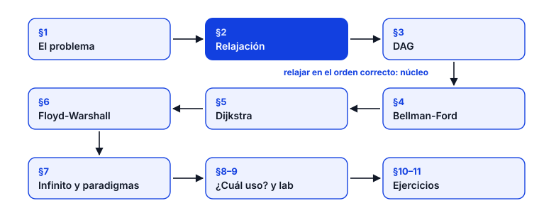
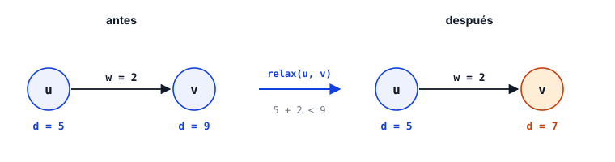

# Lección 10 — Caminos mínimos con pesos

> **Prerrequisitos:** Lección 6 (heaps; `decrease_key` e inserción perezosa) y Lección 9 completa (BFS, DFS, orden topológico).
>
> **Cómo estudiar esta lección:** los cuatro algoritmos son variaciones de **una sola operación**, la relajación, aplicada en órdenes distintos. Antes de cada algoritmo, pregúntate: *¿en qué orden relaja las aristas, y por qué ese orden garantiza el resultado?*
>
> **Lab asociado:** `lab10`: Dijkstra, Bellman-Ford, caminos en DAG y Floyd-Warshall (C, C++ y Rust). Dijkstra reutiliza tu `BinaryHeap` del lab06.

## Objetivos de aprendizaje

Al terminar esta lección deberías poder:
1. Definir el problema de caminos mínimos con pesos, y explicar qué pasa con los pesos y los ciclos negativos.
2. Enunciar y demostrar las propiedades de la **relajación**: cota superior y relajación de caminos.
3. Demostrar la corrección de los caminos mínimos en un **DAG** ($O(V+E)$), de **Bellman-Ford** ($O(VE)$, con detección de ciclos negativos) y de **Dijkstra** ($O((V+E)\lg V)$ con pesos no negativos).
4. Formular **Floyd-Warshall** como programación dinámica y demostrar su corrección.
5. Elegir el algoritmo correcto según los pesos, la estructura del grafo y la pregunta (un origen o todos los pares).
6. Representar "infinito" de forma segura en C, C++ y Rust.

## Mapa de la lección



---

## 1. El problema

Un **grafo con pesos** asigna a cada arista $(u, v)$ un peso $w(u, v)$ (distancia, tiempo, costo). El peso de un camino es la suma de los pesos de sus aristas, y la **distancia** es
$$\delta(s, v) = \min\{\, w(p) : p \text{ camino de } s \text{ a } v \,\},$$
con $\delta(s, v) = \infty$ si $v$ no es alcanzable. Con todos los pesos iguales a 1, es la distancia de BFS (L09).

**Pesos negativos.** Aparecen en problemas reales (arbitraje de divisas con $-\log$ de las tasas de cambio, costos que pueden ser ganancias). Son válidos **mientras no haya un ciclo de peso negativo alcanzable**: si lo hay, se puede recorrer el ciclo tantas veces como se quiera y $\delta = -\infty$ para todo vértice alcanzable desde él.

> **Lema 1 (subestructura óptima).** Todo subcamino de un camino mínimo es un camino mínimo.

*Demostración.* Si $p = s \leadsto u \leadsto v$ es mínimo y el tramo $u \leadsto v$ no lo fuera, reemplazándolo por uno más ligero obtendríamos un camino de $s$ a $v$ más ligero que $p$. $\blacksquare$

> **Lema 2 (desigualdad del triángulo).** Para toda arista $(u, v)$: $\delta(s, v) \le \delta(s, u) + w(u, v)$.

*Demostración.* Un camino mínimo a $u$ seguido de la arista $(u, v)$ es un camino a $v$. $\blacksquare$

Si no hay ciclos negativos, existe un camino mínimo **simple** (quitar un ciclo de peso $\ge 0$ no lo hace más pesado), así que tiene a lo más $V - 1$ aristas.

---

## 2. Relajación

Todos los algoritmos de la lección mantienen un arreglo $d$ con estimaciones ($d[s] = 0$, el resto $\infty$) y lo mejoran con una sola operación:

```
relax(u, v):
    si d[u] + w(u, v) < d[v]:
        d[v] ← d[u] + w(u, v);   padre[v] ← u
```

> **Lema 3 (cota superior).** En todo momento, $d[v] \ge \delta(s, v)$, y si $d[v] < \infty$, es el peso de algún camino de $s$ a $v$. Una vez que $d[v] = \delta(s, v)$, no vuelve a cambiar.

*Demostración.* Por inducción sobre las relajaciones: si $d[u]$ es el peso de un camino a $u$, entonces $d[u] + w(u, v)$ es el peso de un camino a $v$, que no puede ser menor que $\delta(s, v)$. Como $d[v]$ solo baja y nunca por debajo de $\delta$, cuando la alcanza se queda. $\blacksquare$

> **Lema 4 (relajación de caminos).** Sea $s = v_0, v_1, \dots, v_k$ un camino mínimo. Si se relajan las aristas $(v_0, v_1), (v_1, v_2), \dots, (v_{k-1}, v_k)$ **en ese orden** (aunque haya otras relajaciones intercaladas), al final $d[v_k] = \delta(s, v_k)$.

*Demostración.* Inducción sobre $i$: tras relajar $(v_{i-1}, v_i)$, $d[v_i] = \delta(s, v_i)$. Base: $d[v_0] = 0 = \delta(s, s)$ (no hay ciclos negativos). Paso: justo antes de relajar $(v_{i-1}, v_i)$, $d[v_{i-1}] = \delta(s, v_{i-1})$ (hipótesis y Lema 3); tras relajar, $d[v_i] \le \delta(s, v_{i-1}) + w(v_{i-1}, v_i) = \delta(s, v_i)$ (el prefijo de un camino mínimo es mínimo, Lema 1), y por el Lema 3, $d[v_i] \ge \delta(s, v_i)$. $\blacksquare$



**El Lema 4 es la llave de toda la lección:** cada algoritmo es una estrategia para garantizar que, para todo $v$, las aristas de **algún** camino mínimo a $v$ se relajen en orden.

---

## 3. Caminos mínimos en un DAG

Si el grafo es acíclico: tomar un orden topológico (L09 §4) y relajar las aristas salientes de cada vértice **en ese orden**.

> **Teorema 5.** En un DAG, con pesos arbitrarios (incluso negativos), este algoritmo calcula $\delta(s, \cdot)$ en $O(V + E)$.

*Demostración.* Todo camino $v_0, \dots, v_k$ visita sus vértices en orden topológico, así que sus aristas se relajan en el orden del camino: Lema 4. Costo: el orden topológico es $O(V+E)$ y cada arista se relaja una vez. $\blacksquare$

Las soluciones del lab hacen el orden topológico (Kahn) y la relajación **en la misma pasada**: cuando un vértice sale de la lista de listos, todos sus predecesores ya salieron.

**Aplicación: la ruta crítica.** En un proyecto con tareas y dependencias (un DAG), la duración mínima del proyecto es el camino **más largo** desde el inicio. Basta negar los pesos: el camino más largo en un DAG es el camino mínimo con pesos negados. (En un grafo con ciclos, el camino simple más largo es NP-difícil.)

---

## 4. Bellman-Ford

Pesos arbitrarios, grafo arbitrario. La estrategia más simple posible: relajar **todas** las aristas, $V - 1$ veces.

```
Bellman-Ford(G, s):
    repetir V − 1 veces:
        para cada arista (u, v):  relax(u, v)
    para cada arista (u, v):
        si d[u] + w(u, v) < d[v]:  devolver "hay un ciclo negativo"
```

> **Teorema 6.** Si no hay ciclos negativos alcanzables desde $s$, Bellman-Ford termina con $d = \delta(s, \cdot)$. Si los hay, lo detecta. Cuesta $O(VE)$.

*Demostración.* *Sin ciclos negativos:* todo $v$ alcanzable tiene un camino mínimo simple $v_0, \dots, v_k$ con $k \le V - 1$. En la ronda $i$ se relajan todas las aristas, en particular $(v_{i-1}, v_i)$: las aristas del camino se relajan en orden (en las rondas $1, 2, \dots, k$). Lema 4. Y la última pasada no encuentra mejoras por el Lema 2.

*Con un ciclo negativo* $c = v_0, v_1, \dots, v_k = v_0$ alcanzable: supongamos que la última pasada no encuentra mejoras, es decir, $d[v_i] \le d[v_{i-1}] + w(v_{i-1}, v_i)$ para todo $i$ (con todos los $d[v_i]$ finitos, porque el ciclo es alcanzable). Sumando sobre el ciclo:
$$\sum_{i=1}^k d[v_i] \le \sum_{i=1}^k d[v_{i-1}] + \sum_{i=1}^k w(v_{i-1}, v_i).$$
Las dos primeras sumas son iguales (recorren los mismos vértices), así que $0 \le w(c) < 0$. Contradicción: alguna arista sí mejora. $\blacksquare$

**Detalle del lab.** Las soluciones cortan en cuanto una ronda no cambia nada (ya se llegó al punto fijo), y si la ronda número $V$ todavía cambia algo, reportan ciclo negativo. El test `bellman_ford_ciclo_negativo` verifica las dos mitades del contrato: un ciclo negativo **alcanzable** da `None`; uno **no alcanzable** desde $s$ no afecta y se devuelven las distancias.

---

## 5. Dijkstra

### 5.1 El algoritmo

Si los pesos son **no negativos**, hay una estrategia mucho más rápida: procesar los vértices **en orden de distancia**, como BFS procesa por capas.

```
Dijkstra(G, s):
    d[s] ← 0;  Q ← cola de prioridad con todos los vértices por d
    mientras Q no vacía:
        u ← extraer el de menor d
        para cada (u, v):  relax(u, v)        -- y actualizar la prioridad de v
```

### 5.2 Corrección

> **Teorema 7.** Con pesos $w \ge 0$, cuando Dijkstra extrae un vértice $u$, $d[u] = \delta(s, u)$.

*Demostración.* Sea $S$ el conjunto de vértices ya extraídos. Supongamos, por contradicción, que $u$ es el **primer** vértice extraído con $d[u] > \delta(s, u)$ (en particular $u$ es alcanzable y $u \ne s$). Sea $p$ un camino mínimo de $s$ a $u$, y sea $(x, y)$ su primera arista que sale de $S$: $x \in S$, $y \notin S$ (existe porque $s \in S$ y $u \notin S$).

- $x$ se extrajo antes, así que $d[x] = \delta(s, x)$ (por la minimalidad de $u$), y al extraerlo se relajó $(x, y)$: $d[y] \le \delta(s, x) + w(x, y) = \delta(s, y)$ (Lema 1). Con el Lema 3, $d[y] = \delta(s, y)$.
- $y$ está en $p$ antes que $u$ y los pesos son **no negativos**, así que $\delta(s, y) \le \delta(s, u)$.
- Dijkstra eligió $u$ y no $y$, así que $d[u] \le d[y]$.

Juntando: $d[u] \le d[y] = \delta(s, y) \le \delta(s, u) < d[u]$. Contradicción. $\blacksquare$

**¿Dónde falla con pesos negativos?** En el segundo punto: con una arista negativa más adelante, un vértice más lejano en el camino puede tener distancia **menor**. El programa lo muestra con 3 vértices: Dijkstra declara definitivo al vértice 1 con distancia 2, y después aparece un camino más corto que pasa por una arista de peso $-4$.

::: {.tabs}
```c
#include <stdbool.h>
#include <stdio.h>

#define N 3
#define INF 1000000
/* aristas: 0→1 (2), 0→2 (5), 2→1 (−4).  δ(0, 1) = 5 − 4 = 1 */
static const int w[N][N] = {{INF, 2, 5}, {INF, INF, INF}, {INF, -4, INF}};

int main(void) {
    int d[N] = {0, INF, INF};
    bool listo[N] = {false};
    for (int paso = 0; paso < N; paso++) {     /* Dijkstra con arreglo: O(V²) */
        int u = -1;
        for (int v = 0; v < N; v++)
            if (!listo[v] && (u < 0 || d[v] < d[u])) u = v;
        listo[u] = true;                       /* "d[u] es definitivo" */
        for (int v = 0; v < N; v++)
            if (!listo[v] && w[u][v] < INF && d[u] + w[u][v] < d[v]) d[v] = d[u] + w[u][v];
    }
    printf("Dijkstra:     d[1] = %d\n", d[1]);

    int b[N] = {0, INF, INF};                  /* Bellman-Ford: V − 1 rondas */
    for (int r = 0; r < N - 1; r++)
        for (int u = 0; u < N; u++)
            for (int v = 0; v < N; v++)
                if (b[u] < INF && w[u][v] < INF && b[u] + w[u][v] < b[v]) b[v] = b[u] + w[u][v];
    printf("Bellman-Ford: d[1] = %d\n", b[1]);
    return 0;
}
```

```cpp
#include <array>
#include <cstdio>

constexpr int N = 3, INF = 1000000;
// aristas: 0→1 (2), 0→2 (5), 2→1 (−4).  δ(0, 1) = 5 − 4 = 1
constexpr int w[N][N] = {{INF, 2, 5}, {INF, INF, INF}, {INF, -4, INF}};

int main() {
    std::array<int, N> d{0, INF, INF};
    std::array<bool, N> listo{};
    for (int paso = 0; paso < N; ++paso) {     // Dijkstra con arreglo: O(V²)
        int u = -1;
        for (int v = 0; v < N; ++v)
            if (!listo[v] && (u < 0 || d[v] < d[u])) u = v;
        listo[u] = true;                       // "d[u] es definitivo"
        for (int v = 0; v < N; ++v)
            if (!listo[v] && w[u][v] < INF && d[u] + w[u][v] < d[v]) d[v] = d[u] + w[u][v];
    }
    std::printf("Dijkstra:     d[1] = %d\n", d[1]);

    std::array<int, N> b{0, INF, INF};         // Bellman-Ford: V − 1 rondas
    for (int r = 0; r < N - 1; ++r)
        for (int u = 0; u < N; ++u)
            for (int v = 0; v < N; ++v)
                if (b[u] < INF && w[u][v] < INF && b[u] + w[u][v] < b[v]) b[v] = b[u] + w[u][v];
    std::printf("Bellman-Ford: d[1] = %d\n", b[1]);
}
```

```rust
const N: usize = 3;
const INF: i32 = 1_000_000;
// aristas: 0→1 (2), 0→2 (5), 2→1 (−4).  δ(0, 1) = 5 − 4 = 1
const W: [[i32; N]; N] = [[INF, 2, 5], [INF, INF, INF], [INF, -4, INF]];

fn main() {
    let mut d = [0, INF, INF];
    let mut listo = [false; N];
    for _ in 0..N {
        // Dijkstra con arreglo: O(V²)
        let u = (0..N).filter(|&v| !listo[v]).min_by_key(|&v| d[v]).unwrap();
        listo[u] = true; // "d[u] es definitivo"
        for v in 0..N {
            if !listo[v] && W[u][v] < INF && d[u] + W[u][v] < d[v] { d[v] = d[u] + W[u][v]; }
        }
    }
    println!("Dijkstra:     d[1] = {}", d[1]);

    let mut b = [0, INF, INF]; // Bellman-Ford: V − 1 rondas
    for _ in 0..N - 1 {
        for u in 0..N {
            for v in 0..N {
                if b[u] < INF && W[u][v] < INF && b[u] + W[u][v] < b[v] { b[v] = b[u] + W[u][v]; }
            }
        }
    }
    println!("Bellman-Ford: d[1] = {}", b[1]);
}
```
:::

```{.text .salida}
Dijkstra:     d[1] = 2
Bellman-Ford: d[1] = 1
```

### 5.3 Costo e inserción perezosa

El costo depende de la cola de prioridad: $V$ extracciones y hasta $E$ "bajadas de prioridad".

| Cola de prioridad | extraer | bajar prioridad | Dijkstra |
|---|---|---|---|
| Arreglo (buscar el mínimo) | $O(V)$ | $O(1)$ | $O(V^2)$: el mejor en grafos **densos** |
| Heap binario (L06) | $O(\lg V)$ | $O(\lg V)$ | $O((V + E)\lg V)$ |
| Heap de Fibonacci | $O(\lg V)$ amort. | $O(1)$ amort. | $O(E + V\lg V)$ |

El heap del lab06 no tiene `decrease_key` (necesitaría saber dónde está cada vértice, L06 §5.4). La alternativa estándar, que usan las soluciones del lab, es la **inserción perezosa**: cada vez que `relax` mejora $d[v]$, se mete un par $(d[v], v)$ **nuevo** al heap, sin quitar el viejo. Al extraer un par $(x, v)$ con $x \ne d[v]$, es obsoleto (ya se extrajo una versión mejor de $v$) y se ignora.

> **Proposición 8.** Dijkstra con inserción perezosa cuesta $O((V + E)\lg V)$.

*Demostración.* Cada relajación exitosa inserta un par, y hay a lo más una por arista (cuando se extrae $u$ por primera vez con su distancia definitiva; las extracciones obsoletas no relajan): a lo más $E + 1$ pares en total. Cada inserción y extracción cuesta $O(\lg E)$, y $\lg E \le \lg V^2 = 2\lg V$. $\blacksquare$

El test `dijkstra_grande_pesos_unitarios` corre Dijkstra con 200 000 vértices y un millón de aristas de peso 1 y lo compara con BFS: la versión $O(V^2)$ con arreglo no termina a tiempo.

---

## 6. Todos los pares: Floyd-Warshall

Para la distancia entre **todos** los pares de vértices se podría correr Dijkstra $V$ veces ($O(V(V+E)\lg V)$) o Bellman-Ford $V$ veces ($O(V^2E)$). Floyd-Warshall da $\Theta(V^3)$ con pesos negativos y un código de cinco líneas.

**Subproblemas.** Numeremos los vértices $0, \dots, V-1$. Sea $d_k[i][j]$ el peso del camino mínimo de $i$ a $j$ cuyos vértices **intermedios** están todos en $\{0, \dots, k-1\}$. Entonces $d_0[i][j] = w(i, j)$ (o 0 si $i = j$, $\infty$ si no hay arista), $d_V[i][j] = \delta(i, j)$, y

> **Lema 9.** $d_{k+1}[i][j] = \min\big(d_k[i][j],\; d_k[i][k] + d_k[k][j]\big)$.

*Demostración.* Un camino mínimo de $i$ a $j$ con intermedios en $\{0..k\}$ (sin ciclos negativos, simple) o no pasa por $k$, y entonces sus intermedios están en $\{0..k-1\}$: peso $d_k[i][j]$; o pasa por $k$ **una sola vez**, y se parte en $i \leadsto k \leadsto j$, dos caminos con intermedios en $\{0..k-1\}$ que por el Lema 1 son mínimos: peso $d_k[i][k] + d_k[k][j]$. $\blacksquare$

```
para k = 0 .. V−1:
    para i, para j:
        d[i][j] ← min(d[i][j], d[i][k] + d[k][j])
```

Basta **una** matriz (no hace falta guardar $d_k$ y $d_{k+1}$ por separado): en la iteración $k$, la fila $k$ y la columna $k$ no cambian ($d[k][k] = 0$ sin ciclos negativos), así que leer valores ya actualizados no altera nada. Es el primer ejemplo del curso de **programación dinámica**, el tema de la L12.

Si hay un ciclo negativo, al final algún $d[i][i] < 0$: Floyd-Warshall también lo detecta.

---

## 7. Infinito, desbordamiento y paradigmas

¿Cómo se representa $\infty$? La tentación es usar el entero más grande (`INT64_MAX`) y comparar con normalidad. El peligro está en la relajación: `d[u] + w` con `d[u] == INT64_MAX` y `w > 0` **desborda**. En C y C++, el desbordamiento de enteros con signo es **comportamiento indefinido** (UBSan lo reporta); en Rust, en modo debug hace `panic`, y en release da la vuelta en silencio.

| | Representación de $\infty$ | Cómo se evita sumar a $\infty$ |
|---|---|---|
| C (lab) | `DIST_INF = INT64_MAX` | `relax` comprueba `d[u] != DIST_INF` antes de sumar |
| C++ (lab) | `std::optional<int64_t>`, `nullopt` | no se puede sumar un `optional` sin desempacarlo |
| Rust (lab) | `Option<i64>`, `None` | el `match` obliga a tratar el caso `None` |

El tipo opcional hace **imposible de escribir** el error: `d[u] + w` no compila si `d[u]` es un `Option<i64>`. Es el mismo argumento que `Option` contra `NULL` en la L01: llevar el caso especial al sistema de tipos.

| Aspecto | C | C++ | Rust |
|---|---|---|---|
| Heap de Dijkstra | `BinaryHeap` del lab06 con `struct {d, v}` y un `cmp` | `BinaryHeap<pair<int64_t, size_t>>` del lab06 | `BinaryHeap<(i64, usize)>` del lab06; las tuplas son `Ord` |
| Matriz de Floyd-Warshall | un bloque `n*n`, por filas | `vector<vector<Dist>>` | `Vec<Vec<Dist>>` |
| Ciclo negativo | `false` | `std::nullopt` | `None` |

---

## 8. ¿Qué algoritmo uso?

| Situación | Algoritmo | Costo |
|---|---|---|
| Sin pesos (o todos iguales) | BFS (L09) | $O(V + E)$ |
| DAG, pesos cualesquiera | orden topológico + relajación | $O(V + E)$ |
| Pesos $\ge 0$, un origen, grafo disperso | Dijkstra con heap | $O((V + E)\lg V)$ |
| Pesos $\ge 0$, un origen, grafo denso | Dijkstra con arreglo | $O(V^2)$ |
| Pesos negativos, un origen | Bellman-Ford | $O(VE)$ |
| Todos los pares, grafo denso o pequeño | Floyd-Warshall | $\Theta(V^3)$ |
| Todos los pares, disperso, pesos negativos | Johnson (repesar + $V$ Dijkstra) | $O(V(V + E)\lg V)$ |

---

## 9. Guía del Lab 10

**Archivos:** `c/src/lab10/wgraph.c`, `cpp/include/algolib/lab10/shortest_paths.hpp`, `rust/src/lab10/mod.rs`. Necesitas tu `BinaryHeap` del **lab06** funcionando.

**Orden sugerido:** grafo con pesos → una función `relax` → caminos en DAG (el más simple) → Bellman-Ford → Dijkstra con inserción perezosa → Floyd-Warshall.

**Errores frecuentes:**
- Sumar a infinito (`INT64_MAX + w`): UB en C y C++. Comprobar antes de sumar.
- Dijkstra: no descartar los pares obsoletos. Sigue siendo correcto, pero vuelve a relajar las aristas de un vértice cada vez que sale un par viejo: el costo deja de ser $O((V+E)\lg V)$.
- Dijkstra: comparar el par extraído con `>` en vez de `!=`, o marcar como visitado al **meter** en lugar de al **sacar**.
- Bellman-Ford: reportar ciclo negativo si **cualquier** arista se puede relajar, sin importar si es alcanzable: el test con el ciclo no alcanzable falla. Con $d[u] = \infty$ no hay relajación.
- Floyd-Warshall: poner `k` en el ciclo **interior** en vez del exterior. Da resultados incorrectos (el orden de los ciclos es parte de la demostración).

---

## 10. Comprueba tu comprensión

1. ¿Por qué BFS no sirve con pesos distintos de 1?
2. ¿Sumar una constante $c$ a todos los pesos para quitar los negativos preserva los caminos mínimos?
3. En Bellman-Ford, ¿por qué $V - 1$ rondas y no $V$?
4. En Dijkstra con inserción perezosa, ¿cuántos pares puede haber en el heap a la vez, en el peor caso?
5. ¿Qué detecta Floyd-Warshall si al final $d[3][3] = -2$?

<details><summary>Respuestas</summary>

1. Porque procesar por número de aristas no es procesar por peso: un camino de 3 aristas ligeras puede pesar menos que uno de 1 arista pesada.
2. No: un camino de $k$ aristas aumenta $kc$, y favorece a los caminos con menos aristas. (Johnson usa un repesado distinto, con potenciales, que sí los preserva.)
3. Porque un camino mínimo simple tiene a lo más $V - 1$ aristas, y la ronda $i$ garantiza la arista $i$ del camino (Lema 4). La ronda $V$ solo sirve para detectar ciclos negativos.
4. $O(E)$: un par por cada relajación exitosa.
5. Que el vértice 3 está en un ciclo de peso negativo.
</details>

---

## 11. Problem Set 10

**Teoría**
1. Demuestra que si se guardan los `padre[v]` de las relajaciones, al terminar cualquiera de los algoritmos (sin ciclos negativos) forman un **árbol de caminos mínimos** con raíz $s$.
2. Da un grafo con pesos negativos **sin** ciclos negativos en el que Dijkstra da una respuesta incorrecta, y explica en qué paso de la demostración del Teorema 7 falla.
3. **Johnson.** Con un vértice nuevo $q$ conectado a todos con peso 0, sea $h(v) = \delta(q, v)$ (por Bellman-Ford). Demuestra que $\hat w(u, v) = w(u, v) + h(u) - h(v) \ge 0$ y que los caminos mínimos con $\hat w$ son los mismos que con $w$.
4. **Arbitraje.** Dadas las tasas de cambio $r_{ij}$ entre $n$ divisas, demuestra que existe una secuencia de cambios que genera ganancia si y solo si el grafo con pesos $-\log r_{ij}$ tiene un ciclo negativo.
5. Demuestra que Dijkstra con un heap $d$-ario y $d = \max(2, E/V)$ cuesta $O(E\log_{E/V}V)$.

**Implementación (C, C++ y Rust)**

6. Agrega `shortest_path(g, s, t)` que devuelva el camino (no solo la distancia) con los `padre`.
7. Haz que Bellman-Ford devuelva un **ciclo negativo** concreto como testigo (pista: un vértice relajado en la ronda $V$, retrocediendo $V$ veces por `padre`, está en el ciclo).
8. Implementa Dijkstra con **heap indexado** y `decrease_key` (PS6 ej. 6) y compáralo con la inserción perezosa en grafos dispersos y densos.
9. Implementa el algoritmo de Johnson del ej. 3 y compáralo con Floyd-Warshall en grafos dispersos de $V = 2000$.

---

## Referencias
- CLRS, *Introduction to Algorithms*, 4ª ed.: Cap. 22 (un origen: relajación, Bellman-Ford, DAG, Dijkstra), Cap. 23 (todos los pares: Floyd-Warshall, Johnson).
- MIT 6.006 (Spring 2020), Lectures 11–14: *Weighted Shortest Paths*, *Bellman-Ford*, *Dijkstra*, *APSP and Johnson*.
- Dijkstra, E. W. (1959). *A note on two problems in connexion with graphs*. Numerische Mathematik 1.
- Bellman, R. (1958). *On a routing problem*. Quarterly of Applied Mathematics 16.
- Floyd, R. W. (1962). *Algorithm 97: Shortest path*. Communications of the ACM 5(6).
