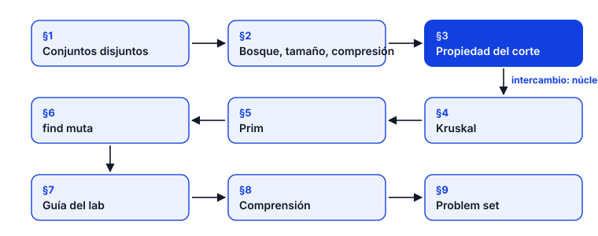
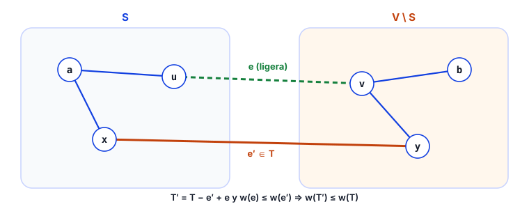

# Lección 11 — Union-Find y árboles de expansión mínima

> **Prerrequisitos:** Lección 1 (análisis amortizado), Lección 5 (ordenamiento), Lección 6 (heaps) y Lección 9 (grafos, componentes conexas).
>
> **Cómo estudiar esta lección:** Union-Find es la estructura con la mejor relación entre "líneas de código" y "profundidad del análisis" de todo el curso: diez líneas y un teorema famoso. Los MST, por su parte, son el ejemplo canónico de **algoritmo voraz** demostrado correcto con un argumento de **intercambio**. Practica ese argumento: reaparece en todo el diseño de algoritmos.
>
> **Lab asociado:** `lab11`: `DisjointSet`, Kruskal y Prim (C, C++ y Rust). Prim reutiliza tu `BinaryHeap` del lab06.

## Objetivos de aprendizaje

Al terminar esta lección deberías poder:
1. Especificar el **TAD Conjuntos disjuntos** e implementarlo como un bosque.
2. Demostrar que la **unión por tamaño** acota la altura por $\lg n$, y explicar qué aporta la **compresión de caminos** ($O(\alpha(n))$ amortizado).
3. Definir árbol de expansión mínima, **corte** y **arista ligera**, y demostrar la **propiedad del corte** con un argumento de intercambio.
4. Demostrar la corrección de **Kruskal** y **Prim** como casos de la propiedad del corte, y analizar su costo.
5. Explicar por qué `find` muta la estructura y cómo lo expresa cada lenguaje (`&mut self`, no-`const`, `mutable`).

## Mapa de la lección



---

## 1. El TAD Conjuntos disjuntos

Mantener una **partición** de $\{0, \dots, n-1\}$ en conjuntos disjuntos, con:

| Operación | Efecto |
|---|---|
| `find(x)` | el **representante** del conjunto de $x$ (un elemento fijo del conjunto) |
| `unite(a, b)` | reemplaza los conjuntos de $a$ y $b$ por su unión |
| `same(a, b)` | `find(a) == find(b)` |

Al inicio cada elemento está solo. Aplicaciones: componentes conexas de un grafo que **crece** (agregar aristas y preguntar "¿ya están conectados?"), el algoritmo de Kruskal, la segmentación de imágenes (unir píxeles parecidos), la unificación de tipos en un compilador, la percolación.

¿Por qué no BFS/DFS? Porque calculan componentes de un grafo **fijo** en $O(V+E)$; si las aristas llegan una por una y entre cada una hay preguntas, recalcular cada vez cuesta $\Theta(E(V+E))$.

---

## 2. El bosque de conjuntos

### 2.1 Representación

Cada conjunto es un **árbol** cuyos nodos apuntan a su padre; la raíz se apunta a sí misma y es el representante. Basta un arreglo `parent[0..n)`:

```
find(x):      mientras parent[x] ≠ x:  x ← parent[x];   devolver x
unite(a, b):  a ← find(a);  b ← find(b);  si a ≠ b:  parent[b] ← a
```

El costo de `find` es la **profundidad** de $x$. Sin cuidado, una secuencia `unite(1,0), unite(2,1), …` construye una cadena y `find` cuesta $\Theta(n)$.

### 2.2 Unión por tamaño

Guardar en cada raíz el tamaño de su árbol, y al unir colgar la raíz del árbol **más chico** de la del más grande.

> **Teorema 1.** Con unión por tamaño, todo nodo tiene profundidad a lo más $\lg n$.

*Demostración.* La profundidad de un nodo $x$ solo aumenta (en 1) cuando la raíz de su árbol se cuelga de otra raíz, y eso solo pasa si su árbol es el más chico de los dos: el árbol que contiene a $x$ **al menos duplica** su tamaño. Como el tamaño nunca pasa de $n$, eso ocurre a lo más $\lg n$ veces. $\blacksquare$

Así `find` y `unite` cuestan $O(\lg n)$ en el peor caso. La **unión por rango** (colgar del de mayor *altura* acotada) da la misma cota con el mismo argumento.

### 2.3 Compresión de caminos

Durante `find(x)`, una vez hallada la raíz $r$, se vuelve a recorrer el camino de $x$ a $r$ y se cuelga **cada nodo directamente de $r$**. Las búsquedas siguientes de esos nodos (y de sus descendientes) cuestan casi nada.

```
find(x):
    r ← x;   mientras parent[r] ≠ r:  r ← parent[r]          -- 1.ª pasada: hallar la raíz
    mientras parent[x] ≠ r:  (x, parent[x]) ← (parent[x], r)  -- 2.ª pasada: comprimir
    devolver r
```

Las soluciones del lab lo hacen así, **iterativo**: la versión recursiva (`parent[x] = find(parent[x])`) es más corta, pero si alguien unió sin tamaño, la recursión tiene profundidad $\Theta(n)$ y desborda la pila (L03, L09).

> **Teorema 2 (Tarjan, 1975).** Con unión por tamaño (o rango) **y** compresión de caminos, cualquier secuencia de $m$ operaciones sobre $n$ elementos cuesta $O(m\,\alpha(n))$, donde $\alpha$ es la inversa de la función de Ackermann. Y esta cota es ajustada: ninguna implementación por punteros puede hacerlo en $O(m)$.

$\alpha(n)$ crece tan despacio que $\alpha(n) \le 4$ para todo $n$ menor que el número de átomos del universo. En la práctica, **constante**. La demostración completa (CLRS §19.4) usa el método del potencial de L01 con una función ingeniosa sobre los rangos; una versión más sencilla, con la cota $O(m\lg^* n)$, es el ej. 3 del problem set.

::: {.tabs}
```c
#include <stdio.h>

#define N 1024
static int parent[N], tam[N];

static void reiniciar(void) { for (int i = 0; i < N; i++) { parent[i] = i; tam[i] = 1; } }
static int raiz(int x) { while (parent[x] != x) x = parent[x]; return x; }  /* sin compresión */
static int profundidad(int x) { int d = 0; while (parent[x] != x) { x = parent[x]; d++; } return d; }
static int max_profundidad(void) { int m = 0; for (int i = 0; i < N; i++) if (profundidad(i) > m) m = profundidad(i); return m; }

static void unir_ingenuo(int a, int b) { a = raiz(a); b = raiz(b); if (a != b) parent[a] = b; }
static void unir_tamano(int a, int b) {
    a = raiz(a); b = raiz(b);
    if (a == b) return;
    if (tam[a] < tam[b]) { int t = a; a = b; b = t; }
    parent[b] = a; tam[a] += tam[b];
}

int main(void) {
    reiniciar();
    for (int i = 0; i + 1 < N; i++) unir_ingenuo(i, i + 1);
    printf("ingenuo, cadena:              profundidad máxima %d\n", max_profundidad());
    reiniciar();
    for (int i = 0; i + 1 < N; i++) unir_tamano(i, i + 1);
    printf("por tamaño, cadena:           profundidad máxima %d\n", max_profundidad());
    reiniciar();
    for (int paso = 1; paso < N; paso *= 2)          /* peor caso: unir árboles iguales */
        for (int i = 0; i + paso < N; i += 2 * paso) unir_tamano(i, i + paso);
    printf("por tamaño, árboles iguales:  profundidad máxima %d\n", max_profundidad());
    return 0;
}
```

```cpp
#include <cstdio>
#include <numeric>
#include <utility>
#include <vector>

struct Bosque {
    std::vector<int> parent, tam;
    explicit Bosque(int n) : parent(n), tam(n, 1) { std::iota(parent.begin(), parent.end(), 0); }
    int raiz(int x) const { while (parent[x] != x) x = parent[x]; return x; }  // sin compresión
    int profundidad(int x) const { int d = 0; while (parent[x] != x) { x = parent[x]; ++d; } return d; }
    int max_profundidad() const {
        int m = 0;
        for (int i = 0; i < (int)parent.size(); ++i) m = std::max(m, profundidad(i));
        return m;
    }
    void unir_ingenuo(int a, int b) { a = raiz(a); b = raiz(b); if (a != b) parent[a] = b; }
    void unir_tamano(int a, int b) {
        a = raiz(a); b = raiz(b);
        if (a == b) return;
        if (tam[a] < tam[b]) std::swap(a, b);
        parent[b] = a; tam[a] += tam[b];
    }
};

int main() {
    const int N = 1024;
    Bosque x(N), y(N), z(N);
    for (int i = 0; i + 1 < N; ++i) x.unir_ingenuo(i, i + 1);
    std::printf("ingenuo, cadena:              profundidad máxima %d\n", x.max_profundidad());
    for (int i = 0; i + 1 < N; ++i) y.unir_tamano(i, i + 1);
    std::printf("por tamaño, cadena:           profundidad máxima %d\n", y.max_profundidad());
    for (int paso = 1; paso < N; paso *= 2)          // peor caso: unir árboles iguales
        for (int i = 0; i + paso < N; i += 2 * paso) z.unir_tamano(i, i + paso);
    std::printf("por tamaño, árboles iguales:  profundidad máxima %d\n", z.max_profundidad());
}
```

```rust
struct Bosque { parent: Vec<usize>, tam: Vec<usize> }

impl Bosque {
    fn new(n: usize) -> Self { Bosque { parent: (0..n).collect(), tam: vec![1; n] } }
    fn raiz(&self, mut x: usize) -> usize { while self.parent[x] != x { x = self.parent[x]; } x } // sin compresión
    fn profundidad(&self, mut x: usize) -> usize {
        let mut d = 0;
        while self.parent[x] != x { x = self.parent[x]; d += 1; }
        d
    }
    fn max_profundidad(&self) -> usize { (0..self.parent.len()).map(|i| self.profundidad(i)).max().unwrap() }
    fn unir_ingenuo(&mut self, a: usize, b: usize) {
        let (a, b) = (self.raiz(a), self.raiz(b));
        if a != b { self.parent[a] = b; }
    }
    fn unir_tamano(&mut self, a: usize, b: usize) {
        let (mut a, mut b) = (self.raiz(a), self.raiz(b));
        if a == b { return; }
        if self.tam[a] < self.tam[b] { std::mem::swap(&mut a, &mut b); }
        self.parent[b] = a;
        self.tam[a] += self.tam[b];
    }
}

fn main() {
    const N: usize = 1024;
    let (mut x, mut y, mut z) = (Bosque::new(N), Bosque::new(N), Bosque::new(N));
    for i in 0..N - 1 { x.unir_ingenuo(i, i + 1); }
    println!("ingenuo, cadena:              profundidad máxima {}", x.max_profundidad());
    for i in 0..N - 1 { y.unir_tamano(i, i + 1); }
    println!("por tamaño, cadena:           profundidad máxima {}", y.max_profundidad());
    let mut paso = 1;
    while paso < N {
        // peor caso: unir árboles iguales
        let mut i = 0;
        while i + paso < N { z.unir_tamano(i, i + paso); i += 2 * paso; }
        paso *= 2;
    }
    println!("por tamaño, árboles iguales:  profundidad máxima {}", z.max_profundidad());
}
```
:::

```{.text .salida}
ingenuo, cadena:              profundidad máxima 1023
por tamaño, cadena:           profundidad máxima 1
por tamaño, árboles iguales:  profundidad máxima 10
```

La última línea alcanza exactamente $\lg 1024 = 10$: la cota del Teorema 1 es ajustada.

---

## 3. Árboles de expansión mínima

### 3.1 El problema

Sea $G = (V, E)$ un grafo **no dirigido, conexo**, con pesos $w$. Un **árbol de expansión** es un subconjunto $T \subseteq E$ que conecta todos los vértices sin ciclos (tiene exactamente $V - 1$ aristas). Un **árbol de expansión mínima** (MST) es uno de peso total $w(T) = \sum_{e \in T} w(e)$ mínimo.

Ejemplos: tender cable (eléctrico, de red, de fibra) entre ciudades con el menor costo; el primer paso de varios algoritmos de agrupamiento (*clustering*) y de aproximación (el problema del viajante, PS11 ej. 5).

A diferencia de los caminos mínimos (L10), los **pesos negativos no causan ningún problema** aquí: solo importa el orden relativo de los pesos, y sumar una constante a todas las aristas no cambia cuál árbol es mínimo (todos tienen $V - 1$ aristas).

### 3.2 La propiedad del corte

Un **corte** $(S, V \setminus S)$ es una partición de los vértices en dos lados no vacíos. Una arista **cruza** el corte si tiene un extremo en cada lado; es **ligera** si es de peso mínimo entre las que cruzan. Un conjunto de aristas $A$ **respeta** el corte si ninguna arista de $A$ lo cruza.

> **Teorema 3 (propiedad del corte).** Sea $A$ un subconjunto de algún MST, $(S, V\setminus S)$ un corte que $A$ respeta, y $e = \{u, v\}$ una arista ligera del corte. Entonces $A \cup \{e\}$ también es subconjunto de algún MST.

*Demostración (intercambio).* Sea $T$ un MST con $A \subseteq T$. Si $e \in T$, listo. Si no, $T \cup \{e\}$ tiene exactamente un ciclo (en $T$ hay un único camino de $u$ a $v$, y $e$ lo cierra). Ese camino va de $u \in S$ a $v \notin S$, así que cruza el corte por alguna arista $e' \ne e$. Sea $T' = T \setminus \{e'\} \cup \{e\}$:
- $T'$ es un árbol de expansión: quitar $e'$ rompe el único ciclo, y sigue conectando todo (cualquier camino que usaba $e'$ puede rodear por el resto del ciclo).
- $w(T') = w(T) - w(e') + w(e) \le w(T)$, porque $e$ es ligera y $e'$ cruza el corte: $w(e) \le w(e')$. Así que $T'$ también es un MST.
- $A \subseteq T'$: $e' \notin A$ porque $A$ no cruza el corte.

Entonces $A \cup \{e\} \subseteq T'$, un MST. $\blacksquare$

**El método voraz genérico:** empezar con $A = \emptyset$ y, $V - 1$ veces, agregar una arista ligera de algún corte que $A$ respete. Por el Teorema 3, $A$ siempre es parte de un MST; al tener $V - 1$ aristas, **es** un MST. Kruskal y Prim son dos maneras de elegir el corte.



---

## 4. Kruskal

```
Kruskal(G):
    A ← ∅;  D ← DisjointSet(V)
    para cada arista {u, v} en orden CRECIENTE de peso:
        si D.unite(u, v):  A ← A ∪ {{u, v}}      -- une dos componentes distintas
```

> **Teorema 4.** Kruskal calcula un MST en $O(E\lg E)$.

*Demostración.* *Corrección:* cuando Kruskal toma $\{u, v\}$, $u$ y $v$ están en componentes distintas $C_u$, $C_v$ del bosque $A$. El corte $(C_u, V \setminus C_u)$ es respetado por $A$, y $\{u, v\}$ lo cruza. Es ligera: cualquier arista más ligera que lo cruzara ya habría sido examinada (orden creciente) y tomada, porque habría unido dos componentes distintas en su momento. Teorema 3. Las aristas descartadas cerrarían un ciclo. *Costo:* ordenar $O(E\lg E)$, más $E$ operaciones de Union-Find, $O(E\,\alpha(V))$. Como $E \le V^2$, $\lg E = O(\lg V)$. $\blacksquare$

::: {.tabs}
```c
#include <stdio.h>
#include <stdlib.h>

typedef struct { int u, v, w; } Arista;
static int parent[9];
static int raiz(int x) { while (parent[x] != x) x = parent[x] = parent[parent[x]]; return x; }

/* Orden total (peso, u, v): así la salida es la misma en los tres lenguajes. */
static int cmp(const void *a, const void *b) {
    const Arista *x = a, *y = b;
    if (x->w != y->w) return (x->w > y->w) - (x->w < y->w);
    if (x->u != y->u) return (x->u > y->u) - (x->u < y->u);
    return (x->v > y->v) - (x->v < y->v);
}

int main(void) {
    /* CLRS Fig. 23.1: a..i = 0..8 */
    Arista es[] = {{0,1,4},{0,7,8},{1,2,8},{1,7,11},{2,3,7},{2,8,2},{2,5,4},
                   {3,4,9},{3,5,14},{4,5,10},{5,6,2},{6,7,1},{6,8,6},{7,8,7}};
    int m = sizeof es / sizeof es[0], total = 0;
    for (int i = 0; i < 9; i++) parent[i] = i;
    qsort(es, m, sizeof es[0], cmp);
    printf("aristas del MST:");
    for (int i = 0; i < m; i++) {
        int a = raiz(es[i].u), b = raiz(es[i].v);
        if (a == b) continue;
        parent[a] = b;
        total += es[i].w;
        printf(" %c%c(%d)", 'a' + es[i].u, 'a' + es[i].v, es[i].w);
    }
    printf("\npeso total: %d\n", total);
    return 0;
}
```

```cpp
#include <algorithm>
#include <cstdio>
#include <numeric>
#include <tuple>
#include <vector>

struct Arista { int u, v, w; };

int main() {
    // CLRS Fig. 23.1: a..i = 0..8
    std::vector<Arista> es = {{0,1,4},{0,7,8},{1,2,8},{1,7,11},{2,3,7},{2,8,2},{2,5,4},
                              {3,4,9},{3,5,14},{4,5,10},{5,6,2},{6,7,1},{6,8,6},{7,8,7}};
    std::vector<int> parent(9);
    std::iota(parent.begin(), parent.end(), 0);
    auto raiz = [&](int x) { while (parent[x] != x) x = parent[x] = parent[parent[x]]; return x; };
    // Orden total (peso, u, v): así la salida es la misma en los tres lenguajes.
    std::sort(es.begin(), es.end(), [](const Arista& a, const Arista& b) {
        return std::tie(a.w, a.u, a.v) < std::tie(b.w, b.u, b.v);
    });
    int total = 0;
    std::printf("aristas del MST:");
    for (const auto& e : es) {
        int a = raiz(e.u), b = raiz(e.v);
        if (a == b) continue;
        parent[a] = b;
        total += e.w;
        std::printf(" %c%c(%d)", 'a' + e.u, 'a' + e.v, e.w);
    }
    std::printf("\npeso total: %d\n", total);
}
```

```rust
fn main() {
    // CLRS Fig. 23.1: a..i = 0..8
    let mut es: Vec<(usize, usize, i32)> = vec![(0,1,4),(0,7,8),(1,2,8),(1,7,11),(2,3,7),(2,8,2),(2,5,4),
                                                 (3,4,9),(3,5,14),(4,5,10),(5,6,2),(6,7,1),(6,8,6),(7,8,7)];
    let mut parent: Vec<usize> = (0..9).collect();
    fn raiz(p: &mut [usize], mut x: usize) -> usize {
        while p[x] != x { p[x] = p[p[x]]; x = p[x]; }
        x
    }
    // Orden total (peso, u, v): así la salida es la misma en los tres lenguajes.
    es.sort_by_key(|&(u, v, w)| (w, u, v));
    let mut total = 0;
    print!("aristas del MST:");
    for (u, v, w) in es {
        let (a, b) = (raiz(&mut parent, u), raiz(&mut parent, v));
        if a == b { continue; }
        parent[a] = b;
        total += w;
        print!(" {}{}({})", (b'a' + u as u8) as char, (b'a' + v as u8) as char, w);
    }
    println!("\npeso total: {total}");
}
```
:::

```{.text .salida}
aristas del MST: gh(1) ci(2) fg(2) ab(4) cf(4) cd(7) ah(8) de(9)
peso total: 37
```

---

## 5. Prim

```
Prim(G):
    T ← {0}   -- el árbol crece desde un vértice cualquiera
    mientras T no tenga todos los vértices:
        tomar la arista más ligera {u, v} con u ∈ T, v ∉ T;   T ← T ∪ {v}
```

> **Teorema 5.** Prim calcula un MST; con un heap binario cuesta $O(E\lg V)$.

*Demostración.* *Corrección:* en cada paso, el corte es $(T, V \setminus T)$, respetado por las aristas ya elegidas (todas dentro de $T$), y la arista tomada es ligera por definición. Teorema 3. *Costo:* igual que Dijkstra (L10 §5.3), con inserción perezosa: cada arista mete a lo más dos pares al heap, $O(E\lg E) = O(E\lg V)$. $\blacksquare$

Prim es **casi idéntico a Dijkstra**; la única diferencia es la prioridad: Dijkstra usa la distancia desde $s$ ($d[u] + w$), Prim usa el peso de la arista sola ($w$). Las soluciones del lab comparten la misma estructura de inserción perezosa en los dos labs.

| | Kruskal | Prim |
|---|---|---|
| Estructura auxiliar | Union-Find | heap |
| Crece | un bosque (muchas componentes) | un árbol |
| Mejor en | grafos dispersos; aristas ya ordenadas | grafos densos (con arreglo: $O(V^2)$) |
| Costo | $O(E\lg E)$ | $O(E\lg V)$ con heap binario |

Si el grafo no es conexo, ninguno de los dos produce un árbol: Kruskal termina con más de una componente y Prim no alcanza todos los vértices. El lab devuelve `None`/`nullopt`/`false` en ese caso.

---

## 6. `find` muta: ¿es una consulta?

`find(x)` **responde una pregunta** (¿quién es el representante?), pero la compresión de caminos **modifica** el arreglo. ¿Debe ser `const` / `&self`?

| | Firma en el lab | Consecuencia |
|---|---|---|
| C | `size_t disjoint_set_find(DisjointSet *d, size_t x)` | puntero no-`const`: honesto |
| C++ | `std::size_t find(std::size_t x)` (no `const`) | no se puede llamar sobre un `const DisjointSet&` |
| C++ (alternativa) | `std::size_t find(std::size_t x) const` con `mutable std::vector<std::size_t> parent_` | parece consulta, pero dos hilos que lo llamen a la vez tienen una carrera de datos |
| Rust | `pub fn find(&mut self, x: usize) -> usize` | quien llame debe tener acceso **exclusivo**: el compilador impide compartirlo entre hilos sin sincronización |
| Rust (alternativa) | `parent: Vec<Cell<usize>>` y `find(&self)` | `Cell` no es `Sync`: el compilador impide compartirlo entre hilos |

La versión de Rust con `&mut self` dice la verdad sobre la operación, y el sistema de tipos protege de la carrera de datos que la versión `mutable` de C++ permite en silencio. Es el mismo contraste "lo que el compilador verifica" de toda la serie, ahora con concurrencia.

---

## 7. Guía del Lab 11

**Archivos:** `c/src/lab11/{disjoint_set,mst}.c`, `cpp/include/algolib/lab11/{disjoint_set,mst}.hpp`, `rust/src/lab11/mod.rs`. Prim necesita tu `BinaryHeap` del **lab06**.

**Orden sugerido:** `DisjointSet` (con tamaño y compresión **iterativa**) → Kruskal → Prim.

**Errores frecuentes:**
- `unite` que hace `parent[a] = b` sin pasar antes por `find`: cuelga un nodo interno y rompe el bosque.
- `find` recursivo: `dsu_grande_y_profundo` usa un millón de elementos; si la unión no usa tamaño, la recursión desborda.
- Kruskal sin verificar conexidad al final (`count() == 1`).
- Prim con grafo no dirigido: agregar solo una dirección de cada arista.
- Prim que ignora los pares obsoletos al sacarlos: suma dos veces un vértice.

---

## 8. Comprueba tu comprensión

1. ¿Por qué la unión por tamaño no evita, por sí sola, que `find` cueste $\Theta(\lg n)$?
2. Si todas las aristas tienen pesos distintos, ¿el MST es único? ¿Por qué?
3. ¿Sirve Kruskal para hallar un árbol de expansión **máxima**?
4. ¿Por qué un MST no da caminos mínimos entre sus vértices? Da un ejemplo con 3 vértices.
5. Si se agrega una arista $e$ a un grafo cuyo MST ya conoces, ¿cómo actualizas el MST en $O(V)$?

<details><summary>Respuestas</summary>

1. Porque el árbol de "árboles iguales" alcanza altura $\lg n$ (el programa de §2.3), y sin compresión cada `find` en sus hojas recorre todo el camino.
2. Sí. Si hubiera dos, sea $e$ la arista más ligera que está en uno y no en el otro; aplicando el intercambio del Teorema 3, se obtendría un árbol de peso estrictamente menor.
3. Sí: ordenar en orden **decreciente** (o negar los pesos). La propiedad del corte vale igual con "pesada" en lugar de "ligera".
4. Triángulo con $w(a,b) = w(b,c) = 2$ y $w(a,c) = 3$: el MST es $\{ab, bc\}$ (peso 4), pero el camino mínimo de $a$ a $c$ es la arista directa (3), que no está en el MST.
5. Agregar $e$ crea un único ciclo en el árbol; quitar la arista más pesada de ese ciclo (propiedad del ciclo, PS11 ej. 2). Encontrar el ciclo y su máximo cuesta $O(V)$ con un DFS en el árbol.
</details>

---

## 9. Problem Set 11

**Teoría**
1. Demuestra que con unión por **rango** (sin compresión) un nodo de rango $r$ tiene al menos $2^r$ descendientes, y concluye que la altura es $\le \lg n$.
2. **Propiedad del ciclo.** Demuestra que si $e$ es la arista estrictamente más pesada de algún ciclo, $e$ no está en ningún MST.
3. Demuestra que con unión por rango y compresión de caminos, $m$ operaciones cuestan $O(m\lg^* n)$, donde $\lg^* n$ es el número de veces que hay que aplicar $\lg$ para llegar a $\le 1$. (Pista: agrupa los rangos en bloques $[k, 2^k)$.)
4. **Borůvka.** En cada ronda, cada componente elige su arista más ligera que sale de ella, y se agregan todas. Demuestra que es correcto (con pesos distintos), que cada ronda al menos divide entre dos el número de componentes, y que cuesta $O(E\lg V)$.
5. **Aproximación del viajante métrico.** Demuestra que recorrer un MST en preorden y saltar los vértices repetidos da un ciclo de peso a lo más el doble del óptimo, si los pesos cumplen la desigualdad del triángulo.

**Implementación (C, C++ y Rust)**

6. Agrega a Kruskal y Prim la lista de aristas del MST (no solo el peso) y verifica que es un árbol de expansión.
7. Implementa Borůvka con tu `DisjointSet` y compáralo con Kruskal y Prim en grafos aleatorios grandes.
8. Usa tu `DisjointSet` para contar componentes conexas de una imagen binaria de $1000\times1000$ píxeles (vecindad 4) y compara con BFS.
9. Implementa una versión de `DisjointSet` con `find(&self)` en Rust usando `Cell`, y muestra con un ejemplo que no se puede compartir entre hilos (error de compilación con `std::thread::scope`).

---

## Referencias
- CLRS, *Introduction to Algorithms*, 4ª ed.: Cap. 19 (conjuntos disjuntos; §19.4 análisis con $\alpha$), Cap. 21 (MST: propiedad del corte, Kruskal, Prim).
- MIT 6.046 (Spring 2015), Lecture 12 (*Greedy Algorithms: MST*) y Recitation (*Union-Find*).
- Tarjan, R. E. (1975). *Efficiency of a good but not linear set union algorithm*. JACM 22(2).
- Kruskal, J. B. (1956). *On the shortest spanning subtree of a graph and the traveling salesman problem*. Proc. AMS 7.
- Prim, R. C. (1957). *Shortest connection networks and some generalizations*. Bell System Technical Journal 36.
