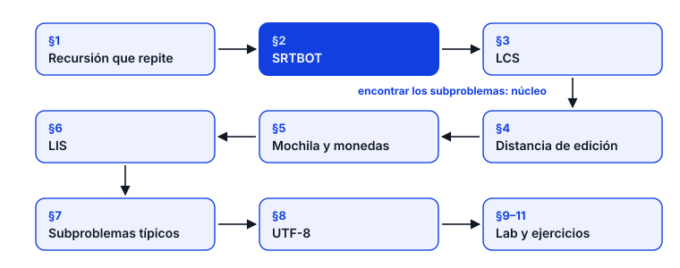
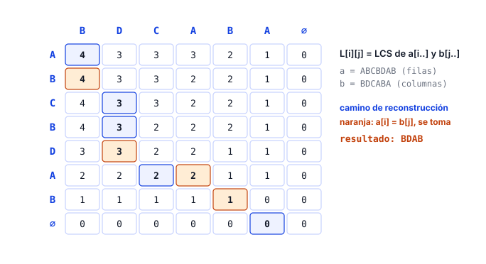

# Lección 12 — Programación dinámica

> **Prerrequisitos:** Lección 0 (§1 inducción fuerte), Lección 5 (divide y vencerás, recurrencias, búsqueda binaria), Lección 9 (DAG y orden topológico) y Lección 10 (Floyd-Warshall, caminos en DAG).
>
> **Cómo estudiar esta lección:** la programación dinámica no es un algoritmo sino un **método de diseño**. Lo que se aprende es a encontrar los **subproblemas**. Para cada problema, intenta escribir tú el SRTBOT antes de leer la solución; si los subproblemas son correctos, el resto sale casi solo.
>
> **Lab asociado:** `lab12`: Fibonacci, LCS, distancia de edición, mochila 0/1, LIS y cambio de monedas (C, C++ y Rust).

## Objetivos de aprendizaje

Al terminar esta lección deberías poder:
1. Reconocer cuándo un problema tiene **subproblemas superpuestos** y **subestructura óptima**.
2. Diseñar un algoritmo con el marco **SRTBOT** y demostrar su corrección por inducción sobre el orden topológico de los subproblemas.
3. Implementar la misma recurrencia **de arriba hacia abajo** (memoización) y **de abajo hacia arriba** (tabla), y reducir la memoria cuando la recurrencia solo mira la fila anterior.
4. Resolver LCS, distancia de edición, mochila 0/1, cambio de monedas y LIS, y **reconstruir** la solución, no solo su valor.
5. Explicar por qué $O(nW)$ es **pseudo-polinomial**.
6. Explicar por qué la distancia de edición sobre texto UTF-8 depende de qué se considera un "carácter".

## Mapa de la lección



---

## 1. Motivación: recursión que repite trabajo

La definición $F(n) = F(n-1) + F(n-2)$ se traduce directo a una función recursiva. Es correcta y desastrosa: $F(n-2)$ se calcula dentro de $F(n-1)$ **y** otra vez directamente, y así en cada nivel.

> **Proposición 1.** La recursión ingenua para $F(n)$ hace $2F(n+1) - 1$ llamadas, que es $\Theta(\varphi^n)$.

*Demostración.* Sea $L(n)$ el número de llamadas. $L(0) = L(1) = 1$ y $L(n) = 1 + L(n-1) + L(n-2)$. Con $L'(n) = L(n) + 1$: $L'(n) = L'(n-1) + L'(n-2)$, $L'(0) = L'(1) = 2$, así que $L'(n) = 2F(n+1)$. $\blacksquare$

Pero solo hay $n + 1$ subproblemas **distintos**: $F(0), \dots, F(n)$. Si guardamos cada uno la primera vez que lo calculamos (**memoización**), el costo baja a $O(n)$:

::: {.tabs}
```c
#include <stdint.h>
#include <stdio.h>

static long llamadas;

static uint64_t fib_ingenuo(int n) {
    llamadas++;
    return n < 2 ? (uint64_t)n : fib_ingenuo(n - 1) + fib_ingenuo(n - 2);
}

static uint64_t memo[100];
static int calculado[100];

static uint64_t fib_memo(int n) {
    llamadas++;
    if (n < 2) return (uint64_t)n;
    if (!calculado[n]) { memo[n] = fib_memo(n - 1) + fib_memo(n - 2); calculado[n] = 1; }
    return memo[n];
}

int main(void) {
    llamadas = 0;
    uint64_t a = fib_ingenuo(30);
    printf("ingenuo:    F(30) = %llu con %ld llamadas\n", (unsigned long long)a, llamadas);
    llamadas = 0;
    uint64_t b = fib_memo(30);
    printf("memoizado:  F(30) = %llu con %ld llamadas\n", (unsigned long long)b, llamadas);
    return 0;
}
```

```cpp
#include <cstdint>
#include <cstdio>
#include <optional>
#include <vector>

long llamadas = 0;

std::uint64_t fib_ingenuo(int n) {
    ++llamadas;
    return n < 2 ? n : fib_ingenuo(n - 1) + fib_ingenuo(n - 2);
}

std::uint64_t fib_memo(int n, std::vector<std::optional<std::uint64_t>>& memo) {
    ++llamadas;
    if (n < 2) return n;
    if (!memo[n]) memo[n] = fib_memo(n - 1, memo) + fib_memo(n - 2, memo);
    return *memo[n];
}

int main() {
    std::uint64_t a = fib_ingenuo(30);
    std::printf("ingenuo:    F(30) = %llu con %ld llamadas\n", (unsigned long long)a, llamadas);
    llamadas = 0;
    std::vector<std::optional<std::uint64_t>> memo(31);
    std::uint64_t b = fib_memo(30, memo);
    std::printf("memoizado:  F(30) = %llu con %ld llamadas\n", (unsigned long long)b, llamadas);
}
```

```rust
fn fib_ingenuo(n: u64, llamadas: &mut u64) -> u64 {
    *llamadas += 1;
    if n < 2 { n } else { fib_ingenuo(n - 1, llamadas) + fib_ingenuo(n - 2, llamadas) }
}

fn fib_memo(n: usize, memo: &mut Vec<Option<u64>>, llamadas: &mut u64) -> u64 {
    *llamadas += 1;
    if n < 2 { return n as u64; }
    if let Some(v) = memo[n] { return v; }
    let v = fib_memo(n - 1, memo, llamadas) + fib_memo(n - 2, memo, llamadas);
    memo[n] = Some(v);
    v
}

fn main() {
    let mut c = 0;
    let a = fib_ingenuo(30, &mut c);
    println!("ingenuo:    F(30) = {a} con {c} llamadas");
    c = 0;
    let b = fib_memo(30, &mut vec![None; 31], &mut c);
    println!("memoizado:  F(30) = {b} con {c} llamadas");
}
```
:::

```{.text .salida}
ingenuo:    F(30) = 832040 con 2692537 llamadas
memoizado:  F(30) = 832040 con 59 llamadas
```

($2F(31) - 1 = 2\cdot 1\,346\,269 - 1 = 2\,692\,537$, como predice la Proposición 1.)

**Programación dinámica** = recursión + reutilizar los subproblemas. Funciona cuando:
1. el problema se descompone en **subproblemas del mismo tipo** (subestructura óptima, como en el Lema 1 de L10), y
2. esos subproblemas **se repiten** (si no se repiten, es divide y vencerás, L05).

El nombre es histórico (Bellman, 1950s): "programación" en el sentido de planificar en una tabla, como "programación lineal".

---

## 2. El marco SRTBOT

MIT 6.006 propone seis pasos. Los usaremos para cada problema:

| Paso | Pregunta |
|---|---|
| **S**ubproblemas | ¿Qué familia de problemas más pequeños resuelvo? Típicamente prefijos, sufijos o subcadenas de la entrada, a veces con un parámetro extra. |
| **R**elación | ¿Cómo resuelvo un subproblema a partir de otros **más pequeños**? Es una recurrencia, y casi siempre "probar todas las opciones para la primera decisión y quedarse con la mejor". |
| **T**opológico | ¿En qué orden resolverlos para que, al calcular uno, los que necesita ya estén? Los subproblemas y sus dependencias forman un **DAG**. |
| **B**ase | ¿Cuáles se resuelven sin recursión? |
| **O**riginal | ¿Cuál subproblema (o combinación) es la respuesta pedida? |
| **T**iempo | (número de subproblemas) × (trabajo de la relación por subproblema), más el trabajo para la original. |

> **Teorema 2 (corrección genérica).** Si la relación es correcta (expresa el valor óptimo de cada subproblema en función de subproblemas menores) y los casos base son correctos, calcular los subproblemas en orden topológico produce el valor correcto de todos ellos.

*Demostración.* Inducción sobre el orden topológico: cuando se calcula un subproblema, todos de los que depende ya fueron calculados correctamente (hipótesis de inducción), y la relación da su valor correcto. $\blacksquare$

Así, **toda** demostración de un algoritmo de PD se reduce a demostrar que la **relación** es correcta. Eso es lo que haremos en cada problema. La relación se justifica casi siempre con el mismo patrón: *"la solución óptima toma alguna decisión sobre el primer elemento; considero todas; y lo que queda es un subproblema, que por subestructura óptima debe resolverse de manera óptima"*.

### 2.1 Arriba-abajo y abajo-arriba

| | Memoización (arriba-abajo) | Tabla (abajo-arriba) |
|---|---|---|
| Código | la recursión + un diccionario | ciclos en orden topológico |
| Calcula | solo los subproblemas alcanzables | todos |
| Pila | profundidad de recursión (¡puede desbordar!) | ninguna |
| Memoria | difícil de reducir | fácil: si la relación mira solo la "fila" anterior, basta guardar dos filas |

Las soluciones del lab son todas abajo-arriba y con memoria reducida.

---

## 3. Subsecuencia común más larga (LCS)

Una **subsecuencia** de una cadena se obtiene borrando caracteres sin reordenar ("ACE" es subsecuencia de "ABCDE"). La LCS de $a$ y $b$ es la subsecuencia común de máxima longitud. Aplicaciones: `diff` (las líneas que no cambian son una LCS), alineamiento de ADN, detección de plagio.

**SRTBOT** (sobre sufijos):
- **S:** $L(i, j)$ = longitud de la LCS de $a[i..]$ y $b[j..]$, para $0 \le i \le |a|$, $0 \le j \le |b|$.
- **R:** si $a[i] = b[j]$: $L(i, j) = 1 + L(i+1, j+1)$. Si no: $L(i, j) = \max(L(i+1, j),\, L(i, j+1))$.
- **T:** $i$ decreciente; para cada $i$, $j$ decreciente.
- **B:** $L(|a|, j) = L(i, |b|) = 0$ (con una cadena vacía no hay nada común).
- **O:** $L(0, 0)$.
- **T:** $(|a|+1)(|b|+1)$ subproblemas, $O(1)$ cada uno: $O(|a|\cdot|b|)$.

> **Lema 3.** La relación de LCS es correcta.

*Demostración.* *Caso $a[i] = b[j] = c$:* sea $S$ una LCS de $a[i..]$ y $b[j..]$. Si $S$ no empieza con este par, se le puede anteponer $c$ (o reemplazar su primer carácter, si usa uno de los dos $c$) sin perder longitud; así hay una LCS que empieza emparejando $a[i]$ con $b[j]$, y el resto es una subsecuencia común de $a[i+1..]$ y $b[j+1..]$, que debe ser de longitud máxima: $1 + L(i+1, j+1)$. *Caso $a[i] \ne b[j]$:* en una LCS, $a[i]$ y $b[j]$ no pueden estar **ambos** emparejados entre sí; así que o $a[i]$ no se usa (y la LCS es de $a[i+1..]$ y $b[j..]$) o $b[j]$ no se usa: el máximo de las dos opciones. $\blacksquare$

**Memoria.** La fila $i$ solo depende de la fila $i + 1$: bastan dos filas. Y como el problema es simétrico, se puede intercambiar $a$ y $b$ para que las filas tengan el largo de la cadena **más corta**: $O(\min(|a|, |b|))$, como exige el lab.

**Reconstrucción.** Para obtener la subsecuencia (no solo su longitud) hace falta la tabla completa: desde $(0, 0)$, si $a[i] = b[j]$ se toma el carácter y se avanza en diagonal; si no, se avanza hacia el vecino con el valor mayor.

::: {.tabs}
```c
#include <stdio.h>
#include <string.h>

int main(void) {
    const char *a = "ABCBDAB", *b = "BDCABA";
    int n = (int)strlen(a), m = (int)strlen(b);
    int L[16][16] = {{0}};                    /* L[i][j] = LCS de a[i..], b[j..] */
    for (int i = n - 1; i >= 0; i--)
        for (int j = m - 1; j >= 0; j--)
            L[i][j] = a[i] == b[j] ? 1 + L[i + 1][j + 1]
                    : (L[i + 1][j] >= L[i][j + 1] ? L[i + 1][j] : L[i][j + 1]);
    printf("longitud de la LCS: %d\nuna LCS: ", L[0][0]);
    for (int i = 0, j = 0; i < n && j < m;) {  /* reconstrucción */
        if (a[i] == b[j]) { putchar(a[i]); i++; j++; }
        else if (L[i + 1][j] >= L[i][j + 1]) i++;
        else j++;
    }
    putchar('\n');
    return 0;
}
```

```cpp
#include <algorithm>
#include <cstdio>
#include <string>
#include <vector>

int main() {
    const std::string a = "ABCBDAB", b = "BDCABA";
    const std::size_t n = a.size(), m = b.size();
    std::vector<std::vector<int>> L(n + 1, std::vector<int>(m + 1, 0));  // L[i][j] = LCS de a[i..], b[j..]
    for (std::size_t i = n; i-- > 0;)
        for (std::size_t j = m; j-- > 0;)
            L[i][j] = a[i] == b[j] ? 1 + L[i + 1][j + 1] : std::max(L[i + 1][j], L[i][j + 1]);
    std::printf("longitud de la LCS: %d\nuna LCS: ", L[0][0]);
    std::string lcs;
    for (std::size_t i = 0, j = 0; i < n && j < m;) {  // reconstrucción
        if (a[i] == b[j]) { lcs += a[i]; ++i; ++j; }
        else if (L[i + 1][j] >= L[i][j + 1]) ++i;
        else ++j;
    }
    std::printf("%s\n", lcs.c_str());
}
```

```rust
fn main() {
    let (a, b) = ("ABCBDAB".as_bytes(), "BDCABA".as_bytes());
    let (n, m) = (a.len(), b.len());
    let mut l = vec![vec![0i32; m + 1]; n + 1]; // l[i][j] = LCS de a[i..], b[j..]
    for i in (0..n).rev() {
        for j in (0..m).rev() {
            l[i][j] = if a[i] == b[j] { 1 + l[i + 1][j + 1] } else { l[i + 1][j].max(l[i][j + 1]) };
        }
    }
    println!("longitud de la LCS: {}", l[0][0]);
    let (mut i, mut j, mut lcs) = (0, 0, String::new());
    while i < n && j < m {
        // reconstrucción
        if a[i] == b[j] { lcs.push(a[i] as char); i += 1; j += 1; }
        else if l[i + 1][j] >= l[i][j + 1] { i += 1; }
        else { j += 1; }
    }
    println!("una LCS: {lcs}");
}
```
:::

```{.text .salida}
longitud de la LCS: 4
una LCS: BDAB
```



---

## 4. Distancia de edición

La **distancia de Levenshtein** entre $a$ y $b$ es el mínimo número de operaciones (insertar, borrar o sustituir un carácter, cada una de costo 1) para convertir $a$ en $b$. "kitten" → "sitting" cuesta 3 (k→s, e→i, +g). Aplicaciones: correctores ortográficos, "¿quisiste decir…?", comparación de secuencias genéticas.

**SRTBOT** (sobre sufijos):
- **S:** $E(i, j)$ = distancia entre $a[i..]$ y $b[j..]$.
- **R:** si $a[i] = b[j]$: $E(i, j) = E(i+1, j+1)$. Si no: $E(i, j) = 1 + \min\big(E(i+1, j),\ E(i, j+1),\ E(i+1, j+1)\big)$ — borrar $a[i]$, insertar $b[j]$, sustituir $a[i]$ por $b[j]$.
- **T:** como en LCS.
- **B:** $E(|a|, j) = |b| - j$ (insertar lo que falta), $E(i, |b|) = |a| - i$ (borrar lo que sobra).
- **O:** $E(0, 0)$. **T:** $O(|a|\cdot|b|)$, con dos filas de memoria.

*Corrección de la relación:* en una edición óptima, la primera posición de $a$ y la de $b$ se resuelven de una de cuatro maneras: coinciden y se dejan (solo si $a[i] = b[j]$, y entonces conviene: dejar un carácter igual nunca empeora, ej. 2 del PS), se borra $a[i]$, se inserta $b[j]$, o se sustituye. Cada opción deja exactamente uno de los subproblemas. $\blacksquare$

---

## 5. Mochila 0/1 y cambio de monedas

### 5.1 Mochila 0/1

$n$ objetos con pesos $w_i$ y valores $v_i$, y una mochila de capacidad $W$. Elegir un subconjunto de peso $\le W$ y valor máximo (cada objeto se toma o no: "0/1").

- **S:** $K(i, c)$ = mejor valor usando solo los objetos $i, \dots, n-1$ con capacidad $c$.
- **R:** $K(i, c) = \max\big(K(i+1, c),\ v_i + K(i+1, c - w_i)\big)$, la segunda solo si $w_i \le c$.
- **T:** $i$ decreciente. **B:** $K(n, c) = 0$. **O:** $K(0, W)$. **T:** $O(nW)$.

**Una sola fila.** Si se guarda una sola fila $k[c]$ y se procesan los objetos uno por uno, hay que recorrer $c$ **de mayor a menor**: así, al calcular $k[c]$, el valor $k[c - w_i]$ todavía es el de la fila anterior (sin el objeto $i$). Recorrerlo de menor a mayor permitiría usar el mismo objeto varias veces (esa es la mochila **no acotada**).

### 5.2 ¿Polinomial? No: pseudo-polinomial

$O(nW)$ parece polinomial, pero el **tamaño de la entrada** no es $W$: el número $W$ se escribe con $\lg W$ bits. Si $W = 2^{60}$, la entrada ocupa unos pocos bytes y el algoritmo hace $2^{60}$ pasos. Un algoritmo cuyo tiempo es polinomial en el **valor** de los números (pero exponencial en su **longitud**) se llama **pseudo-polinomial**. La mochila 0/1 es NP-difícil: no se conoce (y probablemente no existe) un algoritmo polinomial en $n$ y $\lg W$.

### 5.3 Cambio de monedas

Mínimo número de monedas (de denominaciones $c_1, \dots, c_k$, con repetición) para formar el monto $A$.

- **S:** $M(v)$ = mínimo de monedas para formar $v$, para $0 \le v \le A$.
- **R:** $M(v) = 1 + \min_{c_i \le v} M(v - c_i)$ (la primera moneda es alguna $c_i$; el resto forma $v - c_i$ de forma óptima). $\infty$ si no hay opciones.
- **T:** $v$ creciente. **B:** $M(0) = 0$. **O:** $M(A)$. **T:** $O(kA)$, también pseudo-polinomial.

**La estrategia voraz no sirve en general.** Con monedas $\{1, 5, 6, 9\}$ y $A = 11$, tomar siempre la mayor posible da $9 + 1 + 1$ (3 monedas), pero $5 + 6$ usa 2. (Para las monedas del peso mexicano o del dólar la voraz sí es óptima; esos sistemas se llaman *canónicos*.) El test `coin_change` usa exactamente este caso.

---

## 6. Subsecuencia creciente más larga (LIS)

Dada $a_0, \dots, a_{n-1}$, la longitud de la subsecuencia **estrictamente** creciente más larga.

### 6.1 La PD cuadrática

- **S:** $\ell(i)$ = longitud de la LIS que **termina en** $a_i$.
- **R:** $\ell(i) = 1 + \max\{\ell(j) : j < i,\ a_j < a_i\}$ (0 si no hay tales $j$).
- **T:** $i$ creciente. **B:** implícita (el máximo vacío es 0). **O:** $\max_i \ell(i)$. **T:** $O(n^2)$.

Observa el truco de los subproblemas: "la LIS de $a[0..i]$" no da una relación limpia (no sabemos con qué termina); "la LIS que **termina en** $a_i$" sí. Agregar una restricción al subproblema es una técnica frecuente.

### 6.2 La versión $O(n\lg n)$

Mantener un arreglo `cola`, donde `cola[k]` es el **menor último elemento** de una subsecuencia estrictamente creciente de longitud $k+1$ vista hasta ahora. Para cada $x$: buscar el primer `cola[k]` $\ge x$; si existe, reemplazarlo por $x$; si no, agregar $x$ al final. La respuesta es el largo de `cola`.

> **Teorema 4.** `cola` es estrictamente creciente en todo momento, y su largo es la longitud de la LIS.

*Demostración.* *Creciente:* si `cola[k]` es el último de una subsecuencia de largo $k+1$, quitándole el último elemento queda una de largo $k$ que termina en algo $<$ `cola[k]`, así que `cola[k-1]` $<$ `cola[k]`. *Actualización:* al procesar $x$, sea $k$ el primer índice con `cola[k]` $\ge x$. Entonces `cola[k-1]` $< x$, y extendiendo esa subsecuencia con $x$ se obtiene una de largo $k + 1$ que termina en $x \le$ `cola[k]`: el nuevo `cola[k] = x` es correcto y mínimo (cualquier subsecuencia de largo $k+1$ que termine en $x$ necesita un largo-$k$ previo que termine en $< x$). Ningún otro `cola[k']` cambia, porque $x$ no puede terminar una más corta mejor (para $k' < k$, `cola[k']` $< x$) ni extender una de largo $k+1$ o más (para $k' > k$, `cola[k'-1]` $\ge$ `cola[k]` $\ge x$). *Largo:* la LIS de largo $L$ hace crecer `cola` hasta $L$, y `cola` nunca supera $L$ porque cada entrada corresponde a una subsecuencia real. $\blacksquare$

La búsqueda binaria hace $O(\lg n)$ por elemento: $O(n\lg n)$. Se llama *patience sorting* porque es el juego de solitario de repartir cartas en pilas. El test `lis_grande_nlgn` (200 000 elementos) solo pasa con esta versión.

---

## 7. Resumen: los subproblemas típicos

| Entrada | Subproblemas típicos | Ejemplos |
|---|---|---|
| Una secuencia | prefijos o sufijos, $O(n)$ | Fibonacci, LIS, cambio de monedas |
| Dos secuencias | pares de sufijos, $O(nm)$ | LCS, distancia de edición |
| Una secuencia, intervalos | subcadenas $[i, j)$, $O(n^2)$ | multiplicación de matrices en cadena, palíndromos |
| Objetos + capacidad | prefijo × capacidad restante, $O(nW)$ | mochila |
| Grafo | vértices (+ "número de aristas" o "intermedios") | caminos en DAG, Bellman-Ford, Floyd-Warshall (L10) |

---

## 8. Texto y UTF-8

La distancia de edición compara "caracteres". ¿Qué es un carácter?

| | Tipo de cadena | Indexar `s[i]` da | Recorrer "letras" |
|---|---|---|---|
| C | `char *` terminada en `'\0'` | un **byte** | hay que decodificar UTF-8 a mano |
| C++ | `std::string` | un **byte** (`char`) | `std::string` no sabe de UTF-8 |
| Rust | `&str` (UTF-8 garantizado) | **no compila**: `s[i]` no existe para `&str` | `s.chars()` da `char` (puntos de código Unicode) |

En UTF-8, "ñ" ocupa **2 bytes**. Entre "año" y "ano" hay 1 sustitución si se comparan puntos de código, pero **2** si se comparan bytes (los dos bytes de la ñ contra la "n" de un byte: una sustitución y un borrado):

::: {.tabs .no-compare}
```cpp
#include <algorithm>
#include <cstdio>
#include <string>
#include <vector>

// Distancia de edición genérica sobre cualquier secuencia indexable.
template <class S>
std::size_t edit(const S& a, const S& b) {
    std::vector<std::size_t> sig(b.size() + 1), act(b.size() + 1);
    for (std::size_t j = 0; j <= b.size(); ++j) sig[j] = b.size() - j;
    for (std::size_t i = a.size(); i-- > 0;) {
        act[b.size()] = a.size() - i;
        for (std::size_t j = b.size(); j-- > 0;)
            act[j] = a[i] == b[j] ? sig[j + 1] : 1 + std::min({sig[j], act[j + 1], sig[j + 1]});
        std::swap(act, sig);
    }
    return sig[0];
}

int main() {
    std::string a = "año", b = "ano";
    std::printf("bytes: |a| = %zu, distancia = %zu\n", a.size(), edit(a, b));
    std::u32string ua = U"año", ub = U"ano";  // puntos de código (UTF-32)
    std::printf("puntos de código: |a| = %zu, distancia = %zu\n", ua.size(), edit(ua, ub));
}
```

```rust
// Distancia de edición genérica sobre cualquier secuencia comparable.
fn edit<T: PartialEq>(a: &[T], b: &[T]) -> usize {
    let mut sig: Vec<usize> = (0..=b.len()).map(|j| b.len() - j).collect();
    let mut act = vec![0; b.len() + 1];
    for i in (0..a.len()).rev() {
        act[b.len()] = a.len() - i;
        for j in (0..b.len()).rev() {
            act[j] = if a[i] == b[j] { sig[j + 1] } else { 1 + sig[j].min(act[j + 1]).min(sig[j + 1]) };
        }
        std::mem::swap(&mut act, &mut sig);
    }
    sig[0]
}

fn main() {
    let (a, b) = ("año", "ano");
    println!("bytes: |a| = {}, distancia = {}", a.len(), edit(a.as_bytes(), b.as_bytes()));
    let (ca, cb): (Vec<char>, Vec<char>) = (a.chars().collect(), b.chars().collect());
    println!("puntos de código: |a| = {}, distancia = {}", ca.len(), edit(&ca, &cb));
}
```
:::

```{.text .salida}
bytes: |a| = 4, distancia = 2
puntos de código: |a| = 3, distancia = 1
```

Y aun los puntos de código no son "letras": "ñ" también puede escribirse como "n" + tilde combinante (2 puntos de código), y un emoji con tono de piel son varios. La unidad que un usuario percibe como una letra es el **grupo de grafemas**, y compararlos exige normalizar (Unicode NFC) y segmentar con una biblioteca. Los tests del lab usan solo ASCII, donde las tres nociones coinciden; la lección es saber que en un producto real no coinciden.

---

## 9. Guía del Lab 12

**Archivos:** `c/src/lab12/dp.c`, `cpp/include/algolib/lab12/dp.hpp`, `rust/src/lab12/mod.rs`.

**Para cada función, escribe el SRTBOT en un comentario antes del código.** Es parte de la evaluación.

**Orden sugerido:** Fibonacci → cambio de monedas → mochila → LCS → distancia de edición → LIS.

**Errores frecuentes:**
- Fibonacci en Rust: calcular $F(n+1)$ en la última vuelta desborda `u64` para $n = 93$ y hace `panic` en modo debug. Usa `wrapping_add` (y explica por qué es seguro) o cambia el ciclo.
- LCS con la tabla completa: correcto, pero el lab pide $O(\min(|a|, |b|))$ de memoria. Dos filas, y la cadena más corta como columnas.
- Mochila con una fila recorriendo $c$ de menor a mayor: resuelve la mochila no acotada (cada objeto infinitas veces). El test contra fuerza bruta lo detecta.
- LIS "no decreciente" en vez de "estrictamente creciente": usar `upper_bound` en lugar de `lower_bound`.
- Cambio de monedas con "infinito" = `SIZE_MAX` y luego `SIZE_MAX + 1`: desborda a 0 y da respuestas absurdas.

---

## 10. Comprueba tu comprensión

1. ¿Por qué mergesort no es programación dinámica?
2. ¿Cuántos subproblemas tiene la LCS de dos cadenas de largo 1000? ¿Cuánta memoria necesita con dos filas?
3. En la mochila con una fila, ¿qué pasa si recorres $c$ en orden creciente? Da un ejemplo con un objeto.
4. Calcula a mano `cola` de LIS para $\langle 3, 1, 4, 1, 5, 9, 2, 6\rangle$.
5. ¿Es polinomial un algoritmo $O(n\sqrt W)$ para la mochila?

<details><summary>Respuestas</summary>

1. Porque sus subproblemas (las dos mitades) **no se repiten**: cada subarreglo se ordena una sola vez. No hay nada que reutilizar.
2. $1001^2 \approx 10^6$ subproblemas. Con dos filas, $2\times 1001$ enteros: unos 16 KB.
3. Un objeto de peso 1 y valor 10 con $W = 3$: de menor a mayor, $k[1] = 10$, $k[2] = 10 + k[1] = 20$, $k[3] = 30$: usó el objeto tres veces.
4. 3 → [3]; 1 → [1]; 4 → [1,4]; 1 → [1,4]; 5 → [1,4,5]; 9 → [1,4,5,9]; 2 → [1,2,5,9]; 6 → [1,2,5,6]. Largo 4 (por ejemplo 1, 4, 5, 9).
5. No: $\sqrt W = 2^{(\lg W)/2}$ sigue siendo exponencial en el número de bits de $W$.
</details>

---

## 11. Problem Set 12

**Teoría**
1. Demuestra la Proposición 1 y que $F(n) = \Theta(\varphi^n)$.
2. En la distancia de edición, demuestra que si $a[i] = b[j]$, emparejarlos es siempre óptimo (es decir, $E(i+1, j+1) \le 1 + \min(E(i+1, j), E(i, j+1))$).
3. **Multiplicación de matrices en cadena.** Dadas las dimensiones $p_0, p_1, \dots, p_n$ de $n$ matrices, da un SRTBOT que encuentre el orden de multiplicación con el mínimo de multiplicaciones escalares en $O(n^3)$, y demuestra la relación.
4. **Hirschberg.** Demuestra que se puede **reconstruir** una LCS (no solo su longitud) con memoria $O(\min(|a|, |b|))$ y tiempo $O(|a|\cdot|b|)$, dividiendo $a$ por la mitad y encontrando con dos pasadas de dos filas dónde cruza la LCS óptima.
5. Demuestra que el problema de decisión "¿hay un subconjunto de valor $\ge V$ y peso $\le W$?" pertenece a NP, y explica por qué el algoritmo $O(nW)$ no demuestra P = NP.

**Implementación (C, C++ y Rust)**

6. Agrega `lcs_string` que devuelva la subsecuencia (tabla completa está bien) y verifica que es subsecuencia de ambas y tiene la longitud correcta.
7. Agrega `knapsack_items` que devuelva qué objetos se eligen.
8. Implementa la multiplicación de matrices en cadena del ej. 3, con reconstrucción de la parentización.
9. En Rust, haz `edit_distance` genérica sobre `&[T]` con `T: PartialEq` (como en §8) y úsala sobre bytes, `char`s y palabras (`Vec<&str>` de `split_whitespace`).

---

## Referencias
- CLRS, *Introduction to Algorithms*, 4ª ed.: Cap. 14 (programación dinámica: corte de varillas, matrices en cadena, LCS), Problema 14-5 (distancia de edición).
- MIT 6.006 (Spring 2020), Lectures 15–18: *Dynamic Programming* (el marco SRTBOT).
- Bellman, R. (1957). *Dynamic Programming*. Princeton University Press.
- Hirschberg, D. S. (1975). *A linear space algorithm for computing maximal common subsequences*. CACM 18(6).
- The Unicode Standard, Annex #29: *Unicode Text Segmentation* (grupos de grafemas).
