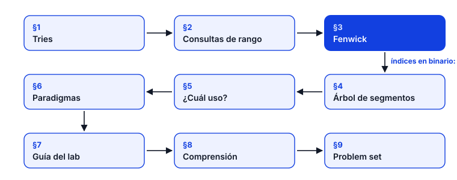
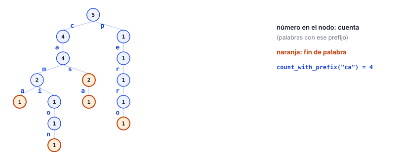
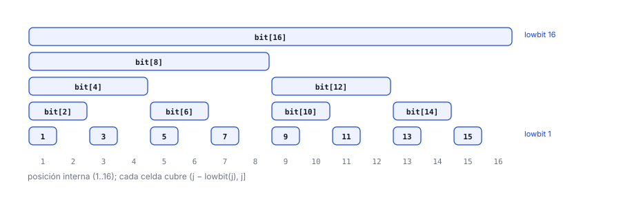

# Lección 13 — Tries y árboles para consultas de rango

> **Prerrequisitos:** Lección 3 (árboles con `Box`/`unique_ptr`), Lección 6 (árbol casi completo en un arreglo), Lección 8 (aumentación) y Lección 12 (sumas prefijas como subproblemas).
>
> **Cómo estudiar esta lección:** las tres estructuras de hoy explotan **la representación** de algo: el trie, la de las palabras como secuencias de letras; Fenwick, la de los índices en **binario**; el árbol de segmentos, la de un intervalo como unión de pocos intervalos "canónicos". Escribe los índices en binario cuando leas Fenwick: sin eso no se entiende.
>
> **Lab asociado:** `lab13`: `Trie`, `FenwickTree` y `SegmentTree` (C, C++ y Rust).

## Objetivos de aprendizaje

Al terminar esta lección deberías poder:
1. Implementar un **trie** con inserción, búsqueda, conteo por prefijo y borrado con poda en $O(L)$, y comparar sus variantes de memoria.
2. Explicar el problema de **consultas de rango** y el compromiso entre consulta y actualización.
3. Demostrar la corrección del **árbol de Fenwick** a partir de la representación binaria de los índices.
4. Construir un **árbol de segmentos** en $O(n)$ y demostrar que cualquier intervalo se descompone en $O(\lg n)$ nodos.
5. Elegir entre arreglo de sumas prefijas, Fenwick y árbol de segmentos según la operación (suma, mínimo, invertible o no).
6. Calcular el bit menos significativo de forma portable en C, C++ y Rust.

## Mapa de la lección



---

## 1. Tries

### 1.1 Estructura

Un **trie** (de *re**trie**val*; Fredkin, 1960) guarda un conjunto de palabras sobre un alfabeto $\Sigma$ como un árbol en el que **cada nodo es un prefijo**: la raíz es la cadena vacía y el hijo de un nodo por la letra $c$ es ese prefijo seguido de $c$. Un nodo se marca como *fin* si su prefijo es una palabra del conjunto.



| Operación | Costo | Cómo |
|---|---|---|
| `insert(w)`, `contains(w)`, `erase(w)` | $O(L)$ | bajar letra por letra ($L = \lvert w\rvert$) |
| `starts_with(p)` | $O(\lvert p\rvert)$ | bajar; ¿existe el nodo? |
| `count_with_prefix(p)` | $O(\lvert p\rvert)$ | con un contador por nodo (§1.2) |
| listar las $k$ palabras con prefijo $p$ | $O(\lvert p\rvert + \text{tamaño de su subárbol})$ | DFS desde el nodo de $p$ |

El costo **no depende de $n$**, el número de palabras: solo de la longitud de lo que se busca. Compara con un AVL de cadenas (L07): $O(L\lg n)$, porque cada una de las $\lg n$ comparaciones de cadenas cuesta $O(L)$.

**El orden in-order de un trie es el orden lexicográfico**: recorrer los hijos en orden alfabético lista las palabras ordenadas. Ordenar $n$ cadenas insertándolas en un trie cuesta $O(\text{total de letras})$: es radix sort (L05 §7.2) de izquierda a derecha.

### 1.2 Contar por prefijo y borrar con poda

Para `count_with_prefix` en $O(\lvert p\rvert)$ se **aumenta** cada nodo (L08) con `cuenta` = número de palabras del conjunto que tienen ese prefijo. Se mantiene en $O(L)$: `insert` suma 1 a cada nodo del camino, `erase` resta 1.

> **Invariante.** $\text{cuenta}(x) = [\text{fin}(x)] + \sum_{\text{hijos } y} \text{cuenta}(y)$, y todo nodo distinto de la raíz tiene $\text{cuenta} \ge 1$.

La segunda mitad dice que no hay nodos **inútiles**: todo nodo está en el camino de alguna palabra. `erase` la mantiene con **poda**: al bajar restando, si un hijo queda con cuenta 0, ese hijo y todo lo que cuelga de él ya no lleva a ninguna palabra; se borra entero y se termina. El test `trie_erase_poda` verifica `node_count()` después de borrar.

### 1.3 Memoria

Un nodo con un arreglo de 26 punteros ocupa unos 216 bytes en una máquina de 64 bits, aunque tenga un solo hijo. Con un millón de palabras, el trie puede ocupar cientos de MB. Variantes:

| Representación de los hijos | Memoria por nodo | Buscar un hijo |
|---|---|---|
| arreglo de $\lvert\Sigma\rvert$ punteros (lab) | $\Theta(\lvert\Sigma\rvert)$ | $O(1)$ |
| lista o arreglo ordenado de pares (letra, hijo) | $\Theta(\text{hijos})$ | $O(\lg \lvert\Sigma\rvert)$ |
| tabla hash | $\Theta(\text{hijos})$ | $O(1)$ esperado |
| **trie comprimido** (*radix tree*, *Patricia*) | las cadenas de nodos con un solo hijo se funden en una arista con una cadena | $O(1)$ por arista |

Los tries comprimidos se usan en las tablas de rutas IP (búsqueda del **prefijo más largo**), en los índices de los motores de búsqueda y en el autocompletado. El problem set pide implementar uno.

::: {.tabs}
```c
#include <stdio.h>
#include <string.h>

#define MAXN 64
static int next_[MAXN][26], fin[MAXN], nodos = 1; /* nodo 0 = raíz; 0 en next_ = sin hijo */

static void insertar(const char *w) {
    int x = 0;
    for (; *w; w++) {
        int c = *w - 'a';
        if (!next_[x][c]) next_[x][c] = nodos++;
        x = next_[x][c];
    }
    fin[x] = 1;
}

static char buf[32];
static void listar(int x, int largo) {   /* DFS en orden alfabético = orden lexicográfico */
    if (fin[x]) { buf[largo] = '\0'; printf("  %s\n", buf); }
    for (int c = 0; c < 26; c++)
        if (next_[x][c]) { buf[largo] = (char)('a' + c); listar(next_[x][c], largo + 1); }
}

int main(void) {
    const char *ps[] = {"perro", "casa", "cama", "camion", "cas", "gato"};
    for (int i = 0; i < 6; i++) insertar(ps[i]);
    const char *p = "ca";
    int x = 0;
    for (int i = 0; p[i] && x >= 0; i++) x = next_[x][p[i] - 'a'] ? next_[x][p[i] - 'a'] : -1;
    printf("con el prefijo \"%s\":\n", p);
    strcpy(buf, p);
    if (x >= 0) listar(x, (int)strlen(p));
    printf("nodos: %d\n", nodos);
    return 0;
}
```

```cpp
#include <array>
#include <cstdio>
#include <memory>
#include <string>

struct Nodo {
    std::array<std::unique_ptr<Nodo>, 26> next{};
    bool fin = false;
};
int nodos = 1;

void insertar(Nodo& raiz, const std::string& w) {
    Nodo* x = &raiz;
    for (char ch : w) {
        auto& h = x->next[ch - 'a'];
        if (!h) { h = std::make_unique<Nodo>(); ++nodos; }
        x = h.get();
    }
    x->fin = true;
}

void listar(const Nodo& x, std::string& pref) {  // DFS en orden alfabético
    if (x.fin) std::printf("  %s\n", pref.c_str());
    for (int c = 0; c < 26; ++c)
        if (x.next[c]) { pref.push_back(char('a' + c)); listar(*x.next[c], pref); pref.pop_back(); }
}

int main() {
    Nodo raiz;
    for (auto w : {"perro", "casa", "cama", "camion", "cas", "gato"}) insertar(raiz, w);
    std::string p = "ca";
    const Nodo* x = &raiz;
    for (char ch : p) x = x ? x->next[ch - 'a'].get() : nullptr;
    std::printf("con el prefijo \"%s\":\n", p.c_str());
    if (x) listar(*x, p);
    std::printf("nodos: %d\n", nodos);
}
```

```rust
#[derive(Default)]
struct Nodo { next: [Option<Box<Nodo>>; 26], fin: bool }

fn insertar(raiz: &mut Nodo, w: &str, nodos: &mut usize) {
    let mut x = raiz;
    for b in w.bytes() {
        let h = &mut x.next[(b - b'a') as usize];
        if h.is_none() { *nodos += 1; }
        x = h.get_or_insert_with(Box::default);
    }
    x.fin = true;
}

fn listar(x: &Nodo, pref: &mut String) { // DFS en orden alfabético
    if x.fin { println!("  {pref}"); }
    for (c, h) in x.next.iter().enumerate() {
        if let Some(h) = h {
            pref.push((b'a' + c as u8) as char);
            listar(h, pref);
            pref.pop();
        }
    }
}

fn main() {
    let (mut raiz, mut nodos) = (Nodo::default(), 1);
    for w in ["perro", "casa", "cama", "camion", "cas", "gato"] { insertar(&mut raiz, w, &mut nodos); }
    let mut p = String::from("ca");
    let mut x = Some(&raiz);
    for b in p.bytes() { x = x.and_then(|n| n.next[(b - b'a') as usize].as_deref()); }
    println!("con el prefijo \"{p}\":");
    if let Some(x) = x { listar(x, &mut p); }
    println!("nodos: {nodos}");
}
```
:::

```{.text .salida}
con el prefijo "ca":
  cama
  camion
  cas
  casa
nodos: 19
```

---

## 2. Consultas de rango

Un arreglo $a[0..n)$ que cambia, y preguntas sobre intervalos $[l, r)$: ¿cuál es la suma?, ¿cuál es el mínimo? Ejemplos: estadísticas sobre ventanas de tiempo, tablas de posiciones (cuántos jugadores tienen puntaje entre $x$ e $y$), contar inversiones (L05, L08), la geometría computacional.

| Estructura | consulta | actualizar un elemento | sirve para |
|---|---|---|---|
| el arreglo tal cual | $O(n)$ | $O(1)$ | cualquier operación |
| arreglo de sumas prefijas $P[i] = a_0 + \dots + a_{i-1}$ | $O(1)$: $P[r] - P[l]$ | $O(n)$ | sumas (operaciones **invertibles**) |
| **árbol de Fenwick** | $O(\lg n)$ | $O(\lg n)$ | sumas (invertibles) |
| **árbol de segmentos** | $O(\lg n)$ | $O(\lg n)$ | cualquier operación **asociativa** (suma, mín, máx, mcd…) |

Las sumas prefijas resuelven la consulta en $O(1)$ porque la suma es **invertible**: la suma de $[l, r)$ es la de $[0, r)$ **menos** la de $[0, l)$. El mínimo no lo es: conocer el mínimo de $[0, r)$ y el de $[0, l)$ no dice nada del de $[l, r)$. Esa diferencia decide entre Fenwick y el árbol de segmentos.

---

## 3. Árbol de Fenwick

### 3.1 La idea en binario

Para $j \ge 1$, sea $\text{lowbit}(j)$ la potencia de 2 del bit **menos significativo** encendido de $j$ ($\text{lowbit}(12) = \text{lowbit}(1100_2) = 100_2 = 4$). El árbol de Fenwick (Fenwick, 1994; Ryabko, 1989) guarda, con índices **desde 1**,
$$\text{bit}[j] = \sum_{k \in (j - \text{lowbit}(j),\ j]} a_k \qquad (\text{la posición interna } k \text{ es } a[k-1]).$$
Cada celda es responsable de un bloque que **termina en $j$** y mide $\text{lowbit}(j)$.

::: {.tabs}
```c
#include <stdio.h>

static void binario(unsigned x) { for (int b = 4; b >= 0; b--) putchar('0' + ((x >> b) & 1)); }

int main(void) {
    printf(" j   binario  lowbit  bloque\n");
    for (unsigned j = 1; j <= 16; j++) {
        unsigned lb = j & (~j + 1);
        printf("%2u   ", j);
        binario(j);
        printf("   %4u    (%u, %u]\n", lb, j - lb, j);
    }
    return 0;
}
```

```cpp
#include <cstdio>

void binario(unsigned x) { for (int b = 4; b >= 0; --b) std::putchar('0' + ((x >> b) & 1)); }

int main() {
    std::printf(" j   binario  lowbit  bloque\n");
    for (unsigned j = 1; j <= 16; ++j) {
        unsigned lb = j & (~j + 1);  // = j & -j, sin el menos unario sobre unsigned
        std::printf("%2u   ", j);
        binario(j);
        std::printf("   %4u    (%u, %u]\n", lb, j - lb, j);
    }
}
```

```rust
fn main() {
    println!(" j   binario  lowbit  bloque");
    for j in 1u32..=16 {
        let lb = j & j.wrapping_neg();
        println!("{:2}   {:05b}   {:4}    ({}, {}]", j, j, lb, j - lb, j);
    }
}
```
:::

```{.text .salida}
 j   binario  lowbit  bloque
 1   00001      1    (0, 1]
 2   00010      2    (0, 2]
 3   00011      1    (2, 3]
 4   00100      4    (0, 4]
 5   00101      1    (4, 5]
 6   00110      2    (4, 6]
 7   00111      1    (6, 7]
 8   01000      8    (0, 8]
 9   01001      1    (8, 9]
10   01010      2    (8, 10]
11   01011      1    (10, 11]
12   01100      4    (8, 12]
13   01101      1    (12, 13]
14   01110      2    (12, 14]
15   01111      1    (14, 15]
16   10000     16    (0, 16]
```



### 3.2 Las dos operaciones

```
prefix_sum(i):            -- a[0] + … + a[i−1]
    s ← 0;  j ← i
    mientras j > 0:  s ← s + bit[j];  j ← j − lowbit(j)

add(i, δ):                -- a[i] += δ
    j ← i + 1
    mientras j ≤ n:  bit[j] ← bit[j] + δ;  j ← j + lowbit(j)
```

> **Teorema 1.** `prefix_sum(i)` es correcta y visita a lo más $\lfloor\lg i\rfloor + 1$ celdas.

*Demostración.* Los bloques visitados son $(j - \text{lowbit}(j), j]$ para $j = i$, luego $j' = j - \text{lowbit}(j)$, etc. Cada bloque empieza exactamente donde termina el siguiente, así que forman una partición de $(0, i]$. Restar el lowbit **apaga** el bit encendido más bajo de $j$; el ciclo termina cuando $j = 0$, tras tantas vueltas como unos tiene $i$ en binario: $\le \lfloor\lg i\rfloor + 1$. $\blacksquare$

> **Teorema 2.** `add(i, δ)` actualiza exactamente las celdas cuyo bloque contiene la posición $i + 1$, y son a lo más $\lceil\lg n\rceil + 1$.

*Demostración.* Sea $p = i + 1$. *Las celdas visitadas contienen a $p$:* $j_0 = p$ la contiene. Si $j$ la contiene y $j' = j + \text{lowbit}(j)$, entonces $\text{lowbit}(j') \ge 2\,\text{lowbit}(j)$ (sumar el lowbit propaga un acarreo hacia bits más altos), así que el bloque de $j'$ empieza en $j' - \text{lowbit}(j') \le j - \text{lowbit}(j)$ y lo contiene. *Son todas:* que ninguna otra celda contiene a $p$ es el ej. 1 del problem set. *Cantidad:* $\text{lowbit}$ al menos se duplica en cada paso, así que hay a lo más $\lg n + 1$ pasos. $\blacksquare$

**Memoria:** exactamente $n + 1$ enteros, el mismo arreglo. **Construcción:** $n$ llamadas a `add`, $O(n\lg n)$ (o $O(n)$ con un truco, PS13 ej. 2).

**`lowbit` en cada lenguaje.** La expresión clásica es `j & -j` (en complemento a dos, $-j$ invierte todos los bits por encima del lowbit). Pero en el lab los índices son sin signo:
- En C y C++, aplicar `-` a un `size_t` está definido (aritmética modular) pero varios compiladores avisan; la forma explícita es `j & (~j + 1)`.
- En Rust, `-j` no compila para `usize`; se escribe `j & j.wrapping_neg()`, que deja claro que la negación es modular.

---

## 4. Árbol de segmentos

### 4.1 Definición

Un **árbol de segmentos** sobre $a[0..n)$ es un árbol binario en el que cada nodo representa un **segmento** $[l, r)$ y guarda $f(a_l, \dots, a_{r-1})$ para una operación **asociativa** $f$ (en el lab, el mínimo). La raíz representa $[0, n)$; los hijos de $[l, r)$ son $[l, m)$ y $[m, r)$; las hojas, los elementos.

### 4.2 Representación iterativa

Las soluciones del lab usan la versión **abajo-arriba** en un arreglo de $2n$ celdas, que funciona para **cualquier** $n$ (no solo potencias de 2):
- las hojas están en $t[n], \dots, t[2n-1]$ ($a_i$ en $t[n + i]$);
- para $1 \le i < n$: $t[i] = \min(t[2i], t[2i+1])$, como en el heap de L06.

**Construcción** en $O(n)$: llenar las hojas y luego $t[i]$ para $i = n-1$ hasta 1. **Actualizar** $a_i$: cambiar la hoja $n + i$ y recalcular sus ancestros ($p \gets p/2$ hasta la raíz): $O(\lg n)$.

### 4.3 La consulta

```
range_min(l, r):           -- intervalo [l, r)
    m ← +∞;  l ← l + n;  r ← r + n
    mientras l < r:
        si l es impar:  m ← min(m, t[l]);  l ← l + 1
        si r es impar:  r ← r − 1;  m ← min(m, t[r])
        l ← l / 2;  r ← r / 2
    devolver m
```

> **Teorema 3.** `range_min(l, r)` devuelve $\min(a_l, \dots, a_{r-1})$ y examina a lo más $2\lceil\lg n\rceil$ nodos.

*Demostración.* Invariante, al comienzo de cada vuelta: *el mínimo pedido es $\min(m, \text{el mínimo de los nodos } t[l], \dots, t[r-1])$ del nivel actual*. Al inicio, $m = +\infty$ y los nodos $t[l..r)$ son exactamente las hojas pedidas ✔. En una vuelta: si $l$ es impar, $t[l]$ es un hijo **derecho**, y su padre $t[l/2]$ también cubre a su hermano izquierdo $t[l-1]$, que está fuera del rango; no se puede subir a $t[l]$ por el padre, así que se toma $t[l]$ directamente y se avanza. Simétrico con $r - 1$ si $r$ es impar ($t[r-1]$ es hijo izquierdo cuyo hermano está fuera). Ahora $l$ es par y $r$ es par, así que $t[l..r)$ son pares completos de hermanos, y sus padres $t[l/2..r/2)$ cubren exactamente lo mismo ✔. Cada vuelta sube un nivel y toma a lo más dos nodos: $\le 2\lceil\lg n\rceil$. Termina cuando el rango queda vacío. $\blacksquare$

La versión **recursiva** (bajar desde la raíz partiendo el intervalo) es igual de correcta y más fácil de generalizar a **propagación perezosa** (*lazy propagation*): actualizar o sumar a todo un **intervalo** en $O(\lg n)$, guardando en cada nodo una actualización pendiente que se empuja a los hijos solo cuando hace falta. Es el ej. 7 del problem set.

---

## 5. ¿Cuál uso?

| Necesito | Estructura |
|---|---|
| Sumas de rango, el arreglo no cambia | arreglo de sumas prefijas: $O(1)$ por consulta |
| Sumas de rango con actualizaciones puntuales | **Fenwick**: el más simple y rápido |
| Mínimo, máximo o cualquier operación asociativa no invertible | **árbol de segmentos** |
| Actualizaciones de **intervalos** completos | árbol de segmentos con propagación perezosa (o dos Fenwick para sumas) |
| $k$-ésimo menor, rango de un valor, en un conjunto dinámico | árbol aumentado (L08), o Fenwick sobre los **valores** (PS13 ej. 6) |
| Prefijos de palabras | trie |

---

## 6. Resumen de paradigmas en este lab

| Aspecto | C | C++ | Rust |
|---|---|---|---|
| Hijos del trie | `struct TNode *next[26]` | `std::array<std::unique_ptr<Node>, 26>` | `[Option<Box<Node>>; 26]` |
| Crear un hijo si falta | `calloc` | `std::make_unique` | `get_or_insert_with(Box::default)` |
| Podar | `free` recursivo | `reset()` (destructor recursivo) | asignar `None` (`Drop` recursivo) |
| Profundidad de la recursión | largo de la palabra | largo de la palabra | largo de la palabra |
| `lowbit` | `j & (~j + 1)` | `j & (~j + 1)` | `j & j.wrapping_neg()` |
| Rango vacío en `range_min` | `false` | `std::nullopt` | `None` |

---

## 7. Guía del Lab 13

**Archivos:** `c/src/lab13/{trie,range_trees}.c`, `cpp/include/algolib/lab13/{trie,range_trees}.hpp`, `rust/src/lab13/mod.rs`.

**Orden sugerido:** Fenwick (el más corto) → árbol de segmentos → trie (insertar, buscar, contar) → borrado con poda.

**Errores frecuentes:**
- Fenwick con índices desde 0: `j & -j` vale 0 para $j = 0$ y el ciclo no termina. Por eso los índices internos empiezan en 1.
- Fenwick: `prefix_sum(i)` debe sumar $a[0..i)$, **sin** incluir $a[i]$ (semiabierto). Revisa el test con `prefix_sum(0) == 0`.
- Árbol de segmentos que asume $n$ potencia de 2: el test usa $n = 777$ a propósito.
- `range_min` con $l = r$: debe devolver "vacío", no $+\infty$ ni basura.
- Trie: contar recorriendo el subárbol en vez de con el contador del nodo: `trie_conteo_es_O_L` no termina.
- Trie: borrar sin podar: `node_count()` no baja.

---

## 8. Comprueba tu comprensión

1. ¿Cuántos nodos tiene un trie con las palabras "a", "ab", "abc"? ¿Y con "abc", "abd", "xyz"?
2. ¿Qué celdas visita `prefix_sum(13)`? ¿Y `add(12, δ)` (posición interna 13) con $n = 16$?
3. ¿Por qué Fenwick no sirve para el mínimo de un rango?
4. En el árbol de segmentos iterativo con $n = 8$, ¿qué nodos examina `range_min(1, 7)`?
5. ¿Cuánta memoria usa un trie con arreglos de 26 hijos para $10^6$ palabras aleatorias de largo 10?

<details><summary>Respuestas</summary>

1. 4 (raíz + a + b + c). Con "abc", "abd", "xyz": raíz + a + b + c + d + x + y + z = 8.
2. $13 = 1101_2$: celdas 13 ($1101$), 12 ($1100$), 8 ($1000$). `add` en la posición interna 13: celdas 13, 14 ($1110$), 16 ($10000$).
3. Porque necesita restar: `range = prefix(r) − prefix(l)`, y el mínimo no tiene inverso.
4. Hojas $t[9..15)$. Nivel 0: $l = 9$ impar → toma $t[9]$, $l = 10$; $r = 15$ impar → toma $t[14]$, $r = 14$. Sube: $l = 5$, $r = 7$. $l = 5$ impar → toma $t[5]$, $l = 6$; $r = 7$ impar → toma $t[6]$, $r = 6$. Sube: $l = 3 = r$: fin. Nodos: $t[9], t[14], t[5], t[6]$.
5. Hasta $10^7$ nodos (casi ninguna palabra aleatoria comparte prefijos largos) × ~216 bytes ≈ 2 GB. Por eso existen los tries comprimidos.
</details>

---

## 9. Problem Set 13

**Teoría**
1. Completa la demostración del Teorema 2: si el bloque de $q > p$ contiene a $p$, entonces $q$ aparece en la secuencia $p, p + \text{lowbit}(p), \dots$.
2. Demuestra que un árbol de Fenwick se puede construir en $O(n)$: para $j = 1..n$, sumar $\text{bit}[j]$ a $\text{bit}[j + \text{lowbit}(j)]$.
3. Demuestra que el árbol de segmentos recursivo visita $O(\lg n)$ nodos en una consulta (pista: en cada nivel, a lo más 4 nodos se visitan y a lo más 2 continúan).
4. **Prefijo más largo.** Diseña un trie binario para una tabla de rutas IP (prefijos de hasta 32 bits con su interfaz de salida) que, dada una dirección, devuelva la ruta del prefijo **más largo** que coincide, en $O(32)$.
5. Demuestra que la propagación perezosa permite sumar $\delta$ a todo un intervalo y consultar sumas de intervalos, ambas en $O(\lg n)$.

**Implementación (C, C++ y Rust)**

6. Usa un árbol de Fenwick **sobre los valores** (comprimidos a $0..n-1$) para contar inversiones en $O(n\lg n)$ y verifica contra L05 y L08.
7. Implementa un árbol de segmentos con propagación perezosa: `add_range(l, r, δ)` y `sum_range(l, r)`.
8. Implementa un **trie comprimido** (radix tree) y compara su número de nodos con el trie del lab sobre un diccionario de palabras del español.
9. Agrega al trie `autocomplete(p, k)`: las $k$ palabras con prefijo $p$ en orden lexicográfico, en $O(\lvert p\rvert + $ lo que se recorre$)$.

---

## Referencias
- Fenwick, P. M. (1994). *A new data structure for cumulative frequency tables*. Software: Practice and Experience 24(3).
- Fredkin, E. (1960). *Trie memory*. Communications of the ACM 3(9).
- Morrison, D. R. (1968). *PATRICIA — Practical Algorithm To Retrieve Information Coded in Alphanumeric*. JACM 15(4).
- de Berg, M. et al. *Computational Geometry: Algorithms and Applications*, 3ª ed., §10.3 (árboles de segmentos).
- MIT 6.851 (*Advanced Data Structures*), Lecture 16 (*Strings: tries*).
